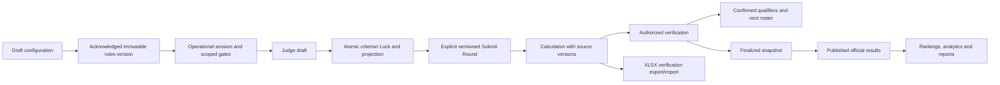

# Competition workflow implementation

The subsequent [criteria guidance update](VOTRIX_CRITERIA_GUIDANCE.md) adds automatic readiness checks and migration **095_competition_criteria_publication_guard.sql**. New rule publication requires this migration after 087–094. It has been verified in an isolated local database; it has not been applied to connected Supabase by this task.

## Working-tree audit

Existing event drafts, branding uploads, ownership, contestant UUIDs/numbering, major/minor criteria, judge pool/enrollment, assignment records, session controls, score tables, calculation snapshots, report adapters and navigation are reusable. Election/polling working-tree changes are owned by the user and must be preserved.

Partially implemented: scoped rounds/advancement, rank-based output mapping, criterion locks and deductions. Missing: immutable acknowledged rules, persistent judge drafts, explicit versioned Submit Round, prepared lineup slots/intersection access, independent verification, rule-defined approved deductions, versioned advancement, real XLSX verification.

Conflicts: duplicate round order values; non-partial PATCH validation; draft-only round service used for live controls; unassigned entries added to scoped fields; weaker live permissions; separate JSON/projection writes; event completion closes tabulation; method selected after results; read-only ranking mount writes projection; WebSocket identity/room authorization mismatch.

Additive migrations are required for rule versions, operational access/lineups, judge drafts/lock versions/submissions, verification/deduction/eligibility/advancement versions and transactional RPCs. They will not be applied to a connected production database. Existing snapshots remain authoritative and historical locks are not promoted to submissions.

Contracts to extend: foundation/setup validation and publication acknowledgement; round order/PATCH and separate live access; context-bound sheet/draft/Lock/Submit Round; explicit audited corrections; calculation verification/finalize/publish; lineup activation; XLSX export/verification import. Existing route prefixes and desktop scoresheet remain.

Compatibility risks: deployments missing migrations must fail with an actionable migration prerequisite; legacy nullable round cells; repeated session uniqueness; preserved historical projections/publications; any new formula is used only with an acknowledged frozen rules version. Manual/offline imports must never manufacture judge submissions.

## Implementation outcome

The working tree now contains the versioned competition workflow described below. Event creation, branding, route prefixes, main navigation, existing accounts, contestant UUIDs and the desktop Judge table remain in use. Changes to shared authentication/realtime code apply the same cookie and tenant checks already used by HTTP. Existing election/polling work was left in place.

The two original VOTRIX analysis documents are historical audits. They were not rewritten to imply that these new changes had existed during the earlier source tracing. This report describes the implementation and its verification separately.

No connected application database was migrated. Database execution used a separate PostgreSQL 18 cluster under `.tmp/competition-postgres-tests` on localhost port 55439 and disposable fixture databases. The fixture represents the required pre-workflow competition contract; it is not a test of every previous migration against an actual deployed Supabase database.

### P0: Permissions, lifecycle and atomic score writes

- Files: `competition-access.service.js`, `competition-workflow.service.js`, `competition-session.service.js`, competition organizer/Judge routes, `eventGuards.js`, `csrf.js`, `ws-authorization.js`, `ws-server.js`, `ws-emitter.js`, frontend `Bootstrap.jsx` and `socket.service.js`.
- Migrations: 087 introduces explicit context, drafts, submission versions and a null-aware transactional scoring RPC; 088 separates operational actions from result publication; 093 preserves immutable lock history; 094 provides explicit projection repair.
- Contracts: every new draft/Lock/Submit Round includes Judge-authenticated event context `{judgeId,sessionId,roundId,rulesVersion}`. PostgreSQL rechecks account, enrollment, scoring role, assignment, roster, gate and lock state while serializing competing event/session operations. JSON lock, numeric projection, draft removal, history and audit commit together.
- Reuse: existing enrollments, assignment scopes, session rows, JSON score rows, flattened scores, ownership middleware and cookies. Native WebSocket now verifies the current HTTP identity/account/session, checks room ownership/enrollment, and supports account-change reconnects. Rankings emissions stay in the Organizer room.
- Validation: atomic projection failure rollback, stale-context rejection, inactive/reviewer rejection, ALL/NONE gates, zero-valued scores, duplicate Lock/Submit, closed-stage submission, ownership and room checks passed in SQL/unit tests. Legacy implicit resync writes were removed from Rankings.
- Lifecycle: End Session closes performance access and leaves tabulation pending. Submit Round has a separate window and can remain available after performance closes. Explicit reopening requires a reason. Event-wide verified publication completes the event. Ordinary setup remains frozen.
- Manual setup/risk: deploy the migrations before using these APIs. Cross-origin cookie/CSRF configuration and authenticated reconnect behavior still require staging browser verification. Legacy scoring switches cannot start unacknowledged official judging.

### P1: Configuration, frozen rules, entries and advancement

- Files: competition/pageant/division services and validators/controllers; `CompetitionWorkspacePage`, `CriteriaManager`, `CompetitionRulesEditor`, Contestants, Judges, assignment and Review pages; `shared/competition-calculation.js`.
- Migrations: 087 rule versions, entry classification, colors, progression metadata and order repair; 088 atomic order/advancement; 089 reviewed sanctions; 090 independently approved scoring amendments; 091 atomic criterion creation/attachment and frozen setup guards.
- Contracts: publication requires a confirmed method, explicit acknowledgement, valid bounds/weights/progression, eligible rosters/panels, tie/precision policy and approval procedure. Rules are immutable snapshots. A type label remains a hint. Entries support individual, duo, group and other; historical null classifications remain null.
- Reuse: four workspace tabs, optional categories, per-division numbering, parent/minor IDs, judge pool, event enrollment and advancement types. Round IDs remain stable; ordinary creation gets sequential order and an explicit order RPC supports reordering. Partial PATCH preserves omitted fields, including Judge roles/activity.
- Validation: exclusive rosters, scoped panels, rank-compatible output, missing versus zero, weighted mean/sum/highest/removal/rank methods, Back to Zero, carry-forward, independent finals, approved penalties and panel-mean tie breaking are covered. SQL qualifier confirmation replaces the destination roster atomically and rejects silent replacement of an existing decision.
- Amendments: an Organizer proposes confirmed scoring configuration and an optional reduced existing scoring panel; an appointed independent reviewer approves. A new rule version requires fresh judging. Prior locks and result snapshots remain historical records. Ordinary criteria/roster edits after publication are rejected.
- Manual setup/risk: enroll the reviewer before publishing when independent approval, manual results or penalties are configured. Structural amendments that introduce new criteria/entries/Judges need an administrator-managed transition or a new draft event; this release's amendment interface changes scoring configuration and the existing scoring panel.

### P2: Prepared lineups and live access

- Files: `CompetitionLiveWorkflowPanel`, Live Control, session/workflow services and existing scoring form. The optional division selector filters presentation while completion still covers the full authorized roster.
- Migrations: 087 prepared lineup slots and explicit gates; 088 audited activation, slot navigation and intersection controls.
- Contracts: prepare division-first, alternating, custom or grouped slots for a round or major criterion, then confirm activation. Every slot stores stable entry IDs. Lineup activation changes presentation order and criterion context without changing score ownership or existing locks.
- Reuse: current session order and primary contestant; the desktop grouped-major/minor table, horizontal scrolling and mobile fallback. All scoped rows remain visible. A focus guard delays row order changes while typing. Division identity determines the configured/default row color.
- Validation: stable entry identity, scope restrictions and deferred reordering are covered by service/component tests. ALL, NONE and SELECTED are distinct. Entry/major closures override intersection permissions; opening access never unlocks a committed criterion. Close Current Stage Access is independent of submission/finalization.
- Manual setup/risk: prepare and activate lineups in Live Control before opening the intended scoring access. Live presentation, focus, scrolling, custom-color contrast and unequal-size/grouped arrangements still need authenticated browser acceptance on target devices.

### P3: Drafts, criterion Lock and Submit Round

- Files: `useJudgeScoreDrafts`, `JudgeScoringPage`, `CompetitionScoringForm`, frontend workflow/pageant services, backend scoring RPC and progress adapter. Participant competition dashboard classification now follows versioned session/submission state.
- Migrations: 087 persistent drafts/submissions and revision checks; 093 immutable criterion history.
- Contracts: ordinary edits are local first, debounced to server drafts, and shown as Unsaved/Saving/Saved Draft. Recovery and retry identity include Judge, event, session, round, rule version, entry and criterion. Context switches clear the old score map. Read queries collect all pages so provider row caps cannot hide saved locks. The server also compares the context Judge ID with the authenticated account; stale sheet reads are ignored and account switches clear local scoring recovery/queues. Saved locks override stale local/server drafts, including a true zero.
- Reuse: one Lock button commits a complete major criterion for one entry. The Judge separately confirms Submit Round after all required locks and drafts are resolved. The Organizer grid exposes lock completion and round-submission version independently. Reviewers cannot score; inactive or out-of-scope Judges are rejected on the server.
- Validation: recovery key isolation, locked-value precedence, unsaved-edit preservation, component bounds/focus/readonly behavior, duplicate submission and atomic score-store behavior passed. Source versions remain attached to every submission.
- Correction: a reasoned Organizer correction invalidates the affected Judge's submission and requires a fresh Lock/Submit. It cannot silently overwrite finalized results or a confirmed advancement decision. Approved amendments provide a new judging version.
- Manual setup/risk: local browser storage is a recovery aid; the server draft is authoritative for saved-draft status. Real network interruption, multiple-tab contention and account-switch recovery remain staging checks.

### P4: Tabulation and independent result verification

- Files: `CompetitionTabulationWorkspace`, `CompetitionJudgeWorksheets`, `CompetitionReviewer`, workflow controller/service and shared exact arithmetic engine. Existing Tabulation routes are retained.
- Migrations: 087 calculation source/configuration versions and workflow states; 088 transitions; 089 approval/rejection of deductions/eligibility; 092 invalidation; 093 immutable calculation content.
- Contracts: Overview, Submissions, Matrix, grouped Judge Worksheets, Calculations, Deductions & Eligibility, Rankings, Advancement and Verification & Audit are internal tabs. The official method is read-only. Missing inputs are null/incomplete; they never become zero or silently shrink the final denominator.
- Calculation: exact rational arithmetic normalizes raw score/max to percent, equally averages active minors inside a major, applies major contributions, rounds each Judge total half up, then applies the confirmed Judge reduction and round/category policy. Approved numeric penalties are applied once in their declared post-aggregation points/placement units. Criterion references identify the offense context. Judge-applied penalties are not enabled.
- Workflow: Awaiting Submissions -> Provisional -> Ready for Verification -> Under Verification -> Finalized -> Published. Source changes invalidate provisional verification. An appointed reviewer verifies current source versions; self-verification is available only when the pre-published numeric procedure permits it. Manual official results contain placements and a documented decision basis, require independent approval, and do not manufacture numeric scores or Judge submissions.
- Reuse: calculation snapshots and the Calculate/Finalize/Publish concept; existing advancement preview/qualifier selection; stored deductions as separate records. Pending reports can be approved or rejected. An offense key prevents duplicate numeric sanctions.
- Validation: independent approval/finalization, qualifier roster replacement, preserved decisions, duplicate offense rejection, immutable amendment history, actual advancement response shape and manual placement request shape passed. Rules/source fingerprints use stable record ordering.
- Manual setup/risk: resolve pending decisions before verification. Confirmed advancement and official result corrections require an authorized version transition. These component/SQL checks do not constitute an authenticated full-browser event run.

### P5: XLSX verification, analytics and reports

- Files: `competition-workbook.service.js`, workbook upload middleware, workflow controller/routes, new Tabulation controls, Competition report/rankings/analytics adapters and the modern workflow analytics service.
- Migration: 094 includes explicit backend service-role access grants and owner-confirmed projection reconciliation.
- Contracts: real `.xlsx` exports contain Competition Info, Official Scoring Rules, Judge Worksheets, Raw Scores, Computation Breakdown, Score Matrix, Approved Penalties, Rankings, Advancement, Final Results and Audit Verification, plus grouped per-Judge worksheets. They contain stable identities, source/configuration/calculation versions, formulas for normalization/contributions/Judge totals, cached calculated values, precision and division colors. Unpublished/incomplete exports are stamped PROVISIONAL or READY FOR VERIFICATION.
- Import: verification only, up to 5 MB with expanded-size checks. It compares template/event/round/rule/calculation identity, raw cells, duplicate/missing/unknown targets, ranges, formulas and cached results against freshly read database sources. It reports matches, mismatches, missing/invalid cells and version conflicts. It executes no macros/formulas and writes no imported scores/submissions.
- Reuse: the existing XLSX dependency, report data providers, CSV/JSON/print exports and published result snapshots. Existing legacy SpreadsheetML report export remains a fallback. Modern analytics derives completion from submitted sources, and missing/manual results retain their meaning in presentation.
- Validation: XLSX ZIP roundtrip, style colors, source identity, Judge formula references and forged/stale input rejection passed. The production frontend build passes.
- Manual setup/risk: Microsoft Excel/LibreOffice recalculation of the exported workbook has not been executed. The server verifies formulas/cached values against the shared calculation core; final result sheets retain authoritative snapshot values. Browser download/upload and large-event performance remain staging acceptance checks.

## Migration manifest

Apply these in order after verifying the relevant forward schema through 086:

| Migration | Purpose |
| --- | --- |
| 087 | Rule snapshots, active parent criteria, entry types, colors, lineups, gates, draft/lock/submission versions, live-session uniqueness, atomic scoring, refreshed session view |
| 088 | Rules publication, round order, live operations, verification/publication, transactional advancement |
| 089 | Unique offense references and independent sanction approval/rejection |
| 090 | Independently approved scoring amendments and required fresh judging |
| 091 | Atomic round criterion creation and frozen setup constraints |
| 092 | Provisional calculation invalidation when official inputs change |
| 093 | Immutable lock history and calculation contents |
| 094 | Reasoned projection repair and explicit workflow table/view grants |

These are forward migrations with transaction boundaries. They do not infer historical round submissions, apply new calculations to old publications, delete old official data, or classify old entries automatically. Do not run the test fixture schema against an application database.

Read-only Supabase inspection found the new workflow tables absent. Migration 087 was then attempted manually and rejected duplicate live sessions for event `3beb7871-cee3-42cf-8436-02c4d9af4bbd`: a newer active session and an older paused session, neither with session score rows. The legacy uniqueness constraint allowed this pair. Migration 087 now checks for such conflicts before modifying schema and requires an explicit current-session choice. The targeted script `backend/src/database/scripts/resolve_legacy_live_session_conflict.sql` retains the observed active session and completes only the observed older paused session, aborting if its status or linked records have changed. The script has not been applied to Supabase by this agent.

Migration 087 also widens the original migration 082 `varchar(16)` calculation status to `text` before introducing longer verification states. The isolated fixture now reproduces that original column limit. Local regression checks passed for duplicate-session preflight rollback, refusal to repair a scored session, preservation of both session records, repeated-repair rejection, migrations 087-094 and both SQL workflow/verification suites after explicit repair.

There is no destructive automatic down-migration for newly captured official history. Before rollout, use a staging copy and database backup. Application rollback needs a compatible prior build and preservation of new workflow records; it must not delete rule/submission/publication history to restore an older UI.

## API and data contracts

Existing prefixes stay `/api/organizer/competition/events/:eventId` and `/api/participant/competition/events/:eventId`.

| Operation | Contract |
| --- | --- |
| Create actual event from form draft | Existing `/drafts/publish`; event remains draft, unrelated to official setup publication |
| Finish & Publish | Existing event publish endpoint with `acknowledged:true`; confirmed rules are validated and frozen |
| Create round criterion | POST `/rounds/:roundId/criteria`; creation and attachment are one transaction |
| Rule read / tabulation read | GET `/workflow/rules`, `/workflow/tabulation?roundId=...` |
| Operational actions | POST `/workflow/lineup-save`, `/lineup-activate`, `/slot`, `/access`, `/submission-window`, `/end-performance`, `/reopen-performance`, `/correction`, `/advancement`, `/round-order` |
| Judge draft | POST participant `/session-draft` with context, entry, major ID, score map and draft revision |
| Judge Lock | Existing participant `/session-score` extended with context and `criteriaId` |
| Judge Submit Round | POST participant `/submit-round` with the same explicit context; separate confirmed action |
| Calculation and publication | Existing Tabulation calculate/latest/finalize/publish; latest can be filtered by round |
| Independent review | Participant `/verification`, `/calculations/:calculationId/verify`, `/decisions/approve`, `/amendments/approve` |
| Amendment proposal | Organizer `/workflow/amendment-request`; confirmed configuration, reason, optional existing scoring-panel IDs |
| XLSX | GET `/workflow/excel`; POST `/workflow/excel/verify` multipart `file` plus optional round |
| Historical repair | POST `/workflow/reconciliation-preview` with explicit session; `/reconciliation-apply` requires session, confirmation and reason |

## Historical records and repair

Existing published snapshots stay authoritative until a newly verified version is published. Historical locks without Submit Round remain historical locks. The new official engine does not promote them to submitted inputs.

Legacy Judge sheets display a transition requirement and remain readonly. An existing legacy event cannot start a new official session without acknowledged rules. For an ongoing old event, finish under the compatible prior application before rollout, or plan an explicit administrator-managed transition/rejudging in a new draft competition. No automatic legacy adoption endpoint was added.

Projection inspection compares only explicit locked parent values with their flattened cells. Missing/ambiguous parent-lock evidence is reported, not inferred. Apply selects one session, mirrors its explicit locked sources atomically, and audits the previous projection. It does not create submissions, change JSON sources or alter result snapshots. Rankings never run this repair automatically.

## Required rollout and manual acceptance

1. Back up the target database, verify existing competition columns/constraints and apply 087-094 to a staging copy. Refresh the Supabase/PostgREST schema cache and verify service-role grants. Include the repository `shared/` directory in backend deployment packaging. Vite permits this shared source directory for development without exposing the backend directory.
2. Retain the existing cookie/CORS/CSRF and WebSocket origin configuration. Confirm roles and first-login/account checks using staging accounts.
3. Create a small draft event through Details/Branding. Configure rounds/divisions, entries, active parent/minor targets and eligible Judge scopes. Add an independent reviewer where required, save confirmed rules and acknowledge publication.
4. Start Live Control, prepare the desired lineup and open the intended entry/criterion/intersection gates. Verify that out-of-scope/inactive/reviewer accounts cannot draft, lock or submit.
5. Enter scores, refresh/reconnect, Lock all required major groups, and separately Submit Round. Confirm that complete locks without Submit Round remain incomplete official input. Test a reasoned correction and renewed submission.
6. Close performance access while keeping the submission window intentional. Calculate, resolve sanctions, verify from the reviewer account, and confirm qualifiers before activating the next round. Reopen performance explicitly when continuing the same session after a closure. Collect special-award results before completing event-wide publication.
7. Verify final/manual/rank/Back-to-Zero variants. Finalize and publish separately. Confirm that later provisional versions do not replace the previous official snapshot.
8. Export/recalculate/open/import XLSX in the intended spreadsheet application. Confirm cached formulas, division colors, source versions and mismatch display. Validate CSV/JSON/print reports, desktop focus/horizontal scrolling and the mobile sheet.
9. Run smoke checks for the preserved election and polling journeys on the same staging deployment. Existing tests pass, but live participant journeys were not exercised against a deployed database.

## Final verification log

Final command results are recorded below. Three pre-existing backend tests requiring external/integration prerequisites remain skipped. Frontend regression tests use `VITE_LOCK_PARTICIPANTS_ON_ACTIVE=true` because the local environment sets it false while an existing constants test expects the enabled policy; the application's environment file was not changed.

| Check | Result |
| --- | --- |
| Backend full Vitest suite | 384 passed, 3 pre-existing skipped; 48 test files passed |
| Frontend full Vitest suite | 64 passed; 11 test files passed (policy override described above) |
| Production frontend build | Passed; existing large-chunk warning |
| ESLint on changed competition/realtime-related frontend files | Passed with 0 errors; one existing workspace effect-dependency warning |
| PostgreSQL fixture + migrations 087-094 | Passed on isolated PostgreSQL 18 |
| SQL workflow assertions | Passed: stale context, ownership, inactive/reviewer rejection, NONE gates, drafts, zero, forced projection rollback, explicit repair, duplicate Lock/Submit and post-performance submission |
| SQL verification assertions | Passed: independent verifier, finalization, exact qualifier roster, decision preservation, approved penalties, duplicate offense and immutable amendment history, stale rule publication rejection and closure of live access on event-wide publication |
| Connected Supabase migration / authenticated browser / Excel recalculation | Not executed |

The isolated test server was stopped after verification. Published snapshots retain their approved ranks when read; shared first-place results do not pick a single arbitrary champion, and carry-forward breakdowns retain summed base/penalty totals.

No deployment, merge, commit, account enrollment, Judge scoring or email operation was performed against the connected VOTRIX environment. Local test cluster files under `.tmp/` are test artifacts and are not release files.

