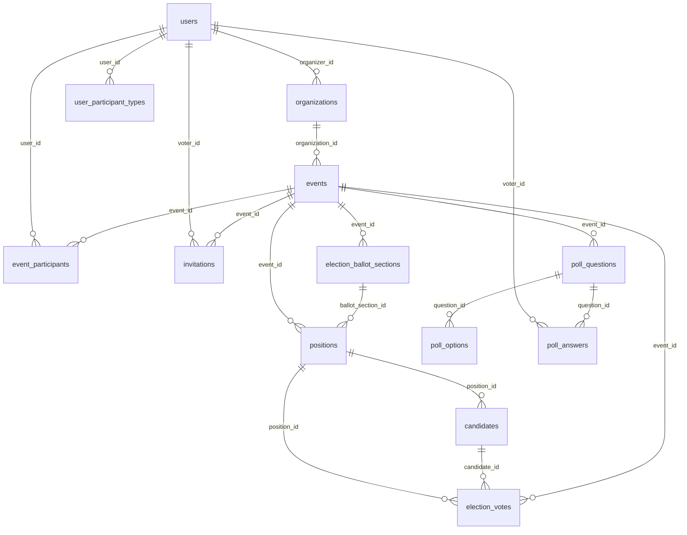

# VOTRIX Database Schema Documentation

## 1. Document Title and Purpose

This document describes the database structure declared by the VOTRIX repository and traces the principal database-backed workflows in the current backend. It distinguishes migration-defined structure from verified application use. It is not a live database dump, deployment runbook, or recommendation to remove schema elements.

## 2. Scope and Inspection Methodology

The inspection covered the backend's PostgreSQL/Supabase configuration, SQL migrations, query services, controllers, authorization paths, database RPC calls, relevant tests/fixtures, and the existing migration audit evidence in the repository. No application source, migrations, database, or configuration was changed for this documentation task.

The best available structural evidence is:

1. The repository migration chain, currently containing forward migrations through `133_competition_organizer_finalization.sql`.
2. A previous isolated PostgreSQL replay captured in `audits/migrations-001-114-2026-10-15/replay.json`. That replay reports 73 tables and 10 views after migration 114, but it is a synthetic historical replay, not the deployed database and not a replay of migrations 115–133.
3. Current application query and RPC call sites in `backend/src`.
4. A prior read-only hosted REST exposure check dated 2026-10-14. Its own metadata says `directCatalogVerified: false`; it is not evidence of a complete hosted table catalog.

The database client tool had no configured connection, and the repository's verified local database identity file was unavailable. Therefore no live or local database catalog was queried for this document. The table and column index below is inferred from migration DDL and the historical replay catalog. Conditional, dynamic, or malformed historical DDL can make a static reconstruction differ from an installed schema; this is called out rather than hidden.

Classification meanings:

- **Actively Used:** current code or a current database routine clearly uses the table in a feature workflow.
- **Partially Used:** usage is limited to certain operations, compatibility paths, or an optional feature.
- **Legacy / Potentially Obsolete:** retained for migration or compatibility, and ordinary current writes use a replacement.
- **Unverified:** the repository does not provide enough evidence to claim current operational use.

These are table-level assessments. A column being present in the schema does not establish that the application reads or writes it. The field inventory records migration-declared columns and types; unless a field is discussed in the workflow sections, its individual read/write/filter/UI status remains **unverified**.

## 3. Technology Stack and Database Engine

- **Database:** PostgreSQL, accessed through Supabase/PostgREST. `backend/src/config/database.js` uses `@supabase/supabase-js` and the configured Supabase URL/service-role credential. Credential values are intentionally not included here.
- **Backend:** Node.js ES modules, Express, JavaScript, and Supabase query/RPC calls. There is no inspected ORM model layer defining an alternate schema.
- **Primary keys:** migrations generally use UUID identifiers with `gen_random_uuid()` defaults.
- **External integrations:** Cloudinary and Resend are configured separately; their remote storage/delivery systems are not represented as ordinary PostgreSQL tables.
- The database README specifies PostgreSQL 15+; the historical isolated migration audit ran on PostgreSQL 18.4. No minimum production version was independently verified.

## 4. Sources of Schema Information

### Schema definitions and migration evidence

- `backend/src/database/migrations/001_initial_schema.sql` establishes the original account, organization, event, election, competition/pageant, and polling tables.
- Forward migrations `003` through `133` evolve the schema. Files named `*_down_*` or otherwise marked as down migrations are rollback scripts and are not part of the forward schema.
- `backend/src/database/README.md` describes the intended migration application order and older schema concepts. Some of its details are stale, including the statement that Admin login uses a username.
- `audits/migrations-001-114-2026-10-15/INVENTORY.md` and `AUDIT.md` record an isolated replay and historical migration defects through 114. This evidence is not a live installation check.

### Application behavior

- `backend/src/config/database.js`, `backend/src/foundation/db.js`, and `backend/src/utils/constants.js` establish database access and commonly named tables.
- `backend/src/services/*.js`, `backend/src/controllers/*.js`, `backend/src/routes/*.js`, and `backend/src/middleware/*.js` implement application read/write paths.
- SQL functions and triggers declared by migrations provide additional behavior that is not necessarily visible as a direct table query in JavaScript.
- Frontend forms and API calls were considered only as supporting request-shape evidence; backend validation and database code are stronger evidence of persistence and enforcement.

## 5. Current Database Schema Overview

The historical isolated replay through migration 114 reports **73 base tables and 10 views**. The replay catalog does not list `email_delivery_logs`, although forward migration 033 creates it and the current email audit service uses it. This document therefore records 73 replay-catalog tables plus that migration-defined table, with its installed presence marked unverified. The views expose compatibility names and derived workflow projections; they are not all independently writable tables. Later forward migrations through 133 were checked for additional table creation and column changes. No later table creation was found in the reviewed migrations; migration 126 adds `competition_child_score_drafts.deductions`, and migration 130 adds `positions.eligible_programs`. Migration 110 adds `events.competition_created_at` and `competitions.participation_format`.

The repository does not include a verified current schema snapshot or migration ledger, so the inventory is a **repository-inferred schema**, not proof that all deployments are at the same migration level.

The raw migration sequence also has known installation concerns in the historical audit: migrations 011, 030, 038, and 039 required scratch-only repair or ordering exceptions in that audit. The audit did not contact a hosted database. Consult `audits/migrations-001-114-2026-10-15/AUDIT.md` before interpreting a clean-replay result as deployment evidence.

### Main domains

| Domain | Main structures | Table-level use |
|---|---|---|
| Accounts and access | `users`, `user_participant_types`, `user_sessions`, `password_reset_tokens` | Login, account status, participant pool eligibility, session tracking, password reset |
| Tenant and event setup | `organizations`, `events`, `event_drafts`, `system_settings` | Organizer ownership, event lifecycle and module settings, saved drafts and admin settings |
| Enrollment | `event_participants`, legacy `event_voters`, `invitations` | Event-scoped voter/judge/respondent enrollment and invitations |
| Election | `election_ballot_sections`, `positions`, `candidates`, `election_votes`, `election_ballot_submissions`, `election_group_voters` | Ballot configuration, eligible voting, atomic ballot submissions and turnout |
| Polling | `poll_questions`, `poll_options`, `poll_answers`, `poll_submissions`, `poll_question_types`, `system_poll_question_types` | Registry-based poll configuration, responses and analytics |
| Competition scoring | Legacy/event-wide competition tables and native `competition_child_*` tables | Setup, judging, live sessions, scoring, tabulation, result history and publication |
| Operations | `audit_logs`, `notifications`, `email_delivery_logs`, `image_assets`, `image_deletion_queue` | Audit/activity history, in-app notifications, email delivery evidence and image lifecycle |

The `user_role` and participant role concepts are not interchangeable: the current application has global `admin`, `organizer`, and `participant` account roles; a participant's event function is represented separately by `participant_type` in `event_participants`.

## 6. Complete Table and Column Documentation

The following catalog is derived from the 73-table catalog in the historical replay through migration 114, plus `email_delivery_logs` from forward migration 033, then reconciled with forward migration declarations through 133. SQL field definitions are compacted to one line per table. A column's presence/type/default is schema evidence only; individual current CRUD use is not inferred unless established in Sections 9–11. The migration files remain authoritative for exact constraints and DDL ordering.

### `audit_logs`

- **Purpose:** Stores actor/action/entity audit records consumed by Admin audit and activity workflows.
- **Usage classification:** **Actively Used.** Current service/RPC workflow references this table or its corresponding feature path; not every column was individually traced.
- **Main application evidence:** `backend/src/foundation/audit.js`.
- **Schema evidence:** `backend/src/database/migrations/008_admin_dashboard.sql`. The repository-wide DDL evolution and related workflow references are listed in Section 16.
- **Columns (migration-declared):**
  - `id` - `UUID PRIMARY KEY DEFAULT gen_random_uuid()`; `user_id` - `UUID REFERENCES users (id) ON DELETE SET NULL`; `action` - `VARCHAR(255) NOT NULL`; `entity` - `VARCHAR(255)`; `entity_id` - `UUID`; `details` - `JSONB`; `created_at` - `TIMESTAMPTZ NOT NULL DEFAULT NOW()`.
- **Column-level CRUD status:** Unverified unless a specific field is discussed in Sections 9-11.

### `candidates`

- **Purpose:** Election candidates attached to ballot positions.
- **Usage classification:** **Actively Used.** Current service/RPC workflow references this table or its corresponding feature path; not every column was individually traced.
- **Main application evidence:** `backend/src/services/election.service.js`.
- **Schema evidence:** `backend/src/database/migrations/001_initial_schema.sql`. The repository-wide DDL evolution and related workflow references are listed in Section 16.
- **Columns (migration-declared):**
  - `id` - `UUID PRIMARY KEY DEFAULT gen_random_uuid()`; `position_id` - `UUID NOT NULL REFERENCES positions (id) ON DELETE CASCADE`; `name` - `VARCHAR(255) NOT NULL`; `photo` - `TEXT`; `description` - `TEXT`; `partylist` - `VARCHAR(255)`; `created_at` - `TIMESTAMPTZ NOT NULL DEFAULT NOW()`; `updated_at` - `TIMESTAMPTZ NOT NULL DEFAULT NOW()`; `biography` - `TEXT`; `platform` - `TEXT`; `image_asset_id` - `UUID REFERENCES image_assets(id) ON DELETE SET NULL`.
- **Column-level CRUD status:** Unverified unless a specific field is discussed in Sections 9-11.

### `competition_advancement_decisions`

- **Purpose:** Competition workflow state/data; specific meaning is inferred from the table name and SQL routines. See competition migration sources.
- **Usage classification:** **Actively Used.** Current service/RPC workflow references this table or its corresponding feature path; not every column was individually traced.
- **Main application evidence:** `backend/src/services/competition-native.service.js` and related native competition services/RPCs.
- **Schema evidence:** `backend/src/database/migrations/087_competition_workflow.sql`. The repository-wide DDL evolution and related workflow references are listed in Section 16.
- **Columns (migration-declared):**
  - `id` - `uuid PRIMARY KEY DEFAULT gen_random_uuid()`; `event_id` - `uuid NOT NULL REFERENCES events(id)`; `round_id` - `uuid NOT NULL REFERENCES competition_rounds(id)`; `next_round_id` - `uuid REFERENCES competition_rounds(id)`; `calculation_id` - `uuid NOT NULL REFERENCES competition_result_calculations(id)`; `rules_version` - `uuid NOT NULL REFERENCES competition_rule_versions(id)`; `qualifiers` - `jsonb NOT NULL`; `overrides` - `jsonb NOT NULL DEFAULT '{}'`; `reason` - `text`; `confirmed_by` - `uuid NOT NULL REFERENCES users(id)`; `confirmed_at` - `timestamptz NOT NULL DEFAULT now()`; `automatic_qualifiers` - `jsonb`; `selection_basis` - `text CHECK(selection_basis IN ('automatic','manual'))`.
- **Column-level CRUD status:** Unverified unless a specific field is discussed in Sections 9-11.

### `competition_categories`

- **Purpose:** Legacy/event-wide competition scoring categories and weights.
- **Usage classification:** **Unverified / feature-specific.** Purpose/use is inferred from migration definitions; current runtime access was not independently established.
- **Main application evidence:** `backend/src/services/pageant.service.js`, `backend/src/services/competition.service.js`, or the corresponding native competition service; path depends on workflow.
- **Schema evidence:** `backend/src/database/migrations/015_competition_scoring_foundation.sql`. The repository-wide DDL evolution and related workflow references are listed in Section 16.
- **Columns (migration-declared):**
  - `id` - `UUID PRIMARY KEY DEFAULT gen_random_uuid ()`; `event_id` - `UUID NOT NULL REFERENCES events(id) ON DELETE CASCADE`; `name` - `VARCHAR(255) NOT NULL`; `description` - `TEXT`; `display_order` - `INTEGER NOT NULL DEFAULT 0`; `weight` - `NUMERIC(5, 2) NOT NULL DEFAULT 0`; `is_active` - `BOOLEAN NOT NULL DEFAULT TRUE`; `created_at` - `TIMESTAMPTZ NOT NULL DEFAULT NOW()`; `updated_at` - `TIMESTAMPTZ NOT NULL DEFAULT NOW()`; `division_id` - `UUID REFERENCES competition_divisions(id) ON DELETE RESTRICT`.
- **Column-level CRUD status:** Unverified unless a specific field is discussed in Sections 9-11.

### `competition_child_calculation_transitions`

- **Purpose:** Official verify/finalize transitions for native competition calculations.
- **Usage classification:** **Actively Used.** Current service/RPC workflow references this table or its corresponding feature path; not every column was individually traced.
- **Main application evidence:** `backend/src/services/competition-native.service.js` and related native competition services/RPCs.
- **Schema evidence:** `backend/src/database/migrations/106_competition_scoped_tabulation.sql`. The repository-wide DDL evolution and related workflow references are listed in Section 16.
- **Columns (migration-declared):**
  - `id` - `uuid PRIMARY KEY DEFAULT gen_random_uuid()`; `calculation_id` - `uuid NOT NULL REFERENCES competition_child_calculations(id)`; `action` - `text NOT NULL CHECK(action IN('verify','finalize'))`; `actor_id` - `uuid NOT NULL REFERENCES users(id)`; `reason` - `text NOT NULL`; `created_at` - `timestamptz NOT NULL DEFAULT now()`.
- **Column-level CRUD status:** Unverified unless a specific field is discussed in Sections 9-11.

### `competition_child_calculations`

- **Purpose:** Versioned native competition calculation outputs and source digests.
- **Usage classification:** **Actively Used.** Current service/RPC workflow references this table or its corresponding feature path; not every column was individually traced.
- **Main application evidence:** `backend/src/services/competition-native-results.service.js` and database RPCs.
- **Schema evidence:** `backend/src/database/migrations/106_competition_scoped_tabulation.sql`. The repository-wide DDL evolution and related workflow references are listed in Section 16.
- **Columns (migration-declared):**
  - `id` - `uuid PRIMARY KEY DEFAULT gen_random_uuid()`; `event_id` - `uuid NOT NULL`; `competition_id` - `uuid NOT NULL`; `round_id` - `uuid`; `session_id` - `uuid NOT NULL REFERENCES competition_child_sessions(id)`; `rules_version` - `uuid NOT NULL`; `source_digest` - `text NOT NULL`; `source_snapshot` - `jsonb NOT NULL`; `input_snapshot` - `jsonb NOT NULL`; `output_snapshot` - `jsonb NOT NULL`; `version` - `integer NOT NULL`; `created_by` - `uuid NOT NULL REFERENCES users(id)`; `created_at` - `timestamptz NOT NULL DEFAULT now()`.
- **Column-level CRUD status:** Unverified unless a specific field is discussed in Sections 9-11.

### `competition_child_configurations`

- **Purpose:** Native competition configuration snapshots for one competition.
- **Usage classification:** **Actively Used.** Current service/RPC workflow references this table or its corresponding feature path; not every column was individually traced.
- **Main application evidence:** `backend/src/services/competition-native.service.js` and database RPCs.
- **Schema evidence:** `backend/src/database/migrations/104_competition_scoped_rules.sql`. The repository-wide DDL evolution and related workflow references are listed in Section 16.
- **Columns (migration-declared):**
  - `competition_id` - `uuid PRIMARY KEY`; `event_id` - `uuid NOT NULL`; `configuration` - `jsonb NOT NULL`.
- **Column-level CRUD status:** Unverified unless a specific field is discussed in Sections 9-11.

### `competition_child_criteria`

- **Purpose:** Native competition criteria within the child competition model.
- **Usage classification:** **Actively Used.** Current service/RPC workflow references this table or its corresponding feature path; not every column was individually traced.
- **Main application evidence:** `backend/src/services/competition-native.service.js` and related native competition services/RPCs.
- **Schema evidence:** `backend/src/database/migrations/104_competition_scoped_rules.sql`. The repository-wide DDL evolution and related workflow references are listed in Section 16.
- **Columns (migration-declared):**
  - `id` - `uuid PRIMARY KEY`; `competition_id` - `uuid NOT NULL`; `event_id` - `uuid NOT NULL`; `round_id` - `uuid`; `definition` - `jsonb NOT NULL`.
- **Column-level CRUD status:** Unverified unless a specific field is discussed in Sections 9-11.

### `competition_child_deduction_decisions`

- **Purpose:** Native score deduction decisions and responsibility records.
- **Usage classification:** **Actively Used.** Current service/RPC workflow references this table or its corresponding feature path; not every column was individually traced.
- **Main application evidence:** `backend/src/services/competition-native.service.js` and related native competition services/RPCs.
- **Schema evidence:** `backend/src/database/migrations/106_competition_scoped_tabulation.sql`. The repository-wide DDL evolution and related workflow references are listed in Section 16.
- **Columns (migration-declared):**
  - `id` - `uuid PRIMARY KEY DEFAULT gen_random_uuid()`; `session_id` - `uuid NOT NULL REFERENCES competition_child_sessions(id)`; `entry_id` - `uuid NOT NULL REFERENCES competition_entries(id)`; `rule_key` - `text NOT NULL`; `offense_key` - `text NOT NULL`; `rule_snapshot` - `jsonb NOT NULL`; `reason` - `text NOT NULL`; `proposed_by` - `uuid NOT NULL REFERENCES users(id)`; `created_at` - `timestamptz NOT NULL DEFAULT now()`.
- **Column-level CRUD status:** Unverified unless a specific field is discussed in Sections 9-11.

### `competition_child_deduction_reviews`

- **Purpose:** Review records for native competition deductions.
- **Usage classification:** **Actively Used.** Current service/RPC workflow references this table or its corresponding feature path; not every column was individually traced.
- **Main application evidence:** `backend/src/services/competition-native.service.js` and related native competition services/RPCs.
- **Schema evidence:** `backend/src/database/migrations/106_competition_scoped_tabulation.sql`. The repository-wide DDL evolution and related workflow references are listed in Section 16.
- **Columns (migration-declared):**
  - `id` - `uuid PRIMARY KEY DEFAULT gen_random_uuid()`; `decision_id` - `uuid NOT NULL REFERENCES competition_child_deduction_decisions(id)`; `action` - `text NOT NULL CHECK(action IN('approve','reject','revoke'))`; `reason` - `text NOT NULL`; `actor_id` - `uuid NOT NULL REFERENCES users(id)`; `created_at` - `timestamptz NOT NULL DEFAULT now()`; `version` - `integer NOT NULL DEFAULT 1`.
- **Column-level CRUD status:** Unverified unless a specific field is discussed in Sections 9-11.

### `competition_child_judge_assignments`

- **Purpose:** Judge assignments scoped to a native competition and optional round.
- **Usage classification:** **Actively Used.** Current service/RPC workflow references this table or its corresponding feature path; not every column was individually traced.
- **Main application evidence:** `backend/src/services/competition-native.service.js` and related native competition services/RPCs.
- **Schema evidence:** `backend/src/database/migrations/104_competition_scoped_rules.sql`. The repository-wide DDL evolution and related workflow references are listed in Section 16.
- **Columns (migration-declared):**
  - `id` - `uuid PRIMARY KEY DEFAULT gen_random_uuid()`; `competition_id` - `uuid NOT NULL`; `event_id` - `uuid NOT NULL`; `participant_id` - `uuid NOT NULL REFERENCES event_participants(id)`; `round_id` - `uuid`.
- **Column-level CRUD status:** Unverified unless a specific field is discussed in Sections 9-11.

### `competition_child_minors`

- **Purpose:** Minor/sub-criterion rows in native competition scoring.
- **Usage classification:** **Actively Used.** Current service/RPC workflow references this table or its corresponding feature path; not every column was individually traced.
- **Main application evidence:** `backend/src/services/competition-native.service.js` and related native competition services/RPCs.
- **Schema evidence:** `backend/src/database/migrations/104_competition_scoped_rules.sql`. The repository-wide DDL evolution and related workflow references are listed in Section 16.
- **Columns (migration-declared):**
  - `id` - `uuid PRIMARY KEY`; `competition_id` - `uuid NOT NULL`; `event_id` - `uuid NOT NULL`; `criterion_id` - `uuid NOT NULL`; `definition` - `jsonb NOT NULL`.
- **Column-level CRUD status:** Unverified unless a specific field is discussed in Sections 9-11.

### `competition_child_publications`

- **Purpose:** Native competition official/public result publication records.
- **Usage classification:** **Actively Used.** Current service/RPC workflow references this table or its corresponding feature path; not every column was individually traced.
- **Main application evidence:** `backend/src/services/competition-native.service.js` and related native competition services/RPCs.
- **Schema evidence:** `backend/src/database/migrations/107_competition_scoped_results.sql`. The repository-wide DDL evolution and related workflow references are listed in Section 16.
- **Columns (migration-declared):**
  - `id` - `uuid PRIMARY KEY DEFAULT gen_random_uuid()`; `event_id` - `uuid NOT NULL`; `competition_id` - `uuid NOT NULL`; `round_id` - `uuid`; `version` - `integer NOT NULL`; `previous_id` - `uuid REFERENCES competition_child_publications(id)`; `action` - `text NOT NULL CHECK(action IN('publish','replace','withdraw'))`; `calculation_id` - `uuid REFERENCES competition_child_calculations(id)`; `public_snapshot` - `jsonb`; `actor_id` - `uuid NOT NULL REFERENCES users(id)`; `reason` - `text NOT NULL`; `request_id` - `uuid NOT NULL`; `request_payload` - `jsonb NOT NULL`; `created_at` - `timestamptz NOT NULL DEFAULT now()`.
- **Column-level CRUD status:** Unverified unless a specific field is discussed in Sections 9-11.

### `competition_child_qualifications`

- **Purpose:** Native competition round advancement/qualification snapshots.
- **Usage classification:** **Actively Used.** Current service/RPC workflow references this table or its corresponding feature path; not every column was individually traced.
- **Main application evidence:** `backend/src/services/competition-native.service.js` and related native competition services/RPCs.
- **Schema evidence:** `backend/src/database/migrations/106_competition_scoped_tabulation.sql`. The repository-wide DDL evolution and related workflow references are listed in Section 16.
- **Columns (migration-declared):**
  - `id` - `uuid PRIMARY KEY DEFAULT gen_random_uuid()`; `event_id` - `uuid NOT NULL`; `competition_id` - `uuid NOT NULL`; `from_round` - `uuid NOT NULL`; `to_round` - `uuid NOT NULL`; `calculation_id` - `uuid NOT NULL REFERENCES competition_child_calculations(id)`; `source_digest` - `text NOT NULL`; `qualifier_ids` - `jsonb NOT NULL`; `policy_snapshot` - `jsonb NOT NULL`; `confirmed_by` - `uuid NOT NULL REFERENCES users(id)`; `reason` - `text NOT NULL`; `confirmed_at` - `timestamptz NOT NULL DEFAULT now()`; `version` - `integer NOT NULL DEFAULT 1`.
- **Column-level CRUD status:** Unverified unless a specific field is discussed in Sections 9-11.

### `competition_child_review_policies`

- **Purpose:** Review/approval policy for native competition results.
- **Usage classification:** **Actively Used.** Current service/RPC workflow references this table or its corresponding feature path; not every column was individually traced.
- **Main application evidence:** `backend/src/services/competition-native.service.js` and related native competition services/RPCs.
- **Schema evidence:** `backend/src/database/migrations/106_competition_scoped_tabulation.sql`. The repository-wide DDL evolution and related workflow references are listed in Section 16.
- **Columns (migration-declared):**
  - `competition_id` - `uuid PRIMARY KEY`; `event_id` - `uuid NOT NULL`; `participant_id` - `uuid NOT NULL REFERENCES event_participants(id)`; `reviewer_id` - `uuid NOT NULL REFERENCES users(id)`; `appointed_by` - `uuid NOT NULL REFERENCES users(id)`; `appointed_at` - `timestamptz NOT NULL DEFAULT now()`.
- **Column-level CRUD status:** Unverified unless a specific field is discussed in Sections 9-11.

### `competition_child_rounds`

- **Purpose:** Configured rounds for a native competition.
- **Usage classification:** **Actively Used.** Current service/RPC workflow references this table or its corresponding feature path; not every column was individually traced.
- **Main application evidence:** `backend/src/services/competition-native.service.js` and related native competition services/RPCs.
- **Schema evidence:** `backend/src/database/migrations/104_competition_scoped_rules.sql`. The repository-wide DDL evolution and related workflow references are listed in Section 16.
- **Columns (migration-declared):**
  - `id` - `uuid PRIMARY KEY`; `competition_id` - `uuid NOT NULL`; `event_id` - `uuid NOT NULL`; `definition` - `jsonb NOT NULL`; `display_order` - `integer NOT NULL CHECK(display_order>=0)`.
- **Column-level CRUD status:** Unverified unless a specific field is discussed in Sections 9-11.

### `competition_child_rule_versions`

- **Purpose:** Frozen/versioned rules and configuration for a native competition.
- **Usage classification:** **Actively Used.** Current service/RPC workflow references this table or its corresponding feature path; not every column was individually traced.
- **Main application evidence:** `backend/src/services/competition-native.service.js` and related native competition services/RPCs.
- **Schema evidence:** `backend/src/database/migrations/104_competition_scoped_rules.sql`. The repository-wide DDL evolution and related workflow references are listed in Section 16.
- **Columns (migration-declared):**
  - `id` - `uuid PRIMARY KEY DEFAULT gen_random_uuid()`; `competition_id` - `uuid NOT NULL`; `event_id` - `uuid NOT NULL`; `version` - `integer NOT NULL`; `setup_revision` - `bigint NOT NULL`; `input_revision` - `bigint NOT NULL`; `configuration_snapshot` - `jsonb NOT NULL`; `assignment_snapshot` - `jsonb NOT NULL`; `participation_snapshot` - `jsonb NOT NULL`; `frozen_by` - `uuid NOT NULL REFERENCES users(id)`; `frozen_at` - `timestamptz NOT NULL DEFAULT now()`.
- **Column-level CRUD status:** Unverified unless a specific field is discussed in Sections 9-11.

### `competition_child_score_drafts`

- **Purpose:** Editable native competition scoring drafts before submission.
- **Usage classification:** **Actively Used.** Current service/RPC workflow references this table or its corresponding feature path; not every column was individually traced.
- **Main application evidence:** `backend/src/services/competition-native.service.js` and related native competition services/RPCs.
- **Schema evidence:** `backend/src/database/migrations/105_competition_scoped_scoring.sql`. The repository-wide DDL evolution and related workflow references are listed in Section 16.
- **Columns (migration-declared):**
  - `session_id` - `uuid NOT NULL REFERENCES competition_child_sessions(id)`; `judge_id` - `uuid NOT NULL REFERENCES users(id)`; `entry_id` - `uuid NOT NULL REFERENCES competition_entries(id)`; `criterion_id` - `uuid NOT NULL REFERENCES competition_child_criteria(id)`; `scores` - `jsonb NOT NULL`; `revision` - `bigint NOT NULL DEFAULT 1`; `locked` - `boolean NOT NULL DEFAULT false`; `deductions` - `jsonb NOT NULL DEFAULT '[]'::jsonb`.
- **Column-level CRUD status:** Unverified unless a specific field is discussed in Sections 9-11.

### `competition_child_scoring_audit`

- **Purpose:** Native scoring workflow audit/event history.
- **Usage classification:** **Actively Used.** Current service/RPC workflow references this table or its corresponding feature path; not every column was individually traced.
- **Main application evidence:** `backend/src/services/competition-native.service.js` and related native competition services/RPCs.
- **Schema evidence:** `backend/src/database/migrations/105_competition_scoped_scoring.sql`. The repository-wide DDL evolution and related workflow references are listed in Section 16.
- **Columns (migration-declared):**
  - `id` - `uuid PRIMARY KEY DEFAULT gen_random_uuid()`; `session_id` - `uuid NOT NULL REFERENCES competition_child_sessions(id)`; `actor_id` - `uuid NOT NULL REFERENCES users(id)`; `request_id` - `uuid NOT NULL`; `action` - `text NOT NULL`; `payload` - `jsonb NOT NULL`; `result` - `jsonb NOT NULL`; `created_at` - `timestamptz NOT NULL DEFAULT now()`.
- **Column-level CRUD status:** Unverified unless a specific field is discussed in Sections 9-11.

### `competition_child_sessions`

- **Purpose:** Native live scoring session state for a competition and round.
- **Usage classification:** **Actively Used.** Current service/RPC workflow references this table or its corresponding feature path; not every column was individually traced.
- **Main application evidence:** `backend/src/services/competition-native-scoring.service.js` and database RPCs.
- **Schema evidence:** `backend/src/database/migrations/105_competition_scoped_scoring.sql`. The repository-wide DDL evolution and related workflow references are listed in Section 16.
- **Columns (migration-declared):**
  - `id` - `uuid PRIMARY KEY DEFAULT gen_random_uuid()`; `event_id` - `uuid NOT NULL`; `competition_id` - `uuid NOT NULL`; `round_id` - `uuid`; `rules_version` - `uuid NOT NULL`; `status` - `text NOT NULL CHECK(status IN('active','paused','closed'))`; `revision` - `bigint NOT NULL DEFAULT 1`; `source_revision` - `bigint NOT NULL DEFAULT 1`; `entry_ids` - `jsonb NOT NULL`; `entry_access` - `jsonb NOT NULL DEFAULT '{}'`; `criterion_access` - `jsonb NOT NULL DEFAULT '{}'`; `created_at` - `timestamptz NOT NULL DEFAULT now()`.
- **Column-level CRUD status:** Unverified unless a specific field is discussed in Sections 9-11.

### `competition_child_submission_heads`

- **Purpose:** Current submission/version pointer for native child scoring.
- **Usage classification:** **Actively Used.** Current service/RPC workflow references this table or its corresponding feature path; not every column was individually traced.
- **Main application evidence:** `backend/src/services/competition-native.service.js` and related native competition services/RPCs.
- **Schema evidence:** `backend/src/database/migrations/105_competition_scoped_scoring.sql`. The repository-wide DDL evolution and related workflow references are listed in Section 16.
- **Columns (migration-declared):**
  - `session_id` - `uuid NOT NULL REFERENCES competition_child_sessions(id)`; `judge_id` - `uuid NOT NULL REFERENCES users(id)`; `submission_id` - `uuid NOT NULL UNIQUE REFERENCES competition_child_submissions(id)`.
- **Column-level CRUD status:** Unverified unless a specific field is discussed in Sections 9-11.

### `competition_child_submissions`

- **Purpose:** Submitted native competition score payloads.
- **Usage classification:** **Actively Used.** Current service/RPC workflow references this table or its corresponding feature path; not every column was individually traced.
- **Main application evidence:** `backend/src/services/competition-native.service.js` and related native competition services/RPCs.
- **Schema evidence:** `backend/src/database/migrations/105_competition_scoped_scoring.sql`. The repository-wide DDL evolution and related workflow references are listed in Section 16.
- **Columns (migration-declared):**
  - `id` - `uuid PRIMARY KEY DEFAULT gen_random_uuid()`; `session_id` - `uuid NOT NULL REFERENCES competition_child_sessions(id)`; `judge_id` - `uuid NOT NULL REFERENCES users(id)`; `rules_version` - `uuid NOT NULL REFERENCES competition_child_rule_versions(id)`; `sources` - `jsonb NOT NULL`; `submitted_at` - `timestamptz NOT NULL DEFAULT now()`.
- **Column-level CRUD status:** Unverified unless a specific field is discussed in Sections 9-11.

### `competition_contestants`

- **Purpose:** Competition workflow state/data; specific meaning is inferred from the table name and SQL routines. See competition migration sources.
- **Usage classification:** **Partially Used.** Use is feature-specific, compatibility-oriented, optional, or mediated by database routines.
- **Main application evidence:** `backend/src/services/pageant.service.js`, `backend/src/services/competition.service.js`, or the corresponding native competition service; path depends on workflow.
- **Schema evidence:** `backend/src/database/migrations/011_rename_pageant_to_competition_scoring.sql`. The repository-wide DDL evolution and related workflow references are listed in Section 16.
- **Columns (migration-declared):**
  - `id` - `UUID PRIMARY KEY DEFAULT gen_random_uuid()`; `event_id` - `UUID NOT NULL REFERENCES events(id) ON DELETE CASCADE`; `name` - `VARCHAR(255) NOT NULL`; `photo` - `TEXT`; `contestant_number` - `INTEGER NOT NULL`; `created_at` - `TIMESTAMPTZ NOT NULL DEFAULT NOW()`; `updated_at` - `TIMESTAMPTZ NOT NULL DEFAULT NOW()`; `image_asset_id` - `UUID REFERENCES image_assets(id) ON DELETE SET NULL`; `division_id` - `UUID REFERENCES competition_divisions(id) ON DELETE RESTRICT`; `entry_type` - `text CHECK(entry_type IN ('individual','duo','group','other'))`; `entry_label` - `text`.
- **Column-level CRUD status:** Unverified unless a specific field is discussed in Sections 9-11.

### `competition_create_requests`

- **Purpose:** Idempotency/request records for native competition creation.
- **Usage classification:** **Actively Used.** Current service/RPC workflow references this table or its corresponding feature path; not every column was individually traced.
- **Main application evidence:** `backend/src/services/competition-native.service.js` and related native competition services/RPCs.
- **Schema evidence:** `backend/src/database/migrations/102_competition_creation_idempotency.sql`. The repository-wide DDL evolution and related workflow references are listed in Section 16.
- **Columns (migration-declared):**
  - `organizer_id` - `uuid NOT NULL REFERENCES users(id)`; `request_id` - `uuid NOT NULL`; `event_id` - `uuid NOT NULL REFERENCES events(id) ON DELETE CASCADE`; `request_payload` - `jsonb NOT NULL`; `created_at` - `timestamptz NOT NULL DEFAULT now()`.
- **Column-level CRUD status:** Unverified unless a specific field is discussed in Sections 9-11.

### `competition_criteria`

- **Purpose:** Competition workflow state/data; specific meaning is inferred from the table name and SQL routines. See competition migration sources.
- **Usage classification:** **Partially Used.** Use is feature-specific, compatibility-oriented, optional, or mediated by database routines.
- **Main application evidence:** `backend/src/services/pageant.service.js`, `backend/src/services/competition.service.js`, or the corresponding native competition service; path depends on workflow.
- **Schema evidence:** `backend/src/database/migrations/011_rename_pageant_to_competition_scoring.sql`. The repository-wide DDL evolution and related workflow references are listed in Section 16.
- **Columns (migration-declared):**
  - `id` - `UUID PRIMARY KEY DEFAULT gen_random_uuid()`; `event_id` - `UUID NOT NULL REFERENCES events(id) ON DELETE CASCADE`; `name` - `VARCHAR(255) NOT NULL`; `percentage` - `NUMERIC(5, 2) NOT NULL DEFAULT 0`; `min_score` - `NUMERIC(10, 2) NOT NULL DEFAULT 0`; `max_score` - `NUMERIC(10, 2) NOT NULL DEFAULT 100`; `created_at` - `TIMESTAMPTZ NOT NULL DEFAULT NOW()`; `updated_at` - `TIMESTAMPTZ NOT NULL DEFAULT NOW()`; `category_id` - `UUID REFERENCES competition_categories (id) ON DELETE SET NULL`; `display_order` - `INTEGER NOT NULL DEFAULT 0`; `division_id` - `UUID REFERENCES competition_divisions(id) ON DELETE RESTRICT`; `is_active` - `boolean NOT NULL DEFAULT true`.
- **Column-level CRUD status:** Unverified unless a specific field is discussed in Sections 9-11.

### `competition_criterion_lock_history`

- **Purpose:** Competition workflow state/data; specific meaning is inferred from the table name and SQL routines. See competition migration sources.
- **Usage classification:** **Unverified / feature-specific.** Purpose/use is inferred from migration definitions; current runtime access was not independently established.
- **Main application evidence:** `backend/src/services/pageant.service.js`, `backend/src/services/competition.service.js`, or the corresponding native competition service; path depends on workflow.
- **Schema evidence:** `backend/src/database/migrations/093_competition_source_history.sql`. The repository-wide DDL evolution and related workflow references are listed in Section 16.
- **Columns (migration-declared):**
  - `id` - `uuid PRIMARY KEY DEFAULT gen_random_uuid()`; `score_row_id` - `uuid NOT NULL REFERENCES competition_session_judge_scores(id)`; `rules_version` - `uuid NOT NULL REFERENCES competition_rule_versions(id)`; `criterion_id` - `uuid NOT NULL REFERENCES competition_criteria(id)`; `revision` - `bigint NOT NULL`; `scores` - `jsonb NOT NULL`; `locked_by` - `uuid NOT NULL REFERENCES users(id)`; `locked_at` - `timestamptz NOT NULL DEFAULT now()`.
- **Column-level CRUD status:** Unverified unless a specific field is discussed in Sections 9-11.

### `competition_deductions`

- **Purpose:** Legacy/event-wide competition score deductions.
- **Usage classification:** **Partially Used.** Use is feature-specific, compatibility-oriented, optional, or mediated by database routines.
- **Main application evidence:** `backend/src/services/pageant.service.js`, `backend/src/services/competition.service.js`, or the corresponding native competition service; path depends on workflow.
- **Schema evidence:** `backend/src/database/migrations/081_competition_deductions.sql`. The repository-wide DDL evolution and related workflow references are listed in Section 16.
- **Columns (migration-declared):**
  - `id` - `UUID PRIMARY KEY DEFAULT gen_random_uuid ()`; `event_id` - `UUID NOT NULL REFERENCES events (id) ON DELETE CASCADE`; `session_id` - `UUID REFERENCES competition_sessions (id) ON DELETE SET NULL`; `round_id` - `UUID REFERENCES competition_rounds (id) ON DELETE SET NULL`; `contestant_id` - `UUID NOT NULL REFERENCES competition_contestants (id) ON DELETE CASCADE`; `applied_by_user_id` - `UUID NOT NULL REFERENCES users (id) ON DELETE RESTRICT`; `authority_type` - `VARCHAR(16) NOT NULL DEFAULT 'organizer'`; `amount` - `NUMERIC(10, 4) NOT NULL CHECK (amount > 0)`; `reason` - `TEXT NOT NULL`; `status` - `VARCHAR(16) NOT NULL DEFAULT 'active' CHECK ( status IN ('active', 'voided') )`; `voided_at` - `TIMESTAMPTZ`; `voided_by_user_id` - `UUID REFERENCES users (id) ON DELETE RESTRICT`; `created_at` - `TIMESTAMPTZ NOT NULL DEFAULT NOW()`; `updated_at` - `TIMESTAMPTZ NOT NULL DEFAULT NOW()`; `rule_id` - `text`; `rules_version` - `uuid REFERENCES competition_rule_versions(id)`; `decision_status` - `text NOT NULL DEFAULT 'legacy' CHECK(decision_status IN ('legacy','pending','approved','voided'))`; `evidence` - `text`; `approved_by` - `uuid REFERENCES users(id)`; `approved_at` - `timestamptz`; `offense_key` - `text`.
- **Column-level CRUD status:** Unverified unless a specific field is discussed in Sections 9-11.

### `competition_divisions`

- **Purpose:** Competition divisions and division-specific configuration.
- **Usage classification:** **Unverified / feature-specific.** Purpose/use is inferred from migration definitions; current runtime access was not independently established.
- **Main application evidence:** `backend/src/services/pageant.service.js`, `backend/src/services/competition.service.js`, or the corresponding native competition service; path depends on workflow.
- **Schema evidence:** `backend/src/database/migrations/038_competition_divisions.sql`. The repository-wide DDL evolution and related workflow references are listed in Section 16.
- **Columns (migration-declared):**
  - `id` - `UUID PRIMARY KEY DEFAULT gen_random_uuid()`; `event_id` - `UUID NOT NULL REFERENCES events(id) ON DELETE CASCADE`; `name` - `VARCHAR(255) NOT NULL`; `description` - `TEXT`; `display_order` - `INTEGER NOT NULL DEFAULT 0`; `is_active` - `BOOLEAN NOT NULL DEFAULT TRUE`; `created_at` - `TIMESTAMPTZ NOT NULL DEFAULT NOW()`; `updated_at` - `TIMESTAMPTZ NOT NULL DEFAULT NOW()`; `row_color` - `text`.
- **Column-level CRUD status:** Unverified unless a specific field is discussed in Sections 9-11.

### `competition_eligibility_decisions`

- **Purpose:** Competition participation/eligibility decisions.
- **Usage classification:** **Actively Used.** Current service/RPC workflow references this table or its corresponding feature path; not every column was individually traced.
- **Main application evidence:** `backend/src/services/competition-native.service.js` and related native competition services/RPCs.
- **Schema evidence:** `backend/src/database/migrations/087_competition_workflow.sql`. The repository-wide DDL evolution and related workflow references are listed in Section 16.
- **Columns (migration-declared):**
  - `id` - `uuid PRIMARY KEY DEFAULT gen_random_uuid()`; `event_id` - `uuid NOT NULL REFERENCES events(id)`; `round_id` - `uuid REFERENCES competition_rounds(id)`; `contestant_id` - `uuid NOT NULL REFERENCES competition_contestants(id)`; `rules_version` - `uuid NOT NULL REFERENCES competition_rule_versions(id)`; `decision` - `text NOT NULL CHECK(decision='non_competing')`; `status` - `text NOT NULL DEFAULT 'pending' CHECK(status IN ('pending','approved','voided'))`; `reason` - `text NOT NULL`; `evidence` - `text`; `reported_by` - `uuid NOT NULL REFERENCES users(id)`; `approved_by` - `uuid REFERENCES users(id)`; `created_at` - `timestamptz NOT NULL DEFAULT now()`; `approved_at` - `timestamptz`.
- **Column-level CRUD status:** Unverified unless a specific field is discussed in Sections 9-11.

### `competition_entries`

- **Purpose:** Entries/participants belonging to a native competition.
- **Usage classification:** **Actively Used.** Current service/RPC workflow references this table or its corresponding feature path; not every column was individually traced.
- **Main application evidence:** `backend/src/services/competition-native.service.js` and database RPCs.
- **Schema evidence:** `backend/src/database/migrations/103_competition_child_identity.sql`. The repository-wide DDL evolution and related workflow references are listed in Section 16.
- **Columns (migration-declared):**
  - `id` - `uuid PRIMARY KEY DEFAULT gen_random_uuid()`; `event_id` - `uuid NOT NULL REFERENCES events(id) ON DELETE RESTRICT`; `competition_id` - `uuid NOT NULL`; `contestant_id` - `uuid NOT NULL REFERENCES competition_contestants(id) ON DELETE CASCADE`; `entry_number` - `integer NOT NULL CHECK(entry_number>0)`; `legacy_contestant_number` - `integer`; `created_at` - `timestamptz NOT NULL DEFAULT now()`.
- **Column-level CRUD status:** Unverified unless a specific field is discussed in Sections 9-11.

### `competition_judge_assignments`

- **Purpose:** Legacy/event-wide judge assignment scopes.
- **Usage classification:** **Partially Used.** Use is feature-specific, compatibility-oriented, optional, or mediated by database routines.
- **Main application evidence:** `backend/src/services/pageant.service.js`, `backend/src/services/competition.service.js`, or the corresponding native competition service; path depends on workflow.
- **Schema evidence:** `backend/src/database/migrations/015_competition_scoring_foundation.sql`. The repository-wide DDL evolution and related workflow references are listed in Section 16.
- **Columns (migration-declared):**
  - `id` - `UUID PRIMARY KEY DEFAULT gen_random_uuid()`; `scope` - `competition_assignment_scope NOT NULL`; `scope_id` - `UUID NOT NULL`; `created_at` - `TIMESTAMPTZ NOT NULL DEFAULT NOW()`; `participant_id` - `UUID`.
- **Column-level CRUD status:** Unverified unless a specific field is discussed in Sections 9-11.

### `competition_judge_drafts`

- **Purpose:** Legacy judge draft scores before submission.
- **Usage classification:** **Partially Used.** Use is feature-specific, compatibility-oriented, optional, or mediated by database routines.
- **Main application evidence:** `backend/src/services/pageant.service.js`, `backend/src/services/competition.service.js`, or the corresponding native competition service; path depends on workflow.
- **Schema evidence:** `backend/src/database/migrations/087_competition_workflow.sql`. The repository-wide DDL evolution and related workflow references are listed in Section 16.
- **Columns (migration-declared):**
  - `id` - `uuid PRIMARY KEY DEFAULT gen_random_uuid()`; `session_id` - `uuid NOT NULL REFERENCES competition_sessions(id)`; `event_id` - `uuid NOT NULL REFERENCES events(id)`; `round_id` - `uuid REFERENCES competition_rounds(id)`; `judge_id` - `uuid NOT NULL REFERENCES users(id)`; `contestant_id` - `uuid NOT NULL REFERENCES competition_contestants(id)`; `criteria_id` - `uuid NOT NULL REFERENCES competition_criteria(id)`; `rules_version` - `uuid NOT NULL REFERENCES competition_rule_versions(id)`; `scores` - `jsonb NOT NULL`; `revision` - `bigint NOT NULL DEFAULT 1`; `updated_at` - `timestamptz NOT NULL DEFAULT now()`.
- **Column-level CRUD status:** Unverified unless a specific field is discussed in Sections 9-11.

### `competition_judges_legacy`

- **Purpose:** Historical judge records retained after canonical enrollment moved to event_participants.
- **Usage classification:** **Legacy / Potentially Obsolete.** Usage is superseded in current application flows; external/deployment consumers remain unverified.
- **Main application evidence:** `backend/src/services/pageant.service.js`, `backend/src/services/competition.service.js`, or the corresponding native competition service; path depends on workflow.
- **Schema evidence:** `backend/src/database/migrations/041_unify_competition_judges.sql`. The repository-wide DDL evolution and related workflow references are listed in Section 16.
- **Columns (migration-declared):**
  - `id` - `UUID PRIMARY KEY DEFAULT gen_random_uuid ()`; `event_id` - `UUID NOT NULL REFERENCES events (id) ON DELETE CASCADE`; `user_id` - `UUID NOT NULL REFERENCES users (id) ON DELETE CASCADE`; `role` - `competition_judge_role NOT NULL DEFAULT 'judge'`; `display_name` - `VARCHAR(255)`; `is_active` - `BOOLEAN NOT NULL DEFAULT TRUE`; `has_submitted` - `BOOLEAN NOT NULL DEFAULT FALSE`; `created_at` - `TIMESTAMPTZ NOT NULL DEFAULT NOW()`; `updated_at` - `TIMESTAMPTZ NOT NULL DEFAULT NOW()`.
- **Column-level CRUD status:** Unverified unless a specific field is discussed in Sections 9-11.

### `competition_legacy_contexts`

- **Purpose:** Compatibility context linking legacy event scoring to native competition identity.
- **Usage classification:** **Partially Used.** Use is feature-specific, compatibility-oriented, optional, or mediated by database routines.
- **Main application evidence:** `backend/src/services/pageant.service.js`, `backend/src/services/competition.service.js`, or the corresponding native competition service; path depends on workflow.
- **Schema evidence:** `backend/src/database/migrations/103_competition_child_identity.sql`. The repository-wide DDL evolution and related workflow references are listed in Section 16.
- **Columns (migration-declared):**
  - `event_id` - `uuid PRIMARY KEY REFERENCES events(id) ON DELETE RESTRICT`; `competition_id` - `uuid NOT NULL UNIQUE`; `mapped_by` - `uuid NOT NULL REFERENCES users(id)`; `mapped_at` - `timestamptz NOT NULL DEFAULT now()`.
- **Column-level CRUD status:** Unverified unless a specific field is discussed in Sections 9-11.

### `competition_lineups`

- **Purpose:** Ordered native competition entry lineups/slots.
- **Usage classification:** **Actively Used.** Current service/RPC workflow references this table or its corresponding feature path; not every column was individually traced.
- **Main application evidence:** `backend/src/services/competition-native.service.js` and related native competition services/RPCs.
- **Schema evidence:** `backend/src/database/migrations/087_competition_workflow.sql`. The repository-wide DDL evolution and related workflow references are listed in Section 16.
- **Columns (migration-declared):**
  - `id` - `uuid PRIMARY KEY DEFAULT gen_random_uuid()`; `event_id` - `uuid NOT NULL REFERENCES events(id)`; `round_id` - `uuid REFERENCES competition_rounds(id)`; `criteria_id` - `uuid REFERENCES competition_criteria(id)`; `rules_version` - `uuid REFERENCES competition_rule_versions(id)`; `name` - `text NOT NULL`; `mode` - `text NOT NULL`; `slots` - `jsonb NOT NULL`; `created_by` - `uuid NOT NULL REFERENCES users(id)`; `created_at` - `timestamptz NOT NULL DEFAULT now()`.
- **Column-level CRUD status:** Unverified unless a specific field is discussed in Sections 9-11.

### `competition_minor_criteria`

- **Purpose:** Legacy/event-wide minor criteria.
- **Usage classification:** **Partially Used.** Use is feature-specific, compatibility-oriented, optional, or mediated by database routines.
- **Main application evidence:** `backend/src/services/pageant.service.js`, `backend/src/services/competition.service.js`, or the corresponding native competition service; path depends on workflow.
- **Schema evidence:** `backend/src/database/migrations/071_minor_criteria.sql`. The repository-wide DDL evolution and related workflow references are listed in Section 16.
- **Columns (migration-declared):**
  - `id` - `UUID PRIMARY KEY DEFAULT gen_random_uuid ()`; `criteria_id` - `UUID NOT NULL REFERENCES competition_criteria (id) ON DELETE CASCADE`; `event_id` - `UUID NOT NULL REFERENCES events (id) ON DELETE CASCADE`; `name` - `VARCHAR(255) NOT NULL`; `score_type` - `VARCHAR(32) NOT NULL DEFAULT 'range_1_100'`; `custom_min` - `NUMERIC(10, 2)`; `custom_max` - `NUMERIC(10, 2)`; `display_order` - `INTEGER NOT NULL DEFAULT 0`; `is_active` - `BOOLEAN NOT NULL DEFAULT TRUE`; `created_at` - `TIMESTAMPTZ NOT NULL DEFAULT NOW()`; `updated_at` - `TIMESTAMPTZ NOT NULL DEFAULT NOW()`.
- **Column-level CRUD status:** Unverified unless a specific field is discussed in Sections 9-11.

### `competition_result_calculations`

- **Purpose:** Legacy/event-wide calculation versions and result status.
- **Usage classification:** **Actively Used.** Current service/RPC workflow references this table or its corresponding feature path; not every column was individually traced.
- **Main application evidence:** `backend/src/services/pageant.service.js`, `backend/src/services/competition.service.js`, or the corresponding native competition service; path depends on workflow.
- **Schema evidence:** `backend/src/database/migrations/082_competition_result_calculations.sql`. The repository-wide DDL evolution and related workflow references are listed in Section 16.
- **Columns (migration-declared):**
  - `id` - `UUID PRIMARY KEY DEFAULT gen_random_uuid()`; `event_id` - `UUID NOT NULL REFERENCES events(id) ON DELETE CASCADE`; `session_id` - `UUID REFERENCES competition_sessions(id) ON DELETE SET NULL`; `round_id` - `UUID REFERENCES competition_rounds(id) ON DELETE SET NULL`; `status` - `VARCHAR(16) NOT NULL DEFAULT 'calculated' CHECK (status IN ('calculated', 'finalized', 'published', 'superseded'))`; `configuration_snapshot` - `JSONB NOT NULL DEFAULT '{}'::jsonb`; `result_snapshot` - `JSONB NOT NULL DEFAULT '[]'::jsonb`; `created_by` - `UUID NOT NULL REFERENCES users(id) ON DELETE RESTRICT`; `calculated_at` - `TIMESTAMPTZ NOT NULL DEFAULT NOW()`; `finalized_by` - `UUID REFERENCES users(id) ON DELETE RESTRICT`; `finalized_at` - `TIMESTAMPTZ`; `published_by` - `UUID REFERENCES users(id) ON DELETE RESTRICT`; `published_at` - `TIMESTAMPTZ`; `created_at` - `TIMESTAMPTZ NOT NULL DEFAULT NOW()`; `updated_at` - `TIMESTAMPTZ NOT NULL DEFAULT NOW()`; `rules_version` - `uuid REFERENCES competition_rule_versions(id)`; `source_versions` - `jsonb NOT NULL DEFAULT '[]'`; `source_digest` - `text`; `verified_by` - `uuid REFERENCES users(id)`; `verified_at` - `timestamptz`; `verification` - `jsonb NOT NULL DEFAULT '{}'`; `source_input_revision` - `bigint`.
- **Column-level CRUD status:** Unverified unless a specific field is discussed in Sections 9-11.

### `competition_round_contestants`

- **Purpose:** Membership of contestants in legacy/event-wide competition rounds.
- **Usage classification:** **Partially Used.** Use is feature-specific, compatibility-oriented, optional, or mediated by database routines.
- **Main application evidence:** `backend/src/services/pageant.service.js`, `backend/src/services/competition.service.js`, or the corresponding native competition service; path depends on workflow.
- **Schema evidence:** `backend/src/database/migrations/015_competition_scoring_foundation.sql`. The repository-wide DDL evolution and related workflow references are listed in Section 16.
- **Columns (migration-declared):**
  - `id` - `UUID PRIMARY KEY DEFAULT gen_random_uuid ()`; `round_id` - `UUID NOT NULL REFERENCES competition_rounds (id) ON DELETE CASCADE`; `contestant_id` - `UUID NOT NULL REFERENCES competition_contestants (id) ON DELETE CASCADE`; `created_at` - `TIMESTAMPTZ NOT NULL DEFAULT NOW()`.
- **Column-level CRUD status:** Unverified unless a specific field is discussed in Sections 9-11.

### `competition_round_criteria`

- **Purpose:** Membership of criteria in legacy/event-wide competition rounds.
- **Usage classification:** **Partially Used.** Use is feature-specific, compatibility-oriented, optional, or mediated by database routines.
- **Main application evidence:** `backend/src/services/pageant.service.js`, `backend/src/services/competition.service.js`, or the corresponding native competition service; path depends on workflow.
- **Schema evidence:** `backend/src/database/migrations/015_competition_scoring_foundation.sql`. The repository-wide DDL evolution and related workflow references are listed in Section 16.
- **Columns (migration-declared):**
  - `id` - `UUID PRIMARY KEY DEFAULT gen_random_uuid ()`; `round_id` - `UUID NOT NULL REFERENCES competition_rounds (id) ON DELETE CASCADE`; `criteria_id` - `UUID NOT NULL REFERENCES competition_criteria (id) ON DELETE CASCADE`; `created_at` - `TIMESTAMPTZ NOT NULL DEFAULT NOW()`.
- **Column-level CRUD status:** Unverified unless a specific field is discussed in Sections 9-11.

### `competition_round_results`

- **Purpose:** Stored results for legacy/event-wide competition rounds.
- **Usage classification:** **Actively Used.** Current service/RPC workflow references this table or its corresponding feature path; not every column was individually traced.
- **Main application evidence:** `backend/src/services/pageant.service.js`, `backend/src/services/competition.service.js`, or the corresponding native competition service; path depends on workflow.
- **Schema evidence:** `backend/src/database/migrations/058_round_advancement.sql`. The repository-wide DDL evolution and related workflow references are listed in Section 16.
- **Columns (migration-declared):**
  - `id` - `UUID PRIMARY KEY DEFAULT gen_random_uuid ()`; `round_id` - `UUID NOT NULL REFERENCES competition_rounds (id) ON DELETE CASCADE`; `contestant_id` - `UUID NOT NULL REFERENCES competition_contestants (id) ON DELETE CASCADE`; `division_id` - `UUID REFERENCES competition_divisions (id) ON DELETE SET NULL`; `rank` - `INTEGER NOT NULL`; `score` - `NUMERIC(10, 4) NOT NULL DEFAULT 0`; `qualified` - `BOOLEAN NOT NULL DEFAULT FALSE`; `created_at` - `TIMESTAMPTZ NOT NULL DEFAULT NOW()`.
- **Column-level CRUD status:** Unverified unless a specific field is discussed in Sections 9-11.

### `competition_round_submissions`

- **Purpose:** Submission state for competition round scoring.
- **Usage classification:** **Actively Used.** Current service/RPC workflow references this table or its corresponding feature path; not every column was individually traced.
- **Main application evidence:** `backend/src/services/pageant.service.js`, `backend/src/services/competition.service.js`, or the corresponding native competition service; path depends on workflow.
- **Schema evidence:** `backend/src/database/migrations/087_competition_workflow.sql`. The repository-wide DDL evolution and related workflow references are listed in Section 16.
- **Columns (migration-declared):**
  - `id` - `uuid PRIMARY KEY DEFAULT gen_random_uuid()`; `event_id` - `uuid NOT NULL REFERENCES events(id)`; `session_id` - `uuid NOT NULL REFERENCES competition_sessions(id)`; `round_id` - `uuid REFERENCES competition_rounds(id)`; `judge_id` - `uuid NOT NULL REFERENCES users(id)`; `rules_version` - `uuid NOT NULL REFERENCES competition_rule_versions(id)`; `version` - `bigint NOT NULL`; `status` - `text NOT NULL CHECK(status IN ('submitted','invalidated'))`; `sources` - `jsonb NOT NULL`; `submitted_at` - `timestamptz NOT NULL DEFAULT now()`; `invalidated_at` - `timestamptz`; `reason` - `text`.
- **Column-level CRUD status:** Unverified unless a specific field is discussed in Sections 9-11.

### `competition_rounds`

- **Purpose:** Legacy/event-wide competition scoring rounds.
- **Usage classification:** **Partially Used.** Use is feature-specific, compatibility-oriented, optional, or mediated by database routines.
- **Main application evidence:** `backend/src/services/pageant.service.js`, `backend/src/services/competition.service.js`, or the corresponding native competition service; path depends on workflow.
- **Schema evidence:** `backend/src/database/migrations/015_competition_scoring_foundation.sql`. The repository-wide DDL evolution and related workflow references are listed in Section 16.
- **Columns (migration-declared):**
  - `id` - `UUID PRIMARY KEY DEFAULT gen_random_uuid ()`; `event_id` - `UUID NOT NULL REFERENCES events(id) ON DELETE CASCADE`; `category_id` - `UUID REFERENCES competition_categories (id) ON DELETE CASCADE`; `name` - `VARCHAR(255) NOT NULL`; `description` - `TEXT`; `display_order` - `INTEGER NOT NULL DEFAULT 0`; `weight` - `NUMERIC(5, 2) NOT NULL DEFAULT 0`; `is_open` - `BOOLEAN NOT NULL DEFAULT FALSE`; `starts_at` - `TIMESTAMPTZ`; `ends_at` - `TIMESTAMPTZ`; `created_at` - `TIMESTAMPTZ NOT NULL DEFAULT NOW()`; `updated_at` - `TIMESTAMPTZ NOT NULL DEFAULT NOW()`; `division_id` - `UUID REFERENCES competition_divisions(id) ON DELETE RESTRICT`; `advancement_type` - `VARCHAR(16) NOT NULL DEFAULT 'none'`; `advancement_value` - `NUMERIC`; `score_policy` - `VARCHAR(16) NOT NULL DEFAULT 'independent'`; `finalized_at` - `TIMESTAMPTZ`; `workflow` - `jsonb NOT NULL DEFAULT '{}'`.
- **Column-level CRUD status:** Unverified unless a specific field is discussed in Sections 9-11.

### `competition_rule_amendments`

- **Purpose:** Amendments to frozen/versioned competition rules.
- **Usage classification:** **Actively Used.** Current service/RPC workflow references this table or its corresponding feature path; not every column was individually traced.
- **Main application evidence:** `backend/src/services/pageant.service.js`, `backend/src/services/competition.service.js`, or the corresponding native competition service; path depends on workflow.
- **Schema evidence:** `backend/src/database/migrations/090_competition_amendments.sql`. The repository-wide DDL evolution and related workflow references are listed in Section 16.
- **Columns (migration-declared):**
  - `id` - `uuid PRIMARY KEY DEFAULT gen_random_uuid()`; `event_id` - `uuid NOT NULL REFERENCES events(id)`; `previous_rules` - `uuid REFERENCES competition_rule_versions(id)`; `proposed_config` - `jsonb NOT NULL`; `reason` - `text NOT NULL`; `requested_by` - `uuid NOT NULL REFERENCES users(id)`; `requested_at` - `timestamptz NOT NULL DEFAULT now()`; `status` - `text NOT NULL DEFAULT 'pending' CHECK(status IN('pending','approved','rejected'))`; `reviewed_by` - `uuid REFERENCES users(id)`; `reviewed_at` - `timestamptz`; `resulting_rules` - `uuid REFERENCES competition_rule_versions(id)`.
- **Column-level CRUD status:** Unverified unless a specific field is discussed in Sections 9-11.

### `competition_rule_versions`

- **Purpose:** Versioned rule snapshots for competition workflows.
- **Usage classification:** **Actively Used.** Current service/RPC workflow references this table or its corresponding feature path; not every column was individually traced.
- **Main application evidence:** `backend/src/services/pageant.service.js`, `backend/src/services/competition.service.js`, or the corresponding native competition service; path depends on workflow.
- **Schema evidence:** `backend/src/database/migrations/087_competition_workflow.sql`. The repository-wide DDL evolution and related workflow references are listed in Section 16.
- **Columns (migration-declared):**
  - `id` - `uuid PRIMARY KEY DEFAULT gen_random_uuid()`; `event_id` - `uuid NOT NULL REFERENCES events(id)`; `version` - `integer NOT NULL`; `snapshot` - `jsonb NOT NULL`; `acknowledged_by` - `uuid NOT NULL REFERENCES users(id)`; `acknowledged_at` - `timestamptz NOT NULL DEFAULT now()`; `reason` - `text`.
- **Column-level CRUD status:** Unverified unless a specific field is discussed in Sections 9-11.

### `competition_scores`

- **Purpose:** Legacy/event-wide per-judge criterion scores.
- **Usage classification:** **Partially Used.** Use is feature-specific, compatibility-oriented, optional, or mediated by database routines.
- **Main application evidence:** `backend/src/services/pageant.service.js`, `backend/src/services/competition.service.js`.
- **Schema evidence:** `backend/src/database/migrations/011_rename_pageant_to_competition_scoring.sql`. The repository-wide DDL evolution and related workflow references are listed in Section 16.
- **Columns (migration-declared):**
  - `id` - `UUID PRIMARY KEY DEFAULT gen_random_uuid()`; `judge_id` - `UUID NOT NULL REFERENCES users (id) ON DELETE CASCADE`; `contestant_id` - `UUID NOT NULL REFERENCES contestants (id) ON DELETE CASCADE`; `criteria_id` - `UUID NOT NULL REFERENCES criteria (id) ON DELETE CASCADE`; `score` - `NUMERIC(10, 2) NOT NULL`; `created_at` - `TIMESTAMPTZ NOT NULL DEFAULT NOW()`; `updated_at` - `TIMESTAMPTZ NOT NULL DEFAULT NOW()`; `round_id` - `UUID REFERENCES competition_rounds (id) ON DELETE SET NULL`; `category_id` - `UUID REFERENCES competition_categories (id) ON DELETE SET NULL`; `division_id` - `UUID REFERENCES competition_divisions(id) ON DELETE RESTRICT`; `event_id` - `UUID REFERENCES events(id) ON DELETE CASCADE`; `participant_id` - `UUID`; `minor_criteria_id` - `UUID REFERENCES competition_minor_criteria (id) ON DELETE CASCADE`.
- **Column-level CRUD status:** Unverified unless a specific field is discussed in Sections 9-11.

### `competition_session_judge_scores`

- **Purpose:** Judge scores associated with a legacy live competition session.
- **Usage classification:** **Partially Used.** Use is feature-specific, compatibility-oriented, optional, or mediated by database routines.
- **Main application evidence:** `backend/src/services/competition-session.service.js`.
- **Schema evidence:** `backend/src/database/migrations/023_competition_live_session.sql`. The repository-wide DDL evolution and related workflow references are listed in Section 16.
- **Columns (migration-declared):**
  - `id` - `UUID PRIMARY KEY DEFAULT gen_random_uuid()`; `session_id` - `UUID NOT NULL REFERENCES competition_sessions (id) ON DELETE CASCADE`; `event_id` - `UUID NOT NULL REFERENCES events (id) ON DELETE CASCADE`; `round_id` - `UUID REFERENCES competition_rounds (id) ON DELETE CASCADE`; `contestant_id` - `UUID NOT NULL REFERENCES competition_contestants (id) ON DELETE CASCADE`; `judge_id` - `UUID NOT NULL REFERENCES users (id) ON DELETE CASCADE`; `scores` - `JSONB NOT NULL DEFAULT '{}'`; `is_locked` - `BOOLEAN NOT NULL DEFAULT FALSE`; `locked_at` - `TIMESTAMPTZ`; `created_at` - `TIMESTAMPTZ NOT NULL DEFAULT NOW()`; `updated_at` - `TIMESTAMPTZ NOT NULL DEFAULT NOW()`; `division_id` - `UUID REFERENCES competition_divisions(id) ON DELETE RESTRICT`; `participant_id` - `UUID`; `locked_criteria` - `JSONB NOT NULL DEFAULT '[]'`; `rules_version` - `uuid REFERENCES competition_rule_versions(id)`; `revision` - `bigint NOT NULL DEFAULT 0`; `lock_versions` - `jsonb NOT NULL DEFAULT '{}'`.
- **Column-level CRUD status:** Unverified unless a specific field is discussed in Sections 9-11.

### `competition_sessions`

- **Purpose:** Legacy/event-wide live competition session state.
- **Usage classification:** **Partially Used.** Use is feature-specific, compatibility-oriented, optional, or mediated by database routines.
- **Main application evidence:** `backend/src/services/competition-session.service.js`.
- **Schema evidence:** `backend/src/database/migrations/023_competition_live_session.sql`. The repository-wide DDL evolution and related workflow references are listed in Section 16.
- **Columns (migration-declared):**
  - `id` - `UUID PRIMARY KEY DEFAULT gen_random_uuid()`; `event_id` - `UUID NOT NULL REFERENCES events (id) ON DELETE CASCADE`; `status` - `competition_session_status NOT NULL DEFAULT 'pending'`; `current_round_id` - `UUID REFERENCES competition_rounds (id) ON DELETE SET NULL`; `active_contestant_id` - `UUID REFERENCES competition_contestants (id) ON DELETE SET NULL`; `current_contestant_order` - `INTEGER DEFAULT 0`; `contestant_order` - `UUID[] DEFAULT '{}'`; `started_at` - `TIMESTAMPTZ`; `paused_at` - `TIMESTAMPTZ`; `completed_at` - `TIMESTAMPTZ`; `created_at` - `TIMESTAMPTZ NOT NULL DEFAULT NOW()`; `updated_at` - `TIMESTAMPTZ NOT NULL DEFAULT NOW()`; `current_division_id` - `UUID REFERENCES competition_divisions(id) ON DELETE RESTRICT`; `active_contestant_ids` - `JSONB`; `active_criteria_ids` - `UUID[] NOT NULL DEFAULT '{}'`; `arrangement` - `JSONB NOT NULL DEFAULT '{"mode":"default","primaryDivisionId":null,"secondaryDivisionId":null}'::jsonb`; `rules_version` - `uuid REFERENCES competition_rule_versions(id)`; `access_config` - `jsonb NOT NULL DEFAULT '{"entries":{"mode":"all","ids":[]},"criteria":{"mode":"all","ids":[]},"intersections":{}}'`; `submission_window` - `boolean NOT NULL DEFAULT true`; `revision` - `bigint NOT NULL DEFAULT 1`; `lineup_id` - `uuid REFERENCES competition_lineups(id)`; `active_slot` - `integer NOT NULL DEFAULT 0`.
- **Column-level CRUD status:** Unverified unless a specific field is discussed in Sections 9-11.

### `competitions`

- **Purpose:** Competition identity and configuration associated with an event.
- **Usage classification:** **Actively Used.** Current service/RPC workflow references this table or its corresponding feature path; not every column was individually traced.
- **Main application evidence:** `backend/src/services/competition-native.service.js` and related native competition services/RPCs.
- **Schema evidence:** `backend/src/database/migrations/103_competition_child_identity.sql`. The repository-wide DDL evolution and related workflow references are listed in Section 16.
- **Columns (migration-declared):**
  - `id` - `uuid PRIMARY KEY DEFAULT gen_random_uuid()`; `event_id` - `uuid NOT NULL REFERENCES events(id) ON DELETE RESTRICT`; `name` - `text NOT NULL CHECK(length(btrim(name)) BETWEEN 1 AND 200)`; `competition_type` - `text CHECK(competition_type IS NULL OR length(btrim(competition_type)) BETWEEN 1 AND 100)`; `origin` - `text NOT NULL DEFAULT 'native' CHECK(origin IN ('native','legacy'))`; `created_at` - `timestamptz NOT NULL DEFAULT now()`; `setup_revision` - `bigint NOT NULL DEFAULT 1`; `input_revision` - `bigint NOT NULL DEFAULT 1`; `official_child_rules_id` - `uuid`; `participation_format` - `text NOT NULL DEFAULT 'individual' CHECK (participation_format IN ('individual','duo','group'))`.
- **Column-level CRUD status:** Unverified unless a specific field is discussed in Sections 9-11.

### `election_ballot_sections`

- **Purpose:** Election ballot groups/sections and display order.
- **Usage classification:** **Actively Used.** Current service/RPC workflow references this table or its corresponding feature path; not every column was individually traced.
- **Main application evidence:** `backend/src/services/election.service.js` and election ballot RPC migrations.
- **Schema evidence:** `backend/src/database/migrations/078_election_ballot_sections.sql`. The repository-wide DDL evolution and related workflow references are listed in Section 16.
- **Columns (migration-declared):**
  - `id` - `UUID PRIMARY KEY DEFAULT gen_random_uuid ()`; `event_id` - `UUID NOT NULL REFERENCES events (id) ON DELETE CASCADE`; `name` - `VARCHAR(255) NOT NULL`; `description` - `TEXT`; `display_order` - `INTEGER NOT NULL DEFAULT 0`; `created_at` - `TIMESTAMPTZ NOT NULL DEFAULT NOW()`; `updated_at` - `TIMESTAMPTZ NOT NULL DEFAULT NOW()`; `eligibility_mode` - `TEXT NOT NULL DEFAULT 'all' CHECK (eligibility_mode IN ('all', 'selected'))`.
- **Column-level CRUD status:** Unverified unless a specific field is discussed in Sections 9-11.

### `election_ballot_submissions`

- **Purpose:** Evidence that an enrolled participant submitted an election ballot section.
- **Usage classification:** **Actively Used.** Current service/RPC workflow references this table or its corresponding feature path; not every column was individually traced.
- **Main application evidence:** `backend/src/services/election.service.js` and election ballot RPC migrations.
- **Schema evidence:** `backend/src/database/migrations/078_election_ballot_sections.sql`. The repository-wide DDL evolution and related workflow references are listed in Section 16.
- **Columns (migration-declared):**
  - `id` - `UUID PRIMARY KEY DEFAULT gen_random_uuid ()`; `event_id` - `UUID NOT NULL`; `ballot_section_id` - `UUID NOT NULL`; `participant_id` - `UUID NOT NULL`; `submitted_at` - `TIMESTAMPTZ NOT NULL DEFAULT NOW()`.
- **Column-level CRUD status:** Unverified unless a specific field is discussed in Sections 9-11.

### `election_group_voters`

- **Purpose:** Group-level voter eligibility/enrollment links.
- **Usage classification:** **Actively Used.** Current service/RPC workflow references this table or its corresponding feature path; not every column was individually traced.
- **Main application evidence:** `backend/src/services/election.service.js` and election ballot RPC migrations.
- **Schema evidence:** `backend/src/database/migrations/080_election_groups.sql`. The repository-wide DDL evolution and related workflow references are listed in Section 16.
- **Columns (migration-declared):**
  - `event_id` - `UUID NOT NULL`; `ballot_section_id` - `UUID NOT NULL`; `participant_id` - `UUID NOT NULL`.
- **Column-level CRUD status:** Unverified unless a specific field is discussed in Sections 9-11.

### `election_votes`

- **Purpose:** Individual election selections recorded for event, position, candidate and participant.
- **Usage classification:** **Actively Used.** Current service/RPC workflow references this table or its corresponding feature path; not every column was individually traced.
- **Main application evidence:** `backend/src/services/election.service.js` and election ballot RPC migrations.
- **Schema evidence:** `backend/src/database/migrations/004_election_module.sql`. The repository-wide DDL evolution and related workflow references are listed in Section 16.
- **Columns (migration-declared):**
  - `id` - `UUID PRIMARY KEY DEFAULT gen_random_uuid()`; `event_id` - `UUID NOT NULL REFERENCES events (id) ON DELETE CASCADE`; `voter_id` - `UUID NOT NULL REFERENCES users (id) ON DELETE CASCADE`; `position_id` - `UUID NOT NULL REFERENCES positions (id) ON DELETE CASCADE`; `candidate_id` - `UUID NOT NULL REFERENCES candidates (id) ON DELETE CASCADE`; `created_at` - `TIMESTAMPTZ NOT NULL DEFAULT NOW()`; `participant_id` - `UUID`.
- **Column-level CRUD status:** Unverified unless a specific field is discussed in Sections 9-11.

### `email_delivery_logs`

- **Purpose:** Email workflow/delivery status and provider metadata; raw payload is a schema field and may contain sensitive data, so it is not reproduced.
- **Usage classification:** **Actively Used in code; migration/replay presence conflict unresolved.** Current email audit service accesses this table, but the historical replay catalog omitted it.
- **Main application evidence:** `backend/src/services/emailAudit.service.js`.
- **Schema evidence:** `backend/src/database/migrations/033_email_delivery_audit.sql`. The repository-wide DDL evolution and related workflow references are listed in Section 16.
- **Columns (migration-declared):**
  - `id` - `UUID PRIMARY KEY DEFAULT gen_random_uuid()`; `workflow` - `VARCHAR(80) NOT NULL`; `recipient` - `VARCHAR(320) NOT NULL`; `subject` - `TEXT`; `event_id` - `UUID`; `user_id` - `UUID`; `template_name` - `VARCHAR(120)`; `dedupe_key` - `TEXT`; `provider_status` - `VARCHAR(32) NOT NULL DEFAULT 'queued'`; `provider_message_id` - `TEXT`; `provider_error` - `TEXT`; `retryable` - `BOOLEAN NOT NULL DEFAULT FALSE`; `raw_payload` - `JSONB`; `created_at` - `TIMESTAMPTZ NOT NULL DEFAULT NOW()`; `updated_at` - `TIMESTAMPTZ NOT NULL DEFAULT NOW()`.
- **Column-level CRUD status:** Unverified unless a specific field is discussed in Sections 9-11.

### `event_drafts`

- **Purpose:** Organizer-saved event setup drafts.
- **Usage classification:** **Actively Used.** Current service/RPC workflow references this table or its corresponding feature path; not every column was individually traced.
- **Main application evidence:** `backend/src/services/draft.service.js`.
- **Schema evidence:** `backend/src/database/migrations/034_event_drafts.sql`. The repository-wide DDL evolution and related workflow references are listed in Section 16.
- **Columns (migration-declared):**
  - `id` - `UUID PRIMARY KEY DEFAULT gen_random_uuid()`; `organizer_id` - `UUID NOT NULL REFERENCES users (id) ON DELETE CASCADE`; `module` - `TEXT NOT NULL`; `step` - `TEXT NOT NULL DEFAULT 'details'`; `title` - `VARCHAR(255)`; `banner` - `TEXT`; `payload` - `JSONB NOT NULL DEFAULT '{}'`; `created_at` - `TIMESTAMPTZ NOT NULL DEFAULT NOW()`; `updated_at` - `TIMESTAMPTZ NOT NULL DEFAULT NOW()`; `image_asset_id` - `UUID REFERENCES image_assets(id) ON DELETE SET NULL`.
- **Column-level CRUD status:** Unverified unless a specific field is discussed in Sections 9-11.

### `event_participants`

- **Purpose:** Canonical event-level enrollment, role, profile metadata and completion flags.
- **Usage classification:** **Actively Used.** Current service/RPC workflow references this table or its corresponding feature path; not every column was individually traced.
- **Main application evidence:** `backend/src/services/participant.service.js`.
- **Schema evidence:** `backend/src/database/migrations/029_event_participant_roles.sql`. The repository-wide DDL evolution and related workflow references are listed in Section 16.
- **Columns (migration-declared):**
  - `id` - `UUID PRIMARY KEY DEFAULT gen_random_uuid()`; `event_id` - `UUID NOT NULL REFERENCES events(id) ON DELETE CASCADE`; `user_id` - `UUID NOT NULL REFERENCES users(id) ON DELETE CASCADE`; `participant_type` - `participant_type NOT NULL`; `has_voted` - `BOOLEAN NOT NULL DEFAULT FALSE`; `has_scored` - `BOOLEAN NOT NULL DEFAULT FALSE`; `has_responded` - `BOOLEAN NOT NULL DEFAULT FALSE`; `first_name` - `VARCHAR(255)`; `last_name` - `VARCHAR(255)`; `metadata` - `JSONB NOT NULL DEFAULT '{}'`; `created_at` - `TIMESTAMPTZ NOT NULL DEFAULT NOW()`; `updated_at` - `TIMESTAMPTZ NOT NULL DEFAULT NOW()`; `voting_nonce` - `UUID DEFAULT gen_random_uuid()`; `judge_role` - `competition_judge_role`; `display_name` - `VARCHAR(255)`; `is_active` - `BOOLEAN NOT NULL DEFAULT TRUE`.
- **Column-level CRUD status:** Unverified unless a specific field is discussed in Sections 9-11.

### `event_voters`

- **Purpose:** Legacy enrollment table retained for migration compatibility.
- **Usage classification:** **Legacy / Potentially Obsolete.** Usage is superseded in current application flows; external/deployment consumers remain unverified.
- **Main application evidence:** See the domain mapping in Section 9; no exhaustive per-column query trace is claimed..
- **Schema evidence:** `backend/src/database/migrations/001_initial_schema.sql`. The repository-wide DDL evolution and related workflow references are listed in Section 16.
- **Columns (migration-declared):**
  - `id` - `UUID PRIMARY KEY DEFAULT gen_random_uuid()`; `event_id` - `UUID NOT NULL REFERENCES events (id) ON DELETE CASCADE`; `voter_id` - `UUID NOT NULL REFERENCES users (id) ON DELETE CASCADE`; `has_voted` - `BOOLEAN NOT NULL DEFAULT FALSE`; `created_at` - `TIMESTAMPTZ NOT NULL DEFAULT NOW()`; `updated_at` - `TIMESTAMPTZ NOT NULL DEFAULT NOW()`; `first_name` - `VARCHAR(255)`; `last_name` - `VARCHAR(255)`; `is_judge` - `BOOLEAN NOT NULL DEFAULT FALSE`; `has_scored` - `BOOLEAN NOT NULL DEFAULT FALSE`; `voting_nonce` - `UUID DEFAULT gen_random_uuid()`.
- **Column-level CRUD status:** Unverified unless a specific field is discussed in Sections 9-11.

### `events`

- **Purpose:** Election, polling, and competition event schedule, lifecycle, settings and ownership reference.
- **Usage classification:** **Actively Used.** Current service/RPC workflow references this table or its corresponding feature path; not every column was individually traced.
- **Main application evidence:** `backend/src/services/event.service.js`.
- **Schema evidence:** `backend/src/database/migrations/001_initial_schema.sql`. The repository-wide DDL evolution and related workflow references are listed in Section 16.
- **Columns (migration-declared):**
  - `id` - `UUID PRIMARY KEY DEFAULT gen_random_uuid()`; `organization_id` - `UUID NOT NULL REFERENCES organizations (id) ON DELETE CASCADE`; `title` - `VARCHAR(255) NOT NULL`; `description` - `TEXT`; `banner` - `TEXT`; `start_date` - `TIMESTAMPTZ`; `end_date` - `TIMESTAMPTZ`; `status` - `event_status NOT NULL DEFAULT 'draft'`; `event_type` - `event_type NOT NULL`; `created_at` - `TIMESTAMPTZ NOT NULL DEFAULT NOW()`; `updated_at` - `TIMESTAMPTZ NOT NULL DEFAULT NOW()`; `voting_enabled` - `BOOLEAN NOT NULL DEFAULT FALSE`; `scoring_enabled` - `BOOLEAN NOT NULL DEFAULT FALSE`; `polling_enabled` - `BOOLEAN NOT NULL DEFAULT FALSE`; `poll_anonymous` - `BOOLEAN NOT NULL DEFAULT FALSE`; `poll_allow_multiple_submissions` - `BOOLEAN NOT NULL DEFAULT FALSE`; `poll_expires_at` - `TIMESTAMPTZ`; `results_visibility` - `election_results_visibility NOT NULL DEFAULT 'public'`; `scoring_config` - `JSONB NOT NULL DEFAULT '{ "scoreType": "range_1_100", "calculationMethod": "weighted_average", "decimalPlaces": 2, "dropHighest": 0, "dropLowest": 0 }'::jsonb`; `information_form_schema` - `JSONB NOT NULL DEFAULT '{"enabled": false, "fields": []}'`; `participant_info_fields` - `JSONB NOT NULL DEFAULT '[]'`; `election_status` - `VARCHAR(20) DEFAULT 'draft' CHECK (election_status IN ('draft', 'active', 'closed', 'finalized', 'archived'))`; `archived_at` - `TIMESTAMPTZ`; `image_asset_id` - `UUID REFERENCES image_assets(id) ON DELETE SET NULL`; `divisions_enabled` - `BOOLEAN NOT NULL DEFAULT FALSE`; `competition_type` - `VARCHAR(32)`; `official_rules_id` - `uuid REFERENCES competition_rule_versions(id)`; `competition_lifecycle` - `text NOT NULL DEFAULT 'legacy'`; `competition_setup_revision` - `bigint NOT NULL DEFAULT 1`; `competition_input_revision` - `bigint NOT NULL DEFAULT 1`; `competition_created_at` - `timestamptz`.
- **Column-level CRUD status:** Unverified unless a specific field is discussed in Sections 9-11.

### `image_assets`

- **Purpose:** Metadata and references for externally stored image assets.
- **Usage classification:** **Actively Used.** Current service/RPC workflow references this table or its corresponding feature path; not every column was individually traced.
- **Main application evidence:** `backend/src/services/imageAsset.service.js`.
- **Schema evidence:** `backend/src/database/migrations/037_image_assets_schema.sql`. The repository-wide DDL evolution and related workflow references are listed in Section 16.
- **Columns (migration-declared):**
  - `id` - `UUID PRIMARY KEY DEFAULT gen_random_uuid()`; `file_hash` - `VARCHAR(64) NOT NULL`; `cloudinary_public_id` - `TEXT NOT NULL`; `cloudinary_url` - `TEXT NOT NULL`; `mime_type` - `VARCHAR(64) NOT NULL`; `file_size` - `INTEGER NOT NULL`; `width` - `INTEGER`; `height` - `INTEGER`; `format` - `VARCHAR(32)`; `created_at` - `TIMESTAMPTZ NOT NULL DEFAULT NOW()`; `updated_at` - `TIMESTAMPTZ NOT NULL DEFAULT NOW()`.
- **Column-level CRUD status:** Unverified unless a specific field is discussed in Sections 9-11.

### `image_deletion_queue`

- **Purpose:** Deferred cleanup jobs for externally stored images.
- **Usage classification:** **Partially Used.** Use is feature-specific, compatibility-oriented, optional, or mediated by database routines.
- **Main application evidence:** `backend/src/scripts/process_deletion_queue.js`.
- **Schema evidence:** `backend/src/database/migrations/037_image_assets_schema.sql`. The repository-wide DDL evolution and related workflow references are listed in Section 16.
- **Columns (migration-declared):**
  - `id` - `UUID PRIMARY KEY DEFAULT gen_random_uuid()`; `cloudinary_public_id` - `TEXT NOT NULL`; `attempts` - `INTEGER NOT NULL DEFAULT 0`; `last_error` - `TEXT`; `created_at` - `TIMESTAMPTZ NOT NULL DEFAULT NOW()`; `updated_at` - `TIMESTAMPTZ NOT NULL DEFAULT NOW()`.
- **Column-level CRUD status:** Unverified unless a specific field is discussed in Sections 9-11.

### `invitations`

- **Purpose:** Event enrollment/invitation state and invitation delivery tracking.
- **Usage classification:** **Actively Used.** Current service/RPC workflow references this table or its corresponding feature path; not every column was individually traced.
- **Main application evidence:** `backend/src/services/organization.service.js`, `backend/src/services/event.service.js`, or `backend/src/services/invitation.service.js`.
- **Schema evidence:** `backend/src/database/migrations/001_initial_schema.sql`. The repository-wide DDL evolution and related workflow references are listed in Section 16.
- **Columns (migration-declared):**
  - `id` - `UUID PRIMARY KEY DEFAULT gen_random_uuid()`; `event_id` - `UUID NOT NULL REFERENCES events (id) ON DELETE CASCADE`; `voter_id` - `UUID NOT NULL REFERENCES users (id) ON DELETE CASCADE`; `temp_password` - `TEXT`; `invitation_sent` - `BOOLEAN NOT NULL DEFAULT FALSE`; `created_at` - `TIMESTAMPTZ NOT NULL DEFAULT NOW()`; `updated_at` - `TIMESTAMPTZ NOT NULL DEFAULT NOW()`; `is_new_account` - `BOOLEAN NOT NULL DEFAULT TRUE`; `email_status` - `VARCHAR(20) DEFAULT 'pending' CHECK (email_status IN ('pending', 'sent', 'delivered', 'bounced', 'opened'))`; `email_delivered_at` - `TIMESTAMPTZ`; `email_bounced_at` - `TIMESTAMPTZ`.
- **Column-level CRUD status:** Unverified unless a specific field is discussed in Sections 9-11.

### `notifications`

- **Purpose:** In-app user notifications and read/action state.
- **Usage classification:** **Actively Used.** Current service/RPC workflow references this table or its corresponding feature path; not every column was individually traced.
- **Main application evidence:** `backend/src/services/notification.service.js`.
- **Schema evidence:** `backend/src/database/migrations/010_notifications.sql`. The repository-wide DDL evolution and related workflow references are listed in Section 16.
- **Columns (migration-declared):**
  - `id` - `UUID PRIMARY KEY DEFAULT gen_random_uuid()`; `user_id` - `UUID NOT NULL REFERENCES users (id) ON DELETE CASCADE`; `type` - `VARCHAR(64) NOT NULL`; `title` - `VARCHAR(255) NOT NULL`; `message` - `TEXT NOT NULL`; `action_url` - `TEXT`; `entity` - `VARCHAR(255)`; `entity_id` - `UUID`; `metadata` - `JSONB`; `is_read` - `BOOLEAN NOT NULL DEFAULT FALSE`; `created_at` - `TIMESTAMPTZ NOT NULL DEFAULT NOW()`; `updated_at` - `TIMESTAMPTZ NOT NULL DEFAULT NOW()`.
- **Column-level CRUD status:** Unverified unless a specific field is discussed in Sections 9-11.

### `organizations`

- **Purpose:** Organizer-owned tenant/organization container for events.
- **Usage classification:** **Actively Used.** Current service/RPC workflow references this table or its corresponding feature path; not every column was individually traced.
- **Main application evidence:** `backend/src/services/organization.service.js`.
- **Schema evidence:** `backend/src/database/migrations/001_initial_schema.sql`. The repository-wide DDL evolution and related workflow references are listed in Section 16.
- **Columns (migration-declared):**
  - `id` - `UUID PRIMARY KEY DEFAULT gen_random_uuid()`; `organization_name` - `VARCHAR(255) NOT NULL`; `organization_type` - `organization_type NOT NULL`; `organizer_id` - `UUID NOT NULL REFERENCES users (id) ON DELETE RESTRICT`; `status` - `organization_status NOT NULL DEFAULT 'draft'`; `created_at` - `TIMESTAMPTZ NOT NULL DEFAULT NOW()`; `updated_at` - `TIMESTAMPTZ NOT NULL DEFAULT NOW()`.
- **Column-level CRUD status:** Unverified unless a specific field is discussed in Sections 9-11.

### `password_reset_tokens`

- **Purpose:** Password-reset request token metadata and expiry/state.
- **Usage classification:** **Actively Used.** Current service/RPC workflow references this table or its corresponding feature path; not every column was individually traced.
- **Main application evidence:** `backend/src/services/password-reset.service.js`.
- **Schema evidence:** `backend/src/database/migrations/003_password_reset_tokens.sql`. The repository-wide DDL evolution and related workflow references are listed in Section 16.
- **Columns (migration-declared):**
  - `id` - `UUID PRIMARY KEY DEFAULT gen_random_uuid()`; `user_id` - `UUID NOT NULL REFERENCES users (id) ON DELETE CASCADE`; `token_hash` - `TEXT NOT NULL`; `expires_at` - `TIMESTAMPTZ NOT NULL`; `used_at` - `TIMESTAMPTZ`; `created_at` - `TIMESTAMPTZ NOT NULL DEFAULT NOW()`.
- **Column-level CRUD status:** Unverified unless a specific field is discussed in Sections 9-11.

### `poll_answers`

- **Purpose:** Stored answers for polling questions where the selected response path persists answer rows.
- **Usage classification:** **Actively Used.** Current service/RPC workflow references this table or its corresponding feature path; not every column was individually traced.
- **Main application evidence:** `backend/src/services/polling.service.js` and polling RPC migrations.
- **Schema evidence:** `backend/src/database/migrations/001_initial_schema.sql`. The repository-wide DDL evolution and related workflow references are listed in Section 16.
- **Columns (migration-declared):**
  - `id` - `UUID PRIMARY KEY DEFAULT gen_random_uuid()`; `question_id` - `UUID NOT NULL REFERENCES poll_questions (id) ON DELETE CASCADE`; `voter_id` - `UUID NOT NULL REFERENCES users (id) ON DELETE CASCADE`; `answer` - `TEXT NOT NULL`; `created_at` - `TIMESTAMPTZ NOT NULL DEFAULT NOW()`; `updated_at` - `TIMESTAMPTZ NOT NULL DEFAULT NOW()`; `submission_id` - `UUID REFERENCES poll_submissions (id) ON DELETE CASCADE`.
- **Column-level CRUD status:** Unverified unless a specific field is discussed in Sections 9-11.

### `poll_options`

- **Purpose:** Selectable options for polling questions.
- **Usage classification:** **Actively Used.** Current service/RPC workflow references this table or its corresponding feature path; not every column was individually traced.
- **Main application evidence:** `backend/src/services/polling.service.js`, `backend/src/services/polling-registry.service.js`.
- **Schema evidence:** `backend/src/database/migrations/006_polling_module.sql`. The repository-wide DDL evolution and related workflow references are listed in Section 16.
- **Columns (migration-declared):**
  - `id` - `UUID PRIMARY KEY DEFAULT gen_random_uuid()`; `question_id` - `UUID NOT NULL REFERENCES poll_questions (id) ON DELETE CASCADE`; `label` - `VARCHAR(255) NOT NULL`; `sort_order` - `INTEGER NOT NULL DEFAULT 0`; `created_at` - `TIMESTAMPTZ NOT NULL DEFAULT NOW()`; `image_url` - `TEXT`; `image_asset_id` - `UUID REFERENCES image_assets(id) ON DELETE SET NULL`.
- **Column-level CRUD status:** Unverified unless a specific field is discussed in Sections 9-11.

### `poll_question_types`

- **Purpose:** Organization-specific/custom polling question type registry.
- **Usage classification:** **Actively Used.** Current service/RPC workflow references this table or its corresponding feature path; not every column was individually traced.
- **Main application evidence:** `backend/src/services/polling.service.js`, `backend/src/services/polling-registry.service.js`.
- **Schema evidence:** `backend/src/database/migrations/017_polling_question_type_registry.sql`. The repository-wide DDL evolution and related workflow references are listed in Section 16.
- **Columns (migration-declared):**
  - `id` - `UUID PRIMARY KEY DEFAULT gen_random_uuid()`; `organization_id` - `UUID REFERENCES organizations (id) ON DELETE CASCADE`; `key` - `VARCHAR(64) NOT NULL`; `label` - `VARCHAR(255) NOT NULL`; `description` - `TEXT`; `answer_format` - `JSONB NOT NULL`; `config_schema` - `JSONB NOT NULL DEFAULT '{}'::jsonb`; `ui` - `JSONB NOT NULL DEFAULT '{}'::jsonb`; `is_active` - `BOOLEAN NOT NULL DEFAULT TRUE`; `sort_order` - `INTEGER NOT NULL DEFAULT 0`; `created_at` - `TIMESTAMPTZ NOT NULL DEFAULT NOW()`; `updated_at` - `TIMESTAMPTZ NOT NULL DEFAULT NOW()`.
- **Column-level CRUD status:** Unverified unless a specific field is discussed in Sections 9-11.

### `poll_questions`

- **Purpose:** Event polling questions, ordering, type configuration and image references.
- **Usage classification:** **Actively Used.** Current service/RPC workflow references this table or its corresponding feature path; not every column was individually traced.
- **Main application evidence:** `backend/src/services/polling.service.js`.
- **Schema evidence:** `backend/src/database/migrations/001_initial_schema.sql`. The repository-wide DDL evolution and related workflow references are listed in Section 16.
- **Columns (migration-declared):**
  - `id` - `UUID PRIMARY KEY DEFAULT gen_random_uuid()`; `event_id` - `UUID NOT NULL REFERENCES events (id) ON DELETE CASCADE`; `question` - `TEXT NOT NULL`; `type` - `poll_question_type NOT NULL DEFAULT 'single_choice'`; `created_at` - `TIMESTAMPTZ NOT NULL DEFAULT NOW()`; `updated_at` - `TIMESTAMPTZ NOT NULL DEFAULT NOW()`; `sort_order` - `INTEGER NOT NULL DEFAULT 0`; `required` - `BOOLEAN NOT NULL DEFAULT TRUE`; `type_config` - `JSONB NOT NULL DEFAULT '{}'::jsonb`; `image_url` - `TEXT`; `image_asset_id` - `UUID REFERENCES image_assets(id) ON DELETE SET NULL`.
- **Column-level CRUD status:** Unverified unless a specific field is discussed in Sections 9-11.

### `poll_submissions`

- **Purpose:** Polling response submission records and participant linkage.
- **Usage classification:** **Actively Used.** Current service/RPC workflow references this table or its corresponding feature path; not every column was individually traced.
- **Main application evidence:** `backend/src/services/polling.service.js` and polling RPC migrations.
- **Schema evidence:** `backend/src/database/migrations/006_polling_module.sql`. The repository-wide DDL evolution and related workflow references are listed in Section 16.
- **Columns (migration-declared):**
  - `id` - `UUID PRIMARY KEY DEFAULT gen_random_uuid()`; `event_id` - `UUID NOT NULL REFERENCES events (id) ON DELETE CASCADE`; `voter_id` - `UUID NOT NULL REFERENCES users (id) ON DELETE CASCADE`; `created_at` - `TIMESTAMPTZ NOT NULL DEFAULT NOW()`; `started_at` - `TIMESTAMPTZ`; `completed_at` - `TIMESTAMPTZ`; `participant_id` - `UUID`.
- **Column-level CRUD status:** Unverified unless a specific field is discussed in Sections 9-11.

### `positions`

- **Purpose:** Election positions and ballot selection rules, including eligible program restrictions.
- **Usage classification:** **Actively Used.** Current service/RPC workflow references this table or its corresponding feature path; not every column was individually traced.
- **Main application evidence:** `backend/src/services/election.service.js`.
- **Schema evidence:** `backend/src/database/migrations/001_initial_schema.sql`. The repository-wide DDL evolution and related workflow references are listed in Section 16.
- **Columns (migration-declared):**
  - `id` - `UUID PRIMARY KEY DEFAULT gen_random_uuid()`; `event_id` - `UUID NOT NULL REFERENCES events (id) ON DELETE CASCADE`; `name` - `VARCHAR(255) NOT NULL`; `min_vote` - `INTEGER NOT NULL DEFAULT 1`; `max_vote` - `INTEGER NOT NULL DEFAULT 1`; `allow_skip` - `BOOLEAN NOT NULL DEFAULT FALSE`; `created_at` - `TIMESTAMPTZ NOT NULL DEFAULT NOW()`; `updated_at` - `TIMESTAMPTZ NOT NULL DEFAULT NOW()`; `description` - `TEXT`; `number_of_winners` - `INTEGER NOT NULL DEFAULT 1`; `display_order` - `INTEGER NOT NULL DEFAULT 0`; `ballot_section_id` - `UUID`; `eligible_programs` - `TEXT[] NOT NULL DEFAULT '{}'`.
- **Column-level CRUD status:** Unverified unless a specific field is discussed in Sections 9-11.

### `system_poll_question_types`

- **Purpose:** Built-in polling question type registry.
- **Usage classification:** **Actively Used.** Current service/RPC workflow references this table or its corresponding feature path; not every column was individually traced.
- **Main application evidence:** `backend/src/services/polling.service.js`, `backend/src/services/polling-registry.service.js`.
- **Schema evidence:** `backend/src/database/migrations/017_polling_question_type_registry.sql`. The repository-wide DDL evolution and related workflow references are listed in Section 16.
- **Columns (migration-declared):**
  - `key` - `VARCHAR(64) PRIMARY KEY`; `label` - `VARCHAR(255) NOT NULL`; `description` - `TEXT`; `answer_format` - `JSONB NOT NULL`; `config_schema` - `JSONB NOT NULL DEFAULT '{}'::jsonb`; `ui` - `JSONB NOT NULL DEFAULT '{}'::jsonb`; `is_active` - `BOOLEAN NOT NULL DEFAULT TRUE`; `sort_order` - `INTEGER NOT NULL DEFAULT 0`; `created_at` - `TIMESTAMPTZ NOT NULL DEFAULT NOW()`; `updated_at` - `TIMESTAMPTZ NOT NULL DEFAULT NOW()`.
- **Column-level CRUD status:** Unverified unless a specific field is discussed in Sections 9-11.

### `system_settings`

- **Purpose:** Admin-managed generic platform settings and taxonomy values.
- **Usage classification:** **Actively Used.** Current service/RPC workflow references this table or its corresponding feature path; not every column was individually traced.
- **Main application evidence:** `backend/src/services/admin.service.js`, `backend/src/services/participant-taxonomy.service.js`.
- **Schema evidence:** `backend/src/database/migrations/008_admin_dashboard.sql`. The repository-wide DDL evolution and related workflow references are listed in Section 16.
- **Columns (migration-declared):**
  - `id` - `UUID PRIMARY KEY DEFAULT gen_random_uuid()`; `setting_key` - `VARCHAR(255) NOT NULL UNIQUE`; `setting_value` - `JSONB NOT NULL`; `description` - `TEXT`; `created_at` - `TIMESTAMPTZ NOT NULL DEFAULT NOW()`; `updated_at` - `TIMESTAMPTZ NOT NULL DEFAULT NOW()`.
- **Column-level CRUD status:** Unverified unless a specific field is discussed in Sections 9-11.

### `user_participant_types`

- **Purpose:** Account-level participant-pool membership by participant type.
- **Usage classification:** **Actively Used.** Current service/RPC workflow references this table or its corresponding feature path; not every column was individually traced.
- **Main application evidence:** `backend/src/services/user-participant-type.service.js`.
- **Schema evidence:** `backend/src/database/migrations/084_user_participant_type_memberships.sql`. The repository-wide DDL evolution and related workflow references are listed in Section 16.
- **Columns (migration-declared):**
  - `user_id` - `UUID NOT NULL REFERENCES users (id) ON DELETE CASCADE`; `participant_type` - `VARCHAR(32) NOT NULL CHECK ( participant_type IN ( 'ELECTION_VOTER', 'COMPETITION_JUDGE', 'POLLING_RESPONDENT' ) )`; `is_active` - `BOOLEAN NOT NULL DEFAULT TRUE`; `created_by` - `UUID REFERENCES users (id) ON DELETE SET NULL`; `created_at` - `TIMESTAMPTZ NOT NULL DEFAULT NOW()`; `updated_at` - `TIMESTAMPTZ NOT NULL DEFAULT NOW()`.
- **Column-level CRUD status:** Unverified unless a specific field is discussed in Sections 9-11.

### `user_sessions`

- **Purpose:** Tracked authenticated sessions used for session listing, touch and revocation.
- **Usage classification:** **Partially Used.** Use is feature-specific, compatibility-oriented, optional, or mediated by database routines.
- **Main application evidence:** `backend/src/services/session.service.js`.
- **Schema evidence:** `backend/src/database/migrations/035_user_sessions.sql`. The repository-wide DDL evolution and related workflow references are listed in Section 16.
- **Columns (migration-declared):**
  - `id` - `UUID PRIMARY KEY DEFAULT gen_random_uuid()`; `user_id` - `UUID NOT NULL REFERENCES users(id) ON DELETE CASCADE`; `token_version` - `INTEGER NOT NULL DEFAULT 0`; `last_activity_at` - `TIMESTAMPTZ NOT NULL DEFAULT NOW()`; `created_at` - `TIMESTAMPTZ NOT NULL DEFAULT NOW()`.
- **Column-level CRUD status:** Unverified unless a specific field is discussed in Sections 9-11.

### `users`

- **Purpose:** Global account identity, role/status, password hash, organizer profile and participant profile data.
- **Usage classification:** **Actively Used.** Current service/RPC workflow references this table or its corresponding feature path; not every column was individually traced.
- **Main application evidence:** `backend/src/services/user.service.js`, `backend/src/services/auth.service.js`.
- **Schema evidence:** `backend/src/database/migrations/001_initial_schema.sql`. The repository-wide DDL evolution and related workflow references are listed in Section 16.
- **Columns (migration-declared):**
  - `id` - `UUID PRIMARY KEY DEFAULT gen_random_uuid()`; `username` - `VARCHAR(64)`; `email` - `VARCHAR(255)`; `password` - `TEXT NOT NULL`; `role` - `user_role NOT NULL`; `must_change_password` - `BOOLEAN NOT NULL DEFAULT FALSE`; `created_at` - `TIMESTAMPTZ NOT NULL DEFAULT NOW()`; `updated_at` - `TIMESTAMPTZ NOT NULL DEFAULT NOW()`; `account_status` - `user_account_status NOT NULL DEFAULT 'active'`; `token_version` - `INTEGER NOT NULL DEFAULT 0`; `organization_name` - `VARCHAR(255)`; `organization_logo` - `TEXT`; `organizer_name` - `VARCHAR(255)`; `position` - `VARCHAR(255)`; `organization_type_display` - `VARCHAR(255)`; `image_asset_id` - `UUID REFERENCES image_assets(id) ON DELETE SET NULL`; `first_name` - `VARCHAR(255)`; `last_name` - `VARCHAR(255)`; `school_id` - `VARCHAR(64)`; `program` - `VARCHAR(255)`; `year_section` - `VARCHAR(64)`; `profile_data` - `JSONB`; `scope` - `JSONB`.
- **Column-level CRUD status:** Unverified unless a specific field is discussed in Sections 9-11.

### Views and compatibility projections

The historical replay reports these ten views. View output names are directly visible in the stored view definitions; inferred output types are not independently catalog-verified.

| View | Output columns | Purpose, classification, and schema evidence |
|---|---|---|
| `competition_judges` | `id`, `event_id`, `user_id`, `role`, `display_name`, `is_active`, `has_submitted`, `created_at`, `updated_at` | Compatibility projection over `event_participants` joined to `users`. Partially used; migration 041 makes `event_participants` the writable enrollment source. |
| `contestants` | `id`, `event_id`, `name`, `photo`, `contestant_number`, `created_at`, `updated_at` | Legacy name over `competition_contestants`; migration 011. |
| `criteria` | `id`, `event_id`, `name`, `percentage`, `min_score`, `max_score`, `created_at`, `updated_at` | Legacy name over `competition_criteria`; migration 011. |
| `judge_scores` | `id`, `judge_id`, `contestant_id`, `criteria_id`, `score`, `created_at`, `updated_at` | Legacy name over `competition_scores`; migration 011. |
| `v_audit_log_with_user` | `id`, `user_id`, `action`, `entity`, `entity_id`, `details`, `created_at`, `user_email`, `user_role` | Audit log with actor identity projection; migration 019. Current audit service use of this view is not established by the inspected code, so view-specific usage is unverified. |
| `v_competition_active_session` | `id`, `event_id`, `status`, `current_round_id`, `active_contestant_id`, `current_contestant_order`, `contestant_order`, `started_at`, `paused_at`, `completed_at`, `created_at`, `updated_at`, `current_division_id`, `active_contestant_ids`, `active_criteria_ids`, `arrangement`, `rules_version`, `access_config`, `submission_window`, `revision`, `lineup_id`, `active_slot`, `current_round_name`, `active_contestant_name`, `active_contestant_number`, `active_contestant_photo` | Derived live competition session projection; migration 023 and later session changes. |
| `v_election_vote_timeline` | `event_id`, `period_hour`, `period_day`, `vote_count`, `unique_voters` | Aggregated hourly/daily election vote counts; migration 013. |
| `v_event_voters` | `id`, `event_id`, `voter_id`, `has_voted`, `is_judge`, `has_scored`, `first_name`, `last_name`, `created_at`, `updated_at`, `metadata`, `participant_type`, `voting_nonce` | Compatibility projection over canonical `event_participants`; migrations 029, 033, and 040. |
| `v_legacy_competition_judges` | `event_id`, `user_id`, `role`, `is_active`, `has_submitted` | Legacy judge projection; migration 015. Current compatibility need is deployment-dependent. |
| `v_poll_question_types` | `id`, `organization_id`, `key`, `label`, `description`, `answer_format`, `config_schema`, `ui`, `is_active`, `sort_order` | Union of active system and organization-defined question type registries; migration 017. |

## 7. Primary Keys, Foreign Keys, Indexes, and Constraints

### Keys and relationships enforced by PostgreSQL

The initial schema declares UUID primary keys and explicit foreign keys among users, organizations, events, positions, candidates, contestants/competition contestants, criteria, judge scores, poll questions, and poll answers. Later migrations add or replace foreign keys and uniqueness rules as modules evolve.

Verified structural examples include:

- `organizations.organizer_id` references `users.id`; an organizer is associated with its organization through that key.
- `events.organization_id` references `organizations.id`; dependent event data is generally deleted by cascade.
- `event_participants.event_id` and `.user_id` reference `events.id` and `users.id`, with one canonical enrollment per `(event_id, user_id)`.
- `positions.event_id`, `candidates.position_id`, and event/module rows establish the election hierarchy.
- Polling questions/options/submissions/answers and competition children/results use event-scoped IDs. Newer competition functions also verify ownership/scope in application logic and SQL routines.
- Some event, actor, role, and scope relationships are checked in SQL functions or services rather than by a database foreign key. Do not assume a similarly named identifier alone is an enforced foreign key.

### Constraints and indexes

Migrations declare unique constraints for account identifiers, event enrollment, ballot or answer uniqueness, scoped judge assignment, and competition operation idempotency. They also declare range/status checks and indexes for common event, role, status, sort, and lookup paths. Exact constraints vary across historical migration states.

Important data rules enforced in the schema or routines include:

- Event start/end date ordering where both values are present.
- Event/participant-type compatibility in participant enrollment triggers.
- Election ballot validation and submission completion in `cast_election_ballot` and related section-based routines.
- Poll submission paths guarded by polling RPCs and event/participant checks, with limitations in older RPC definitions noted in the migration audit.
- Native competition setup revision, ownership, scope, calculation freshness, and lifecycle checks in SQL RPCs.

The document does not assert that every declared constraint is validated on every installed database. The historical replay audit recorded unvalidated constraints; installed state needs catalog inspection to confirm constraint validation and indexes.

## 8. Entity Relationships and Mermaid ER Diagram

The diagram focuses on stable, directly evidenced relationships. Competition's large native workflow is omitted from the diagram to avoid implying a complete relationship model from names alone; see the table catalog and migration references.

Some relationships in application workflows are logical rather than fully enforced by a foreign key; composite event-scope guards and SQL routines can enforce invariants beyond the ER edges shown.

## 9. Feature-to-Database Mapping

| Feature | Tables / important data | Evidence and observed role |
|---|---|---|
| Authentication | `users` (`email`, `password`, `role`, `account_status`, `must_change_password`, `token_version`); `user_sessions` | `auth.controller.js`, `auth.service.js`, `user.service.js`, `session.service.js`. Login validation requires email/password; user lookup filters by email and bcrypt verifies the stored password hash. Session rows are created/touched/revoked where available. |
| Admin and organizer account management | `users`, `organizations`, `user_participant_types`, `audit_logs` | `admin.service.js`, `user.service.js`, `user-participant-type.service.js`. Admin tools provision accounts and manage status/profile/pool memberships; organizers are resolved through organization ownership. |
| Participant event access | `event_participants`, `user_participant_types`, `events`, `users` | `participant.service.js` checks event enrollment, participant type, user role/status and participant-pool membership. Enrollment is event-scoped; pool membership alone is not enrollment. |
| Event configuration/lifecycle | `organizations`, `events`, `event_drafts`, `image_assets` | `event.service.js`, `organization.service.js`, `draft.service.js`, `imageAsset.service.js`; lifecycle and schedule helpers also affect write eligibility. |
| Election setup and turnout | `events`, `event_participants`, `election_ballot_sections`, `positions`, `candidates`, `election_group_voters`, `election_votes`, `election_ballot_submissions` | `election.service.js`, election controllers, and migrations 059, 078–080, 130. Ballot sections and position-level program eligibility are part of current election logic. |
| Poll setup and analytics | `events`, `poll_questions`, `poll_options`, `poll_question_types`, `system_poll_question_types`, `event_participants` | `polling.service.js`, `polling-registry.service.js`, `modules/poll-question-types.js`; questions are registry-driven and respondent status is tracked on event participation. |
| Poll response | `poll_submissions`, `poll_answers`, `poll_options`, `event_participants` | Polling voter/controller paths and migration 060 / 087 RPC declarations. Database functions are used for atomic or anonymous response paths; ordinary table names alone do not describe the full transaction. |
| Legacy competition setup/scoring | `competition_categories`, `competition_rounds`, `competition_contestants`, `competition_criteria`, `competition_scores`, `competition_judge_assignments`, `competition_sessions`, `competition_session_judge_scores` | `pageant.service.js`, `competition.service.js`, `competition-session.service.js`, and migrations 015–023, 038–082. The installed/deployed UI path is feature-flag dependent. |
| Native competition setup/scoring/results | `competitions`, `competition_entries`, `competition_child_configurations`, `competition_child_rounds`, `competition_child_criteria`, `competition_child_judge_assignments`, `competition_child_sessions`, score drafts/submissions, calculations, qualifications and publication tables | `competition-native.service.js`, `competition-child.service.js`, `competition-native-scoring.service.js`, `competition-native-tabulation.service.js`, `competition-native-results.service.js`, and migrations 087–133. Many state changes run through database RPCs rather than direct row writes from JavaScript. |
| Audit and notifications | `audit_logs`, `notifications`, `email_delivery_logs` | `foundation/audit.js`, `foundation/activity.js`, `notification.service.js`, `emailAudit.service.js`. Auth audit writes are intentionally best-effort in `auth.controller.js`; that does not make audit data the authentication source of truth. |
| Images | `image_assets`, `image_deletion_queue`, plus URL/asset references on owning rows | `imageAsset.service.js`, upload and cleanup scripts. Database metadata references remote assets; image bytes are stored by the configured provider, not in these tables. |
| Password reset | `password_reset_tokens`, `users` | `password-reset.service.js`; reset token data is used for expiry/one-time reset flow. Secrets or token values are not included in this document. |
| Admin settings and taxonomy | `system_settings` | `admin.service.js`, `participant-taxonomy.service.js`. Settings are generic key/value records; a key's presence does not prove that every backend feature enforces it. |

## 10. Authentication and Account Role Data Flow

1. `auth.validator.js` validates `email` and `password`; the unified login controller calls `auth.service.js`.
2. `auth.service.login` calls `findUserByEmail`. `user.service.findUserByEmail` selects from `users`, normalizes email to lowercase, and can filter by role when requested.
3. `comparePassword` in `utils/password.js` verifies the supplied password against the stored value with bcrypt. `hashPassword` uses bcrypt with 12 salt rounds for new/changed passwords.
4. Account status is checked before issuing a session/token pair. The account role and `token_version` participate in authorization/revocation logic.
5. The current login endpoint is email-based for Admin, Organizer, and Participant. `findUserByUsername` exists in `user.service.js` but no current login call site was found. Old comments in `backend/src/database/README.md` and portions of `auth.service.js` that describe username-based Admin authentication conflict with the validator/controller path and should not be treated as current behavior.
6. The base schema requires an Admin username but this does not demonstrate that username is the active login identifier. `email` remains the queried login key in the observed implementation.
7. A global participant account can have participant-type pool memberships in `user_participant_types`; event-specific access is then stored separately in `event_participants`. `participant_type` distinguishes Election Voter, Competition Judge, and Polling Respondent.

Password hashes are sensitive and are deliberately not reproduced. The precise production password-hash data, session state, tokens, and private user data were not inspected.

## 11. Database Read, Insert, Update, and Delete Operations

| Operation area | Confirmed behavior and evidence |
|---|---|
| Reads | Services use Supabase `.select()` with explicit projections, filters, ordering, joins, and pagination. Main examples: `user.service.js`, `participant.service.js`, `election.service.js`, `polling.service.js`, `admin.service.js`. |
| Inserts/upserts | Account provisioning, event enrollment, event configuration, poll/election setup, and notifications write through service calls or RPCs. `participant.service.registerParticipant` upserts `event_participants`; participant-type pool management upserts `user_participant_types`. |
| Updates | Account status/password/session versions, event status, participant progress flags, notification read state, poll/election settings and competition workflow state are updated through services or database routines. |
| Deletes | Deletion is feature-specific. Foreign keys use cascades in several event-owned records; some image/asset cleanup is queued. The precise cascade graph must be read from the final installed database, not inferred from one migration alone. |
| RPC writes | Election casting, polling submission, and competition native workflow/scoring/calculation paths include PostgreSQL RPCs. These functions may lock rows, validate event ownership, write several tables atomically, and maintain derived workflow state. |
| Triggers | Migrations install update timestamps, enrollment checks, and competition integrity/lifecycle guards. They are database-side behavior and are not represented by frontend forms alone. |

This section summarizes verified workflow groups, not an exhaustive per-column CRUD matrix. For untraced field-level usage, the correct status is unverified.

## 12. Unused and Partially Used Tables and Columns

No table or column is labeled **Unused in Current Application** solely because a basic text search did not find a reference. A complete unused finding would require a full final catalog, source-wide dynamic query analysis, function/trigger review, and confirmation of external/reporting consumers.

### Confirmed partial/compatibility use

- **`event_voters` (physical legacy table): Legacy / Potentially Obsolete.** Migration 029 introduces `event_participants` as canonical enrollment and creates `v_event_voters`; migrations 033 and 040 repair/reconcile enrollments. Current participant services use `event_participants`. The old table remains in migration history/replay evidence, but current production retention and external consumer usage are unverified.
- **`competition_judges_legacy` (legacy table): Legacy / Potentially Obsolete.** Migration 041 moves the canonical judge enrollment to `event_participants` and keeps `competition_judges` as a compatibility view. The legacy table's continued need for any external consumer is unverified.
- **`competition_judges`, `contestants`, `criteria`, and `judge_scores` (compatibility views): Partially Used.** Migrations rename the physical scoring tables and expose old names through views. Some service constants/legacy code continue to use compatibility names; their exact deployed view grants and all consumers are not verified.
- **`v_event_voters` and `v_legacy_competition_judges`: Partially Used / compatibility.** They present older participant/judge-shaped projections over newer enrollment data. Their existence does not mean the underlying legacy tables remain canonical.
- **`user_sessions`: Partially Used.** `session.service.js` records and revokes session rows, but `auth.service.js` deliberately treats creation as best-effort when the table is unavailable. This is not a required source for account identity.
- **`image_deletion_queue`: Partially Used.** Cleanup is processed by a backend script; successful cleanup depends on the external image provider and worker execution.
- **Generic settings columns: Unverified by key.** `system_settings` is actively read/written by Admin settings code, but each setting key's enforcement must be traced independently. The Admin UI labels some settings as soft limits; do not infer that they are enforced by the existence of a row.

### Unused columns

No column is conclusively classified as globally unused in this static review. Fields not discussed as directly used in Sections 9–10 remain **unverified at column level**. This is especially important for JSON configuration, audit metadata, score snapshots, projection/reconciliation state, and fields read only inside SQL functions.

## 13. Legacy and Potentially Obsolete Schema Elements

| Element | Observed state | Classification and uncertainty |
|---|---|---|
| `event_voters` | Superseded as canonical enrollment by `event_participants`; reconciliation and compatibility migrations remain. | Legacy / potentially obsolete. External reports and deployment-specific compatibility use were not checked. |
| `competition_judges_legacy` | Historical judge table retained after migration 041; canonical enrollment is `event_participants`. | Legacy / potentially obsolete. Do not drop without verifying installed data and external consumers. |
| Old competition names (`contestants`, `criteria`, `judge_scores`, `competition_judges`) | Compatibility views map old names onto renamed tables or canonical participants. | Partially used; exact current grants and external dependencies are unverified. |
| Pageant naming (`pageant`) | `pageant` remains as a backward-compatible event/organization type in application constants and migration history; competition scoring is the current user-facing module name. | Legacy alias, not proof that all deployed data is normalized. |
| `users.username` | Present and constrained for Admin accounts in the initial schema; current unified login path queries by email, not username. `findUserByUsername` is defined but not referenced by the login flow. | Partially used / login-specific non-use confirmed; broader display/administrative usage is not fully assessed. |
| Migration 068 award elements | Historical migrations created award tables and a later migration removed them. They do not appear in the migration-114 table catalog. | Removed from the selected inferred current schema; deployed installation state is unverified. |
| Admin settings such as maintenance mode and organizer limits | Stored as generic setting rows; an inspected Admin UI describes them, but no enforcing backend references were established for every key. | Partially used for storage/UI; enforcement is unverified. |

No schema deletion or cleanup recommendation is made here.

## 14. Schema Discrepancy Report

| Discrepancy | Evidence | Status |
|---|---|---|
| Admin login identifier differs from old docs/comments | Current validator requires email/password; `auth.service.login` calls `findUserByEmail`. The database README and a service comment still describe username-based Admin login. | Confirmed documentation/code-comment mismatch; runtime behavior follows current handler path. |
| Enrollment source changed over time | Migration 029 introduces `event_participants`; migrations 033/040 reconcile old voter/judge rows; migration 041 moves canonical judge state and exposes a compatibility view. | Confirmed migration evolution; actual deployment data consistency is unverified. |
| Schema in historical audit stops at migration 114 | `replay.json` is dated 2026-10-15 and replays forward files only through 114. Current repository includes migrations through 133. | Confirmed. Later migration DDL must be applied to the historical catalog; deployment ledger is unknown. |
| Replay catalog omits an explicitly created email table | Migration `033_email_delivery_audit.sql` creates `email_delivery_logs`, and `emailAudit.service.js` accesses email delivery records; the 001–114 replay catalog does not list that table. | Confirmed source/catalog discrepancy. Whether the audited scratch database skipped the migration or the catalog artifact is incomplete is unresolved; deployed presence is unverified. |
| Raw migration sequence does not replay cleanly without exceptions | Historical `AUDIT.md` documents raw execution failures/order issues in migrations 011, 030, 038, and 039, with repairs limited to a scratch database. | Confirmed in historical isolated audit; not evidence about any particular hosted database. |
| Event and participant semantics evolved | Migrations add event module flags, participant taxonomy, enrollment status, schedule/archive fields, information schemas, and participant completion flags. | Confirmed from migration history. An installed database missing these migrations will differ from current code assumptions. |
| Native competition is partly database-function driven | Migrations 087–133 evolve RPCs, triggers, projections, and workflow state. Some frontend/back-end calls are direct RPCs rather than CRUD against the underlying child tables. | Confirmed by service calls and SQL declarations; current remote function catalog and grants are unverified. |
| RLS and grants cannot be confirmed from repository history alone | An early README describes a service-role API and says RLS was not enabled at that phase; later migrations explicitly change function grants. No current live ACL/RLS catalog was queried. | Unverified for current deployment. |
| Current live schema may diverge from migrations | No configured database connection or local database identity was available; the hosted REST check explicitly did not verify the SQL catalog. | Unverified and deployment-dependent. |

## 15. Data Integrity and Validation Rules

- **Authentication:** email lookup is normalized to lowercase in `user.service.js`; passwords are bcrypt-hashed/verified; account status and role participate in access decisions.
- **Enrollment:** an event participant is associated with an event, user, and participant type. Services check that participant type matches the event and require active participant-pool membership before enrollment. Migrations add a database trigger for event/type consistency.
- **Schedule and event state:** services and shared lifecycle/schedule helpers enforce editable states and time windows. The event table stores schedule/status/module flags, but not every restriction is a simple table constraint.
- **Election:** the cast-ballot RPC checks participant enrollment, ballot section order, candidate/position membership, position eligibility, required choices, and maximum selections; it records votes and a ballot submission atomically and updates voter completion state.
- **Polling:** question types and type configurations are registry-driven. Submission validation is shared with the polling module, while RPC behavior is migration-defined. Review the current RPC source before relying on all cross-event constraints.
- **Competition:** native routines check event/competition ownership, input/setup revisions, configuration, judge assignment scope, session state, calculation source freshness, and publication transitions. Legacy and native workflows coexist in source/migration history.
- **Uniqueness and cascading:** uniqueness and FK cascades are migration-defined; they must be verified against the live catalog before operational assumptions or data-retention changes.

## 16. Evidence and Source File References

### Authentication and participants

- `backend/src/controllers/auth.controller.js`
- `backend/src/validators/auth.validator.js`
- `backend/src/services/auth.service.js`
- `backend/src/services/user.service.js`
- `backend/src/utils/password.js`
- `backend/src/services/session.service.js`
- `backend/src/services/participant.service.js`
- `backend/src/services/user-participant-type.service.js`

### Event, election, and polling

- `backend/src/services/event.service.js`
- `backend/src/services/election.service.js`
- `backend/src/services/polling.service.js`
- `backend/src/services/polling-registry.service.js`
- `backend/src/modules/poll-question-types.js`
- `backend/src/services/invitation.service.js`
- `backend/src/services/cohort.service.js`

### Competition and database operations

- `backend/src/services/pageant.service.js`
- `backend/src/services/competition.service.js`
- `backend/src/services/competition-native.service.js`
- `backend/src/services/competition-native-scoring.service.js`
- `backend/src/services/competition-native-tabulation.service.js`
- `backend/src/services/competition-native-results.service.js`
- `backend/src/services/competition-child.service.js`
- `backend/src/services/competition-session.service.js`
- `backend/src/foundation/db.js`

### Admin, audit, and schema

- `backend/src/services/admin.service.js`
- `backend/src/foundation/audit.js`
- `backend/src/services/emailAudit.service.js`
- `backend/src/services/imageAsset.service.js`
- `backend/src/config/database.js`
- `backend/src/utils/constants.js`
- `backend/src/database/README.md`
- `audits/migrations-001-114-2026-10-15/INVENTORY.md`
- `audits/migrations-001-114-2026-10-15/AUDIT.md`
- `audits/competition-localhost-integration-2026-10-14/hosted-schema-read-only.json`

### Major migration groups

- Base/account/event schema: migrations 001, 003, 007–010, 021–022, 028, 031, 033–037.
- Election: migrations 004, 013, 032, 059, 061–065, 078–080, 130.
- Enrollment and participant types: migrations 029, 033, 040–041, 061–065, 083–086.
- Polling: migrations 006, 017, 027, 060, 087, 031 image support.
- Competition: migrations 005, 011, 015–016, 023, 038–041, 055–058, 066–073, 080–082, and 087–133.
- The migration directory contains gaps, duplicate numeric prefixes, forward migrations, and rollback scripts. Consult the actual file names and README ordering notes rather than assuming one migration per integer.

## 17. Limitations and Unverified Findings

1. No live database connection was configured, and no current local database identity was available. The deployed table/column catalog, migration ledger, indexes, RLS policies, grants, triggers, and constraint validation state were not queried.
2. The historical replay only covers migrations through 114 and is synthetic. It is useful for inventory and replay evidence, not proof of current deployment state.
3. The earlier hosted check inspected REST exposure/capability only and explicitly says its direct SQL catalog was not verified.
4. The replay catalog omits `email_delivery_logs`, despite migration 033 creating it; that table is included as a schema-source finding, not a verified installed table.
5. Static source tracing cannot establish usage by third-party reporting tools, manual SQL jobs, untracked deployments, or external consumers.
6. Migration-defined columns with dynamic JSON usage, RPC-only access, triggers, or conditional DDL need additional targeted review before calling them unused.
7. Field-level read/insert/update/delete classifications are not exhaustive. The catalog lists schema definitions and the feature sections identify important known usage; other column-level behavior is explicitly unverified.
8. No SQL migration was executed in this task because the available local audit runner creates a scratch database and the task requires documentation-only/read-only inspection.

## 18. Summary of Confirmed Findings

- VOTRIX uses PostgreSQL through Supabase/PostgREST; migrations are the repository's main schema source.
- The repository's current forward migration files extend through 133, but the best replay evidence available in the repository covers only 001–114.
- Current login is email-based for all global roles in the inspected validator/controller/service path. Passwords are handled with bcrypt.
- `event_participants` is the canonical event enrollment model in current services; participant pool membership is separate from enrollment.
- Election, polling, and competition use distinct data/workflow tables. Several workflows rely on database RPCs and triggers in addition to ordinary CRUD.
- Compatibility tables/views and historical field names remain in migration history; their need in each deployment must be verified before removal.
- A live schema comparison and field-by-field CRUD audit remain necessary to certify an installed deployment or declare schema elements unused.
