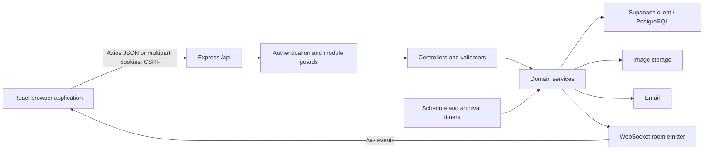
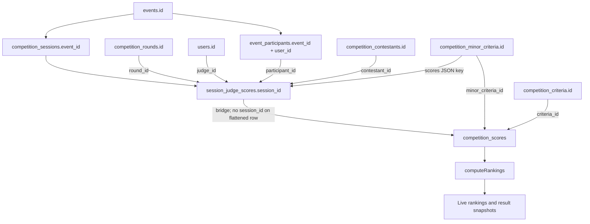
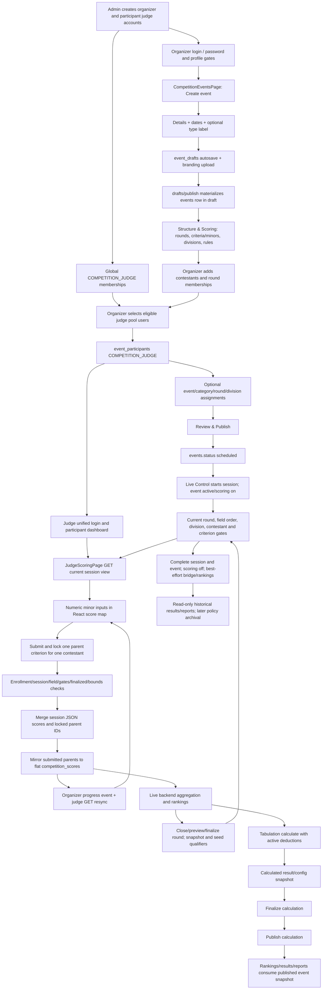

# VOTRIX Complete Flow Analysis

Repository implementation traced on 2026-10-11 (Asia/Bangkok). This is a documentation-only analysis of the working tree, including its existing uncommitted election changes. No application code, configuration, API, database, or UI was changed to produce this document.

Evidence boundary: source code and SQL migration definitions establish the behavior described below. No production database, browser session, email provider, or deployed server was inspected. Migration deployment, environment values, actual stored records, and observed runtime outcomes are **UNCONFIRMED**. A migration's presence does not prove it has been applied. Old plans, comments, and README descriptions are not treated as executable behavior when they differ from code.

`NOT FOUND IN REPOSITORY` means no implementation was identified for the specified process; it does not mean a similarly named historical document cannot exist. File links are relative to the repository root. The endpoint inventory and source-file index in section 24 provide additional navigation.

Contents:

- [1. System Overview](#1-system-overview)
- [2. Repository Structure](#2-repository-structure)
- [3. Event Creation Flow](#3-event-creation-flow)
- [4. Event Configuration Flow](#4-event-configuration-flow)
- [5. Event Structure](#5-event-structure)
- [6. Stage / Round Flow](#6-stage--round-flow)
- [7. Criteria Flow](#7-criteria-flow)
- [8. Contestant Flow](#8-contestant-flow)
- [9. Judge Flow](#9-judge-flow)
- [10. Judge Assignment Flow](#10-judge-assignment-flow)
- [11. Scoring Session Flow](#11-scoring-session-flow)
- [12. Judge Scoring Flow](#12-judge-scoring-flow)
- [13. Score Submission Flow](#13-score-submission-flow)
- [14. Score Data Flow](#14-score-data-flow)
- [15. Tabulation Flow](#15-tabulation-flow)
- [16. Ranking Flow](#16-ranking-flow)
- [17. Results Flow](#17-results-flow)
- [18. Authentication Flow](#18-authentication-flow)
- [19. Authorization Flow](#19-authorization-flow)
- [20. State / Realtime Flow](#20-state--realtime-flow)
- [21. Frontend → Backend → Database Connections](#21-frontend--backend--database-connections)
- [22. Database Relationships](#22-database-relationships)
- [23. Complete End-to-End Flow](#23-complete-end-to-end-flow)
- [24. File-by-File References](#24-file-by-file-references)
- [25. Complete System Data Flow](#25-complete-system-data-flow)
- [26. Summary of How VOTRIX Works](#26-summary-of-how-votrix-works)

## 1. System Overview

VOTRIX implements three event modules: elections, competition scoring, and polling. Admins manage accounts and global participant pools; organizers own organizations and configure events; participants cast ballots, judge competitions, or answer polls according to their event enrollment.

The application is JavaScript/JSX, with React 19, React Router, Axios, React Hook Form/Zod, Zustand, TanStack Query, Tailwind CSS, and Recharts on the frontend. The backend uses Node ESM, Express 5, Supabase's JavaScript client for PostgreSQL access, bcrypt, JWT, cookie-parser, rate limiters, Multer, Cloudinary, Resend, and the `ws` package. Package versions here refer to package declarations, not a verified deployed installation.



Sources: [frontend/package.json](frontend/package.json), [backend/package.json](backend/package.json), [backend/src/app.js](backend/src/app.js), [backend/src/server.js](backend/src/server.js), [backend/src/config/database.js](backend/src/config/database.js).

Equivalent names matter: `pageantService` is also exported as `competitionService`; several competition controllers, validators, and layouts retain `pageant` filenames. Both `pageant` and `competition_scoring` event types are accepted by competition services. The canonical frontend/backend route prefix is `competition`. The frontend service contains legacy `/pageant` helpers, but the current organizer and participant routers do not mount `/pageant` aliases. `/api/voter` remains an alias of `/api/participant`, and `/voter/*` redirects in the frontend.

## 2. Repository Structure

| Location | Actual responsibility |
|---|---|
| `frontend/src/main.jsx`, `app/`, `routes/` | Application bootstrap, query provider, route tree, authentication boundaries |
| `frontend/src/layouts/` | Admin, organizer, module, report, and participant shells |
| `frontend/src/pages/admin/` | Accounts/pools, global events, settings, audits, health, alerts, archival |
| `frontend/src/pages/organizer/{election,competition,polling}/` | Creation, setup, participation management, run controls, analytics |
| `frontend/src/pages/voter/` | Participant dashboard, ballots, polls, judge scoresheet |
| `frontend/src/components/` | Forms, shared UI, analytics/report views, competition criteria and assignment panels |
| `frontend/src/services/` | Axios-backed API contracts and shared WebSocket client |
| `frontend/src/hooks/`, `store/`, `schemas/`, `utils/` | React lifecycle/state, Zustand, Zod, drafts, score/date helpers |
| `frontend/src/modules/` | Module exports and analytics providers, formatting, metrics |
| `backend/src/routes/` | Endpoint registration and module middleware boundaries |
| `backend/src/controllers/`, `validators/` | Request extraction, input validation, response envelopes |
| `backend/src/services/` | Domain operations and database reads/writes |
| `backend/src/modules/` | Pure scoring, deduction, advancement, template, and poll-type logic |
| `backend/src/foundation/` | Shared DB wrapping, mapping, repositories, pagination, filtering, audit/activity |
| `backend/src/middleware/`, `utils/`, `config/` | Auth/CSRF/lifecycle/upload guards, JWT/cookies/constants, environment/provider clients |
| `backend/src/websocket/` | Upgrade authentication, room membership, event emission |
| `backend/src/database/{migrations,seeds,scripts}/` | Schema evolution, SQL RPCs/triggers, seeds, verification scripts |
| `backend/src/scripts/` | Image migration, orphan cleanup, deletion-queue processing |
| `backend/__tests__/`, frontend test files | Existing validation artifacts; not executed for this read-only analysis |
| Root Markdown, `docs/`, `.kiro/`, `.github/`, deployment files | Plans, historical analyses, workflow/deployment support; not proof of runtime behavior |
| `.tmp/`, `scratch/` | Local auxiliary material; not mounted application routes |

No TypeScript domain-interface layer was identified in the application source: data shapes are JavaScript objects, Zod schemas, backend validators, SQL definitions, and mapper functions. Redux, Firebase, and frontend Supabase realtime subscriptions: **NOT FOUND IN REPOSITORY** in the application flow traced here.

## 3. Event Creation Flow

### Competition: the actual create path

1. `CompetitionEventsPage` presents events and navigates to `/organizer/competition/events/new`. Existing lists use `pageantService.listEvents()` and module dashboard data. Source: [CompetitionEventsPage.jsx](frontend/src/pages/organizer/competition/CompetitionEventsPage.jsx).
2. `CompetitionEventFormPage` keeps details in React Hook Form, with `pageantEventSchemaStep1` and `zodResolver`. Local state holds step, banner/file, optional competition-type label, save/loading/error flags. `CalendarCard` receives the start value as the end picker's minimum. `localInputToIso` converts local input for the API. Sources: [CompetitionEventFormPage.jsx](frontend/src/pages/organizer/competition/CompetitionEventFormPage.jsx), [event.schemas.js](frontend/src/schemas/event.schemas.js).
3. `handleNext` validates title/start/end. For a new event it saves a create draft and advances to branding; it does not insert an event at this point. For an existing event it PATCHes details.
4. `handleNextBranding` optionally uploads the banner to the draft banner endpoint, saves the draft, and calls `handleContinueToContestants`. Despite this function's name, the destination is the workspace.
5. `handleContinueToContestants` POSTs `draftService.publishDraft('competition', payload)` to `/api/organizer/competition/drafts/publish`. Payload: `title`, `description`, ISO `startDate`, ISO `endDate`, `competitionType`.
6. `draft.controller.publishDraft('competition')` loads the organizer's draft, takes banner/asset reference from it when present, calls `validateCompetitionEvent(body, true)`, and invokes `draft.service.publishDraft` with `createCompetitionEvent`.
7. `createCompetitionEvent` obtains the organizer organization and inserts `events`: `organization_id`, title/description/banner/asset, `start_date`, `end_date`, `status` (normally `draft`), `event_type='competition_scoring'`, `competition_type`, and `scoring_enabled=false`.
8. The service attempts schedule reconciliation and draft deletion, records event activity, maps the inserted row to a camelCase DTO, and returns it. The controller returns HTTP 201 `{success:true,event}`. The frontend replaces the route with `/organizer/competition/events/:eventId/workspace`.
9. A later list GET queries events scoped to the organizer's organization and competition event types; this is how the new event appears in the event list.

Sources: [draft.service.js frontend](frontend/src/services/draft.service.js), [draft.controller.js](backend/src/controllers/draft.controller.js), [draft.service.js backend](backend/src/services/draft.service.js), [pageant.service.js](backend/src/services/pageant.service.js), [competition.validator.js](backend/src/validators/competition.validator.js), [mapper.js](backend/src/foundation/mapper.js).

The word `publish` in `/drafts/publish` means materialize the create draft into an event. It does **not** publish the competition for operation. The separate `/events/:eventId/publish` endpoint is the setup release gate. `competitionType` is a label and hint input; event creation does not automatically seed rounds, criteria, contestants, or judges, even though a template catalog and historical template-related code exist.

Direct API creation is also mounted: `pageantService.createEvent` → POST `/api/organizer/competition/events` → `pageant-organizer.controller.createEvent` → create validator → `createCompetitionEvent` → `events` → `{success,event}`.

Create validation requires nonblank title and both dates, and checks end ≥ start when both supplied. The validator forwards date values; the PostgreSQL timestamp conversion/date constraint is also part of enforcement. Do not infer a comprehensive ISO parser from the validator's presence.

### Election and polling creation

The analogous pages are [ElectionEventFormPage.jsx](frontend/src/pages/organizer/election/ElectionEventFormPage.jsx) and [PollingEventFormPage.jsx](frontend/src/pages/organizer/polling/PollingEventFormPage.jsx). Both share drafts, dates, banners, and the event-stage infrastructure, but use their own schemas, services, validators, and create functions. `draft.controller.CREATE_MAP` dispatches to `createElectionEvent` or `createPollEvent`. Election fields include voting/result rules; polling fields include anonymity, multiple-submission allowance, and expiration. See [election.service.js](backend/src/services/election.service.js), [polling.service.js](backend/src/services/polling.service.js), and their validators.

Draft records have no `event_id`; they are separate `event_drafts` rows unique by `(organizer_id,module)`. Their payload is incomplete create-form data, not contestant/judge enrollment. Silent autosave and draft recovery use [useDraft.js](frontend/src/hooks/useDraft.js), [useSilentDraftAutosave.js](frontend/src/hooks/useSilentDraftAutosave.js), [useFormSession.js](frontend/src/hooks/useFormSession.js), and [draftStorage.js](frontend/src/utils/draftStorage.js).

## 4. Event Configuration Flow

`EVENT_STAGES` in [eventStages.js](frontend/src/utils/eventStages.js) is a frontend navigation/progress definition, not a database collection of competition rounds:

| Module | Current stage sequence |
|---|---|
| Competition | Details → Branding → Structure & Scoring → Contestants → Judges → Review & Publish → Live Control → Tabulation → Rankings → Analytics → Report |
| Election | Details → Branding → Positions → Candidates → Voters → Review & Publish → Analytics → Report |
| Polling | Details → Branding → Settings → Builder → Respondents → Review & Publish → Analytics → Report |

`EventStepper`, `StageFooter`, `useEventProgress`, and module layouts derive current/completed/available navigation from URL, local progress, and publication status. A completed frontend stage does not itself start scoring or finalize a round.

Competition configuration uses `CompetitionWorkspacePage.load` → `pageantService.getFoundation` → GET `/events/:eventId/foundation` → `competition.controller.getFoundation` → `getCompetitionFoundation`. The snapshot batches event/scoring config, categories, rounds, criteria/minors, contestants, judges, assignments, round membership maps, and divisions. Mutation handlers call the relevant service and reload this snapshot.

The visible workspace tabs are Rounds, Criteria, Divisions, Scoring rules. Categories remain implemented in `StructureTab`, the API, schema, and engine, but the ordinary tab button is hidden; the page retains support for the `structure` tab. Source: [CompetitionWorkspacePage.jsx](frontend/src/pages/organizer/competition/CompetitionWorkspacePage.jsx).

`CompetitionReviewPage.handlePublish` → `pageantService.publishEvent` → POST `/events/:eventId/publish` → `publishCompetitionEvent`. Backend requirements are draft status, at least one contestant, active judge enrollment, and criterion. It changes status to `scheduled`, reconciles schedule/session state, records activity, notifies admins best-effort, rereads and returns the event. This publish function does not call the scoring-weight validator used by the scoring toggle/start workflow. Unpublish only accepts `scheduled` and resets status to draft and scoring off.

Setup writes commonly call `assertSetupEditable` (draft only). Participant additions/assignments use `assertParticipantsEditable` (draft/scheduled; active also allowed if `LOCK_PARTICIPANTS_ON_ACTIVE=false`). Route-level `requireEditableEvent` rejects terminal mutations, with `/session/` exceptions except on archived events. These guards are not interchangeable; see section 19.

## 5. Event Structure

The actual competition model is a graph, not a mandatory Division → Category → Stage → Session tree:

```text
users (organizer)
  └─ organizations
      └─ events
          ├─ optional competition_divisions
          ├─ optional competition_categories
          │   └─ competition_rounds.category_id (nullable)
          ├─ competition_rounds
          │   ├─ competition_round_contestants → competition_contestants
          │   ├─ competition_round_criteria → competition_criteria
          │   └─ competition_round_results → contestants, optional division
          ├─ competition_contestants (optional division_id)
          ├─ competition_criteria (optional category_id and division_id)
          │   └─ competition_minor_criteria
          ├─ event_participants (COMPETITION_JUDGE) → users
          │   └─ competition_judge_assignments (polymorphic scope_id)
          ├─ competition_sessions (current round/division/contestant/order/gates)
          │   └─ competition_session_judge_scores (JSON scores + locks)
          ├─ competition_deductions
          └─ competition_result_calculations (JSON snapshots)

competition_scores → user judge + participant + contestant + criterion
                    + optional minor, round, category, division, event column
```

Division is an optional attribute on multiple entities, enabled by `events.divisions_enabled`. Category is an optional weighted grouping of rounds. Round membership is many-to-many for both contestants and criteria. Judges are participant accounts enrolled in an event, not contestants. A live session is event-scoped and changes its current round; a new session per judge or per contestant is not created.

Sources: migrations [015](backend/src/database/migrations/015_competition_scoring_foundation.sql), [023](backend/src/database/migrations/023_competition_live_session.sql), [038 divisions](backend/src/database/migrations/038_competition_divisions.sql), [041](backend/src/database/migrations/041_unify_competition_judges.sql), [071](backend/src/database/migrations/071_minor_criteria.sql), [081](backend/src/database/migrations/081_competition_deductions.sql), [082](backend/src/database/migrations/082_competition_result_calculations.sql).

## 6. Stage / Round Flow

### Creating and editing rounds

`CompetitionWorkspacePage`'s `RoundsTab` creates rounds through `pageantService.createRound`; `RoundSettings` edits through `updateRound`. The route/controller/validator chain is [competition-organizer.routes.js](backend/src/routes/competition-organizer.routes.js) → [competition.controller.js](backend/src/controllers/competition.controller.js) → `validateRound` → [competition.service.js](backend/src/services/competition.service.js).

Fields: `name`, `description`, `categoryId`, `divisionId`, `displayOrder`, `weight`, `isOpen`, `startsAt`, `endsAt`, `advancementType`, `advancementValue`, `scorePolicy`. SQL uses snake_case and adds `finalized_at`. Lists sort by `display_order`, then creation time. Positive round weights are budget-checked against the event's current total when created. Service updates also handle weighted budgets. There is no standalone competition `stages` table or stage-status enum: **NOT FOUND IN REPOSITORY**. Stage group is a session gate/list, not a round entity.

`validateRound` requires a name for both create and PATCH and supplies defaults for several ordinary fields. Some frontend calls, including open/close calls, send only `{isOpen}`. That payload is not sufficient for the current controller's validator; actual request success is **UNCONFIRMED**, and the source-defined validation rejection is documented rather than assuming all UI controls succeed.

### Active-round selection

The current round is `competition_sessions.current_round_id`, exposed as `currentRoundId`. Start chooses the first ordered round, not a round selected by time. `setActiveRound` validates event membership, builds the field order, resets primary contestant/index, sets all the round's criteria active, clears the contestant gate, updates the session, and emits `session:round-changed`. Round `is_open`, session status, criterion gates, and `finalized_at` are separate values. The live submit function checks finalized state but does not check `round.is_open`.

`buildContestantOrder` first loads eligible event contestants ordered by contestant number; with membership rows, it orders assigned contestants first and then **appends eligible unassigned contestants**. It is not an exclusive membership filter. In contrast, `computeRoundStanding` restricts to assigned contestants when memberships exist. Sources: [competition-session.service.js](backend/src/services/competition-session.service.js).

### Completion and progression

Live Control loads the session/foundation/event and offers round close, advancement preview, qualifier overrides, and finalize. `previewRoundAdvancement` is read-only. `finalizeRound` rejects missing/wrong-event rounds, open rounds, already finalized rounds unless `force=true`, and empty standings. It computes standings and qualifiers, atomically claims an initially unfinalized round by writing `finalized_at` only if null, deletes/reinserts `competition_round_results`, and upserts qualifier membership into the next round. If writing fails after a new claim, it attempts to release the claim. These are sequential Supabase writes with compensation, not a multi-statement transaction.

Next round is the lowest `display_order` strictly greater than the current round. Qualifier seeding does not remove preexisting next-round memberships and does not automatically switch the session to that round. The organizer separately selects it. Forced re-finalization backfills fully locked live scores first and retains the original finalize timestamp.

Advancement types from [advancement.js](backend/src/modules/advancement.js): `none` advances everyone; `manual` auto-selects nobody; `top_n` and `top_percent` include boundary ties; percentage uses `ceil(fieldSize*percent/100)`; `threshold` compares current-round `roundScore`, even with cumulative standing. Overrides remove and add IDs. With divisions enabled, standings and qualifiers are calculated per division. `score_policy='cumulative'` adds prior finalized snapshot scores; `independent` uses the current round only. This policy affects advancement standings, not weighted overall aggregation.

## 7. Criteria Flow

`CriteriaManager` chooses a round, creates a criterion through `pageantService.createCriteria`, and then attaches its returned ID via `addRoundCriteria`. Existing criteria can be attached/detached. The two writes are separate operations. Minor creation is handled by the same component's minor editor. Sources: [CriteriaManager.jsx](frontend/src/components/organizer/competition/CriteriaManager.jsx), [pageant-organizer.controller.js](backend/src/controllers/pageant-organizer.controller.js), [competition.validator.js](backend/src/validators/competition.validator.js), [pageant.service.js](backend/src/services/pageant.service.js).

| Level | Stored rules | Meaning in current live scoring |
|---|---|---|
| Event | `scoring_config` JSON | Judge reduction method, default score scale, precision, removals, tie breaker, optional overall flag |
| Round | weight, criteria membership | Weighted event segment; its criterion percentages are normalized within that round |
| Criterion | name, percentage, min/max columns, optional category/division, display order | Parent weighted criterion; min/max columns are not the live minor bounds |
| Minor criterion | `criteria_id`, `event_id`, name, `score_type`, custom bounds, display order, active flag | Actual numeric target scored by judges; equal weight inside parent |

Bounds resolved by `resolveScoreBounds`: `range_1_10` = 1–10; `range_1_100` = 1–100; `decimal` = 0–10; `custom_range` = configured bounds. Minor create requires name and valid score type; custom minor maximum must exceed minimum. Minor order is `display_order`, then creation time. Current live criteria/minor reads do not filter the stored minor `is_active` flag. Foundation reads parent `display_order`, but the ordinary parent create/update validator does not expose an ordering field or dedicated reorder endpoint. Live round-criterion membership is read without an explicit SQL ordering clause; its returned ID order is used to order parents on the sheet.

Flat-event criterion creation budgets total percentages ≤100. Attaching to a round checks that round's criterion budget ≤100. Start-session validates totals against 100 with tolerance 0.1; scoring-toggle validation uses 0.01 and also checks category and round totals. These are distinct validation paths.

Live criterion scope uses current round membership when available, otherwise falls back to all event criteria. `active_criteria_ids=[]` means **all criteria open**; a nonempty array opens only those parents. Judges still receive closed parents with `open=false`; their minors show disabled. Opening a parent opens its minors together. Minor individual gating: **NOT FOUND IN REPOSITORY**.

Penalties/deductions do exist, as separate contestant-level records used during tabulation (section 15); they are not negative minor inputs or mutations of original judge scores.

## 8. Contestant Flow

Organizer-created records flow through `CompetitionContestantsPage.handleCreate` → create/update service call → contestant route/controller → `validateContestant` → `pageant.service.createContestant`/`updateContestant` → `competition_contestants` → `{success,contestant}` → optional photo upload → list reload.

Payload: nonblank `name`, positive integer `contestantNumber`, optional `photo`, optional `divisionId`. The service validates supplied division ownership. Contestant IDs are generated UUIDs; numbers are presentation/order values, not account or participant IDs. Photos use a separate multipart endpoint. Round checkboxes/bulk selection insert/delete membership through `addRoundContestant`/`removeRoundContestant`, then reload foundation.

Number lookup computes the next number within an optional division. Migration 039 defines one unique index on `(event_id,division_id,contestant_number)` for nonnull divisions and another on `(event_id,contestant_number)` for null divisions. Male #1 and Female #1 can coexist under the declared schema.

Contestant self-registration, approval queue, application account creation, and persistent contestant participation-status lifecycle: **NOT FOUND IN REPOSITORY** in the competition flow. Qualification is stored in `competition_round_results.qualified`; score-row status displayed in rankings is calculated from score presence. It is not a contestant approval field.

Sources: [CompetitionContestantsPage.jsx](frontend/src/pages/organizer/competition/CompetitionContestantsPage.jsx), [pageant.service.js frontend](frontend/src/services/pageant.service.js), [pageant.service.js backend](backend/src/services/pageant.service.js), [039 migration](backend/src/database/migrations/039_per_division_contestant_number.sql).

## 9. Judge Flow

### Admin-managed account/pool

Admin `JudgesPanel` and `admin.service` call `/api/admin/judges`, with CSV template/preview/register routes also mounted. `admin.controller.createJudge` delegates to `admin-participant.service.createJudge`. New judge accounts are `users.role='participant'`, active, and `must_change_password=true`; a generated temporary password is bcrypt-hashed, professional profile is stored in `profile_data`, and a `user_participant_types` membership for `COMPETITION_JUDGE` is added. Account-created email is sent through the shared mailer. An existing participant can acquire the judge membership without a new account/password; conflicting shared name information is rejected. The service returns sanitized user, email result, and created flag.

Sources: [JudgesPanel.jsx](frontend/src/components/admin/JudgesPanel.jsx), [admin-participant.service.js](backend/src/services/admin-participant.service.js), [user-participant-type.service.js](backend/src/services/user-participant-type.service.js), [admin.routes.js](backend/src/routes/admin.routes.js).

### Event selection and login

Organizer picks existing judges (section 10); enrollment exists independently of email delivery. The judge signs in through the same email/password login as other roles. The user can be redirected to the participant dashboard or an eligible event destination by `getVoterLoginRedirect`. `VoterDashboardPage`/`voter.service` aggregate event enrollments. `/participant/competition/events/:eventId/score` renders `JudgeScoringPage`; no separate judge global role or separate judge login backend route is needed.

Global account role, global pool membership, event `participant_type`, event `judge_role`, and assignment scope are different concepts. Judge-role enum: `judge`, `head_judge`, `score_reviewer`. Legacy batch submission rejects reviewers/inactive judge enrollment and enforces scope. Current live submission has a narrower set of checks (section 19); role labels alone do not prove live enforcement.

Historical invitation/account-creation helpers remain in services and frontend API wrappers. Organizer judge invitation/register/import routes are no longer mounted by the competition router. Do not present those old helpers as the current successful UI/API flow.

## 10. Judge Assignment Flow

1. `CompetitionJudgesPage` loads event status, foundation, enrolled judges, and `getJudgePool`.
2. The pool query joins `user_participant_types` to active users, requires active `COMPETITION_JUDGE` membership, supports text search, and annotates enrollment. For pool display, `profile_data.organizerIds` limits visibility when nonempty; no assigned IDs means visible to all organizers.
3. `handlePick` POSTs `{userIds:[...selected],notify}` via `pickJudges` to `/events/:eventId/judges-v2/pick`.
4. Backend validates ownership/participant editing, matches active eligible accounts, skips existing enrollment, and calls `registerParticipant` for new judges. That shared function validates event type, participant role/account status, pool membership, and upserts `event_participants` on `(event_id,user_id)` with judge role/display/name metadata.
5. Optional registered-judge email contains event access information, not a new password. Failures do not undo enrollment. Result contains `matched`, `enrolled`, `alreadyEnrolled`, `notified`; UI reloads judges/pool.
6. `JudgeAssignmentPanel.createAssignment` (and bulk assignment) calls `/judges-v2/:judgeId/assignments` with `{scope,scopeId}`. Here the URL's `judgeId` and `judge.id` mean **event_participants.id**, not `users.id`.
7. `createJudgeAssignment` validates event ownership, judge participant identity, participant editing, and target scope ownership. Insert: `competition_judge_assignments {participant_id,scope,scope_id}`. Unique triple rejects duplicates with 409. Scope is `event`, `category`, `round`, or `division`; scope ID selects the corresponding table.

Migrations 041 and 063 replace the old judge-table reference with participant FK and add a DB trigger validating polymorphic scope ownership. `competition_judges` becomes a compatibility view; canonical writes go to `event_participants`.

The pick POST does not repeat the pool GET's organizer-ID visibility filter; it matches membership/account eligibility for supplied IDs. Live judge session view/submission does not call the assignment-context enforcement helpers. These are source observations, not recommendations.

Sources: [CompetitionJudgesPage.jsx](frontend/src/pages/organizer/competition/CompetitionJudgesPage.jsx), [JudgeAssignmentPanel.jsx](frontend/src/components/organizer/competition/JudgeAssignmentPanel.jsx), [competition.service.js](backend/src/services/competition.service.js), [participant.service.js](backend/src/services/participant.service.js).

## 11. Scoring Session Flow

### Start and persistent state

`CompetitionLiveControlPage` loads session/foundation/event and invokes `competitionSessionService.startSession` → POST `/api/organizer/competition/events/:eventId/session/start` → `competition-session.controller.startSession` → `competition-session.service.startSession`.

Start checks organizer ownership, competition type, status not draft, no active session, ≥1 contestant, ≥1 active judge enrollment, ≥1 criterion, criterion percentage totals, and (if rounds exist) some round-contestant membership. Its preflight message mentions open rounds, but the membership query does not test `is_open`. It orders rounds by display order/creation time and chooses the first. It attempts to set event scoring on/status active, builds contestant order, then inserts an active `competition_sessions` row and broadcasts status/activity. Event update occurs before session insertion, with no encompassing DB transaction.

Session fields: `id`, `event_id`, `status`, `current_round_id`, `current_division_id`, `active_contestant_id`, `active_contestant_ids`, `current_contestant_order`, `contestant_order`, `active_criteria_ids`, `arrangement`, started/paused/completed/created/updated timestamps. There is no session judge ID: judges connect through enrollment and their score rows.

Declared status enum: pending/active/paused/completed. The start endpoint inserts active directly; a separate pending-session creation page/endpoint: **NOT FOUND IN REPOSITORY**. The active view filters active only. Organizer current-session reads include active and paused. Migration 023 declares `UNIQUE(event_id,status)`, which is stronger than merely one active session: it also restricts one row for each other status per event. Repeated session-history behavior depends on the applied schema and is **UNCONFIRMED**.

### Organizer controls

| Action | Persistent effect / emission |
|---|---|
| Next/previous/set contestant | Change primary contestant and index within session order; contestant-changed event |
| Stage group / open contestants | Update session contestant gate; current judge sheet still returns full order with open flags |
| Set round | Change round/order/primary/index, reset criterion and contestant gates; round-changed |
| Set active criteria | Store subset; empty array resolves all-open; active-criteria-changed |
| Set division | Validate event division, rebuild order and primary/index; division-changed |
| Arrangement preview | Read field and calculate default/primary-first/secondary-first/alternate order |
| Arrangement publish | Store order + arrangement; rejects any existing session-score row; arrangement-changed |
| Pause | status paused, paused_at set; status-changed |
| Resume | active/paused base-table lookup, status active, paused_at null; status-changed |
| Complete | status completed, completed_at; attempts event completed/scoring off, backfill and rankings event |
| Unlock score | Remove selected criterion/all criterion locks for contestant, optional one judge; audit and contestant-changed |

`arrangement` is metadata; `contestant_order` is the authoritative published order. Preview uses the complete field rather than a selected division. No reset endpoint is mounted even though the order-lock error mentions finishing/resetting a session.

Completion does not validate every judge has fully scored every contestant. It best-effort backfills fully locked JSON score rows, computes live rankings, and emits updates; it does not automatically calculate/finalize/publish a tabulation snapshot or finalize every round.

### Judge page lifecycle

On mount/return, `JudgeScoringPage` GETs `session-view`, restores database scores, and loads a retry queue from localStorage. Unsubmitted normal score edits live only in React memory and are lost on full page refresh/unmount. No ordinary autosave of typed judge scores exists. In-page resync merges saved scores over existing local edits, preserving unsaved other cells unless the same key is returned from the server. Keys omit round ID, so local score keys are not independently namespaced by round.

No active session returns `{session:null,event,message}`. Paused sessions are invisible to the active-only query, so a fresh GET while paused likewise returns no active session; a currently mounted page may have received the paused state via WebSocket. GET does not restore completed-session scores as a current sheet. Polling every five seconds runs while local status is not active; active-session state relies on events/reconnect resync.

Incomplete criteria are rejected by frontend payload validation. The API locks only completed, currently open, not-already-locked criteria present in the request; other criteria remain unlocked. Network failures without an HTTP response are queued under `competition_retry_queue_${eventId}` with contestant, scores, timestamp. The key is event-only, not judge/session/round-specific. Automatic and manual retry send the saved payload against whichever session is current. Successful removal filters queue entries by contestant ID. Normal input drafts are not this retry queue. `clearVotrixDrafts` removes its listed `votrix_*_draft_` prefixes but not this retry prefix, so ordinary auth-store cleanup does not clear the competition retry queue.

## 12. Judge Scoring Flow

```text
JudgeScoringPage GET session-view
  → pageantService.getSessionView
  → pageant-judge.routes requireEventParticipant(COMPETITION_JUDGE)
  → competition-session.controller.getJudgeSessionView
  → service loads active session, order, contestants/divisions,
    current-round criteria/minors, judge's saved JSON rows/locks
  → sheet, contestants[].existingScores / lockedCriteria / open
  → CompetitionScoringForm and ScoreInput

Score input change
  → onScoreChange(contestantId,targetId,value)
  → setScores({...previous,[`${contestantId}:${targetId}`]:value})
  → no database write until explicit lock submission
```

`targetId` is normally `competition_minor_criteria.id`; for a parent with no minors, it is `competition_criteria.id`. The form renders every returned contestant, groups by division, resolves each target's bounds, and disables closed contestants, closed criteria, locked criteria, and in-flight submission cells. Input step is `0.5`; backend range checks are the authoritative acceptance rule, not a server-enforced half-point increment.

`getJudgeSessionView` returns `event`, `session` and `activeSession`, contestants/stageContestants, compatibility primary contestant/existing scores/hasSubmitted, round ID/name, criteria/minors/open flags, scoring config/bounds, total contestants/current position. It uses the whole `contestantOrder` field, not only the single primary contestant. Optional `divisionId` filters the returned field. The response does not supply `allowedDivisions`, although the page contains selector logic expecting that field.

Sources: [JudgeScoringPage.jsx](frontend/src/pages/voter/JudgeScoringPage.jsx), [CompetitionScoringForm.jsx](frontend/src/components/voter/competition/CompetitionScoringForm.jsx), [ScoreInput.jsx](frontend/src/components/ui/ScoreInput.jsx), [competition-session.service.js](backend/src/services/competition-session.service.js).

## 13. Score Submission Flow

The actual primary UI action commits a **single criterion for a single contestant**, rather than a whole-event submit button.

1. `submitCriterion(contestantId,criterionId)` rejects a closed contestant and calls `buildCriterionPayload`.
2. Payload builder finds the parent, checks it is open, requires every minor/fallback target, numeric conversion, and bounds. It builds `{targetId:number,...}`.
3. `pageantService.submitSessionScore(eventId,scoreMap,contestantId)` POSTs `{scores:scoreMap,contestantId}` to `/api/participant/competition/events/:eventId/session-score`.
4. Parent participant router authenticates/authorizes active accounts with password-change complete. Judge route checks participant type, operational event, and score limiter; controller supplies event and authenticated user IDs to `submitJudgeSessionScore`.
5. Service verifies enrollment, active session, primary contestant present, target in contestant order and open gate, and round not finalized. It reads existing score/lock row for session/judge/round/contestant, loads scope criteria/minors, and selects complete open criteria not already in `locked_criteria`. No complete criterion is a 400; all open criteria already locked is 409.
6. It validates selected target numeric bounds and merges new values with prior JSON scores. `locked_criteria` is the union of submitted parent IDs. `is_locked` becomes true only when all scope parents, including currently closed parents, are covered; `locked_at` is set only for full lock.
7. It UPDATEs existing JSON row or INSERTs a new row in `competition_session_judge_scores`.
8. `bridgeSessionScoresToRankingStore` resolves minor IDs to parent criteria, deletes prior flattened cells for this judge/contestant/parent/round, and inserts new `competition_scores` rows. Only newly submitted parents are mirrored; other parents remain.
9. It records score audit and emits `session:judge-score-submitted` to organizer rooms. Response: `{success:true,locked,lockedCriteria,message}`.
10. Frontend shows a short saved confirmation and resyncs the sheet, which disables committed parents. API failure shows its message; network-only failure queues a retry.

The JSON write and flattened delete/insert are separate operations. Bridge failure can leave JSON saved/locked while the request fails; the source has no rollback of the already saved JSON row. Completion/resync backfill reads only fully locked rows. These observations define persistence behavior; no fix was applied or proposed.

The live path does not mark `event_participants.has_scored`; event-level batch submission does. `getLiveRankings` counts submitted judges by distinct user IDs in flattened scores. Other summaries may still use enrollment flags.

### Legacy batch path still mounted

POST `/participant/competition/events/:eventId/score` → `pageant-judge.controller.submitScores` → `validateJudgeScores` (array of contestant/criterion/context/score objects) → `submitJudgeScores`. It checks schedule/scoring enabled, enrollment, inactive/reviewer role, allowed divisions, all contestant×criterion cells, duplicates/bounds, and assignment scope. It conditionally claims `has_scored=false` → true, INSERTs flattened scores, emits rankings/stats, and resets the flag if its guarded block fails. It is an event-wide once-only parent-criterion path; current `JudgeScoringPage` uses the live JSON/minor path instead. Backend selection/store logic is not a live-session lock mechanism on this batch endpoint.

## 14. Score Data Flow

### Live row and flattened row are different records

| Store | IDs and values | Connection |
|---|---|---|
| `competition_session_judge_scores` | `id`, `session_id`, `event_id`, `round_id`, `contestant_id`, `judge_id`, `participant_id`, optional `division_id`, `scores` JSONB, `locked_criteria` JSONB, `is_locked`, lock/timestamps | Session-local score/lock source returned to judge |
| `competition_scores` | `id`, `judge_id`, `participant_id`, `contestant_id`, `criteria_id`, optional `minor_criteria_id`, `round_id`, `category_id`, `division_id`, schema-added nullable `event_id`, numeric score/timestamps | Flat source read by ranking/analytics engine |
| `competition_round_results` | `round_id`, `contestant_id`, optional `division_id`, `rank`, `score`, `qualified` | Finalized advancement standing |
| `competition_result_calculations` | `event_id`, optional session/round IDs, configuration/result JSON, creator/finalizer/publisher/status/times | Tabulation publication source |

`judge_id` in score rows = `users.id`. `participant_id` = judge's event enrollment UUID. `scope_id` in assignment rows is unrelated to the score's numeric value.



Migrations 061/062 add/validate participant FKs; 064 BEFORE INSERT triggers derive participant IDs; 065 makes them required after guards. The bridge omits `participant_id`, relying on these schema triggers. It also omits the nullable `event_id` column and uses contestant relationships to recover event ownership. `competition_scores` has no `session_id`; flattened rows are shared across sessions by judge/contestant/criterion/minor/round context. Bridge insertion sets category null and division to session current division; backfill uses null division. JSON insert does not populate its schema-added division column.

Declared uniqueness: JSON `(judge_id,session_id,round_id,contestant_id)`; flat `(judge_id,contestant_id,criteria_id,minor_criteria_id,round_id)`. Nullable parts follow PostgreSQL null uniqueness behavior. Bridge explicitly uses null-aware delete rather than relying on an upsert for flat null-round cells. JSON existing-row queries use `.eq('round_id',session.currentRoundId)` even when null; null-round lookup behavior on the actual Supabase deployment is **UNCONFIRMED**.

## 15. Tabulation Flow

### Engine calculation

`pageant.service.getLiveRankings` loads contestants/criteria/rounds/categories/event config/judge count, reads flattened scores, filters to selected contestant IDs and optional division context, builds round→criterion membership and nested minors, then calls [scoring-engine.js](backend/src/modules/scoring-engine.js) `computeRankings`. Calculation is backend JavaScript; no frontend tabulation or database ranking RPC is called by this path.

Let `R` be the configured reduction of a cell's judge score list:

| Method | `reduceScores` behavior |
|---|---|
| average / weighted_average | Arithmetic mean across present judge scores |
| sum | Sum of present judge scores |
| highest_score | Maximum |
| lowest_removal | Sort, remove configured low/high counts, average remaining; clamp removal to retain at least one |
| rank_based | Separate recursive per-judge placement computation described in section 16 |

Empty lists reduce to zero; missing judges are not automatically padded into the averaging denominator. A missing minor contributes its zero reduced value when the parent's minors are averaged.

```text
minor percentage = R(minor scores) / resolved minor MAX * 100
parent value      = mean(all configured minor percentages)

scoped round value = Σ(parent value * parent percentage / round percentage total)
no-category final = Σ(round value * round weight / 100)

category value = Σ(its round value * round weight / 100)
category final = Σ(category value * category weight / 100)
                 + Σ(event-wide uncategorized round value * round weight / 100)
```

Normalization divides by maximum; it does not subtract a custom minimum. Minors do not have independent percentage weights. A parent without minors reduces its direct scores without minor normalization. Decimal places are clamped 0–6, and intermediate/public engine values are rounded at defined stages.

Scoped mode requires rounds and a nonempty membership map. It uses only linked criteria, groups scores by round, and weights parent percentages within that round for all ordinary reduction methods. For a criterion linked to only one round, if exact round cells are absent, it uses round-agnostic cells. Despite comments describing null tolerance, the fallback bucket contains all round IDs.

Legacy mode groups all parent/minor cells ignoring round IDs and reuses the same criterion pool for every round. Weighted_average uses normalized parent percentages; other methods average parent values equally. No rounds produces an implicit Overall round weight 100. With rounds but no categories and no membership map, round weights are normalized by total weight to avoid repeated-value inflation. Scoped/category grouping uses the declared weights.

### Deductions and calculation snapshots

`CompetitionTabulationPage` loads contestants, active deductions, and latest calculation. `addDeduction` → `competitionTabulationService.createDeduction` → organizer deductions POST → `pageant-organizer.controller` → `competition-tabulation.service.createDeduction` inserts a separate record after contestant/amount/reason/authority validation. Amount must be finite >0; reason nonblank. Default authority is organizer; organizer creation accepts authority config `organizer` or `both`. The scoring-config validator does not expose a `deductionAuthority` update branch. A judge deduction endpoint: **NOT FOUND IN REPOSITORY**.

Void sets `status='voided'`, timestamps/user; it does not delete or alter judge scores. `calculate` POSTs chosen method → `calculateResults` validates method, calls live rankings with optional division/round, loads active deductions, applies [tabulation.js](backend/src/modules/tabulation.js) `applyDeductionsToRankings`, reranks, and inserts a `calculated` snapshot. Response contains calculation ID/status/configuration/results.

Numeric mode: final = base score − deduction total, descending. Placement mode (when row has `placementTotal`): final placement = placement total + deductions, ascending. No floor at zero exists. With round filter, other nonnull-round deductions are excluded; event-wide null-round deductions apply. Without round filter, all active event deductions are accumulated. Deduction session IDs are stored but not used as a calculation filter.

Configuration snapshot stores method/scoring config/division/round/totals/judge counts/authority. `session_id` exists in calculation schema but current insert does not set it. Calculation does not require every judge submitted, closed session, finalized rounds, or completed event; route guards and ownership still apply.

Finalize only transitions calculated → finalized, records user/time/audit. Publish only transitions finalized → published, records user/time/audit. Neither recomputes the saved snapshot. New calculations do not mark older publications superseded, even though schema permits that status.

Terminal `requireEditableEvent` guarding applies to deductions/tabulation POSTs because they are outside `/session/`. Thus completing the event through Live Control makes these later mutations rejected by the route-level terminal guard. The navigation order alone does not establish that calculating after completion succeeds.

## 16. Ranking Flow

`computeRankings` sorts ordinary final scores descending and assigns standard competition ranks (1,2,2,4). Ties compare rounded final values. Optional `tieBreaker='highest_criterion'` compares the highest event-level parent average and shares rank only when both final and tie key match. Public round-filter rankings sort/rank by the selected `perRound` value, with optional highest-criterion tie break.

Rank-based engine computes each judge's weighted numeric result recursively, keeps contestants that judge actually scored, converts those results into tied placements, sums placements per contestant, and uses negative placement total as internal descending `finalScore`. Tie ordering also considers average placement and average raw score; returned rows include placement/raw metrics and category summaries.

Current public mapping assumes ordinary engine row shapes: it reads `row.perRound` and `row.perCriterion` and emits ordinary fields without carrying `placementTotal`. Rank-based engine rows do not provide those ordinary maps. Consequently rank-based mode is listed in the UI/API enums, but a successful current `getLiveRankings`/tabulation round trip for it is **UNCONFIRMED**; the mapping contains direct property accesses that cannot be assumed compatible. `applyDeductionsToRankings`' placement branch exists, but does not prove it is reached through the public mapper.

`getLiveRankings` returns totals, judges total/submitted, selected division/round, config, rounds, and ranking rows including criterion/round/category breakdown, weightedScore/finalScore/rankingScore/status. Submitted means at least one flattened score, not all cells complete. Status tests score presence in criterion aggregates; it is not proof all enrolled judges submitted all minors.

`getOfficialRankings` first computes live data, then (when no round filter) loads latest published event-wide calculation ordered by publish time. Its nonempty `result_snapshot` replaces ranking rows; optional division filtering uses snapshot `divisionId` and reranks in existing order. Ordinary engine skeletons do not preserve contestant division ID; unfiltered public mapping falls back to null. Snapshot division grouping therefore depends on the actual mapped data, not merely contestants having divisions.

Sources: [scoring-engine.js](backend/src/modules/scoring-engine.js), [pageant.service.js](backend/src/services/pageant.service.js), [CompetitionRankingsPage.jsx](frontend/src/pages/organizer/competition/CompetitionRankingsPage.jsx).

## 17. Results Flow

Results are available through GET organizer competition `rankings`, `results`, `analytics`, per-round `results`, tabulation snapshots, and report endpoints. There is no separate competition result-table row created on every score submit.

`getCompetitionResults` reads live rankings and latest published event-wide calculation. Nonempty published rows are authoritative; otherwise it uses live results. It derives champion from first row, category leaders from per-category values, division winners/standings, and finalized round snapshots. Custom award tables introduced in migrations 066/067 are dropped by migration 068; current derived `categoryAwards` are not records in those dropped tables.

`CompetitionRankingsPage` subscribes explicitly to the organizer event room and, once per mount, automatically POSTs `resyncRankingStore` before fetching rankings/foundation/results. Thus opening this application page can rewrite flattened scores from fully locked session rows; its displayed ranking GET is not its only operation. The analysis did not open/run the application page. The page offers division/round views; on `rankings:updated` it refetches when a filter is selected, otherwise directly replaces data only when the event supplies a rankings payload. A payload-free event does not trigger its unfiltered reload. `CompetitionAnalyticsPage` uses analytics providers and backend aggregates. `CompetitionReportPage` requests `/api/organizer/reports/competition/:eventId`; `reports.service.getCompetitionReport` loads live data and results, selects published overall rows when present, and includes judge turnout, method, publication ID/time, criterion totals, rounds, round/division results, category awards. With a published snapshot it selects the overall published list even when a division filter was supplied to its live query.

Export endpoints and frontend export utilities format existing report data as supported downloads/print views; they do not submit judge scores. Sources: [reports.service.js](backend/src/services/reports.service.js), [reports-organizer.controller.js](backend/src/controllers/reports-organizer.controller.js), [exportReport.js](frontend/src/utils/exportReport.js), [ReportDocument.jsx](frontend/src/components/analytics/ReportDocument.jsx).

Publication itself emits no `rankings:updated` call in `publishCalculation`; another fetch is needed to read newly published results. Live score submit emits organizer progress, not an immediate rankings payload; completion/finalization/resync and the batch path emit ranking events.

## 18. Authentication Flow

`LoginPage`/`LoginForm` → `useLogin.handleSubmit` → `authService.login` → POST `/api/auth/login` → `validateLogin` → `auth.service.login` → email lookup in users + bcrypt comparison + active-account assertion → optional user-session insertion → token pair → controller cookies/CSRF/user response.

Current unified login uses email for all account roles. Older schema/docs mention admin username login, but no current username-based admin login endpoint is mounted. Token payload includes `sub`, role/email/username/account status/password-change/token-version and optional `sid`; it does not include `id` or `organizationId`.

`sendAuthResponse` sets HTTP-only access/refresh cookies and returns `{success,csrfToken,user}`. Access token is not in JSON or the auth store. Axios uses `withCredentials=true`; request interceptor adds CSRF for mutating requests, not Authorization. Auth store persists user display data but starts with user null and does not trust it to bootstrap authentication.

`useAuthBootstrap` refreshes from the HTTP-only refresh cookie. Refresh verifies JWT, current account/token version and optional session row, touches activity, issues cookies and user response. API response interceptor shares one in-flight refresh promise for 401 retries, retries once, updates user/CSRF, and clears state on failure. It also refreshes CSRF once on a matching 403. Query state is a separate subsystem.

`authenticate` accepts only the access cookie, verifies JWT, retrieves user, checks token version using constant-time comparison, checks optional session row, and sets `req.user`. Logout retains a Bearer fallback for audit/revocation only, clears cookies/CSRF, deletes bound session or increments version for legacy tokens. This fallback does not change cookie-only middleware authentication.

Password-change routes verify current password, hash/update new one, clear must-change, increment token version, revoke old session rows best-effort, and issue fresh cookies. Non-admin users may use skip-password-change, which clears the flag. Forgot/reset flow stores hashed one-time reset tokens with expiry, mails the raw token link, updates password/version, revokes sessions, and marks used. Admin reset requests are excluded.

Cookie options are HTTP-only for auth; production SameSite=None/Secure, path `/`; CSRF cookie is JavaScript-readable. Remember controls refresh-cookie lifetime on login. Actual names/lifetimes/environment settings are **UNCONFIRMED** without deployed configuration. User-session recording is best-effort; lookup fails open on infrastructure errors but rejects a confirmed missing row.

Sources: [auth.controller.js](backend/src/controllers/auth.controller.js), [auth.service.js](backend/src/services/auth.service.js), [token.service.js](backend/src/services/token.service.js), [session.service.js](backend/src/services/session.service.js), [auth.store.js](frontend/src/store/auth.store.js), [api.js](frontend/src/services/api.js), [password-reset.service.js](backend/src/services/password-reset.service.js).

## 19. Authorization Flow

| Boundary | Actual check |
|---|---|
| Frontend `ProtectedRoute` | Bootstrap/authentication, allowed global roles, participant/voter compatibility, must-change redirect |
| Admin router | Authenticate, admin role, password-change complete; no `requireActiveAccount` middleware in this router |
| Organizer router | Authenticate, organizer role, active account; profile endpoints before password gate; module/dashboard routes require password changed and complete profile |
| Participant/voter router | Authenticate, participant/voter-compatible global role, active account, password changed |
| Event ownership | `assertOrganizerOwnsEvent`: event organization organizer ID equals authenticated user |
| Participant module operations | `requireEventParticipant`: enrollment exists and type matches; attaches participant; does not itself test `is_active` |
| Setup writes | Services commonly call draft-only setup guard |
| Participant roster/assignment writes | Draft/scheduled guard, active exception controlled by feature flag |
| Terminal writes | Route middleware rejects completed/cancelled; `/session/` exempt; archived rejects all mutations |
| Operational participant POST | Reject archived event, then module-specific service checks |
| Batch judge score | Enrollment, scoring schedule, inactive/reviewer rejection, allowed divisions and scope |
| Live judge score/view | Enrollment, live session/field/gates/finalized round; does not call scope/role/inactive-enrollment helpers |

The generic event participant lookup and `assertJudgeEnrolled` do not enforce judge `is_active`, reviewer role, or assignment scope. `canJudgeScore` is imported in live service but is not called by its submission function. Live submission also does not call `isCompetitionScoringOpen`; it follows active-session state rather than planned dates. This differs from the legacy batch path. Do not infer stage/session permissions from UI disabling alone.

Several read/control paths have different ownership enforcement: organizer `getActiveSession` controller calls `getActiveSessionDetailed(eventId)` without user ID; division list/detail use event/division IDs without ownership assertion inside those methods. Other foundation/session writes perform ownership checks. Authentication of the parent router is not equivalent to tenant ownership on every handler.

CSRF middleware compares cookie/header tokens on nonexempt mutations; public/auth/health exemptions exist. It still skips checks when any `Authorization: Bearer ...` header is present even though access authentication itself uses cookies. CORS still permits Authorization as an allowed header. These remnants are documented actual behavior.

Sources: [auth.js](backend/src/middleware/auth.js), [csrf.js](backend/src/middleware/csrf.js), [eventGuards.js](backend/src/middleware/eventGuards.js), [eventLifecycle.js](backend/src/utils/eventLifecycle.js), [ProtectedRoute.jsx](frontend/src/routes/ProtectedRoute.jsx), [event.service.js](backend/src/services/event.service.js).

## 20. State / Realtime Flow

React component state holds loaded entities, form values, score map, selected division/round, busy/errors and modal state. React Hook Form/Zod handles event/login form validation. Zustand holds authentication and toasts. React Query is adopted selectively for dashboards/analytics; many pages still use `useEffect`/`useState` and explicit reloads. Shared QueryClient defaults: 30s stale time, 5min garbage collection, no focus refetch, one retry. Router/main/provider files compose the application; Redux/global application Context store: **NOT FOUND IN REPOSITORY** in the traced domain flow.

Frontend [socket.service.js](frontend/src/services/socket.service.js) derives `/ws` from API base, creates native browser WebSocket, parses `{type,data}` messages, and dispatches via listener maps. `useSocketEvent` subscribes/unsubscribes. Bootstrap connects when authenticated and disconnects on logout. Reconnection delay doubles from one second to a 30s cap. `disconnect` sets `isIntentionallyClosed=true`; `connect` does not reset it, so the source's reconnect behavior after intentional disconnect cannot be assumed identical to first connection.

Backend [ws-server.js](backend/src/websocket/ws-server.js) upgrades `/ws`, checks supplied origin, limits connections per IP, verifies access JWT from cookie, and sets `_user`. It pings every 25s; unauthenticated sockets close after 10s. Comment mentions an auth message, but the message handler only implements subscribe; auth-message handling: **NOT FOUND IN REPOSITORY**.

Room initialization destructures `_user.id`/`organizationId`, whereas issued tokens contain `sub` and no organization ID. Automatically joining personal/organizer/participant event rooms therefore is not confirmed by the token contract. Explicit authenticated subscriptions accept strings starting `event:` without checking event ownership/enrollment. The WebSocket upgrade does not perform the HTTP middleware's DB token-version/session/account checks. These are actual implementation differences, not an assertion that deployed real-time delivery was tested.

| Event family | Current consumers/effects |
|---|---|
| `session:status-changed` | Judge view/state and organizer session/dashboard refresh |
| `session:round-changed`, `contestant-changed`, `active-criteria-changed`, `division-changed`, `arrangement-changed` | Reload judge sheet and/or organizer session data |
| `session:judge-score-submitted` | Organizer judge-progress refresh |
| `session:round-finalized`, `rankings:updated` | Standing/results notifications; rankings refresh when subscribed |
| `election:vote-submitted`, `election:voting-toggled`, `election:finalized` | Election analytics/results/lifecycle updates |
| `poll:response-submitted`, `poll:polling-toggled` | Poll participation/lifecycle updates |
| `organizer:stats-updated`, `platform:stats-updated` | Dashboard cache/query refresh triggers |
| Notifications events | User notification list/count updates through notification tools/components |

Judge waiting-state polling: five seconds while not active, stops when active. Fallback fetches and reconnect resync make server state available independently of a persistent local score draft. In-memory backend rooms are not Supabase change streams or socket.io. Firebase/Redux/Supabase frontend channel subscriptions: **NOT FOUND IN REPOSITORY**.

## 21. Frontend → Backend → Database Connections

All table mutations below use the Supabase service client unless an explicit SQL RPC is shown. Organizer competition event-relative paths use base `/api/organizer/competition/events/:eventId`.

| Process | Frontend function/service | HTTP path | Backend chain | Database / response → UI |
|---|---|---|---|---|
| Create event | `CompetitionEventFormPage.handleContinueToContestants` / draft service | POST `/api/organizer/competition/drafts/publish` | draft controller → create validator → draft publish → `createCompetitionEvent` | events INSERT; 201 event → navigate workspace |
| Configure details/banner | event form / pageant service | PATCH base; POST base `/banner` | pageant controller → update or upload service | events UPDATE, image_assets; event/URL → form/list |
| Configure scoring | workspace `ScoringTab.save` | PATCH base `/scoring-config` | competition controller → validator → `setScoringConfig` | events JSON UPDATE → config/reload |
| Create round | workspace `RoundsTab.submit` | POST base `/rounds` | controller → `validateRound` → `createRound` | competition_rounds INSERT → round/reload |
| Criteria/minors | CriteriaManager create/add | POST base `/criteria`; `/criteria/:id/minor-criteria` | pageant controller → validator → parent/minor create | criteria/minor INSERT; memberships separate → reload |
| Contestant | contestants `handleCreate` | POST base `/contestants` | pageant controller → contestant validator → service | contestant INSERT → photo endpoint/reload |
| Judge account/invite | admin JudgesPanel / admin service | POST `/api/admin/judges` | admin controller → `createJudge` | users + memberships; account email → sanitized result/list |
| Judge event enrollment | judges `handlePick` | POST base `/judges-v2/pick` | competition controller → `pickJudges` → `registerParticipant` | event_participants upsert; optional email → count/list |
| Judge assignment | JudgeAssignmentPanel | POST base `/judges-v2/:participantId/assignments` | validator → `createJudgeAssignment` | assignments INSERT + DB scope trigger → assignment/reload |
| Session creation | live control `runAction` service | POST base `/session/start` | session controller → `startSession` | events UPDATE then sessions INSERT → session/reload/event |
| Judge scoring load | judge mount / `getSessionView` | GET `/api/participant/competition/events/:eventId/session-view` | participant guards → session controller/service | active view + criteria + JSON scores SELECT → sheet |
| Score input | ScoreInput / `onScoreChange` | none | none | React state only |
| Score submission | `submitCriterion` / `submitSessionScore` | POST participant event `/session-score` | session controller → `submitJudgeSessionScore` → bridge | JSON UPDATE/INSERT + flat DELETE/INSERT → locks/reload |
| Tabulation | tabulation `calculate` | POST base `/tabulation/calculate` | tabulation service → live rankings → deductions | flat SELECT + calculation INSERT → preview |
| Ranking | rankings `load` | GET base `/rankings` | `getOfficialRankings` → engine + publication lookup | score/config/snapshot SELECT → rows |
| Results | rankings/report service | GET base `/results` | `getCompetitionResults` | live/published/round snapshot SELECT → winners/standings |
| Finalize/publish result | tabulation `transition` | POST base `/tabulation/:id/finalize` or `/publish` | tabulation service guarded state UPDATE | calculation status UPDATE → badge/result |

Controller output conventions include `{success:true,event}`, `{success:true,contestant}`, `{success:true,criteria}`, `{success:true,foundation}`, `{success:true,session}`, list containers, and spread domain results. Tables are snake_case; module DTOs are generally camelCase, but snapshot retrieval exposes raw `configuration_snapshot`/`result_snapshot` and timestamp fields. Frontend tabulation explicitly adapts both shapes.

## 22. Database Relationships

### Current competition/core table map

UUID `id` PK applies to the ordinary entity tables except explicitly noted composite membership keys and the system poll-type registry's string `key` PK. The following reflects forward migrations as reconciled by later renames/drops, not a live schema introspection.

| Entity | Foreign keys / significant fields |
|---|---|
| users | Role/account/password/version/forced-change; name/student/professional/organization/scope profile data |
| user_participant_types | Composite PK `(user_id,participant_type)`; user FK and optional creator FK; active membership |
| organizations | organizer_id → users; organization name/type/status; organizer uniqueness introduced by migration 028 |
| events | organization_id → organizations; dates/type/status/banner/asset; scoring/voting/polling flags/rules |
| event_participants | event_id → events; user_id → users; UNIQUE pair; participant type, flags, metadata, judge role/display/active, voting nonce |
| invitations | event_id → events, voter_id → users; UNIQUE pair; invitation sent/temp/new-account fields |
| competition_divisions | event_id → events; name/order/active |
| competition_categories | event_id → events, optional division_id → divisions; weight/order/active |
| competition_rounds | event_id → events, optional category_id → categories, division_id → divisions; weight/order/open/dates/advancement/policy/finalized |
| competition_contestants | event_id → events; optional division/asset; name/photo/number with division-aware unique indexes |
| competition_criteria | event_id → events; optional category/division; percentage/range/order |
| competition_minor_criteria | event_id → events, criteria_id → criteria; scale/custom bounds/order/active |
| competition_round_contestants | round_id → rounds; contestant_id → contestants; UNIQUE pair |
| competition_round_criteria | round_id → rounds; criteria_id → criteria; UNIQUE pair |
| competition_judge_assignments | participant_id → event_participants; scope/scope_id checked by trigger; UNIQUE triple |
| competition_sessions | event_id → events; optional round/primary contestant/current division; persistent order/gates/status/timestamps |
| competition_session_judge_scores | session/event/round/contestant/judge/participant FKs; optional division; JSON values and parent locks |
| competition_scores | judge/participant/contestant/parent/minor/round/category/division FKs; nullable added event FK; numeric score |
| competition_round_results | round/contestant/division FKs; rank/score/qualified; UNIQUE round+contestant |
| competition_deductions | event/session/round/contestant/applier/voider FKs; amount/reason/status/authority |
| competition_result_calculations | event/session/round/creator/finalizer/publisher FKs; status/config/result/timestamps |
| user_sessions | user_id → users; token_version/activity/timestamps; session ID embedded as JWT sid |
| password_reset_tokens | user_id → users; hashed token/expiry/used timestamp |
| notifications | user_id → users; type/message/action URL/metadata/read flag |
| audit_logs | nullable user_id → users; action/entity/entity_id/details; entity identifiers are polymorphic |
| system_settings | setting key/value/description; platform settings and policies |
| event_drafts | organizer_id → users; module/step/title/banner/payload/asset; UNIQUE organizer+module |
| image_assets | Content hash/provider ID/URL/type/reference metadata; referenced by users/events/candidates/contestants/questions/options/drafts |
| image_deletion_queue | Provider public ID/error/retry schedule; external deletion retry store |

### Election/polling table map

| Entity | Relationships / purpose |
|---|---|
| election_ballot_sections | event FK; name/order; ID+event uniqueness; later eligibility_mode |
| election_group_voters | Composite PK section+participant; composite event-scoped FKs to sections and event_participants |
| positions | event FK and composite ballot-section+event FK; min/max/skip/winner/order/description |
| candidates | position FK; name/photo/partylist/description and image reference |
| election_ballot_submissions | event/section/participant context; completion per ballot section |
| election_votes | event/voter/participant/position/candidate context; atomic ballot RPC inserts selection rows |
| poll_questions | event FK; question/type/type config/required/order/image/custom registry reference |
| poll_options | question FK; option value/label/order/image |
| poll_submissions | event/voter/participant FKs; completion/start/time data |
| poll_answers | question/voter/submission FKs; serialized answer; multiple answers belong to submission |
| system_poll_question_types / poll_question_types | System and organization custom question-type definitions; registry view resolves available types |

```mermaid
erDiagram
  users ||--o{ organizations : organizer_id
  organizations ||--o{ events : organization_id
  users ||--o{ user_participant_types : user_id
  users ||--o{ event_participants : user_id
  events ||--o{ event_participants : event_id
  event_participants ||--o{ competition_judge_assignments : participant_id
  events ||--o{ competition_divisions : event_id
  events ||--o{ competition_categories : event_id
  events ||--o{ competition_rounds : event_id
  competition_categories o|--o{ competition_rounds : category_id
  events ||--o{ competition_contestants : event_id
  events ||--o{ competition_criteria : event_id
  competition_criteria ||--o{ competition_minor_criteria : criteria_id
  competition_rounds ||--o{ competition_round_contestants : round_id
  competition_contestants ||--o{ competition_round_contestants : contestant_id
  competition_rounds ||--o{ competition_round_criteria : round_id
  competition_criteria ||--o{ competition_round_criteria : criteria_id
  events ||--o{ competition_sessions : event_id
  competition_sessions ||--o{ competition_session_judge_scores : session_id
  users ||--o{ competition_session_judge_scores : judge_id
  event_participants ||--o{ competition_session_judge_scores : participant_id
  competition_contestants ||--o{ competition_session_judge_scores : contestant_id
  users ||--o{ competition_scores : judge_id
  event_participants ||--o{ competition_scores : participant_id
  competition_contestants ||--o{ competition_scores : contestant_id
  competition_criteria ||--o{ competition_scores : criteria_id
  competition_minor_criteria o|--o{ competition_scores : minor_criteria_id
  competition_rounds ||--o{ competition_round_results : round_id
  competition_contestants ||--o{ competition_round_results : contestant_id
  events ||--o{ competition_deductions : event_id
  events ||--o{ competition_result_calculations : event_id
  events ||--o{ election_ballot_sections : event_id
  election_ballot_sections ||--o{ positions : ballot_section_id
  positions ||--o{ candidates : position_id
  event_participants ||--o{ election_ballot_submissions : participant_id
  events ||--o{ poll_questions : event_id
  poll_questions ||--o{ poll_options : question_id
  events ||--o{ poll_submissions : event_id
  poll_submissions ||--o{ poll_answers : submission_id
```



Diagram omits some optional FKs for readability; the tables above and migration index retain them. JSON score keys/array entries are logical relationships, not individual PostgreSQL foreign-key constraints. Polymorphic assignment scope uses a trigger rather than a normal scope-ID FK. Most event children cascade deletion; division-linked setup entities generally restrict division deletion; optional result/deduction/session links have their declared SET NULL behavior. Deployment/application of triggers and constraints is **UNCONFIRMED**.

Historical names `contestants`, `criteria`, `judge_scores` are renamed to competition tables with compatibility views in 011. `event_voters` is a retained legacy store with `v_event_voters` compatibility view; current domain enrollment reads/writes use `event_participants`. Migration 041 retains `competition_judges_legacy` and a `competition_judges` compatibility view. Migration 068 removes custom competition award tables. Migration 085 converts voter roles to participant; code accepts legacy voter meanwhile. Migration 086 removes legacy profile type in favor of global type membership. These are distinct schema eras.

## 23. Complete End-to-End Flow



This graph shows separate supported operations, not a guarantee every displayed edge succeeds under every status. In particular tabulation mutations are terminal-event guarded, round-only PATCH controls require the validator's name field, live membership order includes unassigned contestants, and live assignment enforcement differs from batch scoring. Publication/round finalization/session completion are independent actions.

## 24. File-by-File References

### Primary implementation reading order

| File | Functions / connection to trace |
|---|---|
| `frontend/src/routes/index.jsx` | Canonical route tree and legacy participant redirect |
| `frontend/src/utils/eventStages.js` | EVENT_STAGES, stagePath, progress labels |
| `frontend/src/pages/organizer/competition/CompetitionEventsPage.jsx` | Event list and create/open navigation |
| `frontend/src/pages/organizer/competition/CompetitionEventFormPage.jsx` | handleNext, handleNextBranding, handleContinueToContestants |
| `frontend/src/pages/organizer/competition/CompetitionWorkspacePage.jsx` | Foundation loading; RoundsTab, RoundSettings, StructureTab, ScoringTab, DivisionsTab |
| `frontend/src/components/organizer/competition/CriteriaManager.jsx` | Parent create/attach/detach; minor scoring definitions |
| `frontend/src/pages/organizer/competition/CompetitionContestantsPage.jsx` | handleCreate, number lookup, round membership |
| `frontend/src/pages/organizer/competition/CompetitionJudgesPage.jsx` | Pool/list loading, handlePick, handleRemove |
| `frontend/src/components/organizer/competition/JudgeAssignmentPanel.jsx` | Individual/bulk scope assignment calls |
| `frontend/src/pages/organizer/competition/CompetitionReviewPage.jsx` | Readiness and handlePublish/handleUnpublish |
| `frontend/src/pages/organizer/competition/CompetitionLiveControlPage.jsx` | Session actions/gates/order/unlock/progress/advancement |
| `frontend/src/pages/voter/JudgeScoringPage.jsx` | scoresFromSheet, onScoreChange, buildCriterionPayload, submitCriterion, retry/resync |
| `frontend/src/components/voter/competition/CompetitionScoringForm.jsx` | Minor inputs, disabled/open/lock states, row grouping |
| `frontend/src/pages/organizer/competition/CompetitionTabulationPage.jsx` | load, addDeduction, calculate, voidDeduction, transition |
| `frontend/src/pages/organizer/competition/CompetitionRankingsPage.jsx` | Overall/division/round data and publication/result display |
| `frontend/src/services/pageant.service.js` | Most competition organizer/judge HTTP wrappers; compatibility helpers |
| `frontend/src/services/competition-session.service.js` | Session controls and judge API wrappers |
| `frontend/src/services/competition-tabulation.service.js` | Deductions, calculate/latest/finalize/publish wrappers |
| `backend/src/routes/pageant-organizer.routes.js` | Event/contestant/criteria/results/tabulation mounts |
| `backend/src/routes/competition-organizer.routes.js` | Foundation/division/round/judge/assignment/session mounts |
| `backend/src/routes/pageant-judge.routes.js` | Batch and live judge endpoints |
| `backend/src/services/pageant.service.js` | Event/contestant/criteria, legacy scoring/scope, live/official rankings/results/analytics |
| `backend/src/services/competition.service.js` | Categories/rounds/config/foundation/pool/enrollment/assignments |
| `backend/src/services/competition-division.service.js` | Division CRUD/toggle/reference restrictions |
| `backend/src/services/competition-session.service.js` | Persistent session, scoring JSON, bridge, progress/unlock, round results/advancement |
| `backend/src/services/competition-tabulation.service.js` | Deductions and snapshot state transitions |
| `backend/src/modules/scoring-engine.js` | computeRankings, reduceScores, bounds, scoped/legacy/category math |
| `backend/src/modules/advancement.js` | selectQualifiers, applyQualifierOverride |
| `backend/src/modules/tabulation.js` | applyDeductionsToRankings |
| `backend/src/validators/competition.validator.js` | Event, contestant, parent/minor, round/config/assignment contracts |
| `backend/src/services/event.service.js` | Ownership and shared event lookup/notifications |
| `backend/src/services/participant.service.js` | Canonical event enrollment and flags |
| `backend/src/services/admin-participant.service.js` | Global account/pool creation/import/update |
| `backend/src/middleware/auth.js`, `utils/eventLifecycle.js` | Global auth and editable status boundaries |
| `backend/src/services/event-schedule-sync.service.js` | Publication-gated, session-driven competition lifecycle |
| `backend/src/services/reports.service.js` | Module reports and exports |

The additional inventories below are extracted from the current source for navigation. They identify declarations and call sites; an exported helper is not automatically a mounted endpoint, and a migration is not a deployment assertion.

### Mounted backend endpoint inventory

Paths are composed from the current router mounts. Participant paths also resolve through the `/api/voter` parent alias. Each row gives the route declaration and controller symbol; middleware boundaries are described in section 19.

| Method and composed path | Declaration file : line | Controller reference |
|---|---|---|
| `GET /api/admin/overview` | [backend/src/routes/admin.routes.js](backend/src/routes/admin.routes.js) : 14 | `adminController.getAdminOverview` |
| `GET /api/admin/dashboard` | [backend/src/routes/admin.routes.js](backend/src/routes/admin.routes.js) : 15 | `adminController.getDashboard` |
| `GET /api/admin/analytics` | [backend/src/routes/admin.routes.js](backend/src/routes/admin.routes.js) : 16 | `adminController.getAnalytics` |
| `GET /api/admin/organizers` | [backend/src/routes/admin.routes.js](backend/src/routes/admin.routes.js) : 18 | `adminController.getOrganizers` |
| `GET /api/admin/organizers/template` | [backend/src/routes/admin.routes.js](backend/src/routes/admin.routes.js) : 19 | `adminController.getOrganizerCsvTemplate` |
| `POST /api/admin/organizers` | [backend/src/routes/admin.routes.js](backend/src/routes/admin.routes.js) : 20 | `adminController.createOrganizerAccount` |
| `POST /api/admin/organizers/import-preview` | [backend/src/routes/admin.routes.js](backend/src/routes/admin.routes.js) : 21 | `adminController.previewOrganizersCsv` |
| `POST /api/admin/organizers/import-register` | [backend/src/routes/admin.routes.js](backend/src/routes/admin.routes.js) : 22 | `adminController.registerOrganizersCsv` |
| `GET /api/admin/organizers/:organizerId/activity` | [backend/src/routes/admin.routes.js](backend/src/routes/admin.routes.js) : 23 | `adminController.getOrganizerActivity` |
| `PATCH /api/admin/organizers/:organizerId` | [backend/src/routes/admin.routes.js](backend/src/routes/admin.routes.js) : 24 | `adminController.updateOrganizer` |
| `PATCH /api/admin/organizers/:organizerId/status` | [backend/src/routes/admin.routes.js](backend/src/routes/admin.routes.js) : 25 | `adminController.updateOrganizerStatus` |
| `POST /api/admin/organizers/:organizerId/send-onboarding` | [backend/src/routes/admin.routes.js](backend/src/routes/admin.routes.js) : 26 | `adminController.sendOrganizerOnboarding` |
| `GET /api/admin/events` | [backend/src/routes/admin.routes.js](backend/src/routes/admin.routes.js) : 28 | `adminController.getGlobalEvents` |
| `PATCH /api/admin/events/:eventId/restore` | [backend/src/routes/admin.routes.js](backend/src/routes/admin.routes.js) : 29 | `adminController.restoreEvent` |
| `GET /api/admin/voters` | [backend/src/routes/admin.routes.js](backend/src/routes/admin.routes.js) : 32 | `adminController.getVoters` |
| `GET /api/admin/voters/template` | [backend/src/routes/admin.routes.js](backend/src/routes/admin.routes.js) : 33 | `adminController.getVoterCsvTemplate` |
| `POST /api/admin/voters` | [backend/src/routes/admin.routes.js](backend/src/routes/admin.routes.js) : 34 | `adminController.createVoter` |
| `POST /api/admin/voters/import-preview` | [backend/src/routes/admin.routes.js](backend/src/routes/admin.routes.js) : 35 | `adminController.previewVotersCsv` |
| `POST /api/admin/voters/import-register` | [backend/src/routes/admin.routes.js](backend/src/routes/admin.routes.js) : 36 | `adminController.registerVotersCsv` |
| `PATCH /api/admin/voters/:userId` | [backend/src/routes/admin.routes.js](backend/src/routes/admin.routes.js) : 37 | `adminController.updateVoter` |
| `PATCH /api/admin/voters/:userId/status` | [backend/src/routes/admin.routes.js](backend/src/routes/admin.routes.js) : 38 | `adminController.updateVoterStatus` |
| `DELETE /api/admin/voters/:userId/membership` | [backend/src/routes/admin.routes.js](backend/src/routes/admin.routes.js) : 39 | `adminController.removeVoterFromPool` |
| `GET /api/admin/respondents` | [backend/src/routes/admin.routes.js](backend/src/routes/admin.routes.js) : 42 | `adminController.getRespondents` |
| `GET /api/admin/respondents/template` | [backend/src/routes/admin.routes.js](backend/src/routes/admin.routes.js) : 43 | `adminController.getRespondentCsvTemplate` |
| `POST /api/admin/respondents` | [backend/src/routes/admin.routes.js](backend/src/routes/admin.routes.js) : 44 | `adminController.createRespondent` |
| `POST /api/admin/respondents/import-preview` | [backend/src/routes/admin.routes.js](backend/src/routes/admin.routes.js) : 45 | `adminController.previewRespondentsCsv` |
| `POST /api/admin/respondents/import-register` | [backend/src/routes/admin.routes.js](backend/src/routes/admin.routes.js) : 46 | `adminController.registerRespondentsCsv` |
| `PATCH /api/admin/respondents/:userId` | [backend/src/routes/admin.routes.js](backend/src/routes/admin.routes.js) : 47 | `adminController.updateRespondent` |
| `PATCH /api/admin/respondents/:userId/status` | [backend/src/routes/admin.routes.js](backend/src/routes/admin.routes.js) : 48 | `adminController.updateRespondentStatus` |
| `DELETE /api/admin/respondents/:userId/membership` | [backend/src/routes/admin.routes.js](backend/src/routes/admin.routes.js) : 49 | `adminController.removeRespondentFromPool` |
| `GET /api/admin/judges` | [backend/src/routes/admin.routes.js](backend/src/routes/admin.routes.js) : 52 | `adminController.getJudges` |
| `GET /api/admin/judges/template` | [backend/src/routes/admin.routes.js](backend/src/routes/admin.routes.js) : 53 | `adminController.getJudgeCsvTemplate` |
| `POST /api/admin/judges` | [backend/src/routes/admin.routes.js](backend/src/routes/admin.routes.js) : 54 | `adminController.createJudge` |
| `POST /api/admin/judges/import-preview` | [backend/src/routes/admin.routes.js](backend/src/routes/admin.routes.js) : 55 | `adminController.previewJudgesCsv` |
| `POST /api/admin/judges/import-register` | [backend/src/routes/admin.routes.js](backend/src/routes/admin.routes.js) : 56 | `adminController.registerJudgesCsv` |
| `PATCH /api/admin/judges/:userId` | [backend/src/routes/admin.routes.js](backend/src/routes/admin.routes.js) : 57 | `adminController.updateJudge` |
| `PATCH /api/admin/judges/:userId/status` | [backend/src/routes/admin.routes.js](backend/src/routes/admin.routes.js) : 58 | `adminController.updateJudgeStatus` |
| `DELETE /api/admin/judges/:userId/membership` | [backend/src/routes/admin.routes.js](backend/src/routes/admin.routes.js) : 59 | `adminController.removeJudgeFromPool` |
| `GET /api/admin/settings` | [backend/src/routes/admin.routes.js](backend/src/routes/admin.routes.js) : 61 | `adminController.getSystemSettings` |
| `PUT /api/admin/settings` | [backend/src/routes/admin.routes.js](backend/src/routes/admin.routes.js) : 62 | `adminController.updateSystemSettings` |
| `GET /api/admin/settings/taxonomy` | [backend/src/routes/admin.routes.js](backend/src/routes/admin.routes.js) : 65 | `adminController.getParticipantTaxonomy` |
| `PUT /api/admin/settings/taxonomy` | [backend/src/routes/admin.routes.js](backend/src/routes/admin.routes.js) : 66 | `adminController.updateParticipantTaxonomy` |
| `GET /api/admin/audit-logs` | [backend/src/routes/admin.routes.js](backend/src/routes/admin.routes.js) : 68 | `adminController.getAuditLogs` |
| `GET /api/admin/health` | [backend/src/routes/admin.routes.js](backend/src/routes/admin.routes.js) : 70 | `adminController.getSystemHealth` |
| `GET /api/admin/alerts/config` | [backend/src/routes/admin.routes.js](backend/src/routes/admin.routes.js) : 72 | `adminController.getAlertConfig` |
| `PUT /api/admin/alerts/config` | [backend/src/routes/admin.routes.js](backend/src/routes/admin.routes.js) : 73 | `adminController.updateAlertConfig` |
| `GET /api/admin/export/organizers` | [backend/src/routes/admin.routes.js](backend/src/routes/admin.routes.js) : 75 | `adminController.exportOrganizersData` |
| `GET /api/admin/export/voters` | [backend/src/routes/admin.routes.js](backend/src/routes/admin.routes.js) : 76 | `adminController.exportVotersData` |
| `GET /api/admin/export/respondents` | [backend/src/routes/admin.routes.js](backend/src/routes/admin.routes.js) : 77 | `adminController.exportRespondentsData` |
| `GET /api/admin/export/judges` | [backend/src/routes/admin.routes.js](backend/src/routes/admin.routes.js) : 78 | `adminController.exportJudgesData` |
| `GET /api/admin/export/events` | [backend/src/routes/admin.routes.js](backend/src/routes/admin.routes.js) : 79 | `adminController.exportEventsData` |
| `GET /api/admin/export/audit-logs` | [backend/src/routes/admin.routes.js](backend/src/routes/admin.routes.js) : 80 | `adminController.exportAuditLogsData` |
| `GET /api/admin/sessions` | [backend/src/routes/admin.routes.js](backend/src/routes/admin.routes.js) : 82 | `adminController.listSessions` |
| `DELETE /api/admin/sessions/:sessionId` | [backend/src/routes/admin.routes.js](backend/src/routes/admin.routes.js) : 83 | `adminController.revokeOneSession` |
| `DELETE /api/admin/users/:userId/sessions` | [backend/src/routes/admin.routes.js](backend/src/routes/admin.routes.js) : 84 | `adminController.revokeAllForUser` |
| `GET /api/admin/search` | [backend/src/routes/admin.routes.js](backend/src/routes/admin.routes.js) : 86 | `adminController.platformSearchHandler` |
| `GET /api/admin/policies/archival` | [backend/src/routes/admin.routes.js](backend/src/routes/admin.routes.js) : 88 | `adminController.getArchivalPolicy` |
| `PUT /api/admin/policies/archival` | [backend/src/routes/admin.routes.js](backend/src/routes/admin.routes.js) : 89 | `adminController.updateArchivalPolicy` |
| `POST /api/admin/policies/archival/run-now` | [backend/src/routes/admin.routes.js](backend/src/routes/admin.routes.js) : 90 | `adminController.runArchivalNow` |
| `GET /api/auth/csrf` | [backend/src/routes/auth.routes.js](backend/src/routes/auth.routes.js) : 14 | `authController.getCsrfToken` |
| `POST /api/auth/login` | [backend/src/routes/auth.routes.js](backend/src/routes/auth.routes.js) : 15 | `authController.login` |
| `POST /api/auth/forgot-password` | [backend/src/routes/auth.routes.js](backend/src/routes/auth.routes.js) : 16 | `authController.forgotPassword` |
| `POST /api/auth/reset-password` | [backend/src/routes/auth.routes.js](backend/src/routes/auth.routes.js) : 17 | `authController.resetPassword` |
| `POST /api/auth/refresh` | [backend/src/routes/auth.routes.js](backend/src/routes/auth.routes.js) : 18 | `authController.refresh` |
| `POST /api/auth/logout` | [backend/src/routes/auth.routes.js](backend/src/routes/auth.routes.js) : 19 | `authController.logout` |
| `GET /api/auth/me` | [backend/src/routes/auth.routes.js](backend/src/routes/auth.routes.js) : 21 | `authController.getMe` |
| `POST /api/auth/change-password` | [backend/src/routes/auth.routes.js](backend/src/routes/auth.routes.js) : 22 | `authController.changePassword` |
| `POST /api/auth/skip-password-change` | [backend/src/routes/auth.routes.js](backend/src/routes/auth.routes.js) : 23 | `authController.skipPasswordChange` |
| `GET /api/organizer/competition/events/:eventId/divisions` | [backend/src/routes/competition-organizer.routes.js](backend/src/routes/competition-organizer.routes.js) : 14 | `ctrl.listDivisions` |
| `POST /api/organizer/competition/events/:eventId/divisions` | [backend/src/routes/competition-organizer.routes.js](backend/src/routes/competition-organizer.routes.js) : 15 | `ctrl.createDivision` |
| `GET /api/organizer/competition/events/:eventId/divisions/:divisionId` | [backend/src/routes/competition-organizer.routes.js](backend/src/routes/competition-organizer.routes.js) : 16 | `ctrl.getDivision` |
| `PATCH /api/organizer/competition/events/:eventId/divisions/:divisionId` | [backend/src/routes/competition-organizer.routes.js](backend/src/routes/competition-organizer.routes.js) : 17 | `ctrl.updateDivision` |
| `DELETE /api/organizer/competition/events/:eventId/divisions/:divisionId` | [backend/src/routes/competition-organizer.routes.js](backend/src/routes/competition-organizer.routes.js) : 18 | `ctrl.deleteDivision` |
| `PATCH /api/organizer/competition/events/:eventId/divisions-enabled` | [backend/src/routes/competition-organizer.routes.js](backend/src/routes/competition-organizer.routes.js) : 19 | `ctrl.setDivisionsEnabled` |
| `GET /api/organizer/competition/events/:eventId/categories` | [backend/src/routes/competition-organizer.routes.js](backend/src/routes/competition-organizer.routes.js) : 22 | `ctrl.listCategories` |
| `POST /api/organizer/competition/events/:eventId/categories` | [backend/src/routes/competition-organizer.routes.js](backend/src/routes/competition-organizer.routes.js) : 23 | `ctrl.createCategory` |
| `PATCH /api/organizer/competition/events/:eventId/categories/:categoryId` | [backend/src/routes/competition-organizer.routes.js](backend/src/routes/competition-organizer.routes.js) : 24 | `ctrl.updateCategory` |
| `DELETE /api/organizer/competition/events/:eventId/categories/:categoryId` | [backend/src/routes/competition-organizer.routes.js](backend/src/routes/competition-organizer.routes.js) : 25 | `ctrl.deleteCategory` |
| `GET /api/organizer/competition/events/:eventId/rounds` | [backend/src/routes/competition-organizer.routes.js](backend/src/routes/competition-organizer.routes.js) : 28 | `ctrl.listRounds` |
| `POST /api/organizer/competition/events/:eventId/rounds` | [backend/src/routes/competition-organizer.routes.js](backend/src/routes/competition-organizer.routes.js) : 29 | `ctrl.createRound` |
| `PATCH /api/organizer/competition/events/:eventId/rounds/:roundId` | [backend/src/routes/competition-organizer.routes.js](backend/src/routes/competition-organizer.routes.js) : 30 | `ctrl.updateRound` |
| `DELETE /api/organizer/competition/events/:eventId/rounds/:roundId` | [backend/src/routes/competition-organizer.routes.js](backend/src/routes/competition-organizer.routes.js) : 31 | `ctrl.deleteRound` |
| `POST /api/organizer/competition/events/:eventId/rounds/:roundId/contestants/:contestantId` | [backend/src/routes/competition-organizer.routes.js](backend/src/routes/competition-organizer.routes.js) : 34 | `ctrl.addRoundContestant` |
| `DELETE /api/organizer/competition/events/:eventId/rounds/:roundId/contestants/:contestantId` | [backend/src/routes/competition-organizer.routes.js](backend/src/routes/competition-organizer.routes.js) : 35 | `ctrl.removeRoundContestant` |
| `POST /api/organizer/competition/events/:eventId/rounds/:roundId/criteria/:criteriaId` | [backend/src/routes/competition-organizer.routes.js](backend/src/routes/competition-organizer.routes.js) : 36 | `ctrl.addRoundCriteria` |
| `DELETE /api/organizer/competition/events/:eventId/rounds/:roundId/criteria/:criteriaId` | [backend/src/routes/competition-organizer.routes.js](backend/src/routes/competition-organizer.routes.js) : 37 | `ctrl.removeRoundCriteria` |
| `GET /api/organizer/competition/events/:eventId/scoring-config` | [backend/src/routes/competition-organizer.routes.js](backend/src/routes/competition-organizer.routes.js) : 40 | `ctrl.getScoringConfig` |
| `PATCH /api/organizer/competition/events/:eventId/scoring-config` | [backend/src/routes/competition-organizer.routes.js](backend/src/routes/competition-organizer.routes.js) : 41 | `ctrl.setScoringConfig` |
| `GET /api/organizer/competition/events/:eventId/foundation` | [backend/src/routes/competition-organizer.routes.js](backend/src/routes/competition-organizer.routes.js) : 44 | `ctrl.getFoundation` |
| `GET /api/organizer/competition/events/:eventId/judges-v2` | [backend/src/routes/competition-organizer.routes.js](backend/src/routes/competition-organizer.routes.js) : 50 | `ctrl.listJudgesV2` |
| `GET /api/organizer/competition/events/:eventId/judge-pool` | [backend/src/routes/competition-organizer.routes.js](backend/src/routes/competition-organizer.routes.js) : 51 | `ctrl.getJudgePool` |
| `POST /api/organizer/competition/events/:eventId/judges-v2/pick` | [backend/src/routes/competition-organizer.routes.js](backend/src/routes/competition-organizer.routes.js) : 52 | `ctrl.pickJudges` |
| `PATCH /api/organizer/competition/events/:eventId/judges-v2/:judgeId` | [backend/src/routes/competition-organizer.routes.js](backend/src/routes/competition-organizer.routes.js) : 53 | `ctrl.updateJudgeV2` |
| `DELETE /api/organizer/competition/events/:eventId/judges-v2/:judgeId` | [backend/src/routes/competition-organizer.routes.js](backend/src/routes/competition-organizer.routes.js) : 54 | `ctrl.deleteJudgeV2` |
| `GET /api/organizer/competition/events/:eventId/judges-v2/:judgeId/assignments` | [backend/src/routes/competition-organizer.routes.js](backend/src/routes/competition-organizer.routes.js) : 57 | `ctrl.listJudgeAssignments` |
| `POST /api/organizer/competition/events/:eventId/judges-v2/:judgeId/assignments` | [backend/src/routes/competition-organizer.routes.js](backend/src/routes/competition-organizer.routes.js) : 58 | `ctrl.createJudgeAssignment` |
| `DELETE /api/organizer/competition/events/:eventId/judges-v2/:judgeId/assignments/:assignmentId` | [backend/src/routes/competition-organizer.routes.js](backend/src/routes/competition-organizer.routes.js) : 59 | `ctrl.deleteJudgeAssignment` |
| `GET /api/organizer/competition/events/:eventId/session/active` | [backend/src/routes/competition-organizer.routes.js](backend/src/routes/competition-organizer.routes.js) : 65 | `sessionCtrl.getActiveSession` |
| `GET /api/organizer/competition/events/:eventId/sessions` | [backend/src/routes/competition-organizer.routes.js](backend/src/routes/competition-organizer.routes.js) : 66 | `sessionCtrl.listSessions` |
| `GET /api/organizer/competition/events/:eventId/sessions/:sessionId` | [backend/src/routes/competition-organizer.routes.js](backend/src/routes/competition-organizer.routes.js) : 67 | `sessionCtrl.getSession` |
| `POST /api/organizer/competition/events/:eventId/session/start` | [backend/src/routes/competition-organizer.routes.js](backend/src/routes/competition-organizer.routes.js) : 70 | `sessionCtrl.startSession` |
| `POST /api/organizer/competition/events/:eventId/session/pause` | [backend/src/routes/competition-organizer.routes.js](backend/src/routes/competition-organizer.routes.js) : 71 | `sessionCtrl.pauseSession` |
| `POST /api/organizer/competition/events/:eventId/session/resume` | [backend/src/routes/competition-organizer.routes.js](backend/src/routes/competition-organizer.routes.js) : 72 | `sessionCtrl.resumeSession` |
| `POST /api/organizer/competition/events/:eventId/session/complete` | [backend/src/routes/competition-organizer.routes.js](backend/src/routes/competition-organizer.routes.js) : 73 | `sessionCtrl.completeSession` |
| `POST /api/organizer/competition/events/:eventId/session/next-contestant` | [backend/src/routes/competition-organizer.routes.js](backend/src/routes/competition-organizer.routes.js) : 76 | `sessionCtrl.nextContestant` |
| `POST /api/organizer/competition/events/:eventId/session/prev-contestant` | [backend/src/routes/competition-organizer.routes.js](backend/src/routes/competition-organizer.routes.js) : 77 | `sessionCtrl.previousContestant` |
| `POST /api/organizer/competition/events/:eventId/session/set-contestant` | [backend/src/routes/competition-organizer.routes.js](backend/src/routes/competition-organizer.routes.js) : 78 | `sessionCtrl.setActiveContestant` |
| `POST /api/organizer/competition/events/:eventId/session/stage-group` | [backend/src/routes/competition-organizer.routes.js](backend/src/routes/competition-organizer.routes.js) : 79 | `sessionCtrl.setStageGroup` |
| `POST /api/organizer/competition/events/:eventId/session/arrangement/preview` | [backend/src/routes/competition-organizer.routes.js](backend/src/routes/competition-organizer.routes.js) : 80 | `sessionCtrl.previewArrangement` |
| `POST /api/organizer/competition/events/:eventId/session/arrangement/publish` | [backend/src/routes/competition-organizer.routes.js](backend/src/routes/competition-organizer.routes.js) : 81 | `sessionCtrl.publishArrangement` |
| `POST /api/organizer/competition/events/:eventId/session/open-contestants` | [backend/src/routes/competition-organizer.routes.js](backend/src/routes/competition-organizer.routes.js) : 83 | `sessionCtrl.setOpenContestants` |
| `POST /api/organizer/competition/events/:eventId/session/set-round` | [backend/src/routes/competition-organizer.routes.js](backend/src/routes/competition-organizer.routes.js) : 84 | `sessionCtrl.setActiveRound` |
| `POST /api/organizer/competition/events/:eventId/session/set-active-criteria` | [backend/src/routes/competition-organizer.routes.js](backend/src/routes/competition-organizer.routes.js) : 85 | `sessionCtrl.setActiveCriteria` |
| `POST /api/organizer/competition/events/:eventId/session/set-division` | [backend/src/routes/competition-organizer.routes.js](backend/src/routes/competition-organizer.routes.js) : 86 | `sessionCtrl.setActiveDivision` |
| `GET /api/organizer/competition/events/:eventId/session/judge-progress` | [backend/src/routes/competition-organizer.routes.js](backend/src/routes/competition-organizer.routes.js) : 89 | `sessionCtrl.getJudgeProgress` |
| `POST /api/organizer/competition/events/:eventId/session/unlock-score` | [backend/src/routes/competition-organizer.routes.js](backend/src/routes/competition-organizer.routes.js) : 93 | `sessionCtrl.unlockScore` |
| `GET /api/organizer/competition/events/:eventId/rounds/:roundId/advancement-preview` | [backend/src/routes/competition-organizer.routes.js](backend/src/routes/competition-organizer.routes.js) : 96 | `sessionCtrl.previewRoundAdvancement` |
| `POST /api/organizer/competition/events/:eventId/session/finalize-round` | [backend/src/routes/competition-organizer.routes.js](backend/src/routes/competition-organizer.routes.js) : 97 | `sessionCtrl.finalizeRound` |
| `POST /api/organizer/competition/events/:eventId/session/resync-scores` | [backend/src/routes/competition-organizer.routes.js](backend/src/routes/competition-organizer.routes.js) : 98 | `sessionCtrl.resyncRankingStore` |
| `GET /api/organizer/competition/events/:eventId/rounds/:roundId/results` | [backend/src/routes/competition-organizer.routes.js](backend/src/routes/competition-organizer.routes.js) : 99 | `sessionCtrl.getRoundResults` |
| `GET /api/organizer/election/dashboard` | [backend/src/routes/election-organizer.routes.js](backend/src/routes/election-organizer.routes.js) : 14 | `ctrl.getDashboard` |
| `GET /api/organizer/election/events` | [backend/src/routes/election-organizer.routes.js](backend/src/routes/election-organizer.routes.js) : 15 | `ctrl.listEvents` |
| `POST /api/organizer/election/events` | [backend/src/routes/election-organizer.routes.js](backend/src/routes/election-organizer.routes.js) : 16 | `ctrl.createEvent` |
| `GET /api/organizer/election/events/:eventId` | [backend/src/routes/election-organizer.routes.js](backend/src/routes/election-organizer.routes.js) : 17 | `ctrl.getEvent` |
| `PATCH /api/organizer/election/events/:eventId` | [backend/src/routes/election-organizer.routes.js](backend/src/routes/election-organizer.routes.js) : 18 | `ctrl.updateEvent` |
| `POST /api/organizer/election/events/:eventId/banner` | [backend/src/routes/election-organizer.routes.js](backend/src/routes/election-organizer.routes.js) : 19 | `ctrl.uploadBanner` |
| `GET /api/organizer/election/events/:eventId/sections` | [backend/src/routes/election-organizer.routes.js](backend/src/routes/election-organizer.routes.js) : 21 | `ctrl.listBallotSections` |
| `POST /api/organizer/election/events/:eventId/sections` | [backend/src/routes/election-organizer.routes.js](backend/src/routes/election-organizer.routes.js) : 22 | `ctrl.createBallotSection` |
| `PATCH /api/organizer/election/events/:eventId/sections/:sectionId` | [backend/src/routes/election-organizer.routes.js](backend/src/routes/election-organizer.routes.js) : 23 | `ctrl.updateBallotSection` |
| `DELETE /api/organizer/election/events/:eventId/sections/:sectionId` | [backend/src/routes/election-organizer.routes.js](backend/src/routes/election-organizer.routes.js) : 24 | `ctrl.deleteBallotSection` |
| `GET /api/organizer/election/events/:eventId/sections/:sectionId/eligibility` | [backend/src/routes/election-organizer.routes.js](backend/src/routes/election-organizer.routes.js) : 25 | `ctrl.getGroupEligibility` |
| `PUT /api/organizer/election/events/:eventId/sections/:sectionId/eligibility` | [backend/src/routes/election-organizer.routes.js](backend/src/routes/election-organizer.routes.js) : 26 | `ctrl.setGroupEligibility` |
| `GET /api/organizer/election/events/:eventId/sections/:sectionId/positions` | [backend/src/routes/election-organizer.routes.js](backend/src/routes/election-organizer.routes.js) : 27 | `ctrl.listPositions` |
| `POST /api/organizer/election/events/:eventId/sections/:sectionId/positions` | [backend/src/routes/election-organizer.routes.js](backend/src/routes/election-organizer.routes.js) : 28 | `ctrl.createPosition` |
| `GET /api/organizer/election/events/:eventId/positions` | [backend/src/routes/election-organizer.routes.js](backend/src/routes/election-organizer.routes.js) : 30 | `ctrl.listPositions` |
| `POST /api/organizer/election/events/:eventId/positions` | [backend/src/routes/election-organizer.routes.js](backend/src/routes/election-organizer.routes.js) : 31 | `ctrl.createPosition` |
| `PATCH /api/organizer/election/events/:eventId/positions/:positionId` | [backend/src/routes/election-organizer.routes.js](backend/src/routes/election-organizer.routes.js) : 32 | `ctrl.updatePosition` |
| `DELETE /api/organizer/election/events/:eventId/positions/:positionId` | [backend/src/routes/election-organizer.routes.js](backend/src/routes/election-organizer.routes.js) : 33 | `ctrl.deletePosition` |
| `GET /api/organizer/election/events/:eventId/candidates` | [backend/src/routes/election-organizer.routes.js](backend/src/routes/election-organizer.routes.js) : 35 | `ctrl.listCandidates` |
| `POST /api/organizer/election/events/:eventId/positions/:positionId/candidates` | [backend/src/routes/election-organizer.routes.js](backend/src/routes/election-organizer.routes.js) : 36 | `ctrl.createCandidate` |
| `PATCH /api/organizer/election/events/:eventId/candidates/:candidateId` | [backend/src/routes/election-organizer.routes.js](backend/src/routes/election-organizer.routes.js) : 37 | `ctrl.updateCandidate` |
| `DELETE /api/organizer/election/events/:eventId/candidates/:candidateId` | [backend/src/routes/election-organizer.routes.js](backend/src/routes/election-organizer.routes.js) : 38 | `ctrl.deleteCandidate` |
| `POST /api/organizer/election/events/:eventId/candidates/:candidateId/photo` | [backend/src/routes/election-organizer.routes.js](backend/src/routes/election-organizer.routes.js) : 39 | `ctrl.uploadCandidatePhoto` |
| `GET /api/organizer/election/events/:eventId/voters` | [backend/src/routes/election-organizer.routes.js](backend/src/routes/election-organizer.routes.js) : 46 | `ctrl.listVoters` |
| `GET /api/organizer/election/events/:eventId/cohorts` | [backend/src/routes/election-organizer.routes.js](backend/src/routes/election-organizer.routes.js) : 52 | `ctrl.getCohorts` |
| `POST /api/organizer/election/events/:eventId/invite-cohort` | [backend/src/routes/election-organizer.routes.js](backend/src/routes/election-organizer.routes.js) : 53 | `ctrl.inviteCohort` |
| `DELETE /api/organizer/election/events/:eventId/participants/:userId` | [backend/src/routes/election-organizer.routes.js](backend/src/routes/election-organizer.routes.js) : 54 | `ctrl.removeParticipant` |
| `POST /api/organizer/election/events/:eventId/duplicate` | [backend/src/routes/election-organizer.routes.js](backend/src/routes/election-organizer.routes.js) : 56 | `ctrl.duplicateEvent` |
| `POST /api/organizer/election/events/:eventId/finalize` | [backend/src/routes/election-organizer.routes.js](backend/src/routes/election-organizer.routes.js) : 57 | `ctrl.finalizeEvent` |
| `POST /api/organizer/election/events/:eventId/publish` | [backend/src/routes/election-organizer.routes.js](backend/src/routes/election-organizer.routes.js) : 58 | `ctrl.publishEvent` |
| `POST /api/organizer/election/events/:eventId/unpublish` | [backend/src/routes/election-organizer.routes.js](backend/src/routes/election-organizer.routes.js) : 59 | `ctrl.unpublishEvent` |
| `GET /api/organizer/election/events/:eventId/ballot-preview` | [backend/src/routes/election-organizer.routes.js](backend/src/routes/election-organizer.routes.js) : 60 | `ctrl.getBallotPreview` |
| `GET /api/organizer/election/events/:eventId/analytics` | [backend/src/routes/election-organizer.routes.js](backend/src/routes/election-organizer.routes.js) : 62 | `ctrl.getAnalytics` |
| `GET /api/organizer/election/events/:eventId/analytics/timeline` | [backend/src/routes/election-organizer.routes.js](backend/src/routes/election-organizer.routes.js) : 63 | `ctrl.getVotingTimeline` |
| `GET /api/organizer/election/drafts` | [backend/src/routes/election-organizer.routes.js](backend/src/routes/election-organizer.routes.js) : 66 | `draftCtrl.getDraft` |
| `PUT /api/organizer/election/drafts` | [backend/src/routes/election-organizer.routes.js](backend/src/routes/election-organizer.routes.js) : 67 | `draftCtrl.saveDraft` |
| `DELETE /api/organizer/election/drafts` | [backend/src/routes/election-organizer.routes.js](backend/src/routes/election-organizer.routes.js) : 68 | `draftCtrl.deleteDraft` |
| `POST /api/organizer/election/drafts/publish` | [backend/src/routes/election-organizer.routes.js](backend/src/routes/election-organizer.routes.js) : 69 | `draftCtrl.publishDraft` |
| `POST /api/organizer/election/drafts/banner` | [backend/src/routes/election-organizer.routes.js](backend/src/routes/election-organizer.routes.js) : 70 | `draftCtrl.uploadBanner` |
| `GET /api/participant/election/events` | [backend/src/routes/election-voter.routes.js](backend/src/routes/election-voter.routes.js) : 10 | `ctrl.listMyEvents` |
| `GET /api/participant/election/events/:eventId/ballot` | [backend/src/routes/election-voter.routes.js](backend/src/routes/election-voter.routes.js) : 11 | `ctrl.getBallot` |
| `GET /api/participant/election/events/:eventId/results` | [backend/src/routes/election-voter.routes.js](backend/src/routes/election-voter.routes.js) : 12 | `ctrl.getResults` |
| `POST /api/participant/election/events/:eventId/vote` | [backend/src/routes/election-voter.routes.js](backend/src/routes/election-voter.routes.js) : 13 | `ctrl.submitVote` |
| `GET /api/health/` | [backend/src/routes/health.routes.js](backend/src/routes/health.routes.js) : 6 | `Inline handler` |
| `GET /api/notifications/` | [backend/src/routes/notifications.routes.js](backend/src/routes/notifications.routes.js) : 15 | `notificationsController.getNotifications` |
| `GET /api/notifications/unread-count` | [backend/src/routes/notifications.routes.js](backend/src/routes/notifications.routes.js) : 16 | `notificationsController.getUnreadCount` |
| `PATCH /api/notifications/:notificationId/read` | [backend/src/routes/notifications.routes.js](backend/src/routes/notifications.routes.js) : 17 | `notificationsController.markRead` |
| `PATCH /api/notifications/read-all` | [backend/src/routes/notifications.routes.js](backend/src/routes/notifications.routes.js) : 18 | `notificationsController.markAllRead` |
| `GET /api/organizer/profile` | [backend/src/routes/organizer.routes.js](backend/src/routes/organizer.routes.js) : 19 | `organizerProfileController.getProfile` |
| `PUT /api/organizer/profile` | [backend/src/routes/organizer.routes.js](backend/src/routes/organizer.routes.js) : 20 | `organizerProfileController.updateProfile` |
| `GET /api/organizer/profile/status` | [backend/src/routes/organizer.routes.js](backend/src/routes/organizer.routes.js) : 21 | `organizerProfileController.getProfileStatus` |
| `GET /api/organizer/overview` | [backend/src/routes/organizer.routes.js](backend/src/routes/organizer.routes.js) : 33 | `organizerController.getOrganizerOverview` |
| `GET /api/organizer/dashboard` | [backend/src/routes/organizer.routes.js](backend/src/routes/organizer.routes.js) : 34 | `organizerController.getDashboard` |
| `GET /api/organizer/analytics` | [backend/src/routes/organizer.routes.js](backend/src/routes/organizer.routes.js) : 35 | `organizerController.getAnalytics` |
| `POST /api/organizer/organization/logo` | [backend/src/routes/organizer.routes.js](backend/src/routes/organizer.routes.js) : 38 | `organizerController.uploadOrganizationLogo` |
| `POST /api/organizer/events/:eventId/voters/invite` | [backend/src/routes/organizer.routes.js](backend/src/routes/organizer.routes.js) : 41 | `organizerController.inviteVoter` |
| `POST /api/organizer/events/:eventId/voters/:voterId/resend-invitation` | [backend/src/routes/organizer.routes.js](backend/src/routes/organizer.routes.js) : 42 | `organizerController.resendInvitation` |
| `POST /api/organizer/events/:eventId/notify` | [backend/src/routes/organizer.routes.js](backend/src/routes/organizer.routes.js) : 48 | `organizerController.sendEventNotification` |
| `GET /api/participant/competition/events` | [backend/src/routes/pageant-judge.routes.js](backend/src/routes/pageant-judge.routes.js) : 11 | `ctrl.listMyEvents` |
| `GET /api/participant/competition/events/:eventId/score` | [backend/src/routes/pageant-judge.routes.js](backend/src/routes/pageant-judge.routes.js) : 12 | `ctrl.getScoringSheet` |
| `POST /api/participant/competition/events/:eventId/score` | [backend/src/routes/pageant-judge.routes.js](backend/src/routes/pageant-judge.routes.js) : 13 | `ctrl.submitScores` |
| `GET /api/participant/competition/events/:eventId/session-view` | [backend/src/routes/pageant-judge.routes.js](backend/src/routes/pageant-judge.routes.js) : 16 | `sessionCtrl.getJudgeSessionView` |
| `POST /api/participant/competition/events/:eventId/session-score` | [backend/src/routes/pageant-judge.routes.js](backend/src/routes/pageant-judge.routes.js) : 17 | `sessionCtrl.submitJudgeSessionScore` |
| `GET /api/organizer/competition/dashboard` | [backend/src/routes/pageant-organizer.routes.js](backend/src/routes/pageant-organizer.routes.js) : 18 | `ctrl.getDashboard` |
| `GET /api/organizer/competition/templates` | [backend/src/routes/pageant-organizer.routes.js](backend/src/routes/pageant-organizer.routes.js) : 19 | `ctrl.listTemplates` |
| `GET /api/organizer/competition/events` | [backend/src/routes/pageant-organizer.routes.js](backend/src/routes/pageant-organizer.routes.js) : 20 | `ctrl.listEvents` |
| `POST /api/organizer/competition/events` | [backend/src/routes/pageant-organizer.routes.js](backend/src/routes/pageant-organizer.routes.js) : 21 | `ctrl.createEvent` |
| `GET /api/organizer/competition/events/:eventId` | [backend/src/routes/pageant-organizer.routes.js](backend/src/routes/pageant-organizer.routes.js) : 22 | `ctrl.getEvent` |
| `PATCH /api/organizer/competition/events/:eventId` | [backend/src/routes/pageant-organizer.routes.js](backend/src/routes/pageant-organizer.routes.js) : 23 | `ctrl.updateEvent` |
| `PATCH /api/organizer/competition/events/:eventId/scoring` | [backend/src/routes/pageant-organizer.routes.js](backend/src/routes/pageant-organizer.routes.js) : 24 | `ctrl.setScoring` |
| `POST /api/organizer/competition/events/:eventId/publish` | [backend/src/routes/pageant-organizer.routes.js](backend/src/routes/pageant-organizer.routes.js) : 25 | `ctrl.publishEvent` |
| `POST /api/organizer/competition/events/:eventId/unpublish` | [backend/src/routes/pageant-organizer.routes.js](backend/src/routes/pageant-organizer.routes.js) : 26 | `ctrl.unpublishEvent` |
| `POST /api/organizer/competition/events/:eventId/banner` | [backend/src/routes/pageant-organizer.routes.js](backend/src/routes/pageant-organizer.routes.js) : 27 | `ctrl.uploadBanner` |
| `GET /api/organizer/competition/events/:eventId/contestants` | [backend/src/routes/pageant-organizer.routes.js](backend/src/routes/pageant-organizer.routes.js) : 29 | `ctrl.listContestants` |
| `GET /api/organizer/competition/events/:eventId/contestants/next-number` | [backend/src/routes/pageant-organizer.routes.js](backend/src/routes/pageant-organizer.routes.js) : 30 | `ctrl.getNextContestantNumber` |
| `POST /api/organizer/competition/events/:eventId/contestants` | [backend/src/routes/pageant-organizer.routes.js](backend/src/routes/pageant-organizer.routes.js) : 31 | `ctrl.createContestant` |
| `PATCH /api/organizer/competition/events/:eventId/contestants/:contestantId` | [backend/src/routes/pageant-organizer.routes.js](backend/src/routes/pageant-organizer.routes.js) : 32 | `ctrl.updateContestant` |
| `DELETE /api/organizer/competition/events/:eventId/contestants/:contestantId` | [backend/src/routes/pageant-organizer.routes.js](backend/src/routes/pageant-organizer.routes.js) : 33 | `ctrl.deleteContestant` |
| `POST /api/organizer/competition/events/:eventId/contestants/:contestantId/photo` | [backend/src/routes/pageant-organizer.routes.js](backend/src/routes/pageant-organizer.routes.js) : 34 | `ctrl.uploadContestantPhoto` |
| `GET /api/organizer/competition/events/:eventId/criteria` | [backend/src/routes/pageant-organizer.routes.js](backend/src/routes/pageant-organizer.routes.js) : 41 | `ctrl.listCriteria` |
| `POST /api/organizer/competition/events/:eventId/criteria` | [backend/src/routes/pageant-organizer.routes.js](backend/src/routes/pageant-organizer.routes.js) : 42 | `ctrl.createCriteria` |
| `PATCH /api/organizer/competition/events/:eventId/criteria/:criteriaId` | [backend/src/routes/pageant-organizer.routes.js](backend/src/routes/pageant-organizer.routes.js) : 43 | `ctrl.updateCriteria` |
| `DELETE /api/organizer/competition/events/:eventId/criteria/:criteriaId` | [backend/src/routes/pageant-organizer.routes.js](backend/src/routes/pageant-organizer.routes.js) : 44 | `ctrl.deleteCriteria` |
| `GET /api/organizer/competition/events/:eventId/criteria/:criteriaId/minor-criteria` | [backend/src/routes/pageant-organizer.routes.js](backend/src/routes/pageant-organizer.routes.js) : 47 | `ctrl.listMinorCriteria` |
| `POST /api/organizer/competition/events/:eventId/criteria/:criteriaId/minor-criteria` | [backend/src/routes/pageant-organizer.routes.js](backend/src/routes/pageant-organizer.routes.js) : 48 | `ctrl.createMinorCriteria` |
| `PATCH /api/organizer/competition/events/:eventId/criteria/:criteriaId/minor-criteria/:minorCriteriaId` | [backend/src/routes/pageant-organizer.routes.js](backend/src/routes/pageant-organizer.routes.js) : 49 | `ctrl.updateMinorCriteria` |
| `DELETE /api/organizer/competition/events/:eventId/criteria/:criteriaId/minor-criteria/:minorCriteriaId` | [backend/src/routes/pageant-organizer.routes.js](backend/src/routes/pageant-organizer.routes.js) : 50 | `ctrl.deleteMinorCriteria` |
| `GET /api/organizer/competition/events/:eventId/judges` | [backend/src/routes/pageant-organizer.routes.js](backend/src/routes/pageant-organizer.routes.js) : 52 | `ctrl.listJudges` |
| `GET /api/organizer/competition/events/:eventId/rankings` | [backend/src/routes/pageant-organizer.routes.js](backend/src/routes/pageant-organizer.routes.js) : 60 | `ctrl.getRankings` |
| `GET /api/organizer/competition/events/:eventId/results` | [backend/src/routes/pageant-organizer.routes.js](backend/src/routes/pageant-organizer.routes.js) : 61 | `ctrl.getResults` |
| `GET /api/organizer/competition/events/:eventId/analytics` | [backend/src/routes/pageant-organizer.routes.js](backend/src/routes/pageant-organizer.routes.js) : 62 | `ctrl.getAnalytics` |
| `GET /api/organizer/competition/events/:eventId/deductions` | [backend/src/routes/pageant-organizer.routes.js](backend/src/routes/pageant-organizer.routes.js) : 65 | `ctrl.listDeductions` |
| `POST /api/organizer/competition/events/:eventId/deductions` | [backend/src/routes/pageant-organizer.routes.js](backend/src/routes/pageant-organizer.routes.js) : 66 | `ctrl.createDeduction` |
| `POST /api/organizer/competition/events/:eventId/deductions/:deductionId/void` | [backend/src/routes/pageant-organizer.routes.js](backend/src/routes/pageant-organizer.routes.js) : 67 | `ctrl.voidDeduction` |
| `POST /api/organizer/competition/events/:eventId/tabulation/calculate` | [backend/src/routes/pageant-organizer.routes.js](backend/src/routes/pageant-organizer.routes.js) : 68 | `ctrl.calculateResults` |
| `GET /api/organizer/competition/events/:eventId/tabulation/latest` | [backend/src/routes/pageant-organizer.routes.js](backend/src/routes/pageant-organizer.routes.js) : 69 | `ctrl.getLatestCalculation` |
| `GET /api/organizer/competition/events/:eventId/tabulation/:calculationId` | [backend/src/routes/pageant-organizer.routes.js](backend/src/routes/pageant-organizer.routes.js) : 70 | `ctrl.getCalculation` |
| `POST /api/organizer/competition/events/:eventId/tabulation/:calculationId/finalize` | [backend/src/routes/pageant-organizer.routes.js](backend/src/routes/pageant-organizer.routes.js) : 71 | `ctrl.finalizeCalculation` |
| `POST /api/organizer/competition/events/:eventId/tabulation/:calculationId/publish` | [backend/src/routes/pageant-organizer.routes.js](backend/src/routes/pageant-organizer.routes.js) : 72 | `ctrl.publishCalculation` |
| `GET /api/organizer/competition/drafts` | [backend/src/routes/pageant-organizer.routes.js](backend/src/routes/pageant-organizer.routes.js) : 80 | `draftCtrl.getDraft` |
| `PUT /api/organizer/competition/drafts` | [backend/src/routes/pageant-organizer.routes.js](backend/src/routes/pageant-organizer.routes.js) : 81 | `draftCtrl.saveDraft` |
| `DELETE /api/organizer/competition/drafts` | [backend/src/routes/pageant-organizer.routes.js](backend/src/routes/pageant-organizer.routes.js) : 82 | `draftCtrl.deleteDraft` |
| `POST /api/organizer/competition/drafts/publish` | [backend/src/routes/pageant-organizer.routes.js](backend/src/routes/pageant-organizer.routes.js) : 83 | `draftCtrl.publishDraft` |
| `POST /api/organizer/competition/drafts/banner` | [backend/src/routes/pageant-organizer.routes.js](backend/src/routes/pageant-organizer.routes.js) : 84 | `draftCtrl.uploadBanner` |
| `GET /api/organizer/polling/dashboard` | [backend/src/routes/polling-organizer.routes.js](backend/src/routes/polling-organizer.routes.js) : 14 | `ctrl.getDashboard` |
| `GET /api/organizer/polling/events` | [backend/src/routes/polling-organizer.routes.js](backend/src/routes/polling-organizer.routes.js) : 15 | `ctrl.listEvents` |
| `POST /api/organizer/polling/events` | [backend/src/routes/polling-organizer.routes.js](backend/src/routes/polling-organizer.routes.js) : 16 | `ctrl.createEvent` |
| `PATCH /api/organizer/polling/events/:eventId` | [backend/src/routes/polling-organizer.routes.js](backend/src/routes/polling-organizer.routes.js) : 17 | `ctrl.updateEvent` |
| `GET /api/organizer/polling/events/:eventId/settings` | [backend/src/routes/polling-organizer.routes.js](backend/src/routes/polling-organizer.routes.js) : 18 | `ctrl.getSettings` |
| `POST /api/organizer/polling/events/:eventId/publish` | [backend/src/routes/polling-organizer.routes.js](backend/src/routes/polling-organizer.routes.js) : 19 | `ctrl.publishEvent` |
| `POST /api/organizer/polling/events/:eventId/unpublish` | [backend/src/routes/polling-organizer.routes.js](backend/src/routes/polling-organizer.routes.js) : 20 | `ctrl.unpublishEvent` |
| `POST /api/organizer/polling/events/:eventId/banner` | [backend/src/routes/polling-organizer.routes.js](backend/src/routes/polling-organizer.routes.js) : 21 | `ctrl.uploadBanner` |
| `POST /api/organizer/polling/events/:eventId/image` | [backend/src/routes/polling-organizer.routes.js](backend/src/routes/polling-organizer.routes.js) : 22 | `ctrl.uploadGenericImage` |
| `GET /api/organizer/polling/events/:eventId/questions` | [backend/src/routes/polling-organizer.routes.js](backend/src/routes/polling-organizer.routes.js) : 24 | `ctrl.listQuestions` |
| `POST /api/organizer/polling/events/:eventId/questions` | [backend/src/routes/polling-organizer.routes.js](backend/src/routes/polling-organizer.routes.js) : 25 | `ctrl.createQuestion` |
| `PATCH /api/organizer/polling/events/:eventId/questions/reorder` | [backend/src/routes/polling-organizer.routes.js](backend/src/routes/polling-organizer.routes.js) : 26 | `ctrl.reorderQuestions` |
| `PATCH /api/organizer/polling/events/:eventId/questions/:questionId` | [backend/src/routes/polling-organizer.routes.js](backend/src/routes/polling-organizer.routes.js) : 27 | `ctrl.updateQuestion` |
| `DELETE /api/organizer/polling/events/:eventId/questions/:questionId` | [backend/src/routes/polling-organizer.routes.js](backend/src/routes/polling-organizer.routes.js) : 28 | `ctrl.deleteQuestion` |
| `POST /api/organizer/polling/events/:eventId/questions/:questionId/duplicate` | [backend/src/routes/polling-organizer.routes.js](backend/src/routes/polling-organizer.routes.js) : 29 | `ctrl.duplicateQuestion` |
| `GET /api/organizer/polling/events/:eventId/analytics` | [backend/src/routes/polling-organizer.routes.js](backend/src/routes/polling-organizer.routes.js) : 31 | `ctrl.getAnalytics` |
| `GET /api/organizer/polling/question-types` | [backend/src/routes/polling-organizer.routes.js](backend/src/routes/polling-organizer.routes.js) : 34 | `ctrl.listQuestionTypes` |
| `GET /api/organizer/polling/question-types/custom` | [backend/src/routes/polling-organizer.routes.js](backend/src/routes/polling-organizer.routes.js) : 35 | `ctrl.listCustomQuestionTypes` |
| `POST /api/organizer/polling/question-types/custom` | [backend/src/routes/polling-organizer.routes.js](backend/src/routes/polling-organizer.routes.js) : 36 | `ctrl.createCustomQuestionType` |
| `PATCH /api/organizer/polling/question-types/custom/:typeId` | [backend/src/routes/polling-organizer.routes.js](backend/src/routes/polling-organizer.routes.js) : 37 | `ctrl.updateCustomQuestionType` |
| `DELETE /api/organizer/polling/question-types/custom/:typeId` | [backend/src/routes/polling-organizer.routes.js](backend/src/routes/polling-organizer.routes.js) : 38 | `ctrl.deleteCustomQuestionType` |
| `GET /api/organizer/polling/events/:eventId/voters` | [backend/src/routes/polling-organizer.routes.js](backend/src/routes/polling-organizer.routes.js) : 41 | `ctrl.listRespondents` |
| `GET /api/organizer/polling/events/:eventId/cohorts` | [backend/src/routes/polling-organizer.routes.js](backend/src/routes/polling-organizer.routes.js) : 47 | `ctrl.getCohorts` |
| `POST /api/organizer/polling/events/:eventId/invite-cohort` | [backend/src/routes/polling-organizer.routes.js](backend/src/routes/polling-organizer.routes.js) : 48 | `ctrl.inviteCohort` |
| `DELETE /api/organizer/polling/events/:eventId/participants/:userId` | [backend/src/routes/polling-organizer.routes.js](backend/src/routes/polling-organizer.routes.js) : 49 | `ctrl.removeParticipant` |
| `GET /api/organizer/polling/drafts` | [backend/src/routes/polling-organizer.routes.js](backend/src/routes/polling-organizer.routes.js) : 52 | `draftCtrl.getDraft` |
| `PUT /api/organizer/polling/drafts` | [backend/src/routes/polling-organizer.routes.js](backend/src/routes/polling-organizer.routes.js) : 53 | `draftCtrl.saveDraft` |
| `DELETE /api/organizer/polling/drafts` | [backend/src/routes/polling-organizer.routes.js](backend/src/routes/polling-organizer.routes.js) : 54 | `draftCtrl.deleteDraft` |
| `POST /api/organizer/polling/drafts/publish` | [backend/src/routes/polling-organizer.routes.js](backend/src/routes/polling-organizer.routes.js) : 55 | `draftCtrl.publishDraft` |
| `POST /api/organizer/polling/drafts/banner` | [backend/src/routes/polling-organizer.routes.js](backend/src/routes/polling-organizer.routes.js) : 56 | `draftCtrl.uploadBanner` |
| `GET /api/participant/polling/events` | [backend/src/routes/polling-voter.routes.js](backend/src/routes/polling-voter.routes.js) : 12 | `ctrl.listMyPolls` |
| `GET /api/participant/polling/events/:eventId` | [backend/src/routes/polling-voter.routes.js](backend/src/routes/polling-voter.routes.js) : 13 | `ctrl.getPoll` |
| `POST /api/participant/polling/events/:eventId/submit` | [backend/src/routes/polling-voter.routes.js](backend/src/routes/polling-voter.routes.js) : 14 | `ctrl.submitPoll` |
| `GET /api/organizer/reports/overview` | [backend/src/routes/reports-organizer.routes.js](backend/src/routes/reports-organizer.routes.js) : 6 | `ctrl.getOverview` |
| `GET /api/organizer/reports/overview/export` | [backend/src/routes/reports-organizer.routes.js](backend/src/routes/reports-organizer.routes.js) : 7 | `ctrl.exportOverview` |
| `GET /api/organizer/reports/election/:eventId` | [backend/src/routes/reports-organizer.routes.js](backend/src/routes/reports-organizer.routes.js) : 8 | `ctrl.getElectionReport` |
| `GET /api/organizer/reports/election/:eventId/export` | [backend/src/routes/reports-organizer.routes.js](backend/src/routes/reports-organizer.routes.js) : 9 | `ctrl.exportElectionReport` |
| `GET /api/organizer/reports/competition/:eventId` | [backend/src/routes/reports-organizer.routes.js](backend/src/routes/reports-organizer.routes.js) : 11 | `ctrl.getCompetitionReport` |
| `GET /api/organizer/reports/competition/:eventId/export` | [backend/src/routes/reports-organizer.routes.js](backend/src/routes/reports-organizer.routes.js) : 12 | `ctrl.exportCompetitionReport` |
| `GET /api/organizer/reports/polling/:eventId` | [backend/src/routes/reports-organizer.routes.js](backend/src/routes/reports-organizer.routes.js) : 13 | `ctrl.getPollingReport` |
| `GET /api/organizer/reports/polling/:eventId/export` | [backend/src/routes/reports-organizer.routes.js](backend/src/routes/reports-organizer.routes.js) : 14 | `ctrl.exportPollingReport` |
| `GET /api/participant/participant-types` | [backend/src/routes/voter.routes.js](backend/src/routes/voter.routes.js) : 21 | `voterController.getMyParticipantTypes` |
| `GET /api/participant/events/:eventId/my-role` | [backend/src/routes/voter.routes.js](backend/src/routes/voter.routes.js) : 22 | `voterController.getMyEventRole` |
| `GET /api/participant/overview` | [backend/src/routes/voter.routes.js](backend/src/routes/voter.routes.js) : 25 | `voterController.getVoterOverview` |
| `GET /api/participant/login-redirect` | [backend/src/routes/voter.routes.js](backend/src/routes/voter.routes.js) : 26 | `voterController.getVoterLoginRedirect` |

### Backend symbols and direct storage dependencies

This index lists exported function/constant declarations and direct `.from(...)` / `.rpc(...)` references. Calls through imported services are traced in the narrative and controller index; they are not implied to be direct writes. Line numbers refer to this working-tree snapshot.

| File | Exported symbols (line) | Direct table/RPC expressions |
|---|---|---|
| [backend/src/controllers/admin.controller.js](backend/src/controllers/admin.controller.js) | `createOrganizerAccount:112`, `updateOrganizer:134`, `previewOrganizersCsv:149`, `registerOrganizersCsv:155`, `getOrganizerCsvTemplate:171`, `updateOrganizerStatus:179`, `getOrganizers:226`, `getGlobalEvents:231`, `restoreEvent:236`, `getSystemSettings:241`, `updateSystemSettings:246`, `sendOrganizerOnboarding:262`, `getAuditLogs:282`, `getOrganizerActivity:321`, `exportOrganizersData:340`, `exportVotersData:348`, `exportRespondentsData:356`, `exportJudgesData:364`, `exportEventsData:372`, `exportAuditLogsData:386`, `getSystemHealth:399`, `getAlertConfig:404`, `updateAlertConfig:409`, `getParticipantTaxonomy:420`, `updateParticipantTaxonomy:425`, `getVoters:441`, `createVoter:447`, `updateVoter:461`, `updateVoterStatus:476`, `removeVoterFromPool:492`, `previewVotersCsv:499`, `registerVotersCsv:505`, `getRespondents:521`, `createRespondent:527`, `updateRespondent:539`, `updateRespondentStatus:552`, `removeRespondentFromPool:566`, `previewRespondentsCsv:573`, `registerRespondentsCsv:579`, `getVoterCsvTemplate:592`, `getRespondentCsvTemplate:600`, `getJudges:611`, `createJudge:617`, `updateJudge:631`, `updateJudgeStatus:646`, `removeJudgeFromPool:662`, `previewJudgesCsv:669`, `registerJudgesCsv:675`, `getJudgeCsvTemplate:691`, `getAdminOverview:699`, `getDashboard:706`, `getAnalytics:711`, `listSessions:716`, `revokeOneSession:725`, `revokeAllForUser:738`, `platformSearchHandler:752`, `getArchivalPolicy:763`, `updateArchivalPolicy:768`, `runArchivalNow:779` | Through helpers/services, pure logic, or no DB access |
| [backend/src/controllers/auth.controller.js](backend/src/controllers/auth.controller.js) | `getCsrfToken:54`, `login:60`, `refresh:92`, `logout:107`, `getMe:160`, `forgotPassword:165`, `resetPassword:171`, `changePassword:177`, `skipPasswordChange:211` | Through helpers/services, pure logic, or no DB access |
| [backend/src/controllers/competition-session.controller.js](backend/src/controllers/competition-session.controller.js) | `getActiveSession:10`, `listSessions:18`, `getSession:24`, `startSession:38`, `nextContestant:44`, `previousContestant:50`, `setActiveContestant:56`, `previewArrangement:69`, `publishArrangement:74`, `setStageGroup:80`, `setOpenContestants:96`, `setActiveRound:112`, `setActiveCriteria:126`, `setActiveDivision:140`, `pauseSession:152`, `resumeSession:158`, `completeSession:164`, `previewRoundAdvancement:174`, `finalizeRound:184`, `resyncRankingStore:195`, `getRoundResults:201`, `getJudgeProgress:215`, `unlockScore:221`, `getJudgeSessionView:235`, `submitJudgeSessionScore:243` | Through helpers/services, pure logic, or no DB access |
| [backend/src/controllers/competition.controller.js](backend/src/controllers/competition.controller.js) | `listCategories:17`, `createCategory:22`, `updateCategory:28`, `deleteCategory:39`, `listRounds:47`, `createRound:52`, `updateRound:58`, `deleteRound:69`, `addRoundContestant:77`, `removeRoundContestant:87`, `addRoundCriteria:97`, `removeRoundCriteria:107`, `getScoringConfig:120`, `setScoringConfig:125`, `listJudgesV2:134`, `getJudgePool:142`, `pickJudges:149`, `updateJudgeV2:156`, `deleteJudgeV2:167`, `listJudgeAssignments:176`, `createJudgeAssignment:185`, `deleteJudgeAssignment:196`, `getFoundation:212`, `listDivisions:220`, `getDivision:226`, `createDivision:232`, `updateDivision:238`, `deleteDivision:249`, `setDivisionsEnabled:258` | Through helpers/services, pure logic, or no DB access |
| [backend/src/controllers/draft.controller.js](backend/src/controllers/draft.controller.js) | `getDraft:26`, `saveDraft:33`, `deleteDraft:40`, `publishDraft:46`, `uploadBanner:65` | Through helpers/services, pure logic, or no DB access |
| [backend/src/controllers/election-organizer.controller.js](backend/src/controllers/election-organizer.controller.js) | `getDashboard:14`, `listEvents:19`, `createEvent:24`, `getEvent:30`, `updateEvent:35`, `uploadBanner:45`, `listBallotSections:54`, `getGroupEligibility:59`, `setGroupEligibility:64`, `createBallotSection:69`, `updateBallotSection:79`, `deleteBallotSection:90`, `listPositions:99`, `createPosition:108`, `updatePosition:119`, `deletePosition:130`, `listCandidates:139`, `createCandidate:149`, `updateCandidate:160`, `uploadCandidatePhoto:171`, `deleteCandidate:188`, `listVoters:197`, `getCohorts:205`, `inviteCohort:210`, `removeParticipant:216`, `getAnalytics:221`, `getVotingTimeline:229`, `getBallotPreview:237`, `duplicateEvent:245`, `finalizeEvent:253`, `publishEvent:261`, `unpublishEvent:269` | Through helpers/services, pure logic, or no DB access |
| [backend/src/controllers/election-voter.controller.js](backend/src/controllers/election-voter.controller.js) | `listMyEvents:5`, `getBallot:10`, `getResults:15`, `submitVote:20` | Through helpers/services, pure logic, or no DB access |
| [backend/src/controllers/health.controller.js](backend/src/controllers/health.controller.js) | `getHealth:25` | Through helpers/services, pure logic, or no DB access |
| [backend/src/controllers/notifications.controller.js](backend/src/controllers/notifications.controller.js) | `getNotifications:9`, `getUnreadCount:18`, `markRead:23`, `markAllRead:28` | Through helpers/services, pure logic, or no DB access |
| [backend/src/controllers/organizer-profile.controller.js](backend/src/controllers/organizer-profile.controller.js) | `getProfile:41`, `updateProfile:51`, `getProfileStatus:67` | Through helpers/services, pure logic, or no DB access |
| [backend/src/controllers/organizer.controller.js](backend/src/controllers/organizer.controller.js) | `getOrganizerOverview:12`, `getDashboard:19`, `getAnalytics:24`, `inviteVoter:29`, `resendInvitation:45`, `sendEventNotification:59`, `uploadOrganizationLogo:75` | Through helpers/services, pure logic, or no DB access |
| [backend/src/controllers/pageant-judge.controller.js](backend/src/controllers/pageant-judge.controller.js) | `listMyEvents:5`, `getScoringSheet:10`, `submitScores:20` | Through helpers/services, pure logic, or no DB access |
| [backend/src/controllers/pageant-organizer.controller.js](backend/src/controllers/pageant-organizer.controller.js) | `getDashboard:15`, `listEvents:20`, `listTemplates:25`, `createEvent:30`, `getEvent:36`, `updateEvent:41`, `setScoring:51`, `publishEvent:57`, `unpublishEvent:62`, `uploadBanner:67`, `listContestants:76`, `getNextContestantNumber:81`, `createContestant:87`, `updateContestant:97`, `uploadContestantPhoto:108`, `deleteContestant:123`, `listCriteria:132`, `createCriteria:137`, `updateCriteria:147`, `deleteCriteria:158`, `listMinorCriteria:167`, `createMinorCriteria:176`, `updateMinorCriteria:187`, `deleteMinorCriteria:199`, `listJudges:209`, `getRankings:214`, `listDeductions:222`, `createDeduction:229`, `voidDeduction:234`, `calculateResults:239`, `getCalculation:248`, `getLatestCalculation:253`, `finalizeCalculation:258`, `publishCalculation:263`, `getAnalytics:268`, `getResults:273` | Through helpers/services, pure logic, or no DB access |
| [backend/src/controllers/polling-organizer.controller.js](backend/src/controllers/polling-organizer.controller.js) | `getDashboard:13`, `listEvents:18`, `createEvent:23`, `updateEvent:29`, `getSettings:35`, `publishEvent:40`, `unpublishEvent:45`, `uploadBanner:50`, `uploadGenericImage:59`, `listQuestions:68`, `createQuestion:73`, `reorderQuestions:79`, `updateQuestion:112`, `deleteQuestion:123`, `duplicateQuestion:128`, `getAnalytics:137`, `listQuestionTypes:142`, `listCustomQuestionTypes:147`, `createCustomQuestionType:152`, `updateCustomQuestionType:158`, `deleteCustomQuestionType:168`, `listRespondents:173`, `getCohorts:186`, `inviteCohort:191`, `removeParticipant:197` | Through helpers/services, pure logic, or no DB access |
| [backend/src/controllers/polling-voter.controller.js](backend/src/controllers/polling-voter.controller.js) | `listMyPolls:5`, `getPoll:10`, `submitPoll:15` | Through helpers/services, pure logic, or no DB access |
| [backend/src/controllers/reports-organizer.controller.js](backend/src/controllers/reports-organizer.controller.js) | `getOverview:19`, `exportOverview:24`, `getElectionReport:30`, `exportElectionReport:35`, `getPageantReport:41`, `getCompetitionReport:45`, `exportPageantReport:52`, `exportCompetitionReport:56`, `getPollingReport:62`, `exportPollingReport:67` | Through helpers/services, pure logic, or no DB access |
| [backend/src/controllers/voter.controller.js](backend/src/controllers/voter.controller.js) | `getVoterOverview:8`, `getVoterLoginRedirect:13`, `getMyParticipantTypes:22`, `getMyEventRole:31` | Through helpers/services, pure logic, or no DB access |
| [backend/src/services/admin-organizer.service.js](backend/src/services/admin-organizer.service.js) | `ORGANIZER_CSV_TEMPLATE_HEADERS:28`, `listOrganizers:95`, `createOrganizerAccount:108`, `updateOrganizer:149`, `previewOrganizerImport:235`, `registerOrganizerImport:287` | `DB_TABLES.USERS` |
| [backend/src/services/admin-participant.service.js](backend/src/services/admin-participant.service.js) | `VOTER_CSV_TEMPLATE_HEADERS:31`, `JUDGE_CSV_TEMPLATE_HEADERS:47`, `listVoters:190`, `listRespondents:195`, `createVoter:323`, `createRespondent:327`, `updateVoter:380`, `updateRespondent:384`, `updateVoterStatus:403`, `updateRespondentStatus:407`, `removeVoterMembership:411`, `removeRespondentMembership:416`, `previewVoterImport:511`, `previewRespondentImport:515`, `registerVoterImport:552`, `registerRespondentImport:556`, `listJudges:708`, `createJudge:743`, `updateJudge:778`, `updateJudgeStatus:796`, `removeJudgeMembership:811`, `previewJudgeImport:816`, `registerJudgeImport:885` | `DB_TABLES.USERS`, `DB_TABLES.USER_PARTICIPANT_TYPES` |
| [backend/src/services/admin.service.js](backend/src/services/admin.service.js) | `getOrganizersList:12`, `sendOnboardingNotification:67`, `getGlobalEvents:99`, `getSystemSettings:146`, `saveSystemSetting:154`, `getAuditLogs:175`, `createAuditLog:205`, `getOrganizerActivity:209`, `updateOrganizerAccountStatus:220` | `DB_TABLES.USERS`, `DB_TABLES.ORGANIZATIONS`, `DB_TABLES.EVENTS`, `DB_TABLES.SYSTEM_SETTINGS` |
| [backend/src/services/alert.service.js](backend/src/services/alert.service.js) | `DEFAULT_ALERT_CONFIG:11`, `getAlertConfig:52`, `updateAlertConfig:65`, `notifyAdminsOfFailedLoginThreshold:71`, `notifyAdminsOfFailedEmailDelivery:97`, `notifyAdminsOfEventCompletion:129` | `DB_TABLES.AUDIT_LOGS`, `DB_TABLES.EVENTS` |
| [backend/src/services/archival.service.js](backend/src/services/archival.service.js) | `DEFAULT_ARCHIVAL_POLICY:9`, `getArchivalPolicy:25`, `updateArchivalPolicy:31`, `runArchivalNow:41`, `restoreArchivedEvent:67`, `startArchivalScheduler:95` | `DB_TABLES.EVENTS` |
| [backend/src/services/auth.service.js](backend/src/services/auth.service.js) | `login:49`, `refreshSession:68`, `issueSessionForUser:100`, `revokeSession:110`, `getCurrentUser:114`, `changePassword:122`, `skipPasswordChange:148` | `DB_TABLES.USERS` |
| [backend/src/services/cohort.service.js](backend/src/services/cohort.service.js) | `getEventCohorts:35`, `inviteCohort:91`, `removeEventParticipant:180` | `DB_TABLES.USER_PARTICIPANT_TYPES`, `DB_TABLES.EVENT_PARTICIPANTS` |
| [backend/src/services/competition-division.service.js](backend/src/services/competition-division.service.js) | `listDivisions:61`, `getDivisionById:86`, `createDivision:110`, `updateDivision:153`, `deleteDivision:216`, `setDivisionsEnabled:276`, `areDivisionsEnabled:304`, `getDivisionStats:321` | `DB_TABLES.EVENTS`, `DB_TABLES.COMPETITION_DIVISIONS`, `table` |
| [backend/src/services/competition-session.service.js](backend/src/services/competition-session.service.js) | `getActiveSession:187`, `getActiveSessionsForEvents:203`, `getActiveSessionDetailed:249`, `listSessions:399`, `getSession:415`, `previewArrangement:558`, `publishArrangement:562`, `startSession:606`, `nextContestant:815`, `previousContestant:851`, `setActiveContestant:886`, `setStageGroup:923`, `setOpenContestants:966`, `setActiveRound:1011`, `setActiveCriteria:1074`, `setActiveDivision:1118`, `pauseSession:1169`, `resumeSession:1204`, `completeSession:1242`, `resyncRankingStore:1436`, `submitJudgeSessionScore:1452`, `getJudgeSessionView:1655`, `getJudgeProgress:1816`, `unlockSessionScore:1946`, `previewRoundAdvancement:2209`, `finalizeRound:2245`, `getRoundResults:2385` | `DB_TABLES.COMPETITION_ROUND_CRITERIA`, `DB_TABLES.CRITERIA`, `DB_TABLES.MINOR_CRITERIA`, `'v_competition_active_session'`, `'competition_sessions'`, `DB_TABLES.COMPETITION_ROUNDS`, `DB_TABLES.CONTESTANTS`, `DB_TABLES.COMPETITION_ROUND_CONTESTANTS`, `DB_TABLES.COMPETITION_DIVISIONS`, `'competition_session_judge_scores'`, `DB_TABLES.EVENT_PARTICIPANTS`, `DB_TABLES.EVENTS`, `DB_TABLES.JUDGE_SCORES`, `DB_TABLES.COMPETITION_JUDGE_ASSIGNMENTS`, `DB_TABLES.COMPETITION_ROUND_RESULTS` |
| [backend/src/services/competition-tabulation.service.js](backend/src/services/competition-tabulation.service.js) | `listDeductions:46`, `createDeduction:59`, `voidDeduction:98`, `calculateResults:115`, `getCalculation:146`, `getLatestCalculation:154`, `finalizeCalculation:167`, `publishCalculation:176` | `'competition_contestants'`, `'competition_deductions'`, `'competition_result_calculations'` |
| [backend/src/services/competition.service.js](backend/src/services/competition.service.js) | `mergeScoringConfig:47`, `resolveScoreBounds:51`, `isValidCalculationMethod:73`, `isValidScoreType:77`, `isValidJudgeRole:81`, `isValidAssignmentScope:85`, `listCategories:108`, `createCategory:144`, `updateCategory:193`, `deleteCategory:235`, `listRounds:279`, `createRound:299`, `updateRound:361`, `deleteRound:409`, `addContestantToRound:429`, `removeContestantFromRound:445`, `addCriteriaToRound:463`, `removeCriteriaFromRound:498`, `assertScoringWeightsValid:519`, `listCompetitionJudges:619`, `getCompetitionJudgesView:666`, `getJudgePool:678`, `pickJudges:721`, `inviteCompetitionJudge:786`, `updateCompetitionJudge:813`, `deleteCompetitionJudge:845`, `listJudgeAssignments:890`, `createJudgeAssignment:902`, `deleteJudgeAssignment:954`, `getScoringConfig:978`, `setScoringConfig:989`, `getCompetitionFoundation:1018` | `DB_TABLES.COMPETITION_CATEGORIES`, `DB_TABLES.COMPETITION_DIVISIONS`, `DB_TABLES.COMPETITION_ROUNDS`, `DB_TABLES.COMPETITION_ROUND_CONTESTANTS`, `DB_TABLES.COMPETITION_ROUND_CRITERIA`, `DB_TABLES.CRITERIA`, `DB_TABLES.EVENT_PARTICIPANTS`, `DB_TABLES.INVITATIONS`, `DB_TABLES.USER_PARTICIPANT_TYPES`, `DB_TABLES.COMPETITION_JUDGE_ASSIGNMENTS`, `table`, `DB_TABLES.EVENTS`, `DB_TABLES.CONTESTANTS`, `DB_TABLES.MINOR_CRITERIA` |
| [backend/src/services/dashboard.service.js](backend/src/services/dashboard.service.js) | `getAdminDashboardStats:210`, `getAdminAnalytics:274`, `getOrganizerDashboardStats:335`, `getOrganizerAnalytics:495` | `DB_TABLES.ORGANIZATIONS`, `DB_TABLES.EVENTS`, `DB_TABLES.USERS`, `DB_TABLES.INVITATIONS`, `DB_TABLES.EVENT_PARTICIPANTS`, `DB_TABLES.ELECTION_VOTES`, `DB_TABLES.JUDGE_SCORES`, `DB_TABLES.POLL_ANSWERS` |
| [backend/src/services/draft.service.js](backend/src/services/draft.service.js) | `getDraft:18`, `saveDraft:31`, `deleteDraft:70`, `publishDraft:101` | `DB_TABLES.EVENT_DRAFTS` |
| [backend/src/services/election.service.js](backend/src/services/election.service.js) | `getOrganizerDashboard:76`, `listElectionEvents:178`, `createElectionEvent:193`, `updateElectionEvent:236`, `getElectionEvent:295`, `getElectionGroupEligibility:345`, `setElectionGroupEligibility:370`, `listElectionBallotSections:392`, `createElectionBallotSection:405`, `updateElectionBallotSection:432`, `deleteElectionBallotSection:460`, `listPositions:494`, `createPosition:528`, `updatePosition:577`, `deletePosition:610`, `listCandidates:650`, `createCandidate:683`, `updateCandidate:740`, `deleteCandidate:792`, `listEventVoters:836`, `assertVoterEnrolled:926`, `getVoterBallot:944`, `submitBallot:1068`, `listVoterElectionEvents:1280`, `getVoterElectionResults:1517`, `getElectionAnalytics:1544`, `getElectionVotingTimeline:1551`, `getBallotPreview:1593`, `duplicateElectionEvent:1627`, `finalizeElectionEvent:1704`, `publishElectionEvent:1749`, `unpublishElectionEvent:1817` | `DB_TABLES.EVENTS`, `DB_TABLES.EVENT_PARTICIPANTS`, `DB_TABLES.ELECTION_VOTES`, `DB_TABLES.ELECTION_BALLOT_SECTIONS`, `'election_group_voters'`, `'set_election_group_eligibility'`, `DB_TABLES.ELECTION_BALLOT_SUBMISSIONS`, `DB_TABLES.POSITIONS`, `DB_TABLES.CANDIDATES`, `DB_TABLES.INVITATIONS`, `'cast_election_ballot'`, `groups.entries(`, `hourlyMap.entries(`, `dailyMap.entries(` |
| [backend/src/services/email.service.js](backend/src/services/email.service.js) | `sendEmail:5` | Through helpers/services, pure logic, or no DB access |
| [backend/src/services/event-schedule-sync.service.js](backend/src/services/event-schedule-sync.service.js) | `syncEventSchedules:159`, `startEventScheduleSync:231` | `DB_TABLES.EVENTS`, `COMPETITION_SCORING_EVENT_TYPES`, `'competition_sessions'` |
| [backend/src/services/event.service.js](backend/src/services/event.service.js) | `getEventById:12`, `assertOrganizerOwnsEvent:34`, `getEventVoterAccounts:42`, `notifyEventParticipants:73` | `DB_TABLES.EVENTS`, `DB_TABLES.EVENT_PARTICIPANTS` |
| [backend/src/services/export.service.js](backend/src/services/export.service.js) | `exportOrganizersCSV:10`, `exportVotersCSV:40`, `exportRespondentsCSV:54`, `exportJudgesCSV:68`, `exportEventsCSV:90`, `exportAuditLogsCSV:114` | Through helpers/services, pure logic, or no DB access |
| [backend/src/services/health.service.js](backend/src/services/health.service.js) | `checkSystemHealth:5` | Through helpers/services, pure logic, or no DB access |
| [backend/src/services/imageAsset.service.js](backend/src/services/imageAsset.service.js) | `calculateHash:10`, `countReferences:23`, `queueForDeletion:45`, `destroyCloudinaryAsset:63`, `removeReferenceAndDeleteIfUnused:90`, `processDeletionQueue:124`, `findAssetByHash:170`, `registerImageAsset:184` | `DB_TABLES.USERS`, `DB_TABLES.EVENTS`, `DB_TABLES.CANDIDATES`, `'competition_contestants'`, `DB_TABLES.POLL_QUESTIONS`, `DB_TABLES.POLL_OPTIONS`, `DB_TABLES.EVENT_DRAFTS`, `DB_TABLES.IMAGE_DELETION_QUEUE`, `DB_TABLES.IMAGE_ASSETS` |
| [backend/src/services/invitation.service.js](backend/src/services/invitation.service.js) | `inviteVoterToEvent:28`, `inviteRegisteredVoter:134`, `resendVoterInvitation:199`, `registerVoterToEvent:282`, `registerExistingVoter:342`, `sendVoterInvitation:407`, `sendAllPendingInvitations:532` | `DB_TABLES.INVITATIONS`, `DB_TABLES.EVENT_PARTICIPANTS`, `DB_TABLES.USERS` |
| [backend/src/services/mailer.service.js](backend/src/services/mailer.service.js) | `sendWorkflowEmail:26`, `sendOrganizerInvitationEmail:55`, `sendVoterAccountCreatedEmail:72`, `sendOrganizerOnboardingEmail:87`, `sendVoterInvitationEmail:98`, `sendVoterInvitationEmailRegistered:122`, `sendPasswordResetEmail:143`, `sendJudgeInvitationEmail:154`, `sendJudgeInvitationEmailRegistered:180`, `sendEventNotificationEmail:200` | Through helpers/services, pure logic, or no DB access |
| [backend/src/services/notification.service.js](backend/src/services/notification.service.js) | `createNotification:10`, `createNotificationsForUsers:52`, `createNotificationsForRole:89`, `listNotifications:97`, `getUnreadNotificationCount:121`, `markNotificationRead:135`, `markAllNotificationsRead:150`, `createAdminAlert:162`, `notifyOrganizerEventStatus:191`, `notifyAdminsEventPublished:223` | `DB_TABLES.NOTIFICATIONS`, `DB_TABLES.USERS` |
| [backend/src/services/organization.service.js](backend/src/services/organization.service.js) | `mapOrganization:16`, `getOrCreateOrganization:24`, `getOrCreateElectionOrganization:47`, `getOrCreatePollingOrganization:53`, `getOrCreateCompetitionScoringOrganization:59`, `getOrCreatePageantOrganization:65`, `listOrganizations:67`, `createOrganization:86`, `updateOrganizationLogo:108` | `DB_TABLES.ORGANIZATIONS`, `DB_TABLES.USERS` |
| [backend/src/services/organizer-profile.service.js](backend/src/services/organizer-profile.service.js) | `getOrganizerProfile:24`, `updateOrganizerProfile:58`, `isOrganizerProfileComplete:113` | `DB_TABLES.USERS` |
| [backend/src/services/organizer-scope.service.js](backend/src/services/organizer-scope.service.js) | `normalizeScope:20`, `isAllAccess:30`, `getOrganizerScope:35`, `isStudentInScope:46`, `areCohortValuesInScope:56`, `filterCohortsForScope:66` | `DB_TABLES.USERS` |
| [backend/src/services/pageant.service.js](backend/src/services/pageant.service.js) | `getOrganizerDashboard:107`, `listPageantEvents:220`, `listCompetitionEvents:224`, `createPageantEvent:239`, `createCompetitionEvent:243`, `updatePageantEvent:287`, `updateCompetitionEvent:291`, `getPageantEvent:339`, `getCompetitionEvent:343`, `setEventScoring:348`, `publishCompetitionEvent:401`, `unpublishCompetitionEvent:475`, `listContestants:503`, `createContestant:521`, `updateContestant:568`, `deleteContestant:628`, `getNextContestantNumber:664`, `listCriteria:689`, `listMinorCriteria:728`, `createMinorCriteria:752`, `updateMinorCriteria:781`, `deleteMinorCriteria:813`, `createCriteria:831`, `updateCriteria:894`, `deleteCriteria:935`, `inviteJudge:984`, `registerJudge:1036`, `sendJudgeInvitation:1073`, `sendAllPendingJudgeInvitations:1146`, `mergeJudgeRows:1260`, `listJudges:1294`, `assertJudgeEnrolled:1353`, `getJudgeAssignmentContext:1379`, `resolveAllowedDivisions:1410`, `canJudgeScore:1453`, `getJudgeScoringSheet:1467`, `submitJudgeScores:1567`, `listJudgePageantEvents:1734`, `listJudgeCompetitionEvents:1738`, `getOfficialRankings:1798`, `getLiveRankings:1825`, `getCompetitionResults:2062`, `getPageantAnalytics:2152`, `getCompetitionAnalytics:2156` | `DB_TABLES.EVENTS`, `COMPETITION_SCORING_EVENT_TYPES`, `DB_TABLES.CONTESTANTS`, `DB_TABLES.EVENT_PARTICIPANTS`, `DB_TABLES.JUDGE_SCORES`, `'competition_sessions'`, `DB_TABLES.CRITERIA`, `DB_TABLES.COMPETITION_DIVISIONS`, `DB_TABLES.MINOR_CRITERIA`, `DB_TABLES.COMPETITION_ROUNDS`, `DB_TABLES.INVITATIONS`, `DB_TABLES.USERS`, `DB_TABLES.COMPETITION_JUDGE_ASSIGNMENTS`, `DB_TABLES.COMPETITION_CATEGORIES`, `allowedDivisions`, `'competition_result_calculations'`, `DB_TABLES.COMPETITION_ROUND_CRITERIA`, `DB_TABLES.COMPETITION_ROUND_RESULTS`, `criteriaMap.entries(`, `categoryAgg.values(`, `'competition_session_judge_scores'` |
| [backend/src/services/participant-taxonomy.service.js](backend/src/services/participant-taxonomy.service.js) | `DEFAULT_PARTICIPANT_TAXONOMY:14`, `getParticipantTaxonomy:43`, `updateParticipantTaxonomy:49` | Through helpers/services, pure logic, or no DB access |
| [backend/src/services/participant.service.js](backend/src/services/participant.service.js) | `findEventParticipant:28`, `assertEventParticipant:45`, `listUserParticipantRoles:66`, `resolveParticipantType:103`, `registerParticipant:114`, `markVoted:180`, `markScored:197`, `markResponded:214`, `enrichEventWithParticipantType:234`, `listEventParticipants:255` | `DB_TABLES.EVENT_PARTICIPANTS`, `DB_TABLES.EVENTS`, `DB_TABLES.USERS` |
| [backend/src/services/password-reset.service.js](backend/src/services/password-reset.service.js) | `requestPasswordReset:15`, `resetPasswordWithToken:68` | `TABLE` |
| [backend/src/services/polling-registry.service.js](backend/src/services/polling-registry.service.js) | `loadQuestionTypeRegistry:79`, `findQuestionType:109`, `requireQuestionType:114`, `listCustomTypes:121`, `createCustomType:132`, `updateCustomType:158`, `deleteCustomType:180` | `DB_TABLES.SYSTEM_POLL_QUESTION_TYPES`, `DB_TABLES.POLL_QUESTION_TYPES_REGISTRY`, `byKey.values(` |
| [backend/src/services/polling.service.js](backend/src/services/polling.service.js) | `listEventRespondents:149`, `registerRespondentToPoll:224`, `registerExistingRespondent:259`, `sendRespondentInvitation:306`, `sendAllPendingRespondentInvitations:404`, `getOrganizerDashboard:490`, `listPollEvents:571`, `createPollEvent:586`, `updatePollEvent:625`, `getPollSettings:674`, `publishPollEvent:694`, `unpublishPollEvent:746`, `listQuestions:793`, `createQuestion:815`, `updateQuestion:857`, `deleteQuestion:961`, `duplicateQuestion:1008`, `reorderQuestions:1108`, `assertVoterCanRespond:1183`, `getPollForVoter:1199`, `submitPollResponse:1249`, `listVoterPollEvents:1383`, `getPollAnalytics:1426`, `listQuestionTypes:1551`, `listCustomQuestionTypes:1556`, `createCustomQuestionType:1561`, `updateCustomQuestionType:1574`, `deleteCustomQuestionType:1587` | `DB_TABLES.EVENT_PARTICIPANTS`, `DB_TABLES.INVITATIONS`, `DB_TABLES.USERS`, `DB_TABLES.EVENTS`, `DB_TABLES.POLL_ANSWERS`, `DB_TABLES.POLL_OPTIONS`, `DB_TABLES.POLL_QUESTIONS`, `DB_TABLES.POLL_SUBMISSIONS`, `'cast_poll_response'`, `groups.entries(`, `activityByDay.entries(` |
| [backend/src/services/reports.service.js](backend/src/services/reports.service.js) | `getReportsOverview:34`, `getElectionReport:149`, `getPageantReport:220`, `getCompetitionReport:224`, `getPollingReport:270`, `getReportsOverviewExport:309`, `getElectionReportExport:345`, `getPageantReportExport:362`, `getCompetitionReportExport:366`, `getPollingReportExport:381` | `DB_TABLES.EVENT_PARTICIPANTS`, `DB_TABLES.POLL_SUBMISSIONS` |
| [backend/src/services/search.service.js](backend/src/services/search.service.js) | `searchOrganizers:8`, `searchEvents:21`, `platformSearch:36` | `DB_TABLES.USERS`, `DB_TABLES.EVENTS` |
| [backend/src/services/session.service.js](backend/src/services/session.service.js) | `recordSession:5`, `touchSession:20`, `isSessionActive:41`, `listAdminSessions:56`, `listSessionsForUser:69`, `revokeSession:80`, `revokeAllSessionsForUser:93` | `DB_TABLES.USER_SESSIONS` |
| [backend/src/services/token.service.js](backend/src/services/token.service.js) | `buildTokenPayload:4`, `issueTokenPair:20` | Through helpers/services, pure logic, or no DB access |
| [backend/src/services/upload.service.js](backend/src/services/upload.service.js) | `UPLOAD_KIND:10`, `assertImageFile:43`, `uploadImageBuffer:52`, `uploadImageFile:140` | `buffer` |
| [backend/src/services/user-participant-type.service.js](backend/src/services/user-participant-type.service.js) | `addParticipantTypeMembership:13`, `hasParticipantTypeMembership:32`, `setParticipantTypeMembership:46` | `DB_TABLES.USER_PARTICIPANT_TYPES` |
| [backend/src/services/user.service.js](backend/src/services/user.service.js) | `findUserByUsername:11`, `findUserByEmail:21`, `findUserById:35`, `createOrganizer:44`, `updateUserPassword:107`, `incrementTokenVersion:127` | `DB_TABLES.USERS` |
| [backend/src/services/voter.service.js](backend/src/services/voter.service.js) | `getVoterDashboard:129`, `getVoterLoginRedirect:188` | Through helpers/services, pure logic, or no DB access |
| [backend/src/validators/auth.validator.js](backend/src/validators/auth.validator.js) | `validateLogin:7`, `validateChangePassword:21`, `validateCreateOrganizer:39` | Through helpers/services, pure logic, or no DB access |
| [backend/src/validators/competition.validator.js](backend/src/validators/competition.validator.js) | `validateCompetitionEvent:28`, `validateContestant:64`, `validateCriteria:78`, `validateMinorCriteria:102`, `validateScoringToggle:146`, `validateJudgeScores:153`, `validatePageantEvent:171`, `validateCategory:176`, `validateRound:196`, `validateScoringConfig:248`, `validateJudgeRole:329`, `validateAssignment:341`, `validateDivision:354`, `validateDivisionsToggle:365` | `ALLOWED_EVENT_STATUSES` |
| [backend/src/validators/draft.validator.js](backend/src/validators/draft.validator.js) | `validateDraft:6` | Through helpers/services, pure logic, or no DB access |
| [backend/src/validators/election.validator.js](backend/src/validators/election.validator.js) | `ELECTION_RESULTS_VISIBILITY:4`, `validateCreateEvent:37`, `validateUpdateEvent:56`, `validatePosition:71`, `validateElectionBallotSection:104`, `validateCandidate:124`, `validateBallot:139` | `ALLOWED_EVENT_STATUSES` |
| [backend/src/validators/email.validator.js](backend/src/validators/email.validator.js) | `validateEmailField:5`, `validateInviteVoter:15`, `validateEventNotification:27`, `validateForgotPassword:38`, `validateResetPassword:42` | Through helpers/services, pure logic, or no DB access |
| [backend/src/validators/pageant.validator.js](backend/src/validators/pageant.validator.js) | `validatePageantEvent:18`, `validateContestant:34`, `validateCriteria:47`, `validateScoringToggle:63`, `validateJudgeScores:70` | `ALLOWED_EVENT_STATUSES` |
| [backend/src/validators/polling.validator.js](backend/src/validators/polling.validator.js) | `validatePollEvent:3`, `validatePollAnswers:29`, `validatePollQuestion:60`, `validateCustomType:101`, `validateCustomTypeUpdate:119` | Through helpers/services, pure logic, or no DB access |
| [backend/src/modules/advancement.js](backend/src/modules/advancement.js) | `selectQualifiers:23`, `applyQualifierOverride:75` | Through helpers/services, pure logic, or no DB access |
| [backend/src/modules/competition-templates.js](backend/src/modules/competition-templates.js) | `COMPETITION_TYPES:128`, `isValidCompetitionType:130`, `getTemplate:137`, `listTemplates:143` | Through helpers/services, pure logic, or no DB access |
| [backend/src/modules/index.js](backend/src/modules/index.js) | Re-export/private helpers; inspect source | Through helpers/services, pure logic, or no DB access |
| [backend/src/modules/poll-question-types.js](backend/src/modules/poll-question-types.js) | `isLikelyAutoOptionsType:16`, `mapTypeRow:22`, `resolveType:37`, `validateTypeConfig:44`, `buildAutoOptions:100`, `validateAnswer:158`, `serializeAnswer:258`, `buildAnalytics:269` | Through helpers/services, pure logic, or no DB access |
| [backend/src/modules/scoring-engine.js](backend/src/modules/scoring-engine.js) | `DEFAULT_SCORING_CONFIG:12`, `mergeScoringConfig:27`, `resolveScoreBounds:47`, `isScoreInBounds:69`, `resolveMinorScoreBounds:88`, `reduceScores:133`, `computeRankings:216` | Through helpers/services, pure logic, or no DB access |
| [backend/src/modules/tabulation.js](backend/src/modules/tabulation.js) | `applyDeductionsToRankings:1` | Through helpers/services, pure logic, or no DB access |
| [backend/src/middleware/auth.js](backend/src/middleware/auth.js) | `authenticate:21`, `authorize:64`, `requirePasswordChanged:83`, `requireProfileComplete:104`, `requireEventParticipant:154`, `requireActiveAccount:191` | `String(Number(n ?? 0`, `DB_TABLES.USERS` |
| [backend/src/middleware/csrf.js](backend/src/middleware/csrf.js) | `csrfProtection:31` | `cookieToken`, `headerToken` |
| [backend/src/middleware/errorHandler.js](backend/src/middleware/errorHandler.js) | `notFoundHandler:4`, `errorHandler:10` | Through helpers/services, pure logic, or no DB access |
| [backend/src/middleware/eventGuards.js](backend/src/middleware/eventGuards.js) | `requireEditableEvent:38`, `requireOperationalEvent:76` | Through helpers/services, pure logic, or no DB access |
| [backend/src/middleware/queryParser.js](backend/src/middleware/queryParser.js) | `paginationMiddleware:25` | Through helpers/services, pure logic, or no DB access |
| [backend/src/middleware/rateLimiter.js](backend/src/middleware/rateLimiter.js) | `globalLimiter:74`, `csrfLimiter:93`, `authLimiter:100`, `passwordResetLimiter:110`, `refreshLimiter:117`, `strictLimiter:124`, `voteLimiters:155`, `pollLimiters:164`, `scoreLimiters:173`, `judgeScoreLimiter:188`, `submitLimiter:196`, `emailLimiter:207`, `csvImportLimiter:218`, `uploadLimiter:225`, `adminActionLimiter:236`, `publicApiLimiter:247`, `resetRateLimitStores:262` | Through helpers/services, pure logic, or no DB access |
| [backend/src/middleware/upload.js](backend/src/middleware/upload.js) | `imageUpload:41`, `csvUpload:47`, `uploadSingle:53`, `uploadImage:54`, `uploadMultiple:55` | Through helpers/services, pure logic, or no DB access |
| [backend/src/foundation/activity.js](backend/src/foundation/activity.js) | `recordEventActivity:29` | Through helpers/services, pure logic, or no DB access |
| [backend/src/foundation/audit.js](backend/src/foundation/audit.js) | `recordAudit:29`, `listAuditTrail:77` | `DB_TABLES.AUDIT_LOGS` |
| [backend/src/foundation/controller.js](backend/src/foundation/controller.js) | `ok:14`, `created:21`, `noContent:25` | Through helpers/services, pure logic, or no DB access |
| [backend/src/foundation/db.js](backend/src/foundation/db.js) | `db:21`, `wrap:41` | Through helpers/services, pure logic, or no DB access |
| [backend/src/foundation/errors.js](backend/src/foundation/errors.js) | `badRequest:11`, `unauthorized:12`, `forbidden:13`, `notFound:14`, `conflict:15`, `serverError:16`, `upstream:18`, `unavailable:19` | Through helpers/services, pure logic, or no DB access |
| [backend/src/foundation/filtering.js](backend/src/foundation/filtering.js) | `applyTextSearch:13`, `applyIn:26`, `applyEq:35` | Through helpers/services, pure logic, or no DB access |
| [backend/src/foundation/index.js](backend/src/foundation/index.js) | Re-export/private helpers; inspect source | Through helpers/services, pure logic, or no DB access |
| [backend/src/foundation/mapper.js](backend/src/foundation/mapper.js) | `mapOrganization:18`, `mapEvent:36`, `mapNotification:75`, `mapAuditLog:93` | Through helpers/services, pure logic, or no DB access |
| [backend/src/foundation/pagination.js](backend/src/foundation/pagination.js) | `parsePagination:20`, `buildRange:33`, `normalizeOrder:38`, `pagePayload:50` | Through helpers/services, pure logic, or no DB access |
| [backend/src/foundation/repository.js](backend/src/foundation/repository.js) | `BaseRepository:19` | `this.table` |
| [backend/src/utils/ApiError.js](backend/src/utils/ApiError.js) | `ApiError:1` | Through helpers/services, pure logic, or no DB access |
| [backend/src/utils/asyncHandler.js](backend/src/utils/asyncHandler.js) | `asyncHandler:1` | Through helpers/services, pure logic, or no DB access |
| [backend/src/utils/constants.js](backend/src/utils/constants.js) | `USER_ROLES:1`, `isParticipantRole:9`, `ACCOUNT_STATUS:12`, `ORG_TYPES:22`, `ORG_STATUS:29`, `EVENT_STATUS:36`, `EVENT_TYPES:46`, `COMPETITION_SCORING_EVENT_TYPES:54`, `POLL_QUESTION_TYPES:62`, `SCORE_TYPES:76`, `CALCULATION_METHODS:83`, `TABULATION_METHODS:92`, `ADVANCEMENT_TYPES:95`, `SCORE_POLICIES:103`, `JUDGE_ROLES:109`, `ASSIGNMENT_SCOPES:115`, `PARTICIPANT_TYPES:123`, `PARTICIPANT_TYPE_LABELS:130`, `PARTICIPANT_TAXONOMY_SETTING_KEY:139`, `ORGANIZER_SCOPE_TYPES:144`, `DB_TABLES:149`, `DRAFT_MODULES:192` | Through helpers/services, pure logic, or no DB access |
| [backend/src/utils/cookies.js](backend/src/utils/cookies.js) | `setAuthCookies:4`, `clearAuthCookies:22` | Through helpers/services, pure logic, or no DB access |
| [backend/src/utils/crypto.js](backend/src/utils/crypto.js) | `generateTemporaryPassword:21`, `generateSecureToken:29`, `hashToken:33` | Through helpers/services, pure logic, or no DB access |
| [backend/src/utils/csrf.js](backend/src/utils/csrf.js) | `generateCsrfToken:5`, `setCsrfCookie:9`, `clearCsrfCookie:16`, `issueCsrfToken:20` | Through helpers/services, pure logic, or no DB access |
| [backend/src/utils/electionGroups.js](backend/src/utils/electionGroups.js) | `validateGroupName:3`, `eligibleGroups:13` | Through helpers/services, pure logic, or no DB access |
| [backend/src/utils/eventLifecycle.js](backend/src/utils/eventLifecycle.js) | `assertEventUpdateAllowed:13`, `isSetupLocked:45`, `isParticipantsLocked:49`, `canUnpublishEventStatus:53`, `assertSetupEditable:59`, `assertParticipantsEditable:71`, `assertEventOperational:81` | Through helpers/services, pure logic, or no DB access |
| [backend/src/utils/eventSchedule.js](backend/src/utils/eventSchedule.js) | `isWithinEventSchedule:5`, `isElectionVotingOpen:11`, `isPollOpen:26`, `isCompetitionScoringOpen:40`, `canVoterViewElectionResults:56` | Through helpers/services, pure logic, or no DB access |
| [backend/src/utils/jwt.js](backend/src/utils/jwt.js) | `TOKEN_TYPES:4`, `signAccessToken:9`, `signRefreshToken:17`, `verifyAccessToken:33`, `verifyRefreshToken:41` | Through helpers/services, pure logic, or no DB access |
| [backend/src/utils/password.js](backend/src/utils/password.js) | `hashPassword:5`, `comparePassword:9` | Through helpers/services, pure logic, or no DB access |
| [backend/src/utils/sanitize.js](backend/src/utils/sanitize.js) | `sanitizeString:6`, `sanitizeEmail:18`, `validateUUID:28`, `validateRouteUUIDParams:35` | Through helpers/services, pure logic, or no DB access |
| [backend/src/utils/urls.js](backend/src/utils/urls.js) | `organizerLoginUrl:5`, `voterLoginUrl:9`, `adminLoginUrl:13`, `eventUrl:17`, `pollingEventUrl:21`, `participantEventUrl:25`, `pageantScoreUrl:33`, `competitionScoreUrl:37`, `passwordResetUrl:41`, `forgotPasswordUrl:45` | Through helpers/services, pure logic, or no DB access |
| [backend/src/utils/userMapper.js](backend/src/utils/userMapper.js) | `sanitizeUser:1` | Through helpers/services, pure logic, or no DB access |
| [backend/src/config/cloudinary.js](backend/src/config/cloudinary.js) | `configureCloudinary:6`, `getCloudinary:26` | Through helpers/services, pure logic, or no DB access |
| [backend/src/config/cookieOptions.js](backend/src/config/cookieOptions.js) | `getCookieOptions:20`, `getAuthCookieOptions:36`, `getCsrfCookieOptions:40` | Through helpers/services, pure logic, or no DB access |
| [backend/src/config/database.js](backend/src/config/database.js) | `getSupabase:17`, `checkDatabaseConnection:37` | `'users'` |
| [backend/src/config/env.js](backend/src/config/env.js) | `isProduction:5`, `env:41` | Through helpers/services, pure logic, or no DB access |
| [backend/src/config/resend.js](backend/src/config/resend.js) | `isEmailConfigured:4` | Through helpers/services, pure logic, or no DB access |
| [backend/src/config/security.js](backend/src/config/security.js) | `assertProductionSecurity:14` | Through helpers/services, pure logic, or no DB access |
| [backend/src/websocket/ws-emitter.js](backend/src/websocket/ws-emitter.js) | `emitToEvent:4`, `emitToEventOrganizer:8`, `emitToEventVoters:12`, `emitToUser:16`, `emitToRole:20` | Through helpers/services, pure logic, or no DB access |
| [backend/src/websocket/ws-rooms.js](backend/src/websocket/ws-rooms.js) | `joinRoom:6`, `leaveAllRooms:13`, `broadcast:22`, `getRoomSize:31` | Through helpers/services, pure logic, or no DB access |
| [backend/src/websocket/ws-server.js](backend/src/websocket/ws-server.js) | `attachWebSocketServer:30` | `'events'`, `'event_participants'` |

### Frontend HTTP wrapper index

Object methods are listed with their source lines. Some compatibility wrappers have no current mounted backend route; route inventory is authoritative for endpoint presence.

| File | Service methods / exported functions (line) |
|---|---|
| [frontend/src/services/admin.service.js](frontend/src/services/admin.service.js) | `getDashboard:6`, `getAnalytics:9`, `getOrganizers:12`, `createOrganizer:15`, `updateOrganizer:18`, `updateOrganizerStatus:21`, `previewOrganizersCsv:24`, `registerOrganizersCsv:29`, `getGlobalEvents:32`, `restoreEvent:35`, `getSystemSettings:38`, `updateSystemSetting:41`, `getParticipantTaxonomy:44`, `updateParticipantTaxonomy:47`, `getVoters:50`, `getRespondents:53`, `createRespondent:56`, `updateRespondent:59`, `updateRespondentStatus:62`, `removeRespondentMembership:65`, `previewRespondentsCsv:68`, `registerRespondentsCsv:73`, `createVoter:76`, `updateVoter:79`, `updateVoterStatus:82`, `removeVoterMembership:85`, `previewVotersCsv:88`, `registerVotersCsv:93`, `getJudges:96`, `createJudge:99`, `updateJudge:102`, `updateJudgeStatus:105`, `removeJudgeMembership:108`, `previewJudgesCsv:111`, `registerJudgesCsv:116`, `getAuditLogs:119`, `sendOnboardingNotification:122`, `getOrganizerActivity:125`, `getSystemHealth:128`, `getAlertConfig:131`, `updateAlertConfig:134`, `exportOrganizers:137`, `getOrganizerCsvTemplate:140`, `getVoterCsvTemplate:143`, `getRespondentCsvTemplate:146`, `getJudgeCsvTemplate:149`, `exportVoters:152`, `exportRespondents:155`, `exportJudges:158`, `exportEvents:161`, `exportAuditLogs:164`, `listSessions:167`, `revokeSession:170`, `revokeAllUserSessions:173`, `platformSearch:177`, `getArchivalPolicy:180`, `updateArchivalPolicy:183`, `runArchivalNow:186` |
| [frontend/src/services/api.js](frontend/src/services/api.js) | Shared client; inspect interceptors/listeners |
| [frontend/src/services/auth.service.js](frontend/src/services/auth.service.js) | `login:24`, `refresh:28`, `logout:32`, `getMe:36`, `changePassword:40`, `skipPasswordChange:48`, `createOrganizer:56`, `forgotPassword:60`, `resetPassword:64` |
| [frontend/src/services/competition-session.service.js](frontend/src/services/competition-session.service.js) | `getActiveSession:10`, `listSessions:15`, `getSession:20`, `startSession:25`, `pauseSession:30`, `resumeSession:35`, `completeSession:40`, `nextContestant:45`, `previousContestant:50`, `setActiveContestant:55`, `setStageGroup:60`, `previewArrangement:64`, `publishArrangement:68`, `setOpenContestants:75`, `setActiveRound:81`, `setActiveCriteria:86`, `setActiveDivision:91`, `getJudgeProgress:96`, `unlockScore:102`, `previewRoundAdvancement:109`, `finalizeRound:114`, `resyncRankingStore:119`, `getRoundResults:124`, `getJudgeSessionView:131`, `submitJudgeSessionScore:136` |
| [frontend/src/services/competition-tabulation.service.js](frontend/src/services/competition-tabulation.service.js) | `listDeductions:6`, `createDeduction:12`, `voidDeduction:16`, `calculate:20`, `getCalculation:24`, `getLatestCalculation:28`, `finalize:32`, `publish:36` |
| [frontend/src/services/draft.service.js](frontend/src/services/draft.service.js) | `getDraft:6`, `saveDraft:10`, `deleteDraft:14`, `publishDraft:18`, `uploadBanner:22` |
| [frontend/src/services/election.service.js](frontend/src/services/election.service.js) | `getDashboard:7`, `listEvents:11`, `createEvent:15`, `getEvent:19`, `updateEvent:23`, `uploadBanner:27`, `listBallotSections:33`, `getGroupEligibility:37`, `setGroupEligibility:41`, `createBallotSection:45`, `updateBallotSection:49`, `deleteBallotSection:53`, `listPositions:57`, `createPosition:64`, `updatePosition:71`, `deletePosition:75`, `listCandidates:79`, `createCandidate:85`, `updateCandidate:89`, `deleteCandidate:93`, `uploadCandidatePhoto:97`, `listVoters:103`, `getCohorts:110`, `inviteCohort:113`, `removeParticipant:116`, `registerVoter:120`, `registerExistingVoter:124`, `sendInvitation:128`, `sendAllInvitations:132`, `previewCsv:136`, `registerCsv:142`, `getAnalytics:146`, `getVotingTimeline:150`, `getBallotPreview:154`, `duplicateEvent:158`, `finalizeEvent:162`, `publishEvent:167`, `unpublishEvent:172`, `listMyEvents:177`, `getBallot:181`, `submitVote:185`, `getResults:190` |
| [frontend/src/services/notifications.service.js](frontend/src/services/notifications.service.js) | `getNotifications:6`, `getUnreadCount:9`, `markRead:12`, `markAllRead:15` |
| [frontend/src/services/organizer-profile.service.js](frontend/src/services/organizer-profile.service.js) | `getProfile:18`, `getProfileStatus:26`, `updateProfile:41` |
| [frontend/src/services/organizer.service.js](frontend/src/services/organizer.service.js) | `getDashboard:6`, `getAnalytics:10`, `uploadOrganizationLogo:14` |
| [frontend/src/services/pageant.service.js](frontend/src/services/pageant.service.js) | `getDashboard:11`, `listEvents:15`, `getTemplates:19`, `createEvent:23`, `getEvent:27`, `updateEvent:31`, `setScoring:35`, `publishEvent:40`, `unpublishEvent:45`, `uploadBanner:49`, `listContestants:55`, `getNextContestantNumber:59`, `createContestant:64`, `updateContestant:68`, `deleteContestant:72`, `uploadContestantPhoto:76`, `listCriteria:82`, `createCriteria:86`, `updateCriteria:90`, `deleteCriteria:94`, `listMinorCriteria:99`, `createMinorCriteria:103`, `updateMinorCriteria:107`, `deleteMinorCriteria:114`, `listJudges:121`, `inviteJudge:125`, `importJudgesCsv:129`, `registerJudge:135`, `sendJudgeInvitation:139`, `sendAllJudgeInvitations:143`, `previewJudgesCsv:147`, `registerJudgesCsv:153`, `getRankings:157`, `getResults:161`, `getAnalytics:165`, `listDivisions:170`, `createDivision:173`, `updateDivision:176`, `deleteDivision:179`, `setDivisionsEnabled:182`, `getFoundation:187`, `listCategories:192`, `createCategory:195`, `updateCategory:198`, `deleteCategory:201`, `listRounds:206`, `createRound:209`, `updateRound:212`, `deleteRound:215`, `addRoundContestant:218`, `removeRoundContestant:221`, `addRoundCriteria:224`, `removeRoundCriteria:227`, `getScoringConfig:232`, `setScoringConfig:235`, `getJudgePool:240`, `pickJudges:243`, `listJudgesV2:249`, `inviteJudgeV2:252`, `updateJudgeV2:255`, `deleteJudgeV2:258`, `listJudgeAssignments:261`, `createJudgeAssignment:264`, `deleteJudgeAssignment:267`, `listJudgeEvents:272`, `getScoringSheet:276`, `getSessionView:280`, `getActiveSession:286`, `submitScores:290`, `submitSessionScore:300` |
| [frontend/src/services/polling.service.js](frontend/src/services/polling.service.js) | `getDashboard:7`, `uploadBanner:11`, `uploadGenericImage:17`, `listEvents:23`, `createEvent:27`, `updateEvent:31`, `getSettings:35`, `getEvent:41`, `publishEvent:48`, `unpublishEvent:53`, `listQuestions:57`, `createQuestion:61`, `updateQuestion:65`, `deleteQuestion:69`, `duplicateQuestion:73`, `reorderQuestions:77`, `getAnalytics:81`, `inviteRespondent:85`, `inviteExistingRespondent:89`, `importCsv:93`, `registerRespondent:100`, `registerExistingRespondent:105`, `sendInvitation:110`, `sendAllInvitations:115`, `previewCsv:120`, `registerCsv:127`, `listVoters:132`, `getCohorts:137`, `inviteCohort:140`, `removeParticipant:143`, `listQuestionTypes:148`, `listCustomQuestionTypes:151`, `createCustomQuestionType:154`, `updateCustomQuestionType:157`, `deleteCustomQuestionType:160`, `listMyPolls:164`, `getPoll:168`, `submitPoll:172` |
| [frontend/src/services/reports.service.js](frontend/src/services/reports.service.js) | `getOverview:6`, `getElectionReport:10`, `getPageantReport:14`, `getCompetitionReport:18`, `getPollingReport:22` |
| [frontend/src/services/socket.service.js](frontend/src/services/socket.service.js) | `subscribe:64`, `subscribeRoom:70`, `isConnected:76` |
| [frontend/src/services/voter.service.js](frontend/src/services/voter.service.js) | `getOverview:4`, `getLoginRedirect:7`, `getMyParticipantTypes:11`, `getMyEventRole:15` |

### Application source and test file index

All JSX/JS application-source paths below were inventoried. Focused domain traces above distinguish implemented runtime paths from tests, compatibility helpers, and infrastructure.

#### frontend/src

| File |
|---|
| [frontend/src/app/App.jsx](frontend/src/app/App.jsx) |
| [frontend/src/app/Bootstrap.jsx](frontend/src/app/Bootstrap.jsx) |
| [frontend/src/app/queryClient.js](frontend/src/app/queryClient.js) |
| [frontend/src/app/router.jsx](frontend/src/app/router.jsx) |
| [frontend/src/app/routerSuspense.js](frontend/src/app/routerSuspense.js) |
| [frontend/src/components/admin/AccountStatusConfirmModal.jsx](frontend/src/components/admin/AccountStatusConfirmModal.jsx) |
| [frontend/src/components/admin/CreateOrganizerModal.jsx](frontend/src/components/admin/CreateOrganizerModal.jsx) |
| [frontend/src/components/admin/JudgesPanel.jsx](frontend/src/components/admin/JudgesPanel.jsx) |
| [frontend/src/components/admin/ParticipantTaxonomyPanel.jsx](frontend/src/components/admin/ParticipantTaxonomyPanel.jsx) |
| [frontend/src/components/admin/SessionRevokeConfirmModal.jsx](frontend/src/components/admin/SessionRevokeConfirmModal.jsx) |
| [frontend/src/components/admin/VotersPanel.jsx](frontend/src/components/admin/VotersPanel.jsx) |
| [frontend/src/components/analytics/AnalyticsLayout.jsx](frontend/src/components/analytics/AnalyticsLayout.jsx) |
| [frontend/src/components/analytics/AnalyticsSection.jsx](frontend/src/components/analytics/AnalyticsSection.jsx) |
| [frontend/src/components/analytics/AnalyticsStatCard.jsx](frontend/src/components/analytics/AnalyticsStatCard.jsx) |
| [frontend/src/components/analytics/AnalyticsStatsGrid.jsx](frontend/src/components/analytics/AnalyticsStatsGrid.jsx) |
| [frontend/src/components/analytics/DistributionList.jsx](frontend/src/components/analytics/DistributionList.jsx) |
| [frontend/src/components/analytics/EmptyAnalyticsState.jsx](frontend/src/components/analytics/EmptyAnalyticsState.jsx) |
| [frontend/src/components/analytics/RankingList.jsx](frontend/src/components/analytics/RankingList.jsx) |
| [frontend/src/components/analytics/ReportActionsBar.jsx](frontend/src/components/analytics/ReportActionsBar.jsx) |
| [frontend/src/components/analytics/ReportDocument.jsx](frontend/src/components/analytics/ReportDocument.jsx) |
| [frontend/src/components/analytics/TrendList.jsx](frontend/src/components/analytics/TrendList.jsx) |
| [frontend/src/components/auth/AuthFormField.jsx](frontend/src/components/auth/AuthFormField.jsx) |
| [frontend/src/components/auth/LoginForm.jsx](frontend/src/components/auth/LoginForm.jsx) |
| [frontend/src/components/auth/SubmitButton.jsx](frontend/src/components/auth/SubmitButton.jsx) |
| [frontend/src/components/brand/VotrixLogo.jsx](frontend/src/components/brand/VotrixLogo.jsx) |
| [frontend/src/components/brand/VotrixMark.jsx](frontend/src/components/brand/VotrixMark.jsx) |
| [frontend/src/components/charts/AreaChartView.jsx](frontend/src/components/charts/AreaChartView.jsx) |
| [frontend/src/components/charts/BarChartView.jsx](frontend/src/components/charts/BarChartView.jsx) |
| [frontend/src/components/charts/chartTokens.js](frontend/src/components/charts/chartTokens.js) |
| [frontend/src/components/charts/ChartTooltip.jsx](frontend/src/components/charts/ChartTooltip.jsx) |
| [frontend/src/components/charts/ComposedChartView.jsx](frontend/src/components/charts/ComposedChartView.jsx) |
| [frontend/src/components/charts/index.js](frontend/src/components/charts/index.js) |
| [frontend/src/components/charts/LineChartView.jsx](frontend/src/components/charts/LineChartView.jsx) |
| [frontend/src/components/charts/PieChartView.jsx](frontend/src/components/charts/PieChartView.jsx) |
| [frontend/src/components/organizer/CohortInviteManager.jsx](frontend/src/components/organizer/CohortInviteManager.jsx) |
| [frontend/src/components/organizer/competition/CriteriaManager.jsx](frontend/src/components/organizer/competition/CriteriaManager.jsx) |
| [frontend/src/components/organizer/competition/JudgeAssignmentPanel.jsx](frontend/src/components/organizer/competition/JudgeAssignmentPanel.jsx) |
| [frontend/src/components/organizer/DraftBanner.jsx](frontend/src/components/organizer/DraftBanner.jsx) |
| [frontend/src/components/organizer/ElectionGroupEligibility.jsx](frontend/src/components/organizer/ElectionGroupEligibility.jsx) |
| [frontend/src/components/organizer/EventStatsTable.jsx](frontend/src/components/organizer/EventStatsTable.jsx) |
| [frontend/src/components/organizer/OrganizerOverviewEvents.jsx](frontend/src/components/organizer/OrganizerOverviewEvents.jsx) |
| [frontend/src/components/organizer/OrganizerOverviewEvents.test.jsx](frontend/src/components/organizer/OrganizerOverviewEvents.test.jsx) |
| [frontend/src/components/organizer/ProfileCard.jsx](frontend/src/components/organizer/ProfileCard.jsx) |
| [frontend/src/components/organizer/ReadinessItem.jsx](frontend/src/components/organizer/ReadinessItem.jsx) |
| [frontend/src/components/organizer/ReadOnlyEventBanner.jsx](frontend/src/components/organizer/ReadOnlyEventBanner.jsx) |
| [frontend/src/components/reports/BarChart.jsx](frontend/src/components/reports/BarChart.jsx) |
| [frontend/src/components/reports/RechartsWrapper.jsx](frontend/src/components/reports/RechartsWrapper.jsx) |
| [frontend/src/components/reports/ReportHeader.jsx](frontend/src/components/reports/ReportHeader.jsx) |
| [frontend/src/components/reports/StatCard.jsx](frontend/src/components/reports/StatCard.jsx) |
| [frontend/src/components/reports/TurnoutReport.jsx](frontend/src/components/reports/TurnoutReport.jsx) |
| [frontend/src/components/ui/Badge.jsx](frontend/src/components/ui/Badge.jsx) |
| [frontend/src/components/ui/Button.jsx](frontend/src/components/ui/Button.jsx) |
| [frontend/src/components/ui/CalendarCard.jsx](frontend/src/components/ui/CalendarCard.jsx) |
| [frontend/src/components/ui/CalendarCard.test.jsx](frontend/src/components/ui/CalendarCard.test.jsx) |
| [frontend/src/components/ui/Card.jsx](frontend/src/components/ui/Card.jsx) |
| [frontend/src/components/ui/ClockTimePicker.jsx](frontend/src/components/ui/ClockTimePicker.jsx) |
| [frontend/src/components/ui/DraftRecoveryBanner.jsx](frontend/src/components/ui/DraftRecoveryBanner.jsx) |
| [frontend/src/components/ui/EmptyState.jsx](frontend/src/components/ui/EmptyState.jsx) |
| [frontend/src/components/ui/ErrorBoundary.jsx](frontend/src/components/ui/ErrorBoundary.jsx) |
| [frontend/src/components/ui/EventStepper.jsx](frontend/src/components/ui/EventStepper.jsx) |
| [frontend/src/components/ui/FilterBar.jsx](frontend/src/components/ui/FilterBar.jsx) |
| [frontend/src/components/ui/FormAlert.jsx](frontend/src/components/ui/FormAlert.jsx) |
| [frontend/src/components/ui/GlobalSearch.jsx](frontend/src/components/ui/GlobalSearch.jsx) |
| [frontend/src/components/ui/Input.jsx](frontend/src/components/ui/Input.jsx) |
| [frontend/src/components/ui/LoadingSpinner.jsx](frontend/src/components/ui/LoadingSpinner.jsx) |
| [frontend/src/components/ui/ManagementWorkspace.jsx](frontend/src/components/ui/ManagementWorkspace.jsx) |
| [frontend/src/components/ui/Modal.jsx](frontend/src/components/ui/Modal.jsx) |
| [frontend/src/components/ui/ModuleStageLayout.jsx](frontend/src/components/ui/ModuleStageLayout.jsx) |
| [frontend/src/components/ui/NotificationsModal.jsx](frontend/src/components/ui/NotificationsModal.jsx) |
| [frontend/src/components/ui/PageHeader.jsx](frontend/src/components/ui/PageHeader.jsx) |
| [frontend/src/components/ui/PageLoader.jsx](frontend/src/components/ui/PageLoader.jsx) |
| [frontend/src/components/ui/PasswordInput.jsx](frontend/src/components/ui/PasswordInput.jsx) |
| [frontend/src/components/ui/PercentageInput.jsx](frontend/src/components/ui/PercentageInput.jsx) |
| [frontend/src/components/ui/ProgressBar.jsx](frontend/src/components/ui/ProgressBar.jsx) |
| [frontend/src/components/ui/SaveStatus.jsx](frontend/src/components/ui/SaveStatus.jsx) |
| [frontend/src/components/ui/ScoreInput.jsx](frontend/src/components/ui/ScoreInput.jsx) |
| [frontend/src/components/ui/SearchInput.jsx](frontend/src/components/ui/SearchInput.jsx) |
| [frontend/src/components/ui/Skeleton.jsx](frontend/src/components/ui/Skeleton.jsx) |
| [frontend/src/components/ui/StageFooter.jsx](frontend/src/components/ui/StageFooter.jsx) |
| [frontend/src/components/ui/StatCard.jsx](frontend/src/components/ui/StatCard.jsx) |
| [frontend/src/components/ui/Table.jsx](frontend/src/components/ui/Table.jsx) |
| [frontend/src/components/ui/ToastContainer.jsx](frontend/src/components/ui/ToastContainer.jsx) |
| [frontend/src/components/ui/UnsavedChangesDialog.jsx](frontend/src/components/ui/UnsavedChangesDialog.jsx) |
| [frontend/src/components/upload/ImageUploadField.jsx](frontend/src/components/upload/ImageUploadField.jsx) |
| [frontend/src/components/upload/OrganizationLogoUpload.jsx](frontend/src/components/upload/OrganizationLogoUpload.jsx) |
| [frontend/src/components/voter/competition/CompetitionScoringForm.jsx](frontend/src/components/voter/competition/CompetitionScoringForm.jsx) |
| [frontend/src/components/voter/competition/PageantScoringForm.jsx](frontend/src/components/voter/competition/PageantScoringForm.jsx) |
| [frontend/src/components/voter/election/CandidateVoteControl.jsx](frontend/src/components/voter/election/CandidateVoteControl.jsx) |
| [frontend/src/components/voter/election/ElectionPositionSection.jsx](frontend/src/components/voter/election/ElectionPositionSection.jsx) |
| [frontend/src/components/voter/ElectionResultsCard.jsx](frontend/src/components/voter/ElectionResultsCard.jsx) |
| [frontend/src/components/voter/FullscreenVotingShell.jsx](frontend/src/components/voter/FullscreenVotingShell.jsx) |
| [frontend/src/components/voter/polling/PollQuestionField.jsx](frontend/src/components/voter/polling/PollQuestionField.jsx) |
| [frontend/src/components/voter/VoterEventCard.jsx](frontend/src/components/voter/VoterEventCard.jsx) |
| [frontend/src/components/voter/VoterEventHeader.jsx](frontend/src/components/voter/VoterEventHeader.jsx) |
| [frontend/src/components/voter/VoterStatusBadge.jsx](frontend/src/components/voter/VoterStatusBadge.jsx) |
| [frontend/src/config/searchIndex.js](frontend/src/config/searchIndex.js) |
| [frontend/src/hooks/useAuth.js](frontend/src/hooks/useAuth.js) |
| [frontend/src/hooks/useAuthBootstrap.js](frontend/src/hooks/useAuthBootstrap.js) |
| [frontend/src/hooks/useCompetitionSession.js](frontend/src/hooks/useCompetitionSession.js) |
| [frontend/src/hooks/useCsrfBootstrap.js](frontend/src/hooks/useCsrfBootstrap.js) |
| [frontend/src/hooks/useDelayedLoading.js](frontend/src/hooks/useDelayedLoading.js) |
| [frontend/src/hooks/useDraft.js](frontend/src/hooks/useDraft.js) |
| [frontend/src/hooks/useEventProgress.js](frontend/src/hooks/useEventProgress.js) |
| [frontend/src/hooks/useEventStatus.js](frontend/src/hooks/useEventStatus.js) |
| [frontend/src/hooks/useFormSession.js](frontend/src/hooks/useFormSession.js) |
| [frontend/src/hooks/useLogin.js](frontend/src/hooks/useLogin.js) |
| [frontend/src/hooks/useOptimistic.js](frontend/src/hooks/useOptimistic.js) |
| [frontend/src/hooks/useSilentDraftAutosave.js](frontend/src/hooks/useSilentDraftAutosave.js) |
| [frontend/src/hooks/useSocketEvent.js](frontend/src/hooks/useSocketEvent.js) |
| [frontend/src/hooks/useTableFilter.js](frontend/src/hooks/useTableFilter.js) |
| [frontend/src/hooks/useTableFilter.test.jsx](frontend/src/hooks/useTableFilter.test.jsx) |
| [frontend/src/hooks/useToast.js](frontend/src/hooks/useToast.js) |
| [frontend/src/layouts/AppShell.jsx](frontend/src/layouts/AppShell.jsx) |
| [frontend/src/layouts/AuthLayout.jsx](frontend/src/layouts/AuthLayout.jsx) |
| [frontend/src/layouts/DashboardLayout.jsx](frontend/src/layouts/DashboardLayout.jsx) |
| [frontend/src/layouts/ElectionLayout.jsx](frontend/src/layouts/ElectionLayout.jsx) |
| [frontend/src/layouts/PageantLayout.jsx](frontend/src/layouts/PageantLayout.jsx) |
| [frontend/src/layouts/PollingLayout.jsx](frontend/src/layouts/PollingLayout.jsx) |
| [frontend/src/layouts/ReportsLayout.jsx](frontend/src/layouts/ReportsLayout.jsx) |
| [frontend/src/main.jsx](frontend/src/main.jsx) |
| [frontend/src/modules/admin/index.js](frontend/src/modules/admin/index.js) |
| [frontend/src/modules/analytics/hooks/useModuleAnalytics.js](frontend/src/modules/analytics/hooks/useModuleAnalytics.js) |
| [frontend/src/modules/analytics/index.js](frontend/src/modules/analytics/index.js) |
| [frontend/src/modules/analytics/services/providers.js](frontend/src/modules/analytics/services/providers.js) |
| [frontend/src/modules/analytics/services/registry.js](frontend/src/modules/analytics/services/registry.js) |
| [frontend/src/modules/analytics/utils/aggregations.js](frontend/src/modules/analytics/utils/aggregations.js) |
| [frontend/src/modules/analytics/utils/format.js](frontend/src/modules/analytics/utils/format.js) |
| [frontend/src/modules/competition/index.js](frontend/src/modules/competition/index.js) |
| [frontend/src/modules/competition/views/competitionMetrics.js](frontend/src/modules/competition/views/competitionMetrics.js) |
| [frontend/src/modules/election/index.js](frontend/src/modules/election/index.js) |
| [frontend/src/modules/election/views/electionMetrics.js](frontend/src/modules/election/views/electionMetrics.js) |
| [frontend/src/modules/pageant/index.js](frontend/src/modules/pageant/index.js) |
| [frontend/src/modules/polling/index.js](frontend/src/modules/polling/index.js) |
| [frontend/src/modules/polling/views/pollingMetrics.js](frontend/src/modules/polling/views/pollingMetrics.js) |
| [frontend/src/modules/reports/index.js](frontend/src/modules/reports/index.js) |
| [frontend/src/modules/shared/index.js](frontend/src/modules/shared/index.js) |
| [frontend/src/modules/ui/index.js](frontend/src/modules/ui/index.js) |
| [frontend/src/modules/upload/index.js](frontend/src/modules/upload/index.js) |
| [frontend/src/modules/voter/index.js](frontend/src/modules/voter/index.js) |
| [frontend/src/pages/admin/AdminDashboardPage.jsx](frontend/src/pages/admin/AdminDashboardPage.jsx) |
| [frontend/src/pages/admin/AlertConfigPage.jsx](frontend/src/pages/admin/AlertConfigPage.jsx) |
| [frontend/src/pages/admin/ArchivalPolicyPage.jsx](frontend/src/pages/admin/ArchivalPolicyPage.jsx) |
| [frontend/src/pages/admin/AuditLogsPage.jsx](frontend/src/pages/admin/AuditLogsPage.jsx) |
| [frontend/src/pages/admin/GlobalEventsPage.jsx](frontend/src/pages/admin/GlobalEventsPage.jsx) |
| [frontend/src/pages/admin/HealthDashboardPage.jsx](frontend/src/pages/admin/HealthDashboardPage.jsx) |
| [frontend/src/pages/admin/OrganizerDetailPage.jsx](frontend/src/pages/admin/OrganizerDetailPage.jsx) |
| [frontend/src/pages/admin/OrganizerManagementPage.jsx](frontend/src/pages/admin/OrganizerManagementPage.jsx) |
| [frontend/src/pages/admin/SystemSettingsPage.jsx](frontend/src/pages/admin/SystemSettingsPage.jsx) |
| [frontend/src/pages/admin/UserManagementPage.jsx](frontend/src/pages/admin/UserManagementPage.jsx) |
| [frontend/src/pages/auth/ChangePasswordPage.jsx](frontend/src/pages/auth/ChangePasswordPage.jsx) |
| [frontend/src/pages/auth/ForgotPasswordPage.jsx](frontend/src/pages/auth/ForgotPasswordPage.jsx) |
| [frontend/src/pages/auth/LoginPage.jsx](frontend/src/pages/auth/LoginPage.jsx) |
| [frontend/src/pages/auth/ResetPasswordPage.jsx](frontend/src/pages/auth/ResetPasswordPage.jsx) |
| [frontend/src/pages/NotFoundPage.jsx](frontend/src/pages/NotFoundPage.jsx) |
| [frontend/src/pages/organizer/competition/CompetitionAnalyticsPage.jsx](frontend/src/pages/organizer/competition/CompetitionAnalyticsPage.jsx) |
| [frontend/src/pages/organizer/competition/CompetitionContestantsPage.jsx](frontend/src/pages/organizer/competition/CompetitionContestantsPage.jsx) |
| [frontend/src/pages/organizer/competition/CompetitionDashboardPage.jsx](frontend/src/pages/organizer/competition/CompetitionDashboardPage.jsx) |
| [frontend/src/pages/organizer/competition/CompetitionEventFormPage.jsx](frontend/src/pages/organizer/competition/CompetitionEventFormPage.jsx) |
| [frontend/src/pages/organizer/competition/CompetitionEventsPage.jsx](frontend/src/pages/organizer/competition/CompetitionEventsPage.jsx) |
| [frontend/src/pages/organizer/competition/CompetitionJudgesPage.jsx](frontend/src/pages/organizer/competition/CompetitionJudgesPage.jsx) |
| [frontend/src/pages/organizer/competition/CompetitionLiveControlPage.jsx](frontend/src/pages/organizer/competition/CompetitionLiveControlPage.jsx) |
| [frontend/src/pages/organizer/competition/CompetitionRankingsPage.jsx](frontend/src/pages/organizer/competition/CompetitionRankingsPage.jsx) |
| [frontend/src/pages/organizer/competition/CompetitionReviewPage.jsx](frontend/src/pages/organizer/competition/CompetitionReviewPage.jsx) |
| [frontend/src/pages/organizer/competition/CompetitionTabulationPage.jsx](frontend/src/pages/organizer/competition/CompetitionTabulationPage.jsx) |
| [frontend/src/pages/organizer/competition/CompetitionWorkspacePage.jsx](frontend/src/pages/organizer/competition/CompetitionWorkspacePage.jsx) |
| [frontend/src/pages/organizer/election/ElectionAnalyticsPage.jsx](frontend/src/pages/organizer/election/ElectionAnalyticsPage.jsx) |
| [frontend/src/pages/organizer/election/ElectionCandidatesPage.jsx](frontend/src/pages/organizer/election/ElectionCandidatesPage.jsx) |
| [frontend/src/pages/organizer/election/ElectionDashboardPage.jsx](frontend/src/pages/organizer/election/ElectionDashboardPage.jsx) |
| [frontend/src/pages/organizer/election/ElectionDashboardPage.test.jsx](frontend/src/pages/organizer/election/ElectionDashboardPage.test.jsx) |
| [frontend/src/pages/organizer/election/ElectionEventFormPage.jsx](frontend/src/pages/organizer/election/ElectionEventFormPage.jsx) |
| [frontend/src/pages/organizer/election/ElectionEventsPage.jsx](frontend/src/pages/organizer/election/ElectionEventsPage.jsx) |
| [frontend/src/pages/organizer/election/ElectionEventsPage.test.jsx](frontend/src/pages/organizer/election/ElectionEventsPage.test.jsx) |
| [frontend/src/pages/organizer/election/ElectionPositionsPage.jsx](frontend/src/pages/organizer/election/ElectionPositionsPage.jsx) |
| [frontend/src/pages/organizer/election/ElectionReviewPage.jsx](frontend/src/pages/organizer/election/ElectionReviewPage.jsx) |
| [frontend/src/pages/organizer/election/ElectionVotersPage.jsx](frontend/src/pages/organizer/election/ElectionVotersPage.jsx) |
| [frontend/src/pages/organizer/OrganizerDashboardPage.jsx](frontend/src/pages/organizer/OrganizerDashboardPage.jsx) |
| [frontend/src/pages/organizer/polling/PollingAnalyticsPage.jsx](frontend/src/pages/organizer/polling/PollingAnalyticsPage.jsx) |
| [frontend/src/pages/organizer/polling/PollingBuilderPage.jsx](frontend/src/pages/organizer/polling/PollingBuilderPage.jsx) |
| [frontend/src/pages/organizer/polling/PollingDashboardPage.jsx](frontend/src/pages/organizer/polling/PollingDashboardPage.jsx) |
| [frontend/src/pages/organizer/polling/PollingEventFormPage.jsx](frontend/src/pages/organizer/polling/PollingEventFormPage.jsx) |
| [frontend/src/pages/organizer/polling/PollingEventsPage.jsx](frontend/src/pages/organizer/polling/PollingEventsPage.jsx) |
| [frontend/src/pages/organizer/polling/PollingRespondentsPage.jsx](frontend/src/pages/organizer/polling/PollingRespondentsPage.jsx) |
| [frontend/src/pages/organizer/polling/PollingReviewPage.jsx](frontend/src/pages/organizer/polling/PollingReviewPage.jsx) |
| [frontend/src/pages/organizer/reports/CompetitionReportPage.jsx](frontend/src/pages/organizer/reports/CompetitionReportPage.jsx) |
| [frontend/src/pages/organizer/reports/ElectionReportPage.jsx](frontend/src/pages/organizer/reports/ElectionReportPage.jsx) |
| [frontend/src/pages/organizer/reports/PollingReportPage.jsx](frontend/src/pages/organizer/reports/PollingReportPage.jsx) |
| [frontend/src/pages/organizer/reports/ReportsOverviewPage.jsx](frontend/src/pages/organizer/reports/ReportsOverviewPage.jsx) |
| [frontend/src/pages/voter/JudgeScoringPage.jsx](frontend/src/pages/voter/JudgeScoringPage.jsx) |
| [frontend/src/pages/voter/VoterDashboardPage.jsx](frontend/src/pages/voter/VoterDashboardPage.jsx) |
| [frontend/src/pages/voter/VoterEventPage.jsx](frontend/src/pages/voter/VoterEventPage.jsx) |
| [frontend/src/pages/voter/VoterPollPage.jsx](frontend/src/pages/voter/VoterPollPage.jsx) |
| [frontend/src/routes/GuestRoute.jsx](frontend/src/routes/GuestRoute.jsx) |
| [frontend/src/routes/index.jsx](frontend/src/routes/index.jsx) |
| [frontend/src/routes/ProtectedRoute.jsx](frontend/src/routes/ProtectedRoute.jsx) |
| [frontend/src/schemas/auth.schemas.js](frontend/src/schemas/auth.schemas.js) |
| [frontend/src/schemas/event.schemas.js](frontend/src/schemas/event.schemas.js) |
| [frontend/src/services/admin.service.js](frontend/src/services/admin.service.js) |
| [frontend/src/services/api.js](frontend/src/services/api.js) |
| [frontend/src/services/auth.service.js](frontend/src/services/auth.service.js) |
| [frontend/src/services/competition-session.service.js](frontend/src/services/competition-session.service.js) |
| [frontend/src/services/competition-tabulation.service.js](frontend/src/services/competition-tabulation.service.js) |
| [frontend/src/services/draft.service.js](frontend/src/services/draft.service.js) |
| [frontend/src/services/election.service.js](frontend/src/services/election.service.js) |
| [frontend/src/services/notifications.service.js](frontend/src/services/notifications.service.js) |
| [frontend/src/services/organizer-profile.service.js](frontend/src/services/organizer-profile.service.js) |
| [frontend/src/services/organizer.service.js](frontend/src/services/organizer.service.js) |
| [frontend/src/services/pageant.service.js](frontend/src/services/pageant.service.js) |
| [frontend/src/services/polling.service.js](frontend/src/services/polling.service.js) |
| [frontend/src/services/reports.service.js](frontend/src/services/reports.service.js) |
| [frontend/src/services/socket.service.js](frontend/src/services/socket.service.js) |
| [frontend/src/services/voter.service.js](frontend/src/services/voter.service.js) |
| [frontend/src/store/auth.store.js](frontend/src/store/auth.store.js) |
| [frontend/src/store/toast.store.js](frontend/src/store/toast.store.js) |
| [frontend/src/test/setup.js](frontend/src/test/setup.js) |
| [frontend/src/utils/auth.js](frontend/src/utils/auth.js) |
| [frontend/src/utils/constants.js](frontend/src/utils/constants.js) |
| [frontend/src/utils/constants.test.js](frontend/src/utils/constants.test.js) |
| [frontend/src/utils/csrf.js](frontend/src/utils/csrf.js) |
| [frontend/src/utils/csvDownload.js](frontend/src/utils/csvDownload.js) |
| [frontend/src/utils/draftStorage.js](frontend/src/utils/draftStorage.js) |
| [frontend/src/utils/eventStages.js](frontend/src/utils/eventStages.js) |
| [frontend/src/utils/eventStages.test.js](frontend/src/utils/eventStages.test.js) |
| [frontend/src/utils/exportReport.js](frontend/src/utils/exportReport.js) |
| [frontend/src/utils/getErrorMessage.js](frontend/src/utils/getErrorMessage.js) |
| [frontend/src/utils/organizerProfile.js](frontend/src/utils/organizerProfile.js) |
| [frontend/src/utils/pollValidation.js](frontend/src/utils/pollValidation.js) |
| [frontend/src/utils/scoreScale.js](frontend/src/utils/scoreScale.js) |
| [frontend/src/utils/storage.js](frontend/src/utils/storage.js) |
| [frontend/src/utils/uiClasses.js](frontend/src/utils/uiClasses.js) |
#### backend/src

| File |
|---|
| [backend/src/app.js](backend/src/app.js) |
| [backend/src/config/cloudinary.js](backend/src/config/cloudinary.js) |
| [backend/src/config/cookieOptions.js](backend/src/config/cookieOptions.js) |
| [backend/src/config/database.js](backend/src/config/database.js) |
| [backend/src/config/env.js](backend/src/config/env.js) |
| [backend/src/config/resend.js](backend/src/config/resend.js) |
| [backend/src/config/security.js](backend/src/config/security.js) |
| [backend/src/controllers/admin.controller.js](backend/src/controllers/admin.controller.js) |
| [backend/src/controllers/auth.controller.js](backend/src/controllers/auth.controller.js) |
| [backend/src/controllers/competition-session.controller.js](backend/src/controllers/competition-session.controller.js) |
| [backend/src/controllers/competition.controller.js](backend/src/controllers/competition.controller.js) |
| [backend/src/controllers/draft.controller.js](backend/src/controllers/draft.controller.js) |
| [backend/src/controllers/election-organizer.controller.js](backend/src/controllers/election-organizer.controller.js) |
| [backend/src/controllers/election-voter.controller.js](backend/src/controllers/election-voter.controller.js) |
| [backend/src/controllers/health.controller.js](backend/src/controllers/health.controller.js) |
| [backend/src/controllers/notifications.controller.js](backend/src/controllers/notifications.controller.js) |
| [backend/src/controllers/organizer-profile.controller.js](backend/src/controllers/organizer-profile.controller.js) |
| [backend/src/controllers/organizer.controller.js](backend/src/controllers/organizer.controller.js) |
| [backend/src/controllers/pageant-judge.controller.js](backend/src/controllers/pageant-judge.controller.js) |
| [backend/src/controllers/pageant-organizer.controller.js](backend/src/controllers/pageant-organizer.controller.js) |
| [backend/src/controllers/polling-organizer.controller.js](backend/src/controllers/polling-organizer.controller.js) |
| [backend/src/controllers/polling-voter.controller.js](backend/src/controllers/polling-voter.controller.js) |
| [backend/src/controllers/reports-organizer.controller.js](backend/src/controllers/reports-organizer.controller.js) |
| [backend/src/controllers/voter.controller.js](backend/src/controllers/voter.controller.js) |
| [backend/src/database/scripts/hash-password.js](backend/src/database/scripts/hash-password.js) |
| [backend/src/foundation/activity.js](backend/src/foundation/activity.js) |
| [backend/src/foundation/audit.js](backend/src/foundation/audit.js) |
| [backend/src/foundation/controller.js](backend/src/foundation/controller.js) |
| [backend/src/foundation/db.js](backend/src/foundation/db.js) |
| [backend/src/foundation/errors.js](backend/src/foundation/errors.js) |
| [backend/src/foundation/filtering.js](backend/src/foundation/filtering.js) |
| [backend/src/foundation/index.js](backend/src/foundation/index.js) |
| [backend/src/foundation/mapper.js](backend/src/foundation/mapper.js) |
| [backend/src/foundation/pagination.js](backend/src/foundation/pagination.js) |
| [backend/src/foundation/repository.js](backend/src/foundation/repository.js) |
| [backend/src/middleware/auth.js](backend/src/middleware/auth.js) |
| [backend/src/middleware/csrf.js](backend/src/middleware/csrf.js) |
| [backend/src/middleware/errorHandler.js](backend/src/middleware/errorHandler.js) |
| [backend/src/middleware/eventGuards.js](backend/src/middleware/eventGuards.js) |
| [backend/src/middleware/queryParser.js](backend/src/middleware/queryParser.js) |
| [backend/src/middleware/rateLimiter.js](backend/src/middleware/rateLimiter.js) |
| [backend/src/middleware/upload.js](backend/src/middleware/upload.js) |
| [backend/src/modules/advancement.js](backend/src/modules/advancement.js) |
| [backend/src/modules/competition-templates.js](backend/src/modules/competition-templates.js) |
| [backend/src/modules/index.js](backend/src/modules/index.js) |
| [backend/src/modules/poll-question-types.js](backend/src/modules/poll-question-types.js) |
| [backend/src/modules/scoring-engine.js](backend/src/modules/scoring-engine.js) |
| [backend/src/modules/tabulation.js](backend/src/modules/tabulation.js) |
| [backend/src/routes/admin.routes.js](backend/src/routes/admin.routes.js) |
| [backend/src/routes/auth.routes.js](backend/src/routes/auth.routes.js) |
| [backend/src/routes/competition-organizer.routes.js](backend/src/routes/competition-organizer.routes.js) |
| [backend/src/routes/election-organizer.routes.js](backend/src/routes/election-organizer.routes.js) |
| [backend/src/routes/election-voter.routes.js](backend/src/routes/election-voter.routes.js) |
| [backend/src/routes/health.routes.js](backend/src/routes/health.routes.js) |
| [backend/src/routes/index.js](backend/src/routes/index.js) |
| [backend/src/routes/notifications.routes.js](backend/src/routes/notifications.routes.js) |
| [backend/src/routes/organizer.routes.js](backend/src/routes/organizer.routes.js) |
| [backend/src/routes/pageant-judge.routes.js](backend/src/routes/pageant-judge.routes.js) |
| [backend/src/routes/pageant-organizer.routes.js](backend/src/routes/pageant-organizer.routes.js) |
| [backend/src/routes/polling-organizer.routes.js](backend/src/routes/polling-organizer.routes.js) |
| [backend/src/routes/polling-voter.routes.js](backend/src/routes/polling-voter.routes.js) |
| [backend/src/routes/reports-organizer.routes.js](backend/src/routes/reports-organizer.routes.js) |
| [backend/src/routes/voter.routes.js](backend/src/routes/voter.routes.js) |
| [backend/src/scripts/cleanup_orphaned_cloudinary_assets.js](backend/src/scripts/cleanup_orphaned_cloudinary_assets.js) |
| [backend/src/scripts/migrate_existing_images.js](backend/src/scripts/migrate_existing_images.js) |
| [backend/src/scripts/process_deletion_queue.js](backend/src/scripts/process_deletion_queue.js) |
| [backend/src/server.js](backend/src/server.js) |
| [backend/src/services/admin-organizer.service.js](backend/src/services/admin-organizer.service.js) |
| [backend/src/services/admin-participant.service.js](backend/src/services/admin-participant.service.js) |
| [backend/src/services/admin.service.js](backend/src/services/admin.service.js) |
| [backend/src/services/alert.service.js](backend/src/services/alert.service.js) |
| [backend/src/services/archival.service.js](backend/src/services/archival.service.js) |
| [backend/src/services/auth.service.js](backend/src/services/auth.service.js) |
| [backend/src/services/cohort.service.js](backend/src/services/cohort.service.js) |
| [backend/src/services/competition-division.service.js](backend/src/services/competition-division.service.js) |
| [backend/src/services/competition-session.service.js](backend/src/services/competition-session.service.js) |
| [backend/src/services/competition-tabulation.service.js](backend/src/services/competition-tabulation.service.js) |
| [backend/src/services/competition.service.js](backend/src/services/competition.service.js) |
| [backend/src/services/dashboard.service.js](backend/src/services/dashboard.service.js) |
| [backend/src/services/draft.service.js](backend/src/services/draft.service.js) |
| [backend/src/services/election.service.js](backend/src/services/election.service.js) |
| [backend/src/services/email.service.js](backend/src/services/email.service.js) |
| [backend/src/services/event-schedule-sync.service.js](backend/src/services/event-schedule-sync.service.js) |
| [backend/src/services/event.service.js](backend/src/services/event.service.js) |
| [backend/src/services/export.service.js](backend/src/services/export.service.js) |
| [backend/src/services/health.service.js](backend/src/services/health.service.js) |
| [backend/src/services/imageAsset.service.js](backend/src/services/imageAsset.service.js) |
| [backend/src/services/invitation.service.js](backend/src/services/invitation.service.js) |
| [backend/src/services/mailer.service.js](backend/src/services/mailer.service.js) |
| [backend/src/services/notification.service.js](backend/src/services/notification.service.js) |
| [backend/src/services/organization.service.js](backend/src/services/organization.service.js) |
| [backend/src/services/organizer-profile.service.js](backend/src/services/organizer-profile.service.js) |
| [backend/src/services/organizer-scope.service.js](backend/src/services/organizer-scope.service.js) |
| [backend/src/services/pageant.service.js](backend/src/services/pageant.service.js) |
| [backend/src/services/participant-taxonomy.service.js](backend/src/services/participant-taxonomy.service.js) |
| [backend/src/services/participant.service.js](backend/src/services/participant.service.js) |
| [backend/src/services/password-reset.service.js](backend/src/services/password-reset.service.js) |
| [backend/src/services/polling-registry.service.js](backend/src/services/polling-registry.service.js) |
| [backend/src/services/polling.service.js](backend/src/services/polling.service.js) |
| [backend/src/services/reports.service.js](backend/src/services/reports.service.js) |
| [backend/src/services/search.service.js](backend/src/services/search.service.js) |
| [backend/src/services/session.service.js](backend/src/services/session.service.js) |
| [backend/src/services/token.service.js](backend/src/services/token.service.js) |
| [backend/src/services/upload.service.js](backend/src/services/upload.service.js) |
| [backend/src/services/user-participant-type.service.js](backend/src/services/user-participant-type.service.js) |
| [backend/src/services/user.service.js](backend/src/services/user.service.js) |
| [backend/src/services/voter.service.js](backend/src/services/voter.service.js) |
| [backend/src/templates/email/eventNotification.js](backend/src/templates/email/eventNotification.js) |
| [backend/src/templates/email/judgeInvitation.js](backend/src/templates/email/judgeInvitation.js) |
| [backend/src/templates/email/judgeInvitationRegistered.js](backend/src/templates/email/judgeInvitationRegistered.js) |
| [backend/src/templates/email/layout.js](backend/src/templates/email/layout.js) |
| [backend/src/templates/email/organizerInvitation.js](backend/src/templates/email/organizerInvitation.js) |
| [backend/src/templates/email/organizerOnboarding.js](backend/src/templates/email/organizerOnboarding.js) |
| [backend/src/templates/email/passwordReset.js](backend/src/templates/email/passwordReset.js) |
| [backend/src/templates/email/voterAccountCreated.js](backend/src/templates/email/voterAccountCreated.js) |
| [backend/src/templates/email/voterInvitation.js](backend/src/templates/email/voterInvitation.js) |
| [backend/src/templates/email/voterInvitationRegistered.js](backend/src/templates/email/voterInvitationRegistered.js) |
| [backend/src/utils/ApiError.js](backend/src/utils/ApiError.js) |
| [backend/src/utils/asyncHandler.js](backend/src/utils/asyncHandler.js) |
| [backend/src/utils/constants.js](backend/src/utils/constants.js) |
| [backend/src/utils/cookies.js](backend/src/utils/cookies.js) |
| [backend/src/utils/crypto.js](backend/src/utils/crypto.js) |
| [backend/src/utils/csrf.js](backend/src/utils/csrf.js) |
| [backend/src/utils/electionGroups.js](backend/src/utils/electionGroups.js) |
| [backend/src/utils/eventLifecycle.js](backend/src/utils/eventLifecycle.js) |
| [backend/src/utils/eventSchedule.js](backend/src/utils/eventSchedule.js) |
| [backend/src/utils/jwt.js](backend/src/utils/jwt.js) |
| [backend/src/utils/password.js](backend/src/utils/password.js) |
| [backend/src/utils/sanitize.js](backend/src/utils/sanitize.js) |
| [backend/src/utils/urls.js](backend/src/utils/urls.js) |
| [backend/src/utils/userMapper.js](backend/src/utils/userMapper.js) |
| [backend/src/validators/auth.validator.js](backend/src/validators/auth.validator.js) |
| [backend/src/validators/competition.validator.js](backend/src/validators/competition.validator.js) |
| [backend/src/validators/draft.validator.js](backend/src/validators/draft.validator.js) |
| [backend/src/validators/election.validator.js](backend/src/validators/election.validator.js) |
| [backend/src/validators/email.validator.js](backend/src/validators/email.validator.js) |
| [backend/src/validators/pageant.validator.js](backend/src/validators/pageant.validator.js) |
| [backend/src/validators/polling.validator.js](backend/src/validators/polling.validator.js) |
| [backend/src/websocket/ws-emitter.js](backend/src/websocket/ws-emitter.js) |
| [backend/src/websocket/ws-rooms.js](backend/src/websocket/ws-rooms.js) |
| [backend/src/websocket/ws-server.js](backend/src/websocket/ws-server.js) |
#### backend/__tests__

| File |
|---|
| [backend/__tests__/api/admin.api.test.js](backend/__tests__/api/admin.api.test.js) |
| [backend/__tests__/api/auth.api.test.js](backend/__tests__/api/auth.api.test.js) |
| [backend/__tests__/api/organizer.api.test.js](backend/__tests__/api/organizer.api.test.js) |
| [backend/__tests__/api/rate-limiting.test.js](backend/__tests__/api/rate-limiting.test.js) |
| [backend/__tests__/api/submission-flow.e2e.test.js](backend/__tests__/api/submission-flow.e2e.test.js) |
| [backend/__tests__/api/voter.api.test.js](backend/__tests__/api/voter.api.test.js) |
| [backend/__tests__/foundation/audit.test.js](backend/__tests__/foundation/audit.test.js) |
| [backend/__tests__/foundation/foundation.test.js](backend/__tests__/foundation/foundation.test.js) |
| [backend/__tests__/foundation/queryParser.test.js](backend/__tests__/foundation/queryParser.test.js) |
| [backend/__tests__/integration/competition-scoring.integration.test.js](backend/__tests__/integration/competition-scoring.integration.test.js) |
| [backend/__tests__/modules/advancement.test.js](backend/__tests__/modules/advancement.test.js) |
| [backend/__tests__/modules/competition-templates.test.js](backend/__tests__/modules/competition-templates.test.js) |
| [backend/__tests__/modules/poll-question-types.test.js](backend/__tests__/modules/poll-question-types.test.js) |
| [backend/__tests__/modules/scoring-engine.characterization.test.js](backend/__tests__/modules/scoring-engine.characterization.test.js) |
| [backend/__tests__/modules/scoring-engine.test.js](backend/__tests__/modules/scoring-engine.test.js) |
| [backend/__tests__/modules/tabulation.test.js](backend/__tests__/modules/tabulation.test.js) |
| [backend/__tests__/services/alert.service.test.js](backend/__tests__/services/alert.service.test.js) |
| [backend/__tests__/services/competition-session-preflight.test.js](backend/__tests__/services/competition-session-preflight.test.js) |
| [backend/__tests__/services/export-events.test.js](backend/__tests__/services/export-events.test.js) |
| [backend/__tests__/services/judge-record-retrieval-verification.test.js](backend/__tests__/services/judge-record-retrieval-verification.test.js) |
| [backend/__tests__/services/live-scores-store-disconnect.test.js](backend/__tests__/services/live-scores-store-disconnect.test.js) |
| [backend/__tests__/services/pageant-assignments.test.js](backend/__tests__/services/pageant-assignments.test.js) |
| [backend/__tests__/services/participant-enrollment-membership.test.js](backend/__tests__/services/participant-enrollment-membership.test.js) |
| [backend/__tests__/services/round-criteria-fallback.characterization.test.js](backend/__tests__/services/round-criteria-fallback.characterization.test.js) |
| [backend/__tests__/services/round-finalize.test.js](backend/__tests__/services/round-finalize.test.js) |
| [backend/__tests__/services/scoring-weights-scope.test.js](backend/__tests__/services/scoring-weights-scope.test.js) |
| [backend/__tests__/services/stage-group.test.js](backend/__tests__/services/stage-group.test.js) |
| [backend/__tests__/services/user-participant-type.service.test.js](backend/__tests__/services/user-participant-type.service.test.js) |
| [backend/__tests__/utils/apiError.test.js](backend/__tests__/utils/apiError.test.js) |
| [backend/__tests__/utils/asyncHandler.test.js](backend/__tests__/utils/asyncHandler.test.js) |
| [backend/__tests__/utils/eventLifecycle.test.js](backend/__tests__/utils/eventLifecycle.test.js) |
| [backend/__tests__/utils/eventSchedule.test.js](backend/__tests__/utils/eventSchedule.test.js) |
| [backend/__tests__/utils/sanitize.test.js](backend/__tests__/utils/sanitize.test.js) |
| [backend/__tests__/utils/urls.test.js](backend/__tests__/utils/urls.test.js) |
| [backend/__tests__/validators/auth.validator.test.js](backend/__tests__/validators/auth.validator.test.js) |
| [backend/__tests__/validators/competition.validator.test.js](backend/__tests__/validators/competition.validator.test.js) |
| [backend/__tests__/validators/draft.validator.test.js](backend/__tests__/validators/draft.validator.test.js) |
| [backend/__tests__/validators/election.validator.test.js](backend/__tests__/validators/election.validator.test.js) |
| [backend/__tests__/validators/email.validator.test.js](backend/__tests__/validators/email.validator.test.js) |
| [backend/__tests__/validators/polling.validator.test.js](backend/__tests__/validators/polling.validator.test.js) |
| [backend/__tests__/validators/security-hardening.test.js](backend/__tests__/validators/security-hardening.test.js) |

### Forward migration and schema artifact index

Rollback scripts are excluded from this forward inventory. Names sharing a number are separate files; later renames/drops must be considered before treating an earlier table definition as current. Deployment is UNCONFIRMED.

| Migration | Declared table/view/function names |
|---|---|
| [backend/src/database/migrations/001_initial_schema.sql](backend/src/database/migrations/001_initial_schema.sql) | `set_updated_at`, `users`, `organizations`, `events`, `event_voters`, `invitations`, `positions`, `candidates`, `contestants`, `criteria`, `judge_scores`, `poll_questions`, `poll_answers` |
| [backend/src/database/migrations/003_password_reset_tokens.sql](backend/src/database/migrations/003_password_reset_tokens.sql) | `password_reset_tokens` |
| [backend/src/database/migrations/004_election_module.sql](backend/src/database/migrations/004_election_module.sql) | `election_votes` |
| [backend/src/database/migrations/005_pageant_module.sql](backend/src/database/migrations/005_pageant_module.sql) | ALTER/backfill/index/constraint/schema change; inspect migration |
| [backend/src/database/migrations/006_polling_module.sql](backend/src/database/migrations/006_polling_module.sql) | `poll_options`, `poll_submissions` |
| [backend/src/database/migrations/007_organization_logo.sql](backend/src/database/migrations/007_organization_logo.sql) | ALTER/backfill/index/constraint/schema change; inspect migration |
| [backend/src/database/migrations/008_admin_dashboard.sql](backend/src/database/migrations/008_admin_dashboard.sql) | `system_settings`, `audit_logs` |
| [backend/src/database/migrations/009_user_account_status.sql](backend/src/database/migrations/009_user_account_status.sql) | ALTER/backfill/index/constraint/schema change; inspect migration |
| [backend/src/database/migrations/010_notifications.sql](backend/src/database/migrations/010_notifications.sql) | `notifications` |
| [backend/src/database/migrations/011_rename_pageant_to_competition_scoring.sql](backend/src/database/migrations/011_rename_pageant_to_competition_scoring.sql) | `judge_scores`, `criteria`, `contestants` |
| [backend/src/database/migrations/013_election_enhancements.sql](backend/src/database/migrations/013_election_enhancements.sql) | ALTER/backfill/index/constraint/schema change; inspect migration |
| [backend/src/database/migrations/015_competition_scoring_foundation.sql](backend/src/database/migrations/015_competition_scoring_foundation.sql) | `competition_categories`, `competition_rounds`, `competition_round_contestants`, `competition_round_criteria`, `competition_judges`, `competition_judge_assignments`, `v_legacy_competition_judges` |
| [backend/src/database/migrations/017_polling_question_type_registry.sql](backend/src/database/migrations/017_polling_question_type_registry.sql) | `system_poll_question_types`, `poll_question_types`, `v_poll_question_types` |
| [backend/src/database/migrations/018_performance_indexes.sql](backend/src/database/migrations/018_performance_indexes.sql) | ALTER/backfill/index/constraint/schema change; inspect migration |
| [backend/src/database/migrations/019_phase9_indexes_and_optimizations.sql](backend/src/database/migrations/019_phase9_indexes_and_optimizations.sql) | `v_audit_log_with_user` |
| [backend/src/database/migrations/021_token_version.sql](backend/src/database/migrations/021_token_version.sql) | ALTER/backfill/index/constraint/schema change; inspect migration |
| [backend/src/database/migrations/022_invitation_is_new_account.sql](backend/src/database/migrations/022_invitation_is_new_account.sql) | ALTER/backfill/index/constraint/schema change; inspect migration |
| [backend/src/database/migrations/023_competition_live_session.sql](backend/src/database/migrations/023_competition_live_session.sql) | `competition_sessions`, `competition_session_judge_scores`, `v_competition_active_session` |
| [backend/src/database/migrations/027_polling_completion_time.sql](backend/src/database/migrations/027_polling_completion_time.sql) | ALTER/backfill/index/constraint/schema change; inspect migration |
| [backend/src/database/migrations/028_single_organization_per_organizer.sql](backend/src/database/migrations/028_single_organization_per_organizer.sql) | ALTER/backfill/index/constraint/schema change; inspect migration |
| [backend/src/database/migrations/029_event_participant_roles.sql](backend/src/database/migrations/029_event_participant_roles.sql) | `event_participants`, `v_event_voters`, `fn_validate_participant_event_type` |
| [backend/src/database/migrations/030_event_information_form_schema.sql](backend/src/database/migrations/030_event_information_form_schema.sql) | ALTER/backfill/index/constraint/schema change; inspect migration |
| [backend/src/database/migrations/030_participant_info_fields.sql](backend/src/database/migrations/030_participant_info_fields.sql) | ALTER/backfill/index/constraint/schema change; inspect migration |
| [backend/src/database/migrations/031_organizer_onboarding_profile.sql](backend/src/database/migrations/031_organizer_onboarding_profile.sql) | ALTER/backfill/index/constraint/schema change; inspect migration |
| [backend/src/database/migrations/031_polling_image_support.sql](backend/src/database/migrations/031_polling_image_support.sql) | ALTER/backfill/index/constraint/schema change; inspect migration |
| [backend/src/database/migrations/032_election_further_enhancements.sql](backend/src/database/migrations/032_election_further_enhancements.sql) | `v_election_vote_timeline` |
| [backend/src/database/migrations/033_fix_voter_registration_participants.sql](backend/src/database/migrations/033_fix_voter_registration_participants.sql) | `v_event_voters` |
| [backend/src/database/migrations/034_event_drafts.sql](backend/src/database/migrations/034_event_drafts.sql) | `event_drafts` |
| [backend/src/database/migrations/035_user_sessions.sql](backend/src/database/migrations/035_user_sessions.sql) | `user_sessions` |
| [backend/src/database/migrations/036_event_archived_at.sql](backend/src/database/migrations/036_event_archived_at.sql) | ALTER/backfill/index/constraint/schema change; inspect migration |
| [backend/src/database/migrations/037_image_assets_schema.sql](backend/src/database/migrations/037_image_assets_schema.sql) | `image_assets`, `image_deletion_queue` |
| [backend/src/database/migrations/038_competition_divisions.sql](backend/src/database/migrations/038_competition_divisions.sql) | `competition_divisions`, `fn_validate_division_belongs_to_event`, `fn_validate_score_division`, `fn_validate_session_division`, `fn_validate_session_judge_score_division` |
| [backend/src/database/migrations/038_fix_competition_tables_event_id.sql](backend/src/database/migrations/038_fix_competition_tables_event_id.sql) | ALTER/backfill/index/constraint/schema change; inspect migration |
| [backend/src/database/migrations/039_per_division_contestant_number.sql](backend/src/database/migrations/039_per_division_contestant_number.sql) | ALTER/backfill/index/constraint/schema change; inspect migration |
| [backend/src/database/migrations/040_reconcile_event_participants.sql](backend/src/database/migrations/040_reconcile_event_participants.sql) | `v_event_voters` |
| [backend/src/database/migrations/041_unify_competition_judges.sql](backend/src/database/migrations/041_unify_competition_judges.sql) | `competition_judges` |
| [backend/src/database/migrations/055_competition_performance_indexes.sql](backend/src/database/migrations/055_competition_performance_indexes.sql) | ALTER/backfill/index/constraint/schema change; inspect migration |
| [backend/src/database/migrations/057_competition_type.sql](backend/src/database/migrations/057_competition_type.sql) | ALTER/backfill/index/constraint/schema change; inspect migration |
| [backend/src/database/migrations/058_round_advancement.sql](backend/src/database/migrations/058_round_advancement.sql) | `competition_round_results` |
| [backend/src/database/migrations/059_election_cast_ballot_rpc.sql](backend/src/database/migrations/059_election_cast_ballot_rpc.sql) | `cast_election_ballot` |
| [backend/src/database/migrations/059_stage_group.sql](backend/src/database/migrations/059_stage_group.sql) | `v_competition_active_session` |
| [backend/src/database/migrations/060_poll_cast_response_rpc.sql](backend/src/database/migrations/060_poll_cast_response_rpc.sql) | `cast_poll_response` |
| [backend/src/database/migrations/061_add_participant_id_to_ballots.sql](backend/src/database/migrations/061_add_participant_id_to_ballots.sql) | ALTER/backfill/index/constraint/schema change; inspect migration |
| [backend/src/database/migrations/062_validate_participant_id_fks.sql](backend/src/database/migrations/062_validate_participant_id_fks.sql) | ALTER/backfill/index/constraint/schema change; inspect migration |
| [backend/src/database/migrations/063_judge_assignment_scope_guard.sql](backend/src/database/migrations/063_judge_assignment_scope_guard.sql) | `fn_validate_judge_assignment_scope` |
| [backend/src/database/migrations/064_autofill_participant_id.sql](backend/src/database/migrations/064_autofill_participant_id.sql) | `fn_election_votes_set_participant`, `fn_poll_submissions_set_participant`, `fn_session_judge_scores_set_participant`, `fn_competition_scores_set_participant` |
| [backend/src/database/migrations/065_participant_id_not_null.sql](backend/src/database/migrations/065_participant_id_not_null.sql) | ALTER/backfill/index/constraint/schema change; inspect migration |
| [backend/src/database/migrations/066_competition_awards.sql](backend/src/database/migrations/066_competition_awards.sql) | `competition_awards` |
| [backend/src/database/migrations/067_award_selections.sql](backend/src/database/migrations/067_award_selections.sql) | `competition_award_selections` |
| [backend/src/database/migrations/068_remove_competition_awards.sql](backend/src/database/migrations/068_remove_competition_awards.sql) | ALTER/backfill/index/constraint/schema change; inspect migration |
| [backend/src/database/migrations/071_minor_criteria.sql](backend/src/database/migrations/071_minor_criteria.sql) | `competition_minor_criteria` |
| [backend/src/database/migrations/072_session_active_criteria.sql](backend/src/database/migrations/072_session_active_criteria.sql) | ALTER/backfill/index/constraint/schema change; inspect migration |
| [backend/src/database/migrations/073_session_locked_criteria.sql](backend/src/database/migrations/073_session_locked_criteria.sql) | ALTER/backfill/index/constraint/schema change; inspect migration |
| [backend/src/database/migrations/074_participant_type_composite_indexes.sql](backend/src/database/migrations/074_participant_type_composite_indexes.sql) | ALTER/backfill/index/constraint/schema change; inspect migration |
| [backend/src/database/migrations/075_participant_profiles.sql](backend/src/database/migrations/075_participant_profiles.sql) | ALTER/backfill/index/constraint/schema change; inspect migration |
| [backend/src/database/migrations/076_organizer_scope.sql](backend/src/database/migrations/076_organizer_scope.sql) | ALTER/backfill/index/constraint/schema change; inspect migration |
| [backend/src/database/migrations/077_remove_user_session_metadata.sql](backend/src/database/migrations/077_remove_user_session_metadata.sql) | ALTER/backfill/index/constraint/schema change; inspect migration |
| [backend/src/database/migrations/078_election_ballot_sections.sql](backend/src/database/migrations/078_election_ballot_sections.sql) | `election_ballot_sections`, `fn_positions_assign_default_ballot_section`, `election_ballot_submissions` |
| [backend/src/database/migrations/079_election_section_cast_ballot_rpc.sql](backend/src/database/migrations/079_election_section_cast_ballot_rpc.sql) | `cast_election_ballot` |
| [backend/src/database/migrations/080_competition_session_arrangement.sql](backend/src/database/migrations/080_competition_session_arrangement.sql) | ALTER/backfill/index/constraint/schema change; inspect migration |
| [backend/src/database/migrations/080_election_groups.sql](backend/src/database/migrations/080_election_groups.sql) | `election_group_voters`, `enforce_election_group_name`, `election_group_is_eligible`, `set_election_group_eligibility`, `cast_election_ballot` |
| [backend/src/database/migrations/081_competition_deductions.sql](backend/src/database/migrations/081_competition_deductions.sql) | `competition_deductions` |
| [backend/src/database/migrations/082_competition_result_calculations.sql](backend/src/database/migrations/082_competition_result_calculations.sql) | `competition_result_calculations` |
| [backend/src/database/migrations/083_add_participant_user_role.sql](backend/src/database/migrations/083_add_participant_user_role.sql) | ALTER/backfill/index/constraint/schema change; inspect migration |
| [backend/src/database/migrations/084_user_participant_type_memberships.sql](backend/src/database/migrations/084_user_participant_type_memberships.sql) | `user_participant_types` |
| [backend/src/database/migrations/085_convert_voter_role_to_participant.sql](backend/src/database/migrations/085_convert_voter_role_to_participant.sql) | ALTER/backfill/index/constraint/schema change; inspect migration |
| [backend/src/database/migrations/086_drop_legacy_profile_type.sql](backend/src/database/migrations/086_drop_legacy_profile_type.sql) | ALTER/backfill/index/constraint/schema change; inspect migration |

## 25. Complete System Data Flow

### Election

`ElectionEventsPage` → event form/draft materialization → positions/groups → candidates → cohort enrollment → review/publish. Current working-tree code calls ballot sections “groups” in parts of the UI. Sections own positions; positions own candidates. Eligibility uses section `eligibility_mode` and `election_group_voters`, with composite event/participant integrity. `setElectionGroupEligibility` calls the SQL eligibility RPC; actual migration 080 deployment is **UNCONFIRMED**.

Participant `VoterEventPage` GETs ballot through election service/controller, keeps selections by position ID, persists draft selections in localStorage, validates/reviews, and submits `{selections,ballotSectionId,votingNonce}`. Backend `submitBallot` verifies enrollment, current eligible section/nonce, voting enabled and schedule, position constraints, candidate membership, duplicate selections, and at least one selection. It calls `cast_election_ballot` with event/user/section/vote rows. SQL claims/serializes the section submission and writes votes/completion atomically. Return indicates section submitted and `eventComplete`; frontend clears/reloads to next section/completion.

Results count votes by candidate/position, determine ranks/winner/tie metadata, and compute overall/group participation. Voter result visibility is `hidden` (never), `real_time` (enrolled access), or `public` after genuine conclusion (end passed or finalized/completed lifecycle), rather than simply when voting is disabled. Organizer analytics include timelines, groups and turnout; reports/export consume the same services. Election finalization sets completed/voting off and emits finalization. Duplication creates a new setup event through the dedicated service.

Sources: [ElectionEventsPage.jsx](frontend/src/pages/organizer/election/ElectionEventsPage.jsx), [ElectionPositionsPage.jsx](frontend/src/pages/organizer/election/ElectionPositionsPage.jsx), [ElectionGroupEligibility.jsx](frontend/src/components/organizer/ElectionGroupEligibility.jsx), [VoterEventPage.jsx](frontend/src/pages/voter/VoterEventPage.jsx), [election.service.js](backend/src/services/election.service.js), [electionGroups.js](backend/src/utils/electionGroups.js), [079 ballot RPC](backend/src/database/migrations/079_election_section_cast_ballot_rpc.sql), [080 groups](backend/src/database/migrations/080_election_groups.sql).

### Polling

`PollingEventFormPage` → details/branding/settings/draft creation → `PollingBuilderPage` → question/options/type config/reorder/duplicate → cohort respondent enrollment → review/publish. Question types come from the system plus organization custom registry. Existing constants include single/multiple choice, checkbox, yes/no, text/open text, rating, Likert and ranking; registry definitions govern validation/rendering, so constants alone do not exhaust the available type instances.

`VoterPollPage` GETs poll/questions, holds answers and start timestamp, validates with poll helpers/fields, then `pollingService.submitPoll` POSTs to `/api/participant/polling/events/:eventId/submit`. `submitPollResponse` verifies enrollment, rejects unpublished/closed/expired polls, resolves registry, validates required/type-specific answers, serializes them, and calls transactional `cast_poll_response`. RPC writes submission+answer rows and response state; single-submission duplicates return conflict, multi-submission polls allow subsequent submission records. Invitation sent state is updated best-effort; participation stats and WebSocket events follow. Response provides `submissionId` and success/message.

Stored anonymization/settings flags and response/report exposure are module-specific; anonymity should not be interpreted as absence of user-linked submission rows. Schema submissions retain voter/participant references. Analytics aggregates question responses, participation cohorts, timing, and activity. Sources: [PollingBuilderPage.jsx](frontend/src/pages/organizer/polling/PollingBuilderPage.jsx), [VoterPollPage.jsx](frontend/src/pages/voter/VoterPollPage.jsx), [polling.service.js](backend/src/services/polling.service.js), [poll-question-types.js](backend/src/modules/poll-question-types.js), [polling-registry.service.js](backend/src/services/polling-registry.service.js), [060 RPC](backend/src/database/migrations/060_poll_cast_response_rpc.sql).

### Accounts, pools, cohorts, and organizer scope

Admin UI/API creates organizers with organizational/profile data and participant accounts with student/professional profiles. CSV/XLSX import is preview then register, with validation/results from admin services. Global participant-type memberships permit one participant account in voter/respondent/judge pools. Account status is shared across that account's memberships; removing a pool membership is distinct from deleting user or event enrollment.

`CohortInviteManager` → election/polling cohorts GET and invite-cohort POST → `cohort.service`. Cohorts derive from active eligible accounts' actual programs/year-section values, with organizer scope filtering. Invite validates selected cohort values against organizer scope, skips existing event enrollments, calls canonical participant registration, and optionally emails event access without credentials. Return counts matched/enrolled/already-enrolled/notified. Removal deletes event enrollment after ownership/lifecycle checks. Judge selection is the pool-pick equivalent rather than cohort matching.

Sources: [CohortInviteManager.jsx](frontend/src/components/organizer/CohortInviteManager.jsx), [cohort.service.js](backend/src/services/cohort.service.js), [organizer-scope.service.js](backend/src/services/organizer-scope.service.js), [admin-organizer.service.js](backend/src/services/admin-organizer.service.js), [user-participant-type.service.js](backend/src/services/user-participant-type.service.js).

### Uploads and image lifecycle

Frontend `ImageUploadField`/organization-logo upload sends multipart FormData; Axios removes JSON content type so the browser supplies boundary. Route applies upload limiter and Multer file field. Controller calls `uploadImageFile`/buffer validation → content hash/dedup lookup → Cloudinary stream upload if needed → image asset registration → owning entity URL/asset update. Assets are shared through references on several entity tables.

Replacement/deletion cleanup counts references; unreferenced assets can be destroyed externally and removed. Provider deletion failures queue a public ID/retry/error row. `processDeletionQueue` and orphan cleanup/migration scripts exist. They are not automatically invoked by `server.js`, which starts only schedule and archival timers. Actual scheduled external invocation of image cleanup: **UNCONFIRMED**.

Sources: [upload.js](backend/src/middleware/upload.js), [upload.service.js](backend/src/services/upload.service.js), [imageAsset.service.js](backend/src/services/imageAsset.service.js), [backend/src/scripts](backend/src/scripts).

### Notifications, audits, search, reports, and health

Email flows use `mailer.service`/Resend and templates for account onboarding, participant invitations, resets, and event messages. Event enrollment does not depend on an email actually reaching a mailbox. Notification service persists user notifications, publishes user-room updates, and supports list/count/read/read-all routes. Alert service uses settings and notifications for failures/publish/completion conditions. Audit/activity helpers record actor/action/entity/details; ballot/poll activity records selection/answer counts rather than response contents.

Admin pages consume aggregate dashboard/global-event/account/audit/health/search/session/setting APIs. Organizer overview/dashboard/analytics services combine modules; frontend analytics registry/providers select relevant backend data and adapt charts. Reports have JSON and export endpoints; exports do not update domain votes/scores. Admin session revocation deletes session rows; global version checks also invalidate tokens. Health checks database/provider readiness through health service. Actual external provider health/delivery is **UNCONFIRMED**.

Sources: [notification.service.js](backend/src/services/notification.service.js), [mailer.service.js](backend/src/services/mailer.service.js), [alert.service.js](backend/src/services/alert.service.js), [foundation/audit.js](backend/src/foundation/audit.js), [foundation/activity.js](backend/src/foundation/activity.js), [dashboard.service.js](backend/src/services/dashboard.service.js), [search.service.js](backend/src/services/search.service.js), [health.service.js](backend/src/services/health.service.js).

### Schedule and archival

`server.js` starts immediate schedule reconciliation and a 60s interval. Unpublished drafts remain excluded. Elections/polls open according to dates and enabled flags, close at end/poll expiry, and emit module lifecycle notifications. Competition status is **session-driven**: active/paused session → active/scoring enabled; completed session without live one → completed/scoring disabled; never-run published event → scheduled regardless of past end date. This differs from the batch schedule helper's date checks. Source: [event-schedule-sync.service.js](backend/src/services/event-schedule-sync.service.js), [eventSchedule.js](backend/src/utils/eventSchedule.js).

Archival reads `event_archival_policy` (default disabled, 90 days), checks completed events whose `end_date` is before cutoff, marks archived/timestamp, starts after 60s and repeats daily. Admin can run now/update policy/restore archived event. Restore sets completed and retains archived timestamp. It does not recreate event scores or erase history. Sources: [archival.service.js](backend/src/services/archival.service.js), [ArchivalPolicyPage.jsx](frontend/src/pages/admin/ArchivalPolicyPage.jsx).

## 26. Summary of How VOTRIX Works

VOTRIX separates account identity, global participant-pool eligibility, event enrollment, optional competition scope assignments, event setup, live-session controls, score persistence, and publication of results. Organizers create draft events, configure their structures, add eligible participants, and publish setup. Competition judges enter minor scores on a round field and explicitly lock each parent criterion; saved JSON rows are mirrored to the flat ranking store. Backend scoring produces live rankings, round finalization stores advancement snapshots, and separate tabulation operations apply deductions and publish calculation snapshots for official results/reports.

Election and polling submissions use PostgreSQL RPC transactions; live competition writes use sequential JSON and flattened-score operations. Frontend state, HTTP refreshes, and native WebSocket events carry data back to the UI. Schedule/session reconciliation and optional archival maintain lifecycle fields. Current source-level differences, unmounted historical wrappers, and unconfirmed runtime/deployment facts are identified throughout this document without changing or proposing changes to the implementation.

Verification for this documentation is limited to source tracing, reference/section checks, and working-tree preservation. No application was started, no test suite with potential fixtures/writes was run, and no migration, email, scoring action, or production request was executed.
