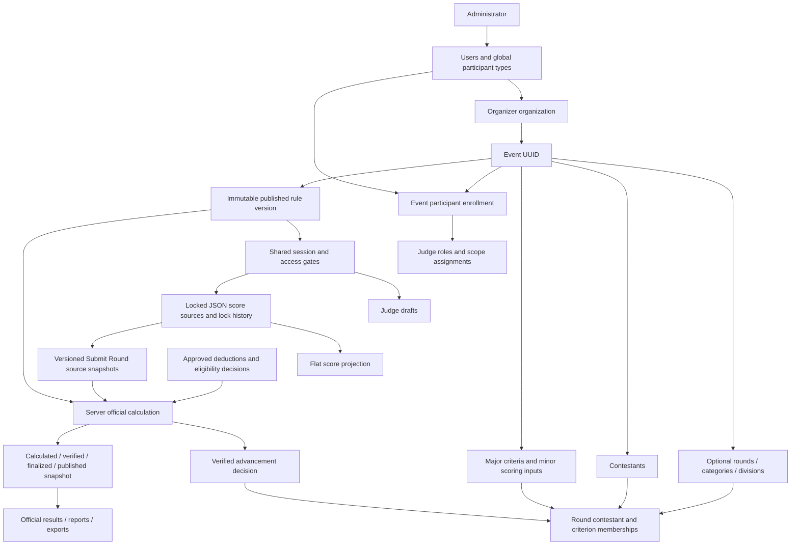

# Current competition workflow map

Audit date: **October 12, 2026, Asia/Bangkok**. Scope: the actual current working tree, including existing uncommitted changes and migration files through 099. This is an audit, not an implementation. Evidence classifications and execution results are in [07](07_END_TO_END_TEST_PLAN.md); control-by-control traces are in [02](02_FEATURE_AND_BUTTON_AUDIT.md).

**Overall: Partially working, with reproduced defects.** No real authenticated organizer/judge/database end-to-end session was performed. Statements below describe traced operations; they do not assert successful deployment.

## Repository and stack

| Area | Actual implementation |
|---|---|
| Frontend | JavaScript/JSX, React 19, Vite 8, React Router 7, Tailwind 4, design-token CSS, React Hook Form/Zod, Zustand authentication/display state and toasts. TanStack Query is used selectively; live competition pages mainly use component state. |
| Backend | Node ESM, Express 5, PostgreSQL access via the Supabase service-role client. Controllers validate and call domain services; `foundation` supplies database, mapping and audit helpers. |
| Scoring | `shared/competition-calculation.js` is the exact-decimal versioned official engine. `backend/src/modules/scoring-engine.js` remains the legacy ranking engine. These branches are not interchangeable. |
| Realtime | Native browser WebSocket and Node `ws` on `/ws`, with in-memory rooms, cookie authentication and authorized event room admission. No frontend Supabase realtime subscription, SSE implementation or cross-process broker was identified. |
| Identity | Application users in `users`, organization ownership, global participant-type membership, event enrollment, then event-scoped judge assignment. Application JWT cookies are distinct from Supabase Auth identities. |
| Tests | Backend Vitest 4/Supertest; frontend Vitest 5/jsdom/Testing Library. Many service/API tests mock persistence/authentication. No complete real-account two-browser harness was found. |
| Deployment declarations | `render.yaml` starts the backend with `npm start`; `frontend/vercel.json` supplies a SPA rewrite. Actual hosting configuration, migration state, table grants and socket ingress were not queried. |

Evidence: [backend package](../../backend/package.json), [frontend package](../../frontend/package.json), [app.js](../../backend/src/app.js), [server.js](../../backend/src/server.js), [API client](../../frontend/src/services/api.js), [Bootstrap](../../frontend/src/app/Bootstrap.jsx), [socket client](../../frontend/src/services/socket.service.js).

`server.js` also starts scheduling and archival services. It was deliberately not started against the configured database during this read-only audit. Environment checks recorded only key presence and recognized nonsecret switches in [_evidence/environment-presence.json](_evidence/environment-presence.json). Presence is not connectivity or correctness.

## Domain relationships



Assignments use `event_participants.id`; score identity uses `users.id`. The rule snapshot freezes their relationship. JSON score keys refer to minor UUIDs or direct-parent fallback UUIDs. UUID arrays and JSON keys are logical references, not per-key SQL foreign keys. Flattened `competition_scores` has no session ID; modern official calculations use submitted snapshots instead of treating that projection as the source of truth.

Evidence: migrations [015](../../backend/src/database/migrations/015_competition_scoring_foundation.sql), [023](../../backend/src/database/migrations/023_competition_live_session.sql), [041](../../backend/src/database/migrations/041_unify_competition_judges.sql), [087](../../backend/src/database/migrations/087_competition_workflow.sql), [093](../../backend/src/database/migrations/093_competition_source_history.sql), [096](../../backend/src/database/migrations/096_competition_participation_guards.sql), [099](../../backend/src/database/migrations/099_competition_round_progression_upgrade.sql).

## Current step-by-step flow

API shorthand: **O** = `/api/organizer/competition/events/:eventId`; **J** = `/api/participant/competition/events/:eventId`. Organizer event routes inherit cookie authentication, active account, password/profile requirements, UUID validation, terminal-state handling and ownership checks. Participant routes inherit authentication, active account/password requirements and event judge enrollment.

| Step / actor | Frontend → backend → stored data → receiving UI | Status and important boundary |
|---|---|---|
| 1. Administrator prepares identities | `JudgesPanel`/User Management → `admin-participant.service.createJudge` → participant user, bcrypt temporary password and global `COMPETITION_JUDGE` membership; optional account email | Partially working; source and mocked tests only. Judge pool membership does not enroll the judge in an event. No institution-only email rule found for judge creation. |
| 2. Organizer enters competition details | `CompetitionEventFormPage` → draft service autosave → `event_drafts` scoped to organizer/module | Partially working. Required title/start/end and end≥start validation exist; a venue field was not found. No unique-title rule found; UUID is identity. |
| 3. Branding/Create & continue | Draft publish POST → `draft.controller`/`draft.service` → `pageant.createCompetitionEvent` → draft `events` row, organization ownership, banner asset → workspace route | Partially working. This operation creates the actual event; it does not publish official rules or start judging. Type labels/hints do not seed complete rounds. |
| 4. Structure and scoring | Workspace rounds/criteria/divisions/rules → O `/rounds`, `/rounds/:id/criteria`, `/criteria`, `/scoring-config`, `/workflow/round-order` → rounds, major/minor inputs, memberships, scoring config → reload foundation | Partially working. Round order now has an atomic reorder RPC. Existing-criterion attach/delete lacks target event validation, reproduced in [03](03_GAPS_BUGS_AND_SECURITY_FINDINGS.md). |
| 5. Contestants/participation | `CompetitionContestantsPage` → O `/contestants` then optional photo upload; membership RPC → contestant entries and planned round memberships → list/foundation reload | Partially working. Positive numbers, division-specific uniqueness, entry types, required enabled division and historical deletion guards exist. No contestant login/self-registration/import workflow identified on this page. |
| 6. Judges/assignments | `CompetitionJudgesPage.handlePick` → O `/judges-v2/pick` → authorized pool lookup → `registerParticipant` → `event_participants`; assignment panel → scope rows → reload | Partially working. POST now repeats authorized pool restrictions. Enrollment/invitation are separate; email failure does not prove loss of enrollment. Frozen roster changes are rejected. |
| 7. Review/publish rules | `CompetitionReviewPage.handlePublish` → O `/publish` → controller `freezeRules` → saved readiness/panel/round configuration → guarded `competition_publish_rules` RPC → immutable rule version, scheduled event | Partially working. `undecided`/unconfirmed rules cannot publish; setup/registration consistency guards exist but cover only part of the snapshot. Modern Unpublish button conflicts with server freeze policy. |
| 8. Start performance | `CompetitionLiveControlPage.performAction('start')` → O `/session/start` → versioned `organizerAction('start')` → SQL operational action → active session, rules version, ordered eligible first-round field and event judging state → generic session event + local reload | Partially working. Actual start/database outcome unverified. One active/paused session per event is enforced by partial unique index after migration 087. |
| 9. Judge opens sheet | Dashboard/direct scoring route → `JudgeScoringPage` → J `/session-view` → `judgeSheet`, `judgeAccess`, effective rules/roster → own scores/drafts/locks, allowed divisions, completion, current context | Partially working. Ordinary judge receives own sheet, not other judges' worksheets. Primary contestant is presentation; explicit access gates determine who can score. |
| 10. Organizer controls availability | Live gates/round/pause/lineup → session or workflow API → SQL event/session locks → `access_config`, revision, current round/order → `session:contestant-changed` → Judge refetch | Partially working. Live refetch dispatch tested with mocked auth; fallback, response order and multi-event filtering defects remain. |
| 11. Type/Lock/Submit Round | Raw input → local state + debounced draft; Lock → J `/session-score`; Submit Round → J `/submit-round` → scoped SQL validation/atomic JSON + projection + history/submission persistence → own refetch + organizer progress event | Partially working. Exact arithmetic exercised, transaction/concurrency traced but not run on PostgreSQL. Locks alone are not official submissions. |
| 12. Calculate/verify standings | Tabulation → O `/tabulation/calculate` → submitted sources + frozen rules + approved decisions → shared engine → calculation snapshot; appointed reviewer verification → guarded transition | Partially working, automatic handoff broken. Incomplete sources can produce provisional snapshots but cannot finalize/publish. Numeric calculation is server authoritative. |
| 13. Advance to next round | Advancement preview + current verified calculation → O `/workflow/advancement` → approved qualifiers and next roster via SQL → separate organizer round activation | Partially working. No-elimination continuation is computed from effective eligible field. Qualification requires verified advancement. Top cutoff ties are included. Weighted overall results can still include eliminated entries. |
| 14. Official results | Verify → Finalize → Publish → SQL result transition → saved official snapshot; overall publication completes event/performance and closes submission window → results/rankings/report reads | Partially working. Recipient refresh and source-digest race remain. Ending performance is separate and does not publish. |
| 15. History/export/archive | Organizer Rankings/Analytics/Report → owned report/result services → live or published data, XLSX/CSV/JSON/print export; archival policy retains history | Partially working; XLSX serialization tests passed. Division-filtered published report substitution is incorrect. Actual external spreadsheet/print/email/archive outcome unverified. |

Precise entry points: [pageant-organizer.routes.js:18](../../backend/src/routes/pageant-organizer.routes.js), [competition-organizer.routes.js](../../backend/src/routes/competition-organizer.routes.js), [pageant-judge.routes.js](../../backend/src/routes/pageant-judge.routes.js), [competition-workflow.service.js](../../backend/src/services/competition-workflow.service.js), [competition-session.service.js](../../backend/src/services/competition-session.service.js), [pageant-organizer.controller.js](../../backend/src/controllers/pageant-organizer.controller.js).

## State transitions actually implemented

These are distinct state machines. A sidebar stage, a database round, a session status, an input gate and a result publication status are not synonymous.

| Entity/state | Action → next state | Actor / guard / evidence | Caveat |
|---|---|---|---|
| Create draft (`event_drafts`) | Materialize → actual event `draft` | Owner draft publisher; draft/pageant services | Partial create draft can be discarded independently of event data. |
| Event `draft` / lifecycle `legacy` | Freeze confirmed rules → `scheduled` / `published_setup` | Organizer; workflow `freezeRules:47–120`, publication RPC 095/096/099 | Setup/registration freezes. Modern ordinary Unpublish rejects `official_rules_id`. |
| Scheduled versioned event | Start → event `active` / `judging`, session `active` | Organizer; 099 operational action:296–309 | Saved planned dates do not auto-start the versioned session. |
| Active session | Pause → `paused`; Resume → `active` | Organizer; same RPC:320–323 | Event can stay active; input gates and separate submission window remain distinct. |
| Session input gate | all / none / selected, per-entry × criterion intersection | Organizer access operation; RPC:325–329 | A closed input is not automatically a finalized round. |
| Primary contestant/slot | Select/next/previous/activate lineup → context/order changes | Owner session service/lineup RPC | Presentation change alone does not narrow the entry gate. |
| Current round | Activate → effective roster/order, new round context, cleared lineup/reset gates | RPC:333–342; qualification/effective roster helpers | Does not copy raw scores or automatically confirm advancement. |
| End performance | Session `completed`; lifecycle `tabulation_pending`, input gates closed | Organizer; RPC:312–314 | Event status can remain active. Submission window is separate; already locked scores may remain submit-able. |
| Reopen performance | Completed → active, reason and explicit confirmation | RPC:315–319; finalized/published guards | Not an unrestricted correction after official publication. |
| Scoring | Local/draft → parent lock → complete locks → submitted round version | Judge; 099 scoring RPC:195–286 | Draft/Lock checks active status and input gates. Submit checks separate window and completeness. |
| Correction | Remove selected locks → submission invalidated; preserved values need relock/resubmit | Organizer reason+confirmed; RPC:353–361 | Existing finalized/published/advanced outcomes require amendment, not ordinary unlock. |
| Calculation | awaiting_submissions / provisional / ready_for_verification → under_verification → finalized → published | Calculate:216–226; verify/transition:229–256; SQL 088:104–139 | Pending decisions/incomplete or changed sources reject transitions. Race coverage is incomplete. |
| Overall published result | Event completed / results_published; active/paused sessions completed; input/submission windows closed | SQL 088:130–134 | Round-only publication does not finish whole event. Historical snapshot remains saved. |
| Eligibility decision | pending → approved or voided | Appointed independent reviewer, decision RPC 089 | Approved `non_competing` exclusion is implemented; no dedicated recusal/no-show reason taxonomy found. |
| Deduction | pending → approved or voided | Frozen penalty rule + reviewer | Draft/pending deductions do not affect official score. |
| Advancement | No decision → confirmed current-rule qualifier decision | Verified current calculation + declared automatic/manual basis; 096/099 | Automatic Top N ties all qualify; nonmanual arbitrary seeding is rejected. |
| Rule amendment | Request → approval → new rule version/rejudging lifecycle | 090 amendment RPC + frozen reviewer | Prior rule/result history retained; approval is not automatic republication. |
| Cancelled / archived | Terminal edit restrictions; archived operations blocked | `eventGuards`, archival service | Competition tabulation/workflow exceptions exist for completed events; older end-then-tabulate guard defect is fixed. |

There is no mandatory Stage table above rounds, contestant approval workflow or individual performance record in this module. Group lineup slots and entry type metadata exist. Round `is_open`, session gates and publication status are separate; old controls must not be used to infer modern availability.

## Actor permissions and visibility

| Actor | Setup/account powers | Scores/results visibility | Scoring/official decisions | Current enforcement |
|---|---|---|---|---|
| Administrator | Creates/updates organizer and participant identities/global pools; account/session controls | Administrative event/audit oversight; no separate normal competition scoring wizard identified | Not granted organizer competition mutation merely by being admin | Shared global role checks and active/session middleware; production runtime unverified |
| Event owner organizer | Own event setup before freeze; enrolls existing pool judges; live controls; calculates/reports/exports | Own event judge worksheets, submitted sources, provisional and published results | Authorized correction, advancement, Finalize/Publish; cannot independently approve own result when frozen policy requires reviewer | Parent route ownership + service/RPC guards; nested criteria/category holes remain |
| Different organizer | Own organization only | No HTTP access to another event's workflow/results | No other event controls | Parent ownership fixed; unchecked nested membership target can cross draft event boundary |
| Enrolled `judge` | No account creation/setup power | Own raw values, ranges/weights, locks/drafts/submission; no ordinary combined result endpoint found | Scores only eligible scope; cannot verify independent calculations | Active account/enrollment + frozen role/assignment/roster + SQL gate/context validation |
| Enrolled `head_judge` | Metadata role, not organizer ownership | Own score sheet; combined data not assumed | Counts as scoring judge; no dedicated head-judge application found | Existing role comments are not proof of separate finalize authority |
| Appointed `score_reviewer` | No normal setup mutation | Authorized full verification data/worksheets, pending decisions, calculations/amendments | Independent Verify/approve/void under frozen verifier policy; no numeric judge total contribution | Reviewer endpoints enforce active appointed account and independence |
| Unenrolled participant / disabled account | None for this event | Cannot legitimately obtain judge sheet via HTTP | No submission | HTTP guards traced/tested in mocks; real DB enforcement not exercised |
| Contestant / public visitor | Contestants are records, not competition user accounts | No implemented public/spectator competition results route identified | None | Missing optional workflow, not an assumed approved requirement |

Supabase anon/authenticated direct-table grants and RLS for older score/result tables are **Cannot verify**, and repository hardening is incomplete. HTTP authorization does not prove direct PostgREST isolation. See [03](03_GAPS_BUGS_AND_SECURITY_FINDINGS.md), F-11.

Judge combined/intermediate/published-result visibility is not a general configurable release policy in the inspected UI. The current ordinary sheet and privileged reviewer path are distinct. Any additional visibility must be explicitly approved; recommended default for the future plan is own scores only until a deliberate official release.

## Sequence: open one contestant, Lock and Submit Round

```mermaid
sequenceDiagram
    participant O as Organizer UI
    participant API as Express / owner and role guards
    participant SQL as PostgreSQL RPC transaction
    participant WS as Authorized WebSocket rooms
    participant J as Judge UI
    O->>API: POST session/open-contestants (selected entry 1)
    API->>SQL: competition_operational_action(access)
    SQL->>SQL: Lock event/session; save entry gate and revision
    SQL-->>API: Saved session
    API-->>WS: session:contestant-changed after success
    WS-->>J: Event-scoped refresh hint
    J->>API: GET participant session-view
    API->>SQL: Read own eligible sheet/context
    SQL-->>J: Entry 1 open; own saved inputs/locks
    Note over J,API: Draft is separate; no authoritative total accepted from browser
    J->>API: POST session-score (Lock major raw values + context)
    API->>SQL: competition_scoring_write(lock)
    SQL->>SQL: Validate scope/gates/bounds/revision; save JSON, projection, history
    SQL-->>API: Locks / revision
    API-->>J: Saved result; reload own sheet
    API-->>WS: session:judge-score-submitted (organizer-only)
    WS-->>O: Progress invalidation
    O->>API: GET session/judge-progress
    J->>API: POST submit-round after required locks
    API->>SQL: Validate window/completeness; save versioned sources
    SQL-->>API: Existing or new submission
    API-->>WS: Organizer progress hint
    Note over WS,J: Isolated transport exercised; full browser/DB sequence unverified
    Note over O,J: Missing fallback/ordered reads/reviewer updates are findings, not assumed success
```

## Deployment and data-integrity boundaries

Migration files exist through **099**. The user's earlier statement that 097 ran does not prove 098/099 or any current table/function/ACL is deployed. No migration was run or edited here. The preexisting 098 file repairs `event_participants.event_id` → `events.id` for PostgREST embedded event reads and rejects orphan rows; 099 upgrades already-run 097 progression logic. The audit does not instruct blindly rerunning one-time SQL.

Source constraints include division-aware contestant numbers, one live active/paused session, current-context revisions, immutable rule/lock history, protected qualification membership and idempotent locks/submissions. Current implementation still has tenant link checks and source-publication race gaps. Date conversions use local calendar input → ISO and TIMESTAMPTZ; real browser/DST/timezone display consistency was not exercised. JSON lineups/submitted source arrays require logical integrity checks in addition to scalar FKs.

No new architecture or competition policy has been applied. The [implementation plan](06_PRIORITIZED_IMPLEMENTATION_PLAN.md) proposes dependency-ordered repairs for approval.
