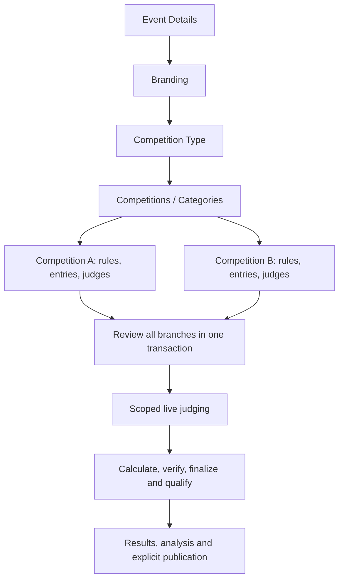

# Competition creation revision — October 15, 2026

## Source analysis and decisions

The requested flow comes from the attached 1,365-line competition specification and `HALAWIG_SAMIJON_CHAPTER_1-3_UPDATED_v2.docx`. The document contains 903 text runs and 37 embedded illustrations. Extracted text and illustrations are in the ignored `.tmp/competition-revision` directory. Document instructions are reference material; the user's requested eight setup steps and independent competition identities determine this revision.

The thesis establishes HTTP-only session authentication, organizer-owned event creation, administrator-owned account registration, eligible judge enrollment, complete score grids, bounded score input, atomic submission, audit records, real-time reconciliation, and standard competition ranks (1, 2, 2, 4). Its competition ERD and diagrams for configuration, judge submission, live sessions, and ranking describe the earlier event-wide model. Those diagrams need revision to show the new `event → competition → phase → entry → assigned judge` identities. The authentication, election, polling, registration, research instruments, and evaluation methodology remain outside this competition change.

The thesis describes equal minor averaging and legacy weight normalization. The newer requested specification overrides those details: weighted minor criteria are supported, major weights must total 100% per phase, and weighted minor weights must total 100% per parent. Legacy records retain their existing engine; new native configurations use the saved, scoped rules. No sample judge, entry, or score is inserted by calculation previews.

The thesis's single event session and event-wide `has_scored` flag cannot represent independent competitions or judge assignments to different rounds. This revision connects the existing native child sessions, submissions, review policies, calculation versions, and publication records instead of adding a second scoring system.

## Implemented flow

| Step | Screen and persisted connection |
| --- | --- |
| 1. Event Details | Existing title, description, start/end inputs and validation; draft autosave and stable creation request ID. |
| 2. Branding | Existing optional banner upload; retained during Back navigation and retries. |
| 3. Competition Type | Separate required step: Pageant, Dance, Music, Visual Arts, Dramatic Arts, Literary Arts, Other. Custom type uses the existing 32-character database contract. |
| 4. Competitions / Categories | Type-specific selection catalog and custom additions. One parent draft; separate native child IDs, formats, and revision counters. Pageant Women/Men/custom divisions use independent contexts and rankings. |
| 5. Rounds & Scoring | Separate configuration cards and selected child editor. Single phase has zero rounds. Named round-based configuration has only organizer-added rounds, including a single named round. Direct/weighted/unweighted minor criteria, custom ranges, calculation examples, copying criteria with fresh IDs, deductions, ties, and score sheet preview. Final phases have no outgoing advancement or carry controls. |
| 6. Contestants / Entries | Register an entrant in the selected competition, automatic numbering, explicit shared entrant reuse, name editing, optional photo upload, and removal of only the selected participation. |
| 7. Judges | Existing account pool and event enrollment; independent child/round assignments. Enrollment alone does not grant scoring access. Assignments require entries. No invitations are sent by this implementation. |
| 8. Review & Publish | Review every saved child, scoring readiness, entries, panel coverage, inactive judges, manual basis, removal capacity, and round contribution totals. The completion RPC freezes all children together, detects stale revisions or changed membership, and records creation completion; the same action then publishes the parent event to its schedule. |
| 9. Live Control | Existing native session controls and exact competition/phase score sheets. Starting, closing, correcting, qualification, and publication remain separate actions. |
| 10. Tabulation | Existing current-submission checks, independent verification, explicit finalization, qualification proposals, and confirmed advancement. Reads the saved round calculation method. |
| 11. Results & Analysis | Combined native standings and analysis view; competition/round/version selection, publication controls and authorized CSV exports. |

Parent creation after Step 3 persists a draft identity for the subsequent database-backed steps. Step 8 reviews and freezes the configuration, marks `competition_created_at`, and publishes the parent event to the schedule; it does not create another parent or start scoring. Live Control starts scoring separately. The set of child identities and reviewed parent details are frozen after completion.

## Integrity and calculation rules

- Removing an unfrozen child deletes its dependent draft configuration and assignments transactionally. Shared entrants and other children remain. Historical rules and sessions block removal.
- Changing type requires confirmed removal of dependent draft competitions. A database trigger blocks bypassing that dependency rule. A new child stays unconfigured until its own rules are saved.
- Major and minor IDs, entry associations, assignments, snapshots, and revisions remain competition-scoped. Repeated selection of the current child cannot invalidate its pending load.
- Weighted minors compute normalized score × minor percentage, then apply the major criterion percentage. Unweighted minors average normalized ratings.
- Different round methods are supported for independent rounds. Combining different method units or their deductions requires a defined normalization policy and is rejected rather than silently summed.
- Rank percentage carry has an explicit stored `weighted_judge_average` basis. Previous phase numeric averages contribute their configured percentages; the current judge's weighted total contributes the current percentage. Judges' placements are calculated from those combined numeric totals. Ordinal ranks are never multiplied by percentages. The numeric contribution is retained alongside final placement totals.
- The sample `86.50 × 20% + 92.00 × 80% = 90.90` is verified. Point deductions adjust numeric scores before ranking and percentage carry. Placement-unit penalties apply to the final ranking; an earlier-round placement penalty cannot be converted into numeric points for carry. Both units remain separate in results and CSV exports.
- Final creation retries with unchanged revisions return success. Any incomplete or stale branch causes the entire transaction to roll back.

## Deployment and local operation

New forward migrations: `110_competition_creation_flow.sql`, `111_competition_weighted_minors.sql`, `112_competition_numeric_rank_carry.sql`, `113_competition_rank_point_deductions.sql`, and `114_competition_judge_setup_order.sql`. They require the existing native foundation through migration 109. No historical event/score conversion or production schema change was performed.

`backend/scripts/competition-creation-flow-local.mjs --test` verifies the local database name, nonce, port and data directory before applying these migrations and running rollback-only assertions. The existing `dev:native` launcher verifies the local PostgREST identity and removes inherited hosted credentials. The frontend `.env` enables the four native competition features. A hosted rollout also requires the corresponding backend feature flags and reviewed schema; frontend flags alone do not establish compatibility.

Photo uploads use the existing Cloudinary integration. The isolated environment has no Cloudinary credentials, so external image delivery is not claimed as verified. Judge invitation delivery is also outside the local test.

## Verification

- Final backend regression suite: 91 files passed, one integration file skipped; 681 tests passed, including creation integrity, numeric rank carry, point penalties, CSV calculations and cookie-only authentication.
- Full frontend regression suite: 49 files, 327 tests passed with its expected lifecycle flag (`VITE_LOCK_PARTICIPANTS_ON_ACTIVE=true`) and explicit legacy baseline flags. An additional rejected-edit regression passed in the focused 13-test setup suite after that full run. The original `.env` lifecycle flag is false, which causes an unrelated active-roster-lock assertion to fail under the unmodified test environment.
- New and changed frontend checks: creation order, custom type validation, banner preservation, stable creation identity, same-selection race, review all branches, acknowledgment, conflict reload, and score sheet rendering.
- Real PostgreSQL assertions: incomplete branch rolls back other freezes; weighted minor configuration accepted; selected draft removal preserves other memberships and shared entrants; creation succeeds only after all branches are complete; unchanged completion retry succeeds. All assertion records roll back.
- Production frontend build and changed-file lint checked. Browser execution evidence is recorded separately in this directory; failed attempts remain distinguishable from a successful final run.
- Real browser acceptance: `real-browser.json` records success for the eight setup steps and two independent calculation branches (average and sum), then real judge submissions, incomplete-score privacy, independent verification, finalization, and publication. The latest successful run recorded 720 API responses and no server responses at status 500 or above. `real-workspace.png` captures the result view.
- Read-only browser checks confirmed all 11 stages and server-confirmed completion of the eight setup stages. Desktop screenshots are `creation-desktop.png` and `results-desktop.png`. Native results and tabulation use the application's table styles, responsive statistic cards, and form controls.

The browser test uses the actual application entry/router, password login, cookies, Express API, PostgREST, PostgreSQL, organizer screens, judge screens, independent reviewer, and publication controls. It checks isolation before writes and creates only synthetic localhost events.

## Continued pageant verification

The rollback-only pageant fixture verifies real PostgreSQL acceptance of two named rounds, weighted minor criteria, the explicit numeric carry basis, point deductions in Preliminary, and placement penalties in Final. It rejects a preliminary placement penalty in percentage carry and a numeric advancement threshold on a rank-based round. It also accepts exactly one organizer-named round and a zero-round single phase. CSV exports now describe weighted minor arithmetic and the actual selected round method, and retain numeric point deductions separately from placement penalties.

Migration `114_competition_judge_setup_order.sql` requires complete saved scoring rules and registered entries before adding a judge grant. Grant removal remains available to repair drafts. The UI also requires every selected competition to complete scoring, entries, and panel coverage before its corresponding Next action is enabled. A rejected configuration save preserves the user's editable draft so validation can be corrected without discarding changes.

## Cookie-only authentication

The shared authentication changes required by `AGENTS.md` are now implemented: login, refresh and password changes set HTTP-only access/refresh cookies without returning access tokens in JSON. Middleware authenticates only from cookies. The frontend removes legacy `votrix_access_token` storage, keeps only user display metadata and CSRF state, and strips stale Authorization headers from retried requests. Cookie-based WebSocket recovery is retained.

The real browser test checks the actual `votrix_access_token` key, confirms an unrelated bearer header cannot override cookie identity, confirms a no-cookie bearer request is rejected, and verifies refresh returns neither access nor refresh tokens in JSON. Login/refresh, middleware and frontend-store regression tests also passed.

The final forward migration set for this revision is 110–114. Hosted schema and deployment remain separate from the verified isolated localhost work.
